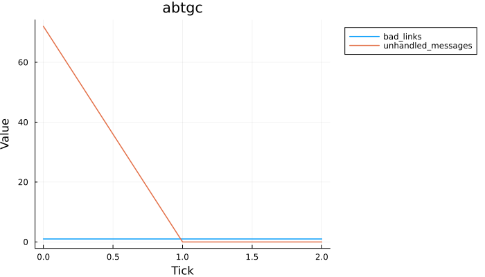
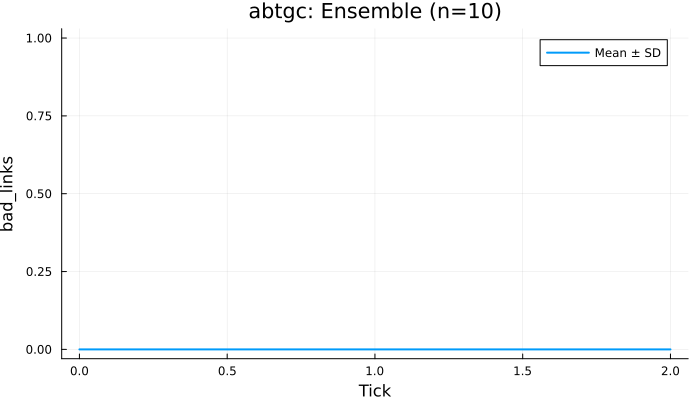
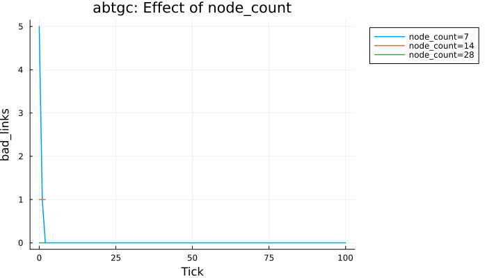

## Overview

This vignette demonstrates the **ABTgc** model implemented in [ArkModelZoo.jl](https://github.com/sdwfrost/ArkModelZoo.jl) using the Ark.jl ECS framework.

## Parameters

| Parameter | Type | Default | Description |
|-----------|------|---------|-------------|
| `node_count` | `Int` | `14` | node count |
| `edges_to_nodes` | `Float64` | `3.19` | edges to nodes |
| `possible_colors` | `Int` | `6` | possible colors |
| `grid_size` | `Int` | `33` | grid size |
| `max_ticks` | `Int` | `100` | max ticks |

## Source Code

The Julia code to run this model:

```julia
using ArkModelZoo
_, trajectory = run_abtgc()
```

## Time Series

{width=100%}

## Ensemble Runs

Ten replicates with different random seeds, showing mean ± standard deviation.

{width=100%}

## Parameter Sensitivity

Varying `node_count`.

{width=100%}


## Appendix: Source Code

This model is implemented in the [Ark.jl](https://github.com/sdwfrost/Ark.jl) Entity-Component-System (ECS) framework. The code is split into five files, each with a distinct role:

- **Parameters**: a mutable struct holding all configurable values.
- **Components**: lightweight data types attached to individual entities (agents).
- **Resources**: world-level shared state accessible to all systems.
- **Systems**: functions that operate on entities each tick, defining model behavior.
- **Model**: wiring that assembles the world, registers resources and systems, and provides the run entry point.

### Parameters (`parameters.jl`)

The parameter struct uses `@kwdef` so that every field has a default value and can be overridden by keyword. These defaults match the original NetLogo model's slider settings.

```julia
Base.@kwdef mutable struct ABTParams
    node_count::Int = 14
    edges_to_nodes::Float64 = 3.19
    possible_colors::Int = 6
    grid_size::Int = 33
    max_ticks::Int = 100
    seed::Int = 42
end
```

### Components (`components.jl`)

Components are lightweight data types attached to individual entities (agents). Mutable structs hold per-entity state, while empty tag structs act as markers for the ECS query system to efficiently filter entities.

```julia
struct ABTDummy end
```

### Resources (`resources.jl`)

Resources are world-level singletons shared across all systems, used for global state and aggregate statistics.

```julia
# Message types: (:ok, sender, value), (:nogood, sender, nogood_list), (:new_neighbor, sender)
const ABTMessage = Tuple{Symbol, Int, Any}

mutable struct ABTState
    n_agents::Int
    value::Vector{Int}                          # current color 0..5
    adj::Vector{Set{Int}}                       # undirected adjacency
    message_queue::Vector{Vector{ABTMessage}}
    local_view::Vector{Dict{Int,Int}}           # agent → (neighbor → value)
    no_goods::Vector{Vector{Dict{Int,Int}}}     # agent → list of nogood constraints
    x::Vector{Float64}
    y::Vector{Float64}
end

function ABTState()
    ABTState(0, Int[], Set{Int}[], Vector{ABTMessage}[], Dict{Int,Int}[], Vector{Dict{Int,Int}}[], Float64[], Float64[])
end

function _abt_add_agent!(state::ABTState, val::Int, x::Float64, y::Float64)
    state.n_agents += 1
    push!(state.value, val)
    push!(state.adj, Set{Int}())
    push!(state.message_queue, ABTMessage[])
    push!(state.local_view, Dict{Int,Int}())
    push!(state.no_goods, Vector{Dict{Int,Int}}())
    push!(state.x, x)
    push!(state.y, y)
    return state.n_agents
end

mutable struct ABTStats
    bad_links::Int
    unhandled_messages::Int
end
ABTStats() = ABTStats(0, 0)
```

### Systems (`systems.jl`)

Systems contain the model logic and execute in a defined order each tick. Each system struct implements either `initialize!` (run once at setup) or `update!` (run every tick).

```julia
# --- Helpers ---

function _abt_build_network!(rng, state::ABTState, edges_to_nodes::Float64)
    n = state.n_agents
    target_edges = round(Int, edges_to_nodes * n)

    # Handle lonely nodes first: nodes with 0 edges get priority
    for _ in 1:target_edges
        # Find lonely nodes (degree 0)
        lonely = [i for i in 1:n if isempty(state.adj[i])]
        if !isempty(lonely)
            src = lonely[rand(rng, 1:length(lonely))]
        else
            src = rand(rng, 1:n)
        end
        # Find unlinked nodes with different color
        candidates = [j for j in 1:n if j != src && !(j in state.adj[src]) && state.value[j] != state.value[src]]
        if isempty(candidates)
            # Fallback: any unlinked node
            candidates = [j for j in 1:n if j != src && !(j in state.adj[src])]
        end
        isempty(candidates) && continue
        tgt = candidates[rand(rng, 1:length(candidates))]
        push!(state.adj[src], tgt)
        push!(state.adj[tgt], src)
    end
end

function _abt_count_bad_links(state::ABTState)
    count = 0
    for i in 1:state.n_agents
        for j in state.adj[i]
            if j > i && state.value[i] == state.value[j]
                count += 1
            end
        end
    end
    return count
end

function _abt_count_unhandled(state::ABTState)
    total = 0
    for i in 1:state.n_agents
        total += length(state.message_queue[i])
    end
    return total
end

function _abt_send_ok!(state::ABTState, sender::Int)
    for nb in state.adj[sender]
        push!(state.message_queue[nb], (:ok, sender, state.value[sender]))
    end
end

function _abt_check_value!(rng, state::ABTState, agent::Int, all_colors::Vector{Int})
    # Find a value consistent with local_view and no_goods
    for c in all_colors
        if _abt_consistent(state, agent, c)
            if state.value[agent] != c
                state.value[agent] = c
                _abt_send_ok!(state, agent)
            end
            return true
        end
    end
    # No consistent value found — backtrack
    return false
end

function _abt_consistent(state::ABTState, agent::Int, color::Int)
    # Check against local_view: no neighbor should have same color
    for (nb, nb_val) in state.local_view[agent]
        if nb_val == color
            return false
        end
    end
    # Check against no_goods
    for ng in state.no_goods[agent]
        # A nogood {i=>vi, j=>vj, ...} is violated if all assignments match
        # and the agent's candidate color matches its entry
        all_match = true
        for (k, v) in ng
            if k == agent
                if color != v
                    all_match = false
                    break
                end
            else
                lv = get(state.local_view[agent], k, nothing)
                if lv === nothing || lv != v
                    all_match = false
                    break
                end
            end
        end
        if all_match
            return false
        end
    end
    return true
end

function _abt_handle_ok!(state::ABTState, agent::Int, sender::Int, val::Int, all_colors::Vector{Int}, rng)
    state.local_view[agent][sender] = val
    if !_abt_consistent(state, agent, state.value[agent])
        _abt_check_value!(rng, state, agent, all_colors)
    end
end

function _abt_handle_nogood!(rng, state::ABTState, agent::Int, sender::Int, nogood_list::Vector{Dict{Int,Int}}, all_colors::Vector{Int})
    for ng in nogood_list
        push!(state.no_goods[agent], ng)
        # Add any unknown agents as neighbors
        for k in keys(ng)
            if k != agent && !(k in state.adj[agent])
                push!(state.adj[agent], k)
                push!(state.adj[k], agent)
                # Request their value
                push!(state.message_queue[k], (:new_neighbor, agent, nothing))
            end
        end
    end
    # Remove old value entry for sender
    state.local_view[agent][sender] = state.value[sender]
    _abt_check_value!(rng, state, agent, all_colors)
end

function _abt_handle_new_neighbor!(state::ABTState, agent::Int, sender::Int)
    # Send current value to new neighbor
    push!(state.message_queue[sender], (:ok, agent, state.value[agent]))
end

function _abt_backtrack!(state::ABTState, agent::Int, all_colors::Vector{Int})
    # Build nogood from local_view + own assignment
    ng = Dict{Int,Int}()
    for (k, v) in state.local_view[agent]
        ng[k] = v
    end
    if isempty(ng)
        return  # Cannot backtrack further
    end
    # Send nogood to lowest-priority agent in the nogood
    # Priority = agent id (lower id = higher priority)
    target = maximum(keys(ng))
    push!(state.message_queue[target], (:nogood, agent, [ng]))
    # Remove target from local_view
    delete!(state.local_view[agent], target)
    # Garbage collection: remove no_goods referencing target
    filter!(ngi -> !haskey(ngi, target), state.no_goods[agent])
end

# --- Systems ---

struct InitABTSystem <: System end

function initialize!(::InitABTSystem, world::World)
    params = get_resource(world, ABTParams)
    rng = get_resource(world, RNGResource).rng
    state = get_resource(world, ABTState)
    stats = get_resource(world, ABTStats)
    all_colors = collect(0:(params.possible_colors - 1))

    # Create agents at random positions on a grid
    for _ in 1:params.node_count
        val = rand(rng, 0:(params.possible_colors - 1))
        x = rand(rng) * Float64(params.grid_size)
        y = rand(rng) * Float64(params.grid_size)
        _abt_add_agent!(state, val, x, y)
    end

    # Build network
    _abt_build_network!(rng, state, params.edges_to_nodes)

    # Initialize ABT: each agent sends "ok" to neighbors
    for i in 1:state.n_agents
        # Build initial local_view from neighbors' current values
        for nb in state.adj[i]
            state.local_view[i][nb] = state.value[nb]
        end
    end

    # Each agent checks consistency and sends ok messages
    for i in 1:state.n_agents
        if !_abt_consistent(state, i, state.value[i])
            _abt_check_value!(rng, state, i, all_colors)
        else
            _abt_send_ok!(state, i)
        end
    end

    stats.bad_links = _abt_count_bad_links(state)
    stats.unhandled_messages = _abt_count_unhandled(state)
    return nothing
end

struct ABTGoSystem <: System end

function update!(::ABTGoSystem, world::World)
    params = get_resource(world, ABTParams)
    rng = get_resource(world, RNGResource).rng
    state = get_resource(world, ABTState)
    stats = get_resource(world, ABTStats)
    all_colors = collect(0:(params.possible_colors - 1))

    # Find agents with non-empty queues
    important = [i for i in 1:state.n_agents if !isempty(state.message_queue[i])]

    if isempty(important)
        get_resource(world, Terminate).stop = true
        return nothing
    end

    for agent in important
        while !isempty(state.message_queue[agent])
            msg = popfirst!(state.message_queue[agent])
            mtype, sender, payload = msg
            if mtype == :ok
                _abt_handle_ok!(state, agent, sender, payload::Int, all_colors, rng)
            elseif mtype == :nogood
                _abt_handle_nogood!(rng, state, agent, sender, payload::Vector{Dict{Int,Int}}, all_colors)
            elseif mtype == :new_neighbor
                _abt_handle_new_neighbor!(state, agent, sender)
            end
        end
    end

    stats.bad_links = _abt_count_bad_links(state)
    stats.unhandled_messages = _abt_count_unhandled(state)
    return nothing
end

struct ABTTerminationSystem <: System end

function update!(::ABTTerminationSystem, world::World)
    params = get_resource(world, ABTParams)
    tick = get_resource(world, Tick)
    if tick.tick + 1 >= params.max_ticks
        get_resource(world, Terminate).stop = true
    end
    return nothing
end
```

### Model (`model.jl`)

The model file assembles all pieces: it creates the ECS `World` with the required component types, registers resources, builds the `Scheduler` with systems in execution order, and exposes the public `run` entry point. The observer pattern records the trajectory each tick.

```julia
function abtgc_world(; initial_capacity::Int = 128)
    return World(ABTDummy; initial_capacity=initial_capacity, allow_mutable=true)
end

function abtgc_systems()
    return (
        InitABTSystem(),
        ABTGoSystem(),
        ABTTerminationSystem(),
    )
end

function abtgc_model(params::ABTParams = ABTParams())
    world = abtgc_world()
    _add_standard_resources!(world, params)
    add_resource!(world, ABTState())
    add_resource!(world, ABTStats())
    scheduler = Scheduler(world, abtgc_systems())
    initialize!(scheduler)
    return scheduler
end

struct ABTObserver end

function abtgc_headers(::ABTObserver)
    return ["bad_links", "unhandled_messages"]
end

function abtgc_values(::ABTObserver, world::World)
    stats = get_resource(world, ABTStats)
    return Float64[stats.bad_links, stats.unhandled_messages]
end

function run_abtgc(; params::ABTParams = ABTParams(), observe::Bool = true)
    return _run_model(abtgc_model, ABTObserver(), abtgc_values; params, observe)
end
```
