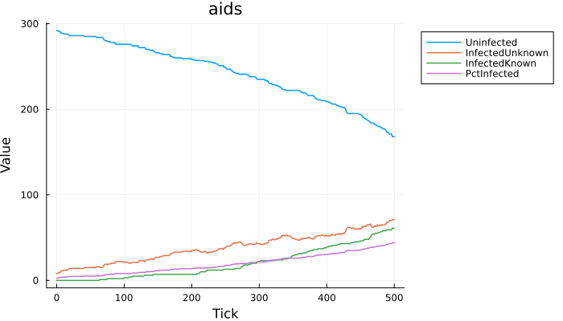
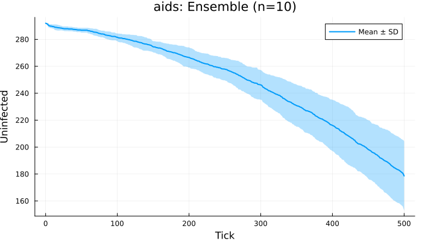
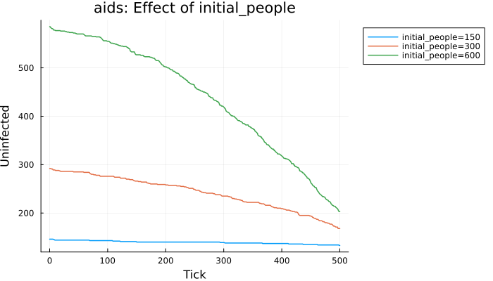

## Overview

### WHAT IS IT?

This model simulates the spread of the human immunodeficiency virus (HIV), via sexual transmission, through a small isolated human population.  It therefore illustrates the effects of certain sexual practices across a population.

As is well known now, HIV is spread in a variety of ways of which sexual contact is only one.  HIV can also be spread by needle-sharing among injecting drug users, through blood transfusions (although this has become very uncommon in countries like the United States in which blood is screened for HIV antibodies), or from HIV-infected women to their babies either before or during birth, or afterwards through breast-feeding.  This model focuses only on the spread of HIV via sexual contact.

The model examines the emergent effects of four aspects of sexual behavior.  The user controls the population's tendency to practice abstinence, the amount of time an average "couple" in the population will stay together, the population's tendency to use condoms, and the population's tendency to get tested for HIV.  Exploration of the first and second variables may illustrate how changes in sexual mores in our society have contributed to increases in the prevalence of sexually transmitted diseases, while exploration of the third and fourth may provide contemporary solutions to the problem.

By allowing the user to control how often an average individual will choose to be tested, the user can explore an important dimension of HIV's threat to public health.  Because the virus does not make itself immediately known in its host, individuals are often infected for some time before a test or immune deficiency symptoms (which leads to a test) identifies them as such.  Regular identification of individuals infected by the virus could have significant public health impacts if knowledge of the infection positively affected sexual behaviors.  This model explores this possibility by making all individuals who know of their positive HIV status always practice safe sex.

### HOW IT WORKS

The model uses "couples" to represent two people engaged in sexual relations.  Individuals wander around the world when they are not in couples.  Upon coming into contact with a suitable partner, there is a chance the two individuals will "couple" together.  When this happens, the two individuals no longer move about, they stand next to each other holding hands as a representation of two people in a sexual relationship.

The presence of the virus in the population is represented by the colors of individuals. Three colors are used: green individuals are uninfected, blue individuals are infected but their infection is unknown, and red individuals are infected and their infection is known.

### THINGS TO NOTICE

Set the INITIAL-PEOPLE slider to 300, AVERAGE-COUPLING-TENDENCY to 10, AVERAGE-COMMITMENT to 100, and the other two sliders to 0. Push SETUP and then push GO. Notice that many individuals rapidly pair up into stationary "couples", with the patches behind them turned a dark gray.  These couples represent sexual activity between the two individuals.  Individuals that continue to move about (and do not have a gray patch behind them) are not engaging in sexual relations.  With RELATIONSHIP-DURATION set to 100, an average individual will have monogamous sexual relations with a partner for about 100 weeks (approximately 2 years) before ending the sexual relationship and searching out a new partner.

Stop the simulation (by pressing the GO button once again), move the AVERAGE-COUPLING-TENDENCY slider to 0, push SETUP, and start the simulation again (with the GO button).  Notice that this time, couples are not forming.  With a low COUPLING-TENDENCY, individuals do not choose to have sex, which in this model is depicted by the graphical representation of couplehood.  Notice that with these settings, HIV does not typically spread. However, spreading could happen since the population's tendency is set according to a normal distribution and a few people will probably have COUPLING-TENDENCY values above 0 at this setting.

Again reset the simulation, this time with AVERAGE-COUPLING-TENDENCY set back to 10 and AVERAGE-COMMITMENT set to 1.  Notice that while individuals do not stand still next to each other for any noticeable length of time, coupling is nevertheless occurring.  This is indicated by the occasional flash of dark gray behind individuals that are briefly next to one another.  Notice that the spread of HIV is actually faster when RELATIONSHIP-DURATION is very short compared to when it is very long.

Now run a simulation with AVERAGE-COMMITMENT equal to 1, AVERAGE-COUPLING-TENDENCY set to 1, AVERAGE-CONDOM-USE set to 10, and AVERAGE-TEST-FREQUENCY set to 1.0. With negligible couple formation and high condom use anyway, there should be no spread of HIV.  Notice how pale blue "infection unknown" individuals turn red much quicker in this simulation.  When the individuals turn red, they know their HIV status.  Some individuals turn red because they have been infected for long enough that they develop symptoms, which alerts them to the need for an HIV test.  Others become red because they choose to be tested.  With AVERAGE-TEST-FREQUENCY set to 1.0, healthy individuals are also being tested, but their color does not change since the tests come back negative.

When all the individuals in the simulation are either green or red, change the sliders without stopping the simulation.  Set AVERAGE-COUPLING-TENDENCY to 10, AVERAGE-COMMITMENT to 100, AVERAGE-CONDOM-USE to 0, and AVERAGE-TEST-FREQUENCY to 0.  Notice that despite the immediate formation of couples and the fact that condom-use tendency is presumably very low, some between healthy (green) individuals and infected (red) individuals, no spread of HIV occurs.  This is because while the model expects HIV positive individuals to continue to engage in sexual relations, it presumes that those individuals will always use condoms and that the condoms will always work.  The rationale for this design is discussed briefly in the "What is it?" section of this tab.

Finally, set INITIAL-PEOPLE to 500 to notice that couples can form on top of each other.  Watch the simulation until you see individuals by themselves, but standing still and with a gray patch behind them indicating coupling.  Underneath one of its neighbors, is the individuals partner.  This apparent bug in the program is necessary because individuals need to be able to couple fairly freely.  If space constraints prohibited coupling, unwanted emergent behavior would occur with high population densities.

Couples are formed by a partnership of "righty" and "lefty" shapes which is not immediately noticeable.  These shapes are not intended to represent genders in any fashion, but merely to provide a useful way to depict couple graphics. In order for the hands of a righty and lefty to match up, both must be off-centered in their patch.  Without this feature, two couples next to each other would appear to be a line of four individuals (instead of two groups of two).  It is intended that the differences between righty and lefty shapes not be especially apparent in order to prevent unintended associations with gender.  Any righty or lefty shape can be thought of as male or female or neither.

### THINGS TO TRY

Run a number of experiments with the GO button to find out the effects of different variables on the spread of HIV.  Try using good controls in your experiment.  Good controls are when only one variable is changed between trials.  For instance, to find out what effect the average duration of a relationship has, run four experiments with the AVERAGE-COMMITMENT slider set at 1 the first time, 2 the second time, 10 the third time, and 50 the last.  How much does the prevalence of HIV increase in each case?  Does this match your expectations?

Are the effects of some slider variables mediated by the effects of others?  For instance, if lower AVERAGE-COMMITMENT values seem to increase the spread of HIV when all other sliders are set at 0, does the same thing occur if all other sliders are set at 10?  You can run many experiments to test different hypotheses regarding the emergent public health effects associated with individual sexual behaviors.

### EXTENDING THE MODEL

Like all computer simulations of human behaviors, this model has necessarily simplified its subject area substantially.  The model therefore provides numerous opportunities for extension:

The model depicts sexual activity as two people standing next to each other.  This suggests that all couples have sex and that abstinence is only practiced in singlehood.  The model could be changed to reflect a more realistic view of what couples are.  Individuals could be in couples without having sex.  To show sex, then, a new graphical representation would have to be employed.  Perhaps sex could be symbolized by having the patches beneath the couple flash briefly to a different color.

The model does not distinguish between genders.  This is an obvious over-simplification chosen because making an exclusively heterosexual model was untenable while making one that included a variety of sexual preferences might have distracted from the public health issues which it was designed to explore.  However, extending the model by adding genders would make the model more realistic.

The model assumes that individuals who are aware that they are infected always practice safe sex.  This portrayal of human behavior is clearly not entirely realistic, but it does create interesting emergent behavior that has genuine relevance to certain public health debate.  However, an interesting extension of the model would be to change individuals' reactions to knowledge of HIV status.

The model assumes that condom use is always 100% effective.  In fact, responsible condom use is actually slightly less than ideal protection from the transmission of HIV.  Add a line of code to the INFECT procedure to check for a slight random chance that a particular episode of condom-use is not effective.  Another change that can be made in the INFECT procedure regards a couple's choice of condom-use.  In this model, when the two partners of a couple "disagree" about whether or not to use a condom, the partner that doesn't wish to use a condom makes the choice.  The opposite possibility is also valid.

Finally, certain significant changes can easily be made in the model by simply changing the value of certain global variables in the procedure SETUP-GLOBALS.  Two variables set in this procedure that are especially worthy of investigation are INFECTION-CHANCE and SYMPTOMS-SHOW.  The former controls what chance an infection has of spreading from an infected to an uninfected partner if no protection is used.  The variable is currently set to 50, meaning that in a week of sexual relations, the chance of infection occurring is 50%.  It is not clear at this time how realistic that figure is. SYMPTOMS-SHOW is the variable that controls how long, on average, a person will have the HIV virus before symptoms begin to appear, alerting that person to the presence of some health problem.  It is currently set to 200 (weeks) in this model.

### NETLOGO FEATURES

Notice that the four procedures that assign the different tendencies generate many small random numbers and add them together.  This produces a normal distribution of tendency values.  A random number between 0 and 100 is as likely to be 1 as it is to be 99. However, the sum of 20 numbers between 0 and 5 is much more likely to be 50 than it is to be 99.

Notice that the global variables SLIDER-CHECK-1, SLIDER-CHECK-2, and so on are assigned with the values of the various sliders so that the model can check the sliders against the variables while the model is running.  Every time-step, a slider's value is checked against a global variable that holds the value of what the slider's value was the time-step before.  If the slider's current value is different than the global variable, NetLogo knows to call procedures that adjust the population's tendencies.  Otherwise, those adjustment procedures are not called.

### CREDITS AND REFERENCES

Special thanks to Steve Longenecker for model development.

### HOW TO CITE

If you mention this model in a publication, we ask that you include these citations for the model itself and for the NetLogo software:

* Wilensky, U. (1997).  NetLogo AIDS model.  http://ccl.northwestern.edu/netlogo/models/AIDS.  Center for Connected Learning and Computer-Based Modeling, Northwestern Institute on Complex Systems, Northwestern University, Evanston, IL.
* Wilensky, U. (1999). NetLogo. http://ccl.northwestern.edu/netlogo/. Center for Connected Learning and Computer-Based Modeling, Northwestern Institute on Complex Systems, Northwestern University, Evanston, IL.

### COPYRIGHT AND LICENSE

Copyright 1997 Uri Wilensky.


This work is licensed under the Creative Commons Attribution-NonCommercial-ShareAlike 3.0 License.  To view a copy of this license, visit http://creativecommons.org/licenses/by-nc-sa/3.0/ or send a letter to Creative Commons, 559 Nathan Abbott Way, Stanford, California 94305, USA.

Commercial licenses are also available. To inquire about commercial licenses, please contact Uri Wilensky at uri@northwestern.edu.

This model was created as part of the project: CONNECTED MATHEMATICS: MAKING SENSE OF COMPLEX PHENOMENA THROUGH BUILDING OBJECT-BASED PARALLEL MODELS (OBPML).  The project gratefully acknowledges the support of the National Science Foundation (Applications of Advanced Technologies Program) -- grant numbers RED #9552950 and REC #9632612.

This model was converted to NetLogo as part of the projects: PARTICIPATORY SIMULATIONS: NETWORK-BASED DESIGN FOR SYSTEMS LEARNING IN CLASSROOMS and/or INTEGRATED SIMULATION AND MODELING ENVIRONMENT. The project gratefully acknowledges the support of the National Science Foundation (REPP & ROLE programs) -- grant numbers REC #9814682 and REC-0126227. Converted from StarLogoT to NetLogo, 2001.

## Parameters

| Parameter | Type | Default | Description |
|-----------|------|---------|-------------|
| `initial_people` | `Int` | `300` | initial people |
| `average_commitment` | `Float64` | `50.0` | average commitment |

## Source Code

The Julia code to run this model:

```julia
using ArkModelZoo
_, trajectory = run_aids()
```

## Time Series

{width=100%}

## Ensemble Runs

Ten replicates with different random seeds, showing mean ± standard deviation.

{width=100%}

## Parameter Sensitivity

Varying `initial_people`.

{width=100%}


## Appendix: Source Code

This model is implemented in the [Ark.jl](https://github.com/sdwfrost/Ark.jl) Entity-Component-System (ECS) framework. The code is split into five files, each with a distinct role:

- **Parameters**: a mutable struct holding all configurable values.
- **Components**: lightweight data types attached to individual entities (agents).
- **Resources**: world-level shared state accessible to all systems.
- **Systems**: functions that operate on entities each tick, defining model behavior.
- **Model**: wiring that assembles the world, registers resources and systems, and provides the run entry point.

### Parameters (`parameters.jl`)

The parameter struct uses `@kwdef` so that every field has a default value and can be overridden by keyword. These defaults match the original NetLogo model's slider settings.

```julia
Base.@kwdef mutable struct AIDSParams
    initial_people::Int = 300
    average_commitment::Float64 = 50.0
    average_coupling_tendency::Float64 = 5.0
    average_condom_use::Float64 = 0.0
    average_test_frequency::Float64 = 0.0
    infection_chance::Float64 = 50.0     # percent per coupling week
    symptoms_show::Float64 = 200.0       # weeks until symptoms
    grid_width::Int = 25
    grid_height::Int = 25
    max_ticks::Int = 500
    seed::Int = 42
end
```

### Components (`components.jl`)

Components are lightweight data types attached to individual entities (agents). Mutable structs hold per-entity state, while empty tag structs act as markers for the ECS query system to efficiently filter entities.

```julia
mutable struct AIDSPerson
    x::Float64
    y::Float64
    infected::Bool
    known::Bool
    infection_length::Float64
    coupled::Bool
    couple_length::Int
    commitment::Float64
    coupling_tendency::Float64
    condom_use::Float64
    test_frequency::Float64
    is_righty::Bool
    partner_idx::Int      # 0 = no partner (index into person list)
end
AIDSPerson() = AIDSPerson(0.0, 0.0, false, false, 0.0, false, 0, 50.0, 5.0, 0.0, 0.0, true, 0)
```

### Resources (`resources.jl`)

Resources are world-level singletons shared across all systems, used for global state and aggregate statistics.

```julia
mutable struct AIDSStats
    num_uninfected::Int
    num_infected_unknown::Int
    num_infected_known::Int
    pct_infected::Float64
end
AIDSStats() = AIDSStats(0, 0, 0, 0.0)
```

### Systems (`systems.jl`)

Systems contain the model logic and execute in a defined order each tick. Each system struct implements either `initialize!` (run once at setup) or `update!` (run every tick).

```julia
struct InitAIDSSystem <: System end

function _aids_random_near(rng, center::Float64)
    s = 0.0
    for _ in 1:40
        s += rand(rng) * center
    end
    return s / 20.0
end

function initialize!(::InitAIDSSystem, world::World)
    params = get_resource(world, AIDSParams)
    rng = get_resource(world, RNGResource).rng

    for i in 1:params.initial_people
        x = rand(rng) * params.grid_width
        y = rand(rng) * params.grid_height
        is_righty = rand(rng, Bool)
        infected = (i <= round(Int, params.initial_people * 0.025))
        inf_len = infected ? rand(rng) * params.symptoms_show : 0.0
        commitment = _aids_random_near(rng, params.average_commitment)
        ct = _aids_random_near(rng, params.average_coupling_tendency)
        cu = _aids_random_near(rng, params.average_condom_use)
        tf = _aids_random_near(rng, params.average_test_frequency)
        new_entity!(world, (AIDSPerson(x, y, infected, false, inf_len,
                                        false, 0, commitment, ct, cu, tf,
                                        is_righty, 0),))
    end

    _aids_update_stats!(world)
    return nothing
end

struct AIDSGoSystem <: System end

function update!(::AIDSGoSystem, world::World)
    params = get_resource(world, AIDSParams)
    rng = get_resource(world, RNGResource).rng

    # Collect all people
    people = Tuple{Entity, AIDSPerson}[]
    for (eids, persons) in Query(world, (AIDSPerson,))
        @inbounds for i in eachindex(persons)
            push!(people, (eids[i], persons[i]))
        end
    end

    # Build entity-to-index map
    eid_to_idx = Dict{Entity, Int}()
    for (i, (eid, _)) in enumerate(people)
        eid_to_idx[eid] = i
    end

    n = length(people)
    w = Float64(params.grid_width)
    h = Float64(params.grid_height)

    # Increment infection_length and couple_length
    indices = collect(1:n)
    Random.shuffle!(rng, indices)
    for i in indices
        p = people[i][2]
        if p.infected
            p.infection_length += 1.0
        end
        if p.coupled
            p.couple_length += 1
        end
    end

    # Move uncoupled people
    Random.shuffle!(rng, indices)
    for i in indices
        p = people[i][2]
        !p.coupled || continue
        heading = rand(rng) * 2π
        p.x = mod(p.x + sin(heading), w)
        p.y = mod(p.y + cos(heading), h)
    end

    # Coupling: righties initiate
    Random.shuffle!(rng, indices)
    for i in indices
        p = people[i][2]
        p.coupled && continue
        !p.is_righty && continue
        rand(rng) * 10.0 >= p.coupling_tendency && continue

        # Find a potential partner: uncoupled lefty on the patch at (-1, 0)
        # NetLogo turtles-at -1 0: turtles on the patch 1 unit to the left
        my_px = mod(floor(Int, p.x + 0.5), Int(w))
        my_py = mod(floor(Int, p.y + 0.5), Int(h))
        target_px = mod(my_px - 1 + Int(w), Int(w))
        candidates = Int[]
        for j in 1:n
            j == i && continue
            q = people[j][2]
            q.coupled && continue
            q.is_righty && continue
            qpx = mod(floor(Int, q.x + 0.5), Int(w))
            qpy = mod(floor(Int, q.y + 0.5), Int(h))
            if qpx == target_px && qpy == my_py
                push!(candidates, j)
            end
        end
        isempty(candidates) && continue
        best_j = candidates[rand(rng, 1:length(candidates))]
        q = people[best_j][2]
        rand(rng) * 10.0 >= q.coupling_tendency && continue
        # Couple them
        p.coupled = true; q.coupled = true
        p.partner_idx = best_j; q.partner_idx = i
        p.couple_length = 0; q.couple_length = 0
    end

    # Uncouple
    Random.shuffle!(rng, indices)
    for i in indices
        p = people[i][2]
        !p.coupled && continue
        !p.is_righty && continue
        pi = p.partner_idx
        (pi < 1 || pi > n) && continue
        q = people[pi][2]
        if p.couple_length > p.commitment || q.couple_length > q.commitment
            p.coupled = false; q.coupled = false
            p.partner_idx = 0; q.partner_idx = 0
            p.couple_length = 0; q.couple_length = 0
        end
    end

    # Infect
    Random.shuffle!(rng, indices)
    for i in indices
        p = people[i][2]
        !p.coupled && continue
        !p.infected && continue
        p.known && continue
        pi = p.partner_idx
        (pi < 1 || pi > n) && continue
        q = people[pi][2]
        if rand(rng) * 11.0 > p.condom_use || rand(rng) * 11.0 > q.condom_use
            if rand(rng) * 100.0 < params.infection_chance
                q.infected = true
            end
        end
    end

    # Test
    Random.shuffle!(rng, indices)
    for i in indices
        p = people[i][2]
        if rand(rng) * 52.0 < p.test_frequency
            if p.infected
                p.known = true
            end
        end
        if p.infection_length > params.symptoms_show
            if rand(rng) * 100.0 < 5.0
                p.known = true
            end
        end
    end

    _aids_update_stats!(world)
    return nothing
end

function _aids_update_stats!(world::World)
    stats = get_resource(world, AIDSStats)
    nu = 0; niu = 0; nik = 0
    total = 0
    for (_, persons) in Query(world, (AIDSPerson,))
        @inbounds for i in eachindex(persons)
            p = persons[i]
            total += 1
            if !p.infected
                nu += 1
            elseif p.known
                nik += 1
            else
                niu += 1
            end
        end
    end
    stats.num_uninfected = nu
    stats.num_infected_unknown = niu
    stats.num_infected_known = nik
    stats.pct_infected = total > 0 ? (niu + nik) / total * 100.0 : 0.0
end

struct AIDSTerminationSystem <: System end

function update!(::AIDSTerminationSystem, world::World)
    params = get_resource(world, AIDSParams)
    stats = get_resource(world, AIDSStats)
    tick = get_resource(world, Tick)
    all_known = (stats.num_infected_unknown == 0 && stats.num_infected_known > 0)
    if all_known || tick.tick + 1 >= params.max_ticks
        get_resource(world, Terminate).stop = true
    end
    return nothing
end
```

### Model (`model.jl`)

The model file assembles all pieces: it creates the ECS `World` with the required component types, registers resources, builds the `Scheduler` with systems in execution order, and exposes the public `run` entry point. The observer pattern records the trajectory each tick.

```julia
function aids_world(; initial_capacity::Int = 1024)
    return World(AIDSPerson; initial_capacity = initial_capacity, allow_mutable = true)
end

function aids_systems()
    return (InitAIDSSystem(), AIDSGoSystem(), AIDSTerminationSystem())
end

function aids_model(params::AIDSParams = AIDSParams())
    world = aids_world()
    _add_standard_resources!(world, params)
    add_resource!(world, AIDSStats())
    scheduler = Scheduler(world, aids_systems())
    initialize!(scheduler)
    return scheduler
end

struct AIDSObserver end

function aids_headers(::AIDSObserver)
    return ["Uninfected", "InfectedUnknown", "InfectedKnown", "PctInfected"]
end

function aids_values(::AIDSObserver, world::World)
    stats = get_resource(world, AIDSStats)
    return Float64[stats.num_uninfected, stats.num_infected_unknown,
                    stats.num_infected_known, stats.pct_infected]
end

function run_aids(; params::AIDSParams = AIDSParams(), observe::Bool = true)
    return _run_model(aids_model, AIDSObserver(), aids_values; params, observe)
end
```
