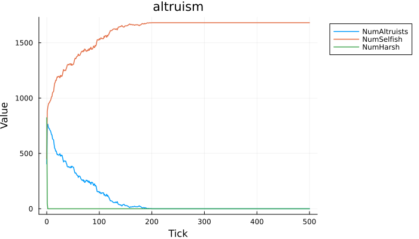
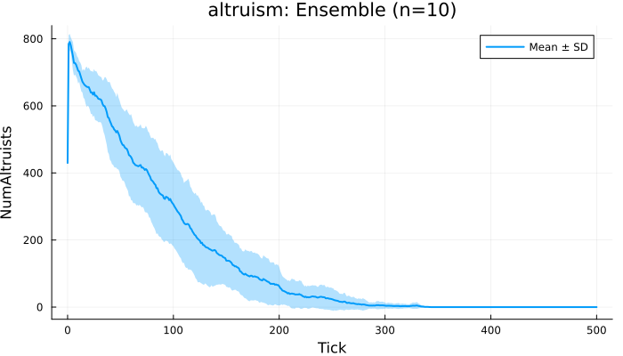
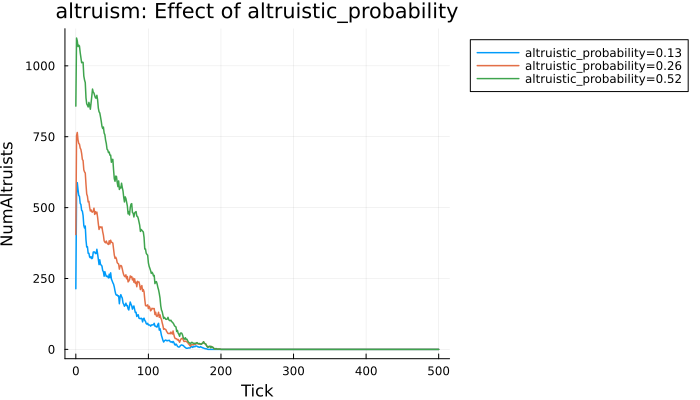

# Altruism


- [Overview](#overview)
  - [WHAT IS IT?](#what-is-it)
  - [HOW IT WORKS](#how-it-works)
  - [THINGS TO TRY](#things-to-try)
  - [EXTENDING THE MODEL](#extending-the-model)
  - [NETLOGO FEATURES](#netlogo-features)
  - [RELATED MODELS](#related-models)
  - [CREDITS AND REFERENCES](#credits-and-references)
  - [HOW TO CITE](#how-to-cite)
  - [COPYRIGHT AND LICENSE](#copyright-and-license)
- [Parameters](#parameters)
- [Source Code](#source-code)
- [Time Series](#time-series)
- [Ensemble Runs](#ensemble-runs)
- [Parameter Sensitivity](#parameter-sensitivity)
- [Appendix: Source Code](#appendix-source-code)
  - [Parameters (`parameters.jl`)](#parameters-parametersjl)
  - [Components (`components.jl`)](#components-componentsjl)
  - [Resources (`resources.jl`)](#resources-resourcesjl)
  - [Systems (`systems.jl`)](#systems-systemsjl)
  - [Model (`model.jl`)](#model-modeljl)

## Overview

### WHAT IS IT?

This is an evolutionary biology model. It models population genetics
with respect to the fitness of traits that are affected by social and
environmental conditions. The model has two types of patch agents:
altruistic agents and selfish agents.

The basic premise of the model is that the selfish agents and the
altruistic agents are competing for each spot in the world by entering
into a genetic lottery. You can imagine these agents as plants who
“seed” for a spot, and the dominant seed generally wins. The details of
the lottery are explained below in HOW IT WORKS.

Under normal (non-interfering) environmental conditions, the selfish
agents win, and the altruistic population is driven to extinction.
However, as outlined in HOW TO USE IT, when the environmental conditions
are made more harsh, the altruistic population is able to survive, and
even dominate the selfish population.

This model (and Cooperation and Divide the Cake) are part of the EACH
unit (“Evolution of Altruistic and Cooperative Habits: Learning About
Complexity in Evolution”). See
http://ccl.northwestern.edu/rp/each/index.shtml for more information on
the EACH unit. The EACH unit is embedded within the BEAGLE (Biological
Experiments in Adaptation, Genetics, Learning and Evolution) evolution
curriculum. See http://ccl.northwestern.edu/rp/beagle/index.shtml.

### HOW IT WORKS

1.  Patches live in five-cell, plus-sign-shaped neighborhoods. Whenever
    a patch is calculating something about its fitness, it is the center
    of the neighborhood. For another patch, when that patch is
    calculating, it becomes merely one of the neighbors.

2.  Each patch is an agent that has a fitness. Each patch is also the
    location of a lottery for its space. The patch and the four
    surrounding patches put in “seeds” to try to get the patch turned to
    their type of patch, altruist or selfish. Being successful in the
    lottery is getting patches to turn to your type. We’re assuming here
    that the type (altruistic or selfish) is the important genetic
    trait.

3.  Each patch calculates its own fitness using equation: if it is A
    (altruist): 1 - cost + (Number Altruists in Neighborhood / 5 \*
    benefit from Altruists) if it is S (selfish): 1 + (Number Altruists
    in Neighborhood / 5 \* benefit from Altruists) Thus, the fitness of
    the S patch will be higher than the fitness of the A’s. If the cost
    is 0.2 and benefit is 0.5, for an A surrounded by two S’s and two
    A’s, then the fitness of this spot is 1 - 0.2 + (3/5 \* 0.5) = 1.1.

4.  After each patch has calculated its fitness, it looks to its four
    neighbors. Each of the five patches, including itself, puts a
    weighted seed into a genetic lottery for this center spot. So, for
    example, if the neighborhood is ASASA, each of the three A’s
    register their fitness value, and each of the two S’s put in their
    fitness. The A’s are added, and the S’s are added. Let us assume
    that the A’s add up to 3.2 (this includes the A in the center spot),
    and the S’s add up to 2.6. These two numbers are the altruist weight
    and selfish weight respectively, in the lottery for the center spot.
    Now, the larger number, whichever it is, is called the Major seed;
    it is divided by the sum of all the fitnesses. Thus, 3.2/(3.2 + 2.6)
    = .552. This number is the Altruism seed in the lottery. The minor
    seed is 2.6/(3.2 + 2.6) = .448. (Notice that the Altruism seed of
    the parent is 3/5 = .600, while the child’s is .552. Even though
    altruism is dominating, it is losing ground.)

5.  There are a number of ways of doing the lottery itself. Currently,
    we choose a random number between 0 and 1. Now, if the Number is
    below the Minor seed, the minor weight gets the spot, and if it is
    above the major seed, the major seed gets the spot. So, in the
    example, if the random number is anywhere from .449 to 1, then the
    Major seed gets it. If it is between 0 and .448, the minor seed gets
    it.

### THINGS TO TRY

1.  At first, run the model with Harshness and Disease both at 0. Notice
    that the selfish population quickly dominates the world, driving the
    altruistic population to extinction. How do respective population
    sizes affect the outcome?

2.  Play with the values of cost and benefit. What are realistic values
    for actual genetic competition? How does initial population size
    effect the significance of these values?

3.  Increase the Harshness and Disease values, independently, and with
    respect to one another. What are the effects of the Harshness Model?
    of Disease? How are the values dependent on one another? At what
    values does the altruistic population begin to have greater success?

4.  Consider why the introduction of Harshness and Disease conditions
    affects the success of the altruistic population. How does each
    population, run alone, respond to the Harshness and Disease
    conditions? If you imagine the black spots as Voids (a third type of
    competing agent), what is the fitness relationship between Altruists
    and Voids? Selfish agents and Voids?

5.  Can you find slider values that maximize the advantage of the
    altruistic agents?

6.  Try running BehaviorSpace on this model to explore the model’s
    behavior under a range of initial conditions.

### EXTENDING THE MODEL

The model can be extended in a number of interesting directions,
including adding new environmental variables, adding different types of
agents, and changing the altruistic and selfish weighting under
different environmental conditions.

This model does not address the behaviors of individuals, only the
relative weights of genetic traits. A next step in considering the
evolution of altruism is to model altruistic behaviors. (See the related
model: Cooperation.)

### NETLOGO FEATURES

This model uses patches as its basic agents. Can you design an
“equivalent” model using turtles? How would the model dynamics be
affected?

### RELATED MODELS

- Cooperation
- Divide the Cake

### CREDITS AND REFERENCES

This model, the Cooperation model and the Divide the Cake model are part
of the curriculum unit “Evolution of Altruistic and Cooperative Habits:
Learning About Complexity in Evolution”. See
http://ccl.northwestern.edu/rp/each/index.shtml for more information.
The EACH unit is embedded within the BEAGLE (Biological Experiments in
Adaptation, Genetics, Learning and Evolution) evolution curriculum. See
http://ccl.northwestern.edu/rp/beagle/index.shtml.

This model is based on a paper by Mitteldorf and Wilson, 2000,
“Population Viscosity and the Evolution of Altruism”, Journal of
Theoretical Biology, v.204, pp.481-496.

Thanks also to Damon Centola and Scott Styles.

### HOW TO CITE

If you mention this model or the NetLogo software in a publication, we
ask that you include the citations below.

For the model itself:

- Wilensky, U. (1998). NetLogo Altruism model.
  http://ccl.northwestern.edu/netlogo/models/Altruism. Center for
  Connected Learning and Computer-Based Modeling, Northwestern
  University, Evanston, IL.

Please cite the NetLogo software as:

- Wilensky, U. (1999). NetLogo. http://ccl.northwestern.edu/netlogo/.
  Center for Connected Learning and Computer-Based Modeling,
  Northwestern University, Evanston, IL.

### COPYRIGHT AND LICENSE

Copyright 1998 Uri Wilensky.


This model is licensed under the Creative Commons
Attribution-NonCommercial-ShareAlike 3.0 License. To view a copy of this
license, visit https://creativecommons.org/licenses/by-nc-sa/3.0/ or
send a letter to Creative Commons, 559 Nathan Abbott Way, Stanford,
California 94305, USA.

NetLogo itself is free software for non-commercial use under the terms
of the GNU General Public License ([see full license information
here](https://ccl.northwestern.edu/netlogo/docs/copyright.html)).

To inquire about commercial licenses for either NetLogo or specific
models from the models library, please contact
netlogo-commercial-admin@ccl.northwestern.edu.

This model was created as part of the project: CONNECTED MATHEMATICS:
MAKING SENSE OF COMPLEX PHENOMENA THROUGH BUILDING OBJECT-BASED PARALLEL
MODELS (OBPML). The project gratefully acknowledges the support of the
National Science Foundation (Applications of Advanced Technologies
Program) – grant numbers RED \#9552950 and REC \#9632612.

This model was converted to NetLogo as part of the projects:
PARTICIPATORY SIMULATIONS: NETWORK-BASED DESIGN FOR SYSTEMS LEARNING IN
CLASSROOMS and/or INTEGRATED SIMULATION AND MODELING ENVIRONMENT. The
project gratefully acknowledges the support of the National Science
Foundation (REPP & ROLE programs) – grant numbers REC \#9814682 and
REC-0126227. Converted from StarLogoT to NetLogo, 2001.

<!-- 1998 2001 -->

## Parameters

| Parameter                | Type      | Default | Description            |
|--------------------------|-----------|---------|------------------------|
| `altruistic_probability` | `Float64` | `0.26`  | altruistic probability |
| `selfish_probability`    | `Float64` | `0.26`  | selfish probability    |
| `benefit_from_altruism`  | `Float64` | `0.48`  | benefit from altruism  |
| `cost_of_altruism`       | `Float64` | `0.13`  | cost of altruism       |
| `disease`                | `Float64` | `0.0`   | disease                |
| `harshness`              | `Float64` | `0.0`   | harshness              |
| `grid_width`             | `Int`     | `41`    | grid width             |
| `grid_height`            | `Int`     | `41`    | grid height            |
| `max_ticks`              | `Int`     | `500`   | max ticks              |

## Source Code

The Julia code to run this model:

``` julia
using ArkModelZoo
_, trajectory = run_altruism()
```

## Time Series



## Ensemble Runs

Ten replicates with different random seeds, showing mean ± standard
deviation.



## Parameter Sensitivity

Varying `altruistic_probability`.



## Appendix: Source Code

This model is implemented in the
[Ark.jl](https://github.com/sdwfrost/Ark.jl) Entity-Component-System
(ECS) framework. The code is split into five files, each with a distinct
role:

- **Parameters**: a mutable struct holding all configurable values.
- **Components**: lightweight data types attached to individual entities
  (agents).
- **Resources**: world-level shared state accessible to all systems.
- **Systems**: functions that operate on entities each tick, defining
  model behavior.
- **Model**: wiring that assembles the world, registers resources and
  systems, and provides the run entry point.

### Parameters (`parameters.jl`)

The parameter struct uses `@kwdef` so that every field has a default
value and can be overridden by keyword. These defaults match the
original NetLogo model’s slider settings.

``` julia
Base.@kwdef mutable struct ALTParams
    altruistic_probability::Float64 = 0.26
    selfish_probability::Float64 = 0.26
    benefit_from_altruism::Float64 = 0.48
    cost_of_altruism::Float64 = 0.13
    disease::Float64 = 0.0
    harshness::Float64 = 0.0
    grid_width::Int = 41
    grid_height::Int = 41
    max_ticks::Int = 500
    seed::Int = 42
end
```

### Components (`components.jl`)

Components are lightweight data types attached to individual entities
(agents). Mutable structs hold per-entity state, while empty tag structs
act as markers for the ECS query system to efficiently filter entities.

``` julia
# Dummy component — World requires at least one registered component type.
# Altruism is purely patch-based; no ECS entities are used.
mutable struct ALTDummy
    _::Int
end
ALTDummy() = ALTDummy(0)
```

### Resources (`resources.jl`)

Resources are world-level singletons shared across all systems, used for
global state and aggregate statistics.

``` julia
# Patch types
const ALT_HARSH = Int8(0)
const ALT_ALTRUIST = Int8(1)
const ALT_SELFISH = Int8(2)

mutable struct ALTGrid
    width::Int
    height::Int
    ptype::Matrix{Int8}            # 0=harsh, 1=altruist, 2=selfish
    benefit_out::Matrix{Float64}
    altruism_benefit::Matrix{Float64}
    fitness::Matrix{Float64}
    alt_fitness::Matrix{Float64}
    self_fitness::Matrix{Float64}
    harsh_fitness::Matrix{Float64}
end

function ALTGrid(w::Int, h::Int)
    ALTGrid(w, h,
        zeros(Int8, w, h),
        zeros(w, h),
        zeros(w, h),
        zeros(w, h),
        zeros(w, h),
        zeros(w, h),
        zeros(w, h))
end

mutable struct ALTStats
    num_altruists::Int
    num_selfish::Int
    num_harsh::Int
end
ALTStats() = ALTStats(0, 0, 0)
```

### Systems (`systems.jl`)

Systems contain the model logic and execute in a defined order each
tick. Each system struct implements either `initialize!` (run once at
setup) or `update!` (run every tick).

``` julia
# Von Neumann (4-neighbor) offsets: N, S, E, W
const ALT_VON_NEUMANN = ((0, -1), (0, 1), (1, 0), (-1, 0))

# --- Initialization ---

struct InitALTSystem <: System end

function initialize!(::InitALTSystem, world::World)
    params = get_resource(world, ALTParams)
    rng = get_resource(world, RNGResource).rng
    grid = get_resource(world, ALTGrid)

    for x in 1:grid.width, y in 1:grid.height
        ptype_val = rand(rng)
        if ptype_val < params.altruistic_probability
            grid.ptype[x, y] = ALT_ALTRUIST
            grid.benefit_out[x, y] = 1.0
        elseif ptype_val < params.altruistic_probability + params.selfish_probability
            grid.ptype[x, y] = ALT_SELFISH
            grid.benefit_out[x, y] = 0.0
        else
            grid.ptype[x, y] = ALT_HARSH
            grid.benefit_out[x, y] = 0.0
        end
    end

    _alt_update_stats!(grid, get_resource(world, ALTStats))
    return nothing
end

# --- Main Go System ---

struct ALTGoSystem <: System end

function update!(::ALTGoSystem, world::World)
    params = get_resource(world, ALTParams)
    rng = get_resource(world, RNGResource).rng
    grid = get_resource(world, ALTGrid)
    stats = get_resource(world, ALTStats)
    w, h = grid.width, grid.height

    # Early termination: if no altruists and no selfish patches remain, stop
    if stats.num_altruists == 0 && stats.num_selfish == 0
        get_resource(world, Terminate).stop = true
        return nothing
    end

    # Phase 1: compute altruism-benefit for each patch
    # benefit = benefit_from_altruism * (benefit_out + sum of 4 neighbors' benefit_out) / 5
    @inbounds for x in 1:w, y in 1:h
        s = grid.benefit_out[x, y]
        for (dx, dy) in ALT_VON_NEUMANN
            nx = mod1(x + dx, w)
            ny = mod1(y + dy, h)
            s += grid.benefit_out[nx, ny]
        end
        grid.altruism_benefit[x, y] = params.benefit_from_altruism * s / 5.0
    end

    # Phase 2: compute fitness for each patch
    @inbounds for x in 1:w, y in 1:h
        pt = grid.ptype[x, y]
        ab = grid.altruism_benefit[x, y]
        if pt == ALT_SELFISH
            grid.fitness[x, y] = 1.0 + ab
        elseif pt == ALT_ALTRUIST
            grid.fitness[x, y] = (1.0 - params.cost_of_altruism) + ab
        else  # ALT_HARSH
            grid.fitness[x, y] = params.harshness
        end
    end

    # Phase 3: lottery (record-neighbor-fitness, find-lottery-weights, next-generation)
    _alt_lottery!(rng, grid, params)

    _alt_update_stats!(grid, stats)
    return nothing
end

# --- Lottery ---

function _alt_lottery!(rng, grid::ALTGrid, params::ALTParams)
    w, h = grid.width, grid.height

    # Scratch buffers for weights (reuse grid fields after lottery computation)
    alt_w = grid.alt_fitness
    self_w = grid.self_fitness
    harsh_w = grid.harsh_fitness

    # Record neighbor fitness: sum fitness by type from self + 4 cardinal neighbors
    @inbounds for x in 1:w, y in 1:h
        af = 0.0; sf = 0.0; hf = 0.0
        # Self
        pt = grid.ptype[x, y]
        f = grid.fitness[x, y]
        if pt == ALT_ALTRUIST
            af += f
        elseif pt == ALT_SELFISH
            sf += f
        else
            hf += f
        end
        # 4 cardinal neighbors
        for (dx, dy) in ALT_VON_NEUMANN
            nx = mod1(x + dx, w)
            ny = mod1(y + dy, h)
            npt = grid.ptype[nx, ny]
            nf = grid.fitness[nx, ny]
            if npt == ALT_ALTRUIST
                af += nf
            elseif npt == ALT_SELFISH
                sf += nf
            else
                hf += nf
            end
        end
        alt_w[x, y] = af
        self_w[x, y] = sf
        harsh_w[x, y] = hf
    end

    # Find lottery weights: normalize
    @inbounds for x in 1:w, y in 1:h
        fitness_sum = alt_w[x, y] + self_w[x, y] + harsh_w[x, y] + params.disease
        if fitness_sum > 0.0
            alt_w[x, y] /= fitness_sum
            self_w[x, y] /= fitness_sum
            harsh_w[x, y] /= fitness_sum
        else
            alt_w[x, y] = 0.0
            self_w[x, y] = 0.0
            harsh_w[x, y] = 0.0
        end
    end

    # Next generation: probabilistic selection per patch
    @inbounds for x in 1:w, y in 1:h
        breed_chance = rand(rng)
        if breed_chance < alt_w[x, y]
            grid.ptype[x, y] = ALT_ALTRUIST
            grid.benefit_out[x, y] = 1.0
        elseif breed_chance < alt_w[x, y] + self_w[x, y]
            grid.ptype[x, y] = ALT_SELFISH
            grid.benefit_out[x, y] = 0.0
        else
            grid.ptype[x, y] = ALT_HARSH
            grid.benefit_out[x, y] = 0.0
        end
    end
end

# --- Termination ---

struct ALTTerminationSystem <: System end

function update!(::ALTTerminationSystem, world::World)
    params = get_resource(world, ALTParams)
    tick = get_resource(world, Tick)
    stats = get_resource(world, ALTStats)

    if tick.tick + 1 >= params.max_ticks || (stats.num_altruists == 0 && stats.num_selfish == 0)
        get_resource(world, Terminate).stop = true
    end
    return nothing
end

# --- Helper ---

function _alt_update_stats!(grid::ALTGrid, stats::ALTStats)
    na = 0; ns = 0; nh = 0
    @inbounds for x in 1:grid.width, y in 1:grid.height
        pt = grid.ptype[x, y]
        if pt == ALT_ALTRUIST
            na += 1
        elseif pt == ALT_SELFISH
            ns += 1
        else
            nh += 1
        end
    end
    stats.num_altruists = na
    stats.num_selfish = ns
    stats.num_harsh = nh
    return nothing
end
```

### Model (`model.jl`)

The model file assembles all pieces: it creates the ECS `World` with the
required component types, registers resources, builds the `Scheduler`
with systems in execution order, and exposes the public `run` entry
point. The observer pattern records the trajectory each tick.

``` julia
function altruism_world(; initial_capacity::Int = 128)
    return World(ALTDummy; initial_capacity = initial_capacity, allow_mutable = true)
end

function altruism_systems()
    return (
        InitALTSystem(),
        ALTGoSystem(),
        ALTTerminationSystem(),
    )
end

function altruism_model(params::ALTParams = ALTParams())
    world = altruism_world()
    _add_standard_resources!(world, params)
    add_resource!(world, ALTGrid(params.grid_width, params.grid_height))
    add_resource!(world, ALTStats())
    scheduler = Scheduler(world, altruism_systems())
    initialize!(scheduler)
    return scheduler
end

struct ALTObserver end

function altruism_headers(::ALTObserver)
    return ["NumAltruists", "NumSelfish", "NumHarsh"]
end

function altruism_values(::ALTObserver, world::World)
    stats = get_resource(world, ALTStats)
    return Float64[stats.num_altruists, stats.num_selfish, stats.num_harsh]
end

function run_altruism(; params::ALTParams = ALTParams(), observe::Bool = true)
    return _run_model(altruism_model, ALTObserver(), altruism_values; params, observe)
end
```
