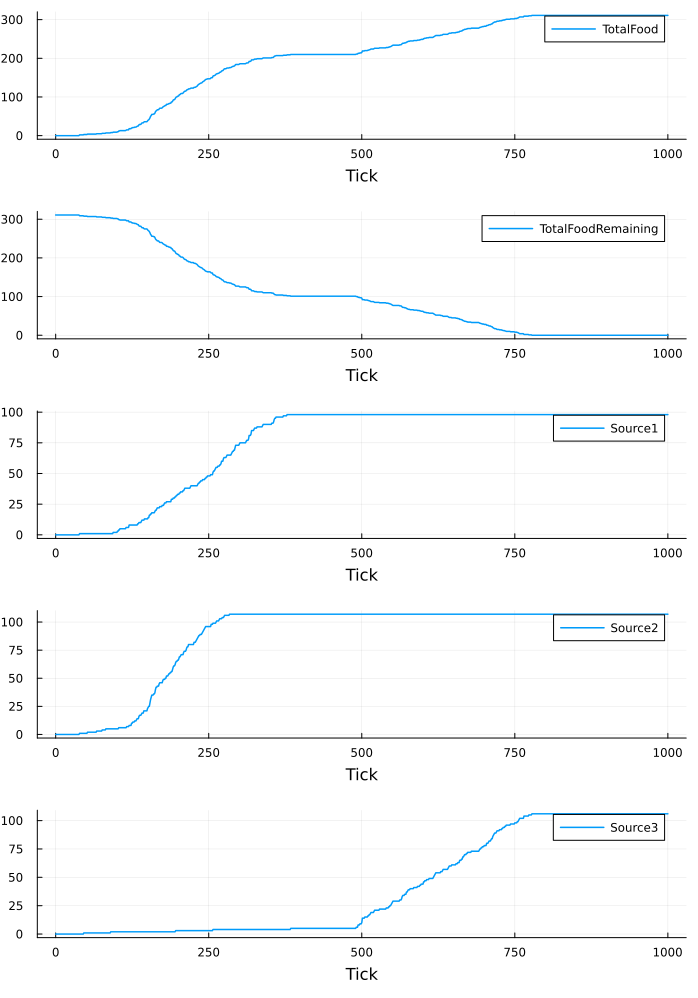
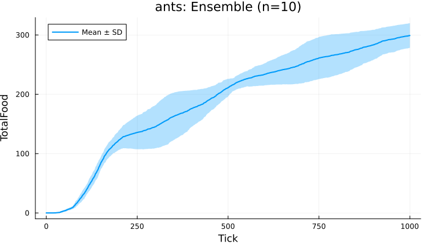
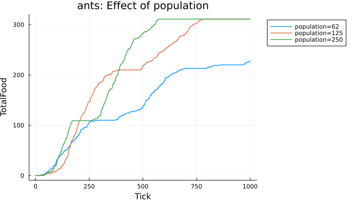

# Ants


- [Overview](#overview)
  - [WHAT IS IT?](#what-is-it)
  - [HOW IT WORKS](#how-it-works)
  - [THINGS TO NOTICE](#things-to-notice)
  - [EXTENDING THE MODEL](#extending-the-model)
  - [NETLOGO FEATURES](#netlogo-features)
  - [HOW TO CITE](#how-to-cite)
  - [COPYRIGHT AND LICENSE](#copyright-and-license)
- [Parameters](#parameters)
- [Source Code](#source-code)
- [Time Series](#time-series)
- [Ensemble Runs](#ensemble-runs)
- [Parameter Sensitivity](#parameter-sensitivity)
- [Appendix: Source Code](#appendix-source-code)
  - [Parameters (`parameters.jl`)](#parameters-parametersjl)
  - [Components (`components.jl`)](#components-componentsjl)
  - [Resources (`resources.jl`)](#resources-resourcesjl)
  - [Systems (`systems.jl`)](#systems-systemsjl)
  - [Model (`model.jl`)](#model-modeljl)

## Overview

### WHAT IS IT?

In this project, a colony of ants forages for food. Though each ant
follows a set of simple rules, the colony as a whole acts in a
sophisticated way.

### HOW IT WORKS

When an ant finds a piece of food, it carries the food back to the nest,
dropping a chemical as it moves. When other ants “sniff” the chemical,
they follow the chemical toward the food. As more ants carry food to the
nest, they reinforce the chemical trail.

### THINGS TO NOTICE

The ant colony generally exploits the food source in order, starting
with the food closest to the nest, and finishing with the food most
distant from the nest. It is more difficult for the ants to form a
stable trail to the more distant food, since the chemical trail has more
time to evaporate and diffuse before being reinforced.

Once the colony finishes collecting the closest food, the chemical trail
to that food naturally disappears, freeing up ants to help collect the
other food sources. The more distant food sources require a larger
“critical number” of ants to form a stable trail.

The consumption of the food is shown in a plot. The line colors in the
plot match the colors of the food piles.

### EXTENDING THE MODEL

Try different placements for the food sources. What happens if two food
sources are equidistant from the nest? When that happens in the real
world, ant colonies typically exploit one source then the other (not at
the same time).

In this project, the ants use a “trick” to find their way back to the
nest: they follow the “nest scent.” Real ants use a variety of different
approaches to find their way back to the nest. Try to implement some
alternative strategies.

The ants only respond to chemical levels between 0.05 and 2. The lower
limit is used so the ants aren’t infinitely sensitive. Try removing the
upper limit. What happens? Why?

In the `uphill-chemical` procedure, the ant “follows the gradient” of
the chemical. That is, it “sniffs” in three directions, then turns in
the direction where the chemical is strongest. You might want to try
variants of the `uphill-chemical` procedure, changing the number and
placement of “ant sniffs.”

### NETLOGO FEATURES

The built-in `diffuse` primitive lets us diffuse the chemical easily
without complicated code.

The primitive `patch-right-and-ahead` is used to make the ants smell in
different directions without actually turning.

### HOW TO CITE

If you mention this model or the NetLogo software in a publication, we
ask that you include the citations below.

For the model itself:

- Wilensky, U. (1997). NetLogo Ants model.
  http://ccl.northwestern.edu/netlogo/models/Ants. Center for Connected
  Learning and Computer-Based Modeling, Northwestern University,
  Evanston, IL.

Please cite the NetLogo software as:

- Wilensky, U. (1999). NetLogo. http://ccl.northwestern.edu/netlogo/.
  Center for Connected Learning and Computer-Based Modeling,
  Northwestern University, Evanston, IL.

### COPYRIGHT AND LICENSE

Copyright 1997 Uri Wilensky.


This model is licensed under the Creative Commons
Attribution-NonCommercial-ShareAlike 3.0 License. To view a copy of this
license, visit https://creativecommons.org/licenses/by-nc-sa/3.0/ or
send a letter to Creative Commons, 559 Nathan Abbott Way, Stanford,
California 94305, USA.

NetLogo itself is free software for non-commercial use under the terms
of the GNU General Public License ([see full license information
here](https://ccl.northwestern.edu/netlogo/docs/copyright.html)).

To inquire about commercial licenses for either NetLogo or specific
models from the models library, please contact
netlogo-commercial-admin@ccl.northwestern.edu.

This model was created as part of the project: CONNECTED MATHEMATICS:
MAKING SENSE OF COMPLEX PHENOMENA THROUGH BUILDING OBJECT-BASED PARALLEL
MODELS (OBPML). The project gratefully acknowledges the support of the
National Science Foundation (Applications of Advanced Technologies
Program) – grant numbers RED \#9552950 and REC \#9632612.

This model was developed at the MIT Media Lab using CM StarLogo. See
Resnick, M. (1994) “Turtles, Termites and Traffic Jams: Explorations in
Massively Parallel Microworlds.” Cambridge, MA: MIT Press. Adapted to
StarLogoT, 1997, as part of the Connected Mathematics Project.

This model was converted to NetLogo as part of the projects:
PARTICIPATORY SIMULATIONS: NETWORK-BASED DESIGN FOR SYSTEMS LEARNING IN
CLASSROOMS and/or INTEGRATED SIMULATION AND MODELING ENVIRONMENT. The
project gratefully acknowledges the support of the National Science
Foundation (REPP & ROLE programs) – grant numbers REC \#9814682 and
REC-0126227. Converted from StarLogoT to NetLogo, 1998.

<!-- 1997 1998 MIT -->

## Parameters

| Parameter          | Type      | Default | Description                            |
|--------------------|-----------|---------|----------------------------------------|
| `population`       | `Int`     | `125`   | population                             |
| `diffusion_rate`   | `Float64` | `50.0`  | 0-99, percentage                       |
| `evaporation_rate` | `Float64` | `10.0`  | 0-99, percentage                       |
| `grid_size`        | `Int`     | `71`    | width and height (odd for center nest) |
| `max_ticks`        | `Int`     | `1000`  | max ticks                              |

## Source Code

The Julia code to run this model:

``` julia
using ArkModelZoo
_, trajectory = run_ants()
```

## Time Series



## Ensemble Runs

Ten replicates with different random seeds, showing mean ± standard
deviation.



## Parameter Sensitivity

Varying `population`.



## Appendix: Source Code

This model is implemented in the
[Ark.jl](https://github.com/sdwfrost/Ark.jl) Entity-Component-System
(ECS) framework. The code is split into five files, each with a distinct
role:

- **Parameters**: a mutable struct holding all configurable values.
- **Components**: lightweight data types attached to individual entities
  (agents).
- **Resources**: world-level shared state accessible to all systems.
- **Systems**: functions that operate on entities each tick, defining
  model behavior.
- **Model**: wiring that assembles the world, registers resources and
  systems, and provides the run entry point.

### Parameters (`parameters.jl`)

The parameter struct uses `@kwdef` so that every field has a default
value and can be overridden by keyword. These defaults match the
original NetLogo model’s slider settings.

``` julia
Base.@kwdef mutable struct AntsParams
    population::Int = 125
    diffusion_rate::Float64 = 50.0    # 0-99, percentage
    evaporation_rate::Float64 = 10.0  # 0-99, percentage
    grid_size::Int = 71               # width and height (odd for center nest)
    max_ticks::Int = 1000
    seed::Int = 42
end
```

### Components (`components.jl`)

Components are lightweight data types attached to individual entities
(agents). Mutable structs hold per-entity state, while empty tag structs
act as markers for the ECS query system to efficiently filter entities.

``` julia
# Ant position on continuous space mapped to grid
mutable struct AntPosition
    x::Float64
    y::Float64
end
AntPosition() = AntPosition(0.0, 0.0)

# Heading in degrees (0 = north, 90 = east)
mutable struct Heading
    angle::Float64
end
Heading() = Heading(0.0)

# Tag: ant is carrying food
struct CarryingFood end

# Ant identity for staggered departure
mutable struct AntID
    who::Int
end
AntID() = AntID(0)
```

### Resources (`resources.jl`)

Resources are world-level singletons shared across all systems, used for
global state and aggregate statistics.

``` julia
# Patch grid holds all per-cell state
mutable struct PatchGrid
    width::Int
    height::Int
    chemical::Matrix{Float64}     # pheromone level
    food::Matrix{Int}             # food amount (0, 1, or 2)
    nest::Matrix{Bool}            # true if nest area
    nest_scent::Matrix{Float64}   # gradient: higher closer to nest
    food_source::Matrix{Int}      # food source identifier (0, 1, 2, or 3)
end

function PatchGrid(width::Int, height::Int)
    PatchGrid(
        width, height,
        zeros(Float64, width, height),
        zeros(Int, width, height),
        falses(width, height),
        zeros(Float64, width, height),
        zeros(Int, width, height),
    )
end

mutable struct AntsStats
    total_food_collected::Int
    total_food_remaining::Int   # sum of food on all patches (NetLogo's "total-food")
    food_source1::Int
    food_source2::Int
    food_source3::Int
end
AntsStats() = AntsStats(0, 0, 0, 0, 0)
```

### Systems (`systems.jl`)

Systems contain the model logic and execute in a defined order each
tick. Each system struct implements either `initialize!` (run once at
setup) or `update!` (run every tick).

``` julia
# --- Initialization ---

struct InitAntsSystem <: System end

function _setup_nest!(grid::PatchGrid)
    cx = (grid.width + 1) ÷ 2
    cy = (grid.height + 1) ÷ 2
    for x in 1:grid.width, y in 1:grid.height
        dist = sqrt(Float64((x - cx)^2 + (y - cy)^2))
        grid.nest_scent[x, y] = max(0.0, 200.0 - dist)
        if dist < 5.0
            grid.nest[x, y] = true
        end
    end
end

function _setup_food!(grid::PatchGrid, rng)
    cx = (grid.width + 1) ÷ 2
    cy = (grid.height + 1) ÷ 2
    max_r = (grid.width - 1) ÷ 2

    # Three food sources at fixed relative positions
    sources = [
        (round(Int, cx + 0.6 * max_r), cy, 1),
        (round(Int, cx - 0.6 * max_r), round(Int, cy - 0.6 * max_r), 2),
        (round(Int, cx - 0.8 * max_r), round(Int, cy + 0.8 * max_r), 3),
    ]

    for (sx, sy, src_id) in sources
        for x in 1:grid.width, y in 1:grid.height
            dist = sqrt(Float64((x - sx)^2 + (y - sy)^2))
            if dist < 5.0
                grid.food[x, y] = rand(rng, 1:2)
                grid.food_source[x, y] = src_id
            end
        end
    end
end

function initialize!(::InitAntsSystem, world::World)
    params = get_resource(world, AntsParams)
    rng = get_resource(world, RNGResource).rng
    grid = get_resource(world, PatchGrid)

    _setup_nest!(grid)
    _setup_food!(grid, rng)

    # Compute initial total food remaining
    stats = get_resource(world, AntsStats)
    total = 0
    for x in 1:grid.width, y in 1:grid.height
        total += grid.food[x, y]
    end
    stats.total_food_remaining = total

    # Create ants at nest center
    cx = Float64((grid.width + 1) ÷ 2)
    cy = Float64((grid.height + 1) ÷ 2)
    for i in 1:params.population
        new_entity!(world, (
            AntPosition(cx, cy),
            Heading(rand(rng) * 360.0),
            AntID(i),
        ))
    end
    return nothing
end

# --- Foraging Behavior ---

struct ForagingBehaviorSystem <: System
    to_add_food::Vector{Entity}      # ants that found food (add CarryingFood)
    to_drop_food::Vector{Entity}     # ants at nest (remove CarryingFood)
end
ForagingBehaviorSystem() = ForagingBehaviorSystem(Entity[], Entity[])

function _grid_xy(pos::AntPosition, grid::PatchGrid)
    gx = clamp(round(Int, pos.x), 1, grid.width)
    gy = clamp(round(Int, pos.y), 1, grid.height)
    return gx, gy
end

function _scent_at_angle(pos::AntPosition, heading::Float64, offset::Float64,
                          grid::PatchGrid, field::Matrix{Float64})
    θ = deg2rad(heading + offset)
    nx = pos.x + sin(θ)
    ny = pos.y + cos(θ)
    gx = clamp(round(Int, nx), 1, grid.width)
    gy = clamp(round(Int, ny), 1, grid.height)
    return field[gx, gy]
end

function _uphill!(heading_comp::Heading, pos::AntPosition, grid::PatchGrid, field::Matrix{Float64})
    ahead = _scent_at_angle(pos, heading_comp.angle, 0.0, grid, field)
    right = _scent_at_angle(pos, heading_comp.angle, 45.0, grid, field)
    left = _scent_at_angle(pos, heading_comp.angle, -45.0, grid, field)
    if right > ahead || left > ahead
        if right > left
            heading_comp.angle += 45.0
        else
            heading_comp.angle -= 45.0
        end
    end
end

function update!(system::ForagingBehaviorSystem, world::World)
    grid = get_resource(world, PatchGrid)
    stats = get_resource(world, AntsStats)
    tick_val = get_resource(world, Tick).tick

    empty!(system.to_add_food)
    empty!(system.to_drop_food)

    # Ants NOT carrying food: look for food
    for (eids, positions, headings, antids) in Query(world, (AntPosition, Heading, AntID); without=(CarryingFood,))
        @inbounds for i in eachindex(positions)
            antids[i].who >= tick_val && continue

            gx, gy = _grid_xy(positions[i], grid)

            if grid.food[gx, gy] > 0
                grid.food[gx, gy] -= 1
                stats.total_food_collected += 1
                src = grid.food_source[gx, gy]
                if src == 1; stats.food_source1 += 1
                elseif src == 2; stats.food_source2 += 1
                elseif src == 3; stats.food_source3 += 1
                end
                headings[i].angle += 180.0
                push!(system.to_add_food, eids[i])
            else
                chem = grid.chemical[gx, gy]
                if chem >= 0.05 && chem < 2.0
                    _uphill!(headings[i], positions[i], grid, grid.chemical)
                end
            end
        end
    end

    # Ants carrying food: return to nest
    for (eids, positions, headings) in Query(world, (AntPosition, Heading); with=(CarryingFood,))
        @inbounds for i in eachindex(positions)
            gx, gy = _grid_xy(positions[i], grid)
            if grid.nest[gx, gy]
                headings[i].angle += 180.0
                push!(system.to_drop_food, eids[i])
            else
                grid.chemical[gx, gy] += 60.0
                _uphill!(headings[i], positions[i], grid, grid.nest_scent)
            end
        end
    end

    # Apply deferred component changes outside query iteration
    for e in system.to_add_food
        add_components!(world, e, (CarryingFood(),))
    end
    for e in system.to_drop_food
        remove_components!(world, e, (CarryingFood,))
    end
    return nothing
end

# --- Movement ---

struct AntMovementSystem <: System end

function update!(::AntMovementSystem, world::World)
    rng = get_resource(world, RNGResource).rng
    grid = get_resource(world, PatchGrid)
    tick_val = get_resource(world, Tick).tick
    w, h = grid.width, grid.height

    for (_, positions, headings, antids) in Query(world, (AntPosition, Heading, AntID))
        @inbounds for i in eachindex(positions)
            antids[i].who >= tick_val && continue

            # Wiggle: random ±40 degrees
            headings[i].angle += rand(rng) * 40.0
            headings[i].angle -= rand(rng) * 40.0

            # Move forward 1
            θ = deg2rad(headings[i].angle)
            nx = positions[i].x + sin(θ)
            ny = positions[i].y + cos(θ)

            # Bounce off walls
            if nx < 1.0 || nx > Float64(w) || ny < 1.0 || ny > Float64(h)
                headings[i].angle += 180.0
                θ = deg2rad(headings[i].angle)
                nx = positions[i].x + sin(θ)
                ny = positions[i].y + cos(θ)
            end

            positions[i].x = clamp(nx, 1.0, Float64(w))
            positions[i].y = clamp(ny, 1.0, Float64(h))
        end
    end
    return nothing
end

# --- Pheromone Diffusion & Evaporation ---

struct PheromoneSystem <: System
    buffer::Matrix{Float64}
end
PheromoneSystem(grid_size::Int) = PheromoneSystem(zeros(Float64, grid_size, grid_size))
PheromoneSystem() = PheromoneSystem(0)  # placeholder; re-created in init

function initialize!(system::PheromoneSystem, world::World)
    # No-op; buffer allocated at construction
    return nothing
end

function update!(system::PheromoneSystem, world::World)
    params = get_resource(world, AntsParams)
    grid = get_resource(world, PatchGrid)
    w, h = grid.width, grid.height
    chem = grid.chemical
    buf = system.buffer

    # Diffuse: each cell shares diffusion_rate% with 8 neighbors
    diff_frac = params.diffusion_rate / 100.0
    share = diff_frac / 8.0

    # NetLogo diffuse: edge/corner patches keep shares meant for non-existent
    # neighbors, preserving the global sum of chemical.
    @inbounds for x in 1:w, y in 1:h
        n_nbr = 0
        for dx in -1:1, dy in -1:1
            (dx == 0 && dy == 0) && continue
            nx = x + dx
            ny = y + dy
            if nx >= 1 && nx <= w && ny >= 1 && ny <= h
                n_nbr += 1
            end
        end
        buf[x, y] = chem[x, y] * (1.0 - n_nbr * share)
    end

    @inbounds for x in 1:w, y in 1:h
        contrib = chem[x, y] * share
        contrib == 0.0 && continue
        for dx in -1:1, dy in -1:1
            (dx == 0 && dy == 0) && continue
            nx = x + dx
            ny = y + dy
            (nx < 1 || nx > w || ny < 1 || ny > h) && continue
            buf[nx, ny] += contrib
        end
    end

    # Evaporate
    retention = (100.0 - params.evaporation_rate) / 100.0
    @inbounds for x in 1:w, y in 1:h
        chem[x, y] = buf[x, y] * retention
    end
    return nothing
end

# --- Update Food Stats ---

struct UpdateFoodStatsSystem <: System end

function update!(::UpdateFoodStatsSystem, world::World)
    grid = get_resource(world, PatchGrid)
    stats = get_resource(world, AntsStats)
    total = 0
    @inbounds for x in 1:grid.width, y in 1:grid.height
        total += grid.food[x, y]
    end
    stats.total_food_remaining = total
    return nothing
end

# --- Termination ---

struct AntsTerminationSystem <: System end

function update!(::AntsTerminationSystem, world::World)
    params = get_resource(world, AntsParams)
    tick = get_resource(world, Tick)
    if tick.tick + 1 >= params.max_ticks
        get_resource(world, Terminate).stop = true
    end
    return nothing
end
```

### Model (`model.jl`)

The model file assembles all pieces: it creates the ECS `World` with the
required component types, registers resources, builds the `Scheduler`
with systems in execution order, and exposes the public `run` entry
point. The observer pattern records the trajectory each tick.

``` julia
function ants_world(; initial_capacity::Int = 1024)
    return World(
        AntPosition,
        Heading,
        AntID,
        CarryingFood;
        initial_capacity = initial_capacity,
        allow_mutable = true,
    )
end

function ants_systems(grid_size::Int = 71)
    return (
        InitAntsSystem(),
        ForagingBehaviorSystem(),
        AntMovementSystem(),
        PheromoneSystem(grid_size),
        UpdateFoodStatsSystem(),
        AntsTerminationSystem(),
    )
end

function ants_model(params::AntsParams = AntsParams())
    world = ants_world()
    _add_standard_resources!(world, params)
    add_resource!(world, PatchGrid(params.grid_size, params.grid_size))
    add_resource!(world, AntsStats())
    scheduler = Scheduler(world, ants_systems(params.grid_size))
    initialize!(scheduler)
    return scheduler
end

struct AntsObserver end

function ants_headers(::AntsObserver)
    return ["TotalFood", "TotalFoodRemaining", "Source1", "Source2", "Source3"]
end

function ants_values(::AntsObserver, world::World)
    stats = get_resource(world, AntsStats)
    return Float64[stats.total_food_collected, stats.total_food_remaining,
                    stats.food_source1, stats.food_source2, stats.food_source3]
end

function run_ants(; params::AntsParams = AntsParams(), observe::Bool = true)
    return _run_model(ants_model, AntsObserver(), ants_values; params, observe)
end
```
