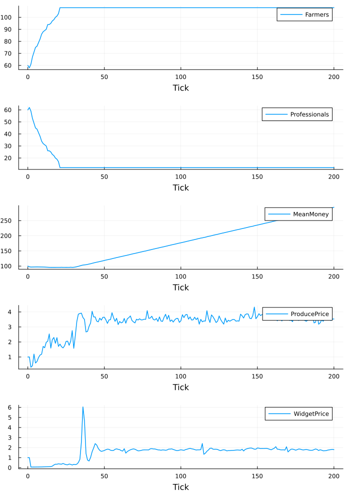
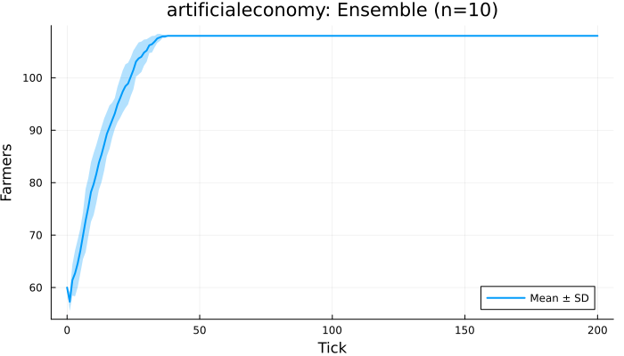
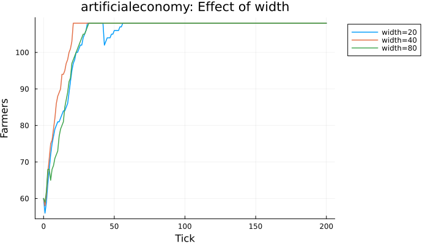

## Overview

This vignette demonstrates the **Artificial Economy** model implemented in [ArkModelZoo.jl](https://github.com/sdwfrost/ArkModelZoo.jl) using the Ark.jl ECS framework.

## Parameters

| Parameter | Type | Default | Description |
|-----------|------|---------|-------------|
| `width` | `Int` | `40` | width |
| `height` | `Int` | `40` | height |
| `population` | `Int` | `60` | per role (60 farmers + 60 professionals) |
| `fuel_grow_rate` | `Float64` | `0.01` | production rate for farmers |
| `productivity_farmerworld` | `Float64` | `10.0` | farm production multiplier |
| `productivity_cityworld` | `Float64` | `200.0` | widget production multiplier |
| `depreciation` | `Float64` | `0.01` | goods decay rate per tick |
| `produce_supply_level` | `Float64` | `2000.0` | target produce supply (price formula) |
| `widget_supply_level` | `Float64` | `600.0` | target widget supply (price formula) |
| `markup` | `Float64` | `10.0` | price markup percentage |
| `initial_money` | `Float64` | `100.0` | initial money |
| `interest_rate` | `Float64` | `0.05` | bank interest rate on loans |
| `max_debt` | `Float64` | `500.0` | bankruptcy threshold |
| `switch_probability` | `Float64` | `0.05` | prob of considering role switch per tick |
| `max_ticks` | `Int` | `200` | max ticks |

## Source Code

The Julia code to run this model:

```julia
using ArkModelZoo
_, trajectory = run_artificialeconomy()
```

## Time Series

{width=100%}

## Ensemble Runs

Ten replicates with different random seeds, showing mean ± standard deviation.

{width=100%}

## Parameter Sensitivity

Varying `width`.

{width=100%}


## Appendix: Source Code

This model is implemented in the [Ark.jl](https://github.com/sdwfrost/Ark.jl) Entity-Component-System (ECS) framework. The code is split into five files, each with a distinct role:

- **Parameters**: a mutable struct holding all configurable values.
- **Components**: lightweight data types attached to individual entities (agents).
- **Resources**: world-level shared state accessible to all systems.
- **Systems**: functions that operate on entities each tick, defining model behavior.
- **Model**: wiring that assembles the world, registers resources and systems, and provides the run entry point.

### Parameters (`parameters.jl`)

The parameter struct uses `@kwdef` so that every field has a default value and can be overridden by keyword. These defaults match the original NetLogo model's slider settings.

```julia
Base.@kwdef mutable struct AEconParams
    width::Int = 40
    height::Int = 40
    population::Int = 60                     # per role (60 farmers + 60 professionals)
    fuel_grow_rate::Float64 = 0.01           # production rate for farmers
    productivity_farmerworld::Float64 = 10.0 # farm production multiplier
    productivity_cityworld::Float64 = 200.0  # widget production multiplier
    depreciation::Float64 = 0.01             # goods decay rate per tick
    produce_supply_level::Float64 = 2000.0   # target produce supply (price formula)
    widget_supply_level::Float64 = 600.0     # target widget supply (price formula)
    markup::Float64 = 10.0                   # price markup percentage
    initial_money::Float64 = 100.0
    interest_rate::Float64 = 0.05            # bank interest rate on loans
    max_debt::Float64 = 500.0                # bankruptcy threshold
    switch_probability::Float64 = 0.05       # prob of considering role switch per tick
    max_ticks::Int = 200
    seed::Int = 42
end
```

### Components (`components.jl`)

Components are lightweight data types attached to individual entities (agents). Mutable structs hold per-entity state, while empty tag structs act as markers for the ECS query system to efficiently filter entities.

```julia
struct AEconDummy end
```

### Resources (`resources.jl`)

Resources are world-level singletons shared across all systems, used for global state and aggregate statistics.

```julia
mutable struct AEconState
    n_agents::Int
    is_farmer::Vector{Bool}
    x::Vector{Int}
    y::Vector{Int}
    money::Vector{Float64}
    produce::Vector{Float64}
    widget::Vector{Float64}
    debt::Vector{Float64}
    alive::Vector{Bool}
    last_income::Vector{Float64}
    # Store state
    store_produce::Float64
    store_widget::Float64
    store_money::Float64
    # Prices
    produce_price::Float64
    widget_price::Float64
    # Bank state
    farmer_bank_capital::Float64
    professional_bank_capital::Float64
    farmer_interest_rate::Float64
    professional_interest_rate::Float64
    # Trade tracking for price setting
    total_produce_traded::Float64
    total_widget_traded::Float64
    # Grid
    width::Int
    height::Int
    farm_yield::Matrix{Float64}
end


mutable struct AEconStats
    n_farmers::Int
    n_professionals::Int
    mean_money::Float64
    produce_price::Float64
    widget_price::Float64
end
AEconStats() = AEconStats(0, 0, 0.0, 0.0, 0.0)
```

### Systems (`systems.jl`)

Systems contain the model logic and execute in a defined order each tick. Each system struct implements either `initialize!` (run once at setup) or `update!` (run every tick).

```julia
# --- Initialization ---

struct InitAEconSystem <: System end

function initialize!(::InitAEconSystem, world::World)
    state = get_resource(world, AEconState)
    stats = get_resource(world, AEconStats)
    n_f = 0
    n_p = 0
    total_money = 0.0
    for i in 1:state.n_agents
        total_money += state.money[i]
        if state.is_farmer[i]
            n_f += 1
        else
            n_p += 1
        end
    end
    stats.n_farmers = n_f
    stats.n_professionals = n_p
    stats.mean_money = total_money / state.n_agents
    stats.produce_price = state.produce_price
    stats.widget_price = state.widget_price
    return nothing
end

# --- Move + Produce ---

struct AEconMoveProduceSystem <: System end

function update!(::AEconMoveProduceSystem, world::World)
    params = get_resource(world, AEconParams)
    rng = get_resource(world, RNGResource).rng
    state = get_resource(world, AEconState)
    w, h = state.width, state.height
    half_w = div(w, 2)

    for i in 1:state.n_agents
        !state.alive[i] && continue

        dx = rand(rng, -1:1)
        dy = rand(rng, -1:1)
        nx = state.x[i] + dx
        ny = state.y[i] + dy

        if state.is_farmer[i]
            state.x[i] = clamp(nx, 1, half_w)
            state.y[i] = clamp(ny, 1, h)
            px, py = state.x[i], state.y[i]
            state.produce[i] += state.farm_yield[px, py] * params.fuel_grow_rate * params.productivity_farmerworld
        else
            state.x[i] = clamp(nx, half_w + 1, w)
            state.y[i] = clamp(ny, 1, h)
            if state.produce[i] > 0.0
                convert_amount = min(state.produce[i], 5.0)
                state.widget[i] += convert_amount * params.productivity_cityworld / 100.0
                state.produce[i] -= convert_amount
            end
        end

        state.produce[i] *= (1.0 - params.depreciation)
        state.widget[i] *= (1.0 - params.depreciation)
    end
    return nothing
end

# --- Price Setting ---

struct AEconPriceSystem <: System end

function update!(::AEconPriceSystem, world::World)
    params = get_resource(world, AEconParams)
    state = get_resource(world, AEconState)

    state.produce_price = (params.produce_supply_level / max(state.total_produce_traded, 0.01)) * params.markup / 100.0
    state.widget_price = (params.widget_supply_level / max(state.total_widget_traded, 0.01)) * params.markup / 100.0

    state.produce_price = clamp(state.produce_price, 0.01, 100.0)
    state.widget_price = clamp(state.widget_price, 0.01, 100.0)
    return nothing
end

# --- Trade ---

struct AEconTradeSystem <: System end

function update!(::AEconTradeSystem, world::World)
    rng = get_resource(world, RNGResource).rng
    state = get_resource(world, AEconState)

    total_produce_traded = 0.0
    total_widget_traded = 0.0

    order = collect(1:state.n_agents)
    Random.shuffle!(rng, order)

    for i in order
        !state.alive[i] && continue

        old_money = state.money[i]

        if state.is_farmer[i]
            # Sell produce
            sell_amount = min(state.produce[i], 20.0)
            if sell_amount > 0.0
                revenue = sell_amount * state.produce_price
                state.money[i] += revenue
                state.produce[i] -= sell_amount
                state.store_produce += sell_amount
                state.store_money -= revenue
                total_produce_traded += sell_amount
            end

            # Buy widgets
            if state.money[i] > 0.0 && state.store_widget > 0.0
                affordable = state.money[i] / max(state.widget_price, 0.01)
                buy_amount = min(affordable, state.store_widget, 5.0)
                if buy_amount > 0.0
                    cost = buy_amount * state.widget_price
                    state.money[i] -= cost
                    state.widget[i] += buy_amount
                    state.store_widget -= buy_amount
                    state.store_money += cost
                    total_widget_traded += buy_amount
                end
            end
        else
            # Sell widgets
            sell_amount = min(state.widget[i], 10.0)
            if sell_amount > 0.0
                revenue = sell_amount * state.widget_price
                state.money[i] += revenue
                state.widget[i] -= sell_amount
                state.store_widget += sell_amount
                state.store_money -= revenue
                total_widget_traded += sell_amount
            end

            # Buy produce
            if state.money[i] > 0.0 && state.store_produce > 0.0
                affordable = state.money[i] / max(state.produce_price, 0.01)
                buy_amount = min(affordable, state.store_produce, 10.0)
                if buy_amount > 0.0
                    cost = buy_amount * state.produce_price
                    state.money[i] -= cost
                    state.produce[i] += buy_amount
                    state.store_produce -= buy_amount
                    state.store_money += cost
                    total_produce_traded += buy_amount
                end
            end
        end

        state.last_income[i] = state.money[i] - old_money
    end

    state.total_produce_traded = max(total_produce_traded, 0.01)
    state.total_widget_traded = max(total_widget_traded, 0.01)
    return nothing
end

# --- Finance (borrow, repay, interest, bankruptcy) ---

struct AEconFinanceSystem <: System end

function update!(::AEconFinanceSystem, world::World)
    params = get_resource(world, AEconParams)
    rng = get_resource(world, RNGResource).rng
    state = get_resource(world, AEconState)
    half_w = div(state.width, 2)

    for i in 1:state.n_agents
        !state.alive[i] && continue

        # Emergency borrowing
        if state.money[i] < 0.0
            borrow_amount = abs(state.money[i])
            state.debt[i] += borrow_amount
            state.money[i] = 0.0
            if state.is_farmer[i]
                state.farmer_bank_capital -= borrow_amount
            else
                state.professional_bank_capital -= borrow_amount
            end
        end

        # Repay
        if state.money[i] > 0.0 && state.debt[i] > 0.0
            repay_amount = min(state.money[i] * 0.5, state.debt[i])
            state.money[i] -= repay_amount
            state.debt[i] -= repay_amount
            if state.is_farmer[i]
                state.farmer_bank_capital += repay_amount
            else
                state.professional_bank_capital += repay_amount
            end
        end

        # Compound interest
        rate = state.is_farmer[i] ? state.farmer_interest_rate : state.professional_interest_rate
        state.debt[i] *= (1.0 + rate)

        # Bankruptcy
        if state.debt[i] > params.max_debt
            state.money[i] = params.initial_money
            state.debt[i] = 0.0
            state.produce[i] = 0.0
            state.widget[i] = 0.0
            if state.is_farmer[i]
                state.x[i] = rand(rng, 1:half_w)
            else
                state.x[i] = rand(rng, (half_w + 1):state.width)
            end
            state.y[i] = rand(rng, 1:state.height)
        end
    end
    return nothing
end

# --- Role Switching ---

struct AEconSwitchSystem <: System end

function update!(::AEconSwitchSystem, world::World)
    params = get_resource(world, AEconParams)
    rng = get_resource(world, RNGResource).rng
    state = get_resource(world, AEconState)

    farmer_income_sum = 0.0
    farmer_count = 0
    prof_income_sum = 0.0
    prof_count = 0

    for i in 1:state.n_agents
        !state.alive[i] && continue
        if state.is_farmer[i]
            farmer_income_sum += state.last_income[i]
            farmer_count += 1
        else
            prof_income_sum += state.last_income[i]
            prof_count += 1
        end
    end

    avg_farmer = farmer_count > 0 ? farmer_income_sum / farmer_count : 0.0
    avg_prof = prof_count > 0 ? prof_income_sum / prof_count : 0.0

    half_w = div(state.width, 2)
    min_per_role = max(5, div(state.n_agents, 10))

    # Only allow switching when both roles have enough agents for meaningful data
    (farmer_count < min_per_role || prof_count < min_per_role) && return nothing

    for i in 1:state.n_agents
        !state.alive[i] && continue
        rand(rng) >= params.switch_probability && continue

        if state.is_farmer[i] && avg_prof > avg_farmer * 1.2 && farmer_count > min_per_role
            state.is_farmer[i] = false
            state.x[i] = rand(rng, (half_w + 1):state.width)
            state.produce[i] = 0.0
            farmer_count -= 1
            prof_count += 1
        elseif !state.is_farmer[i] && avg_farmer > avg_prof * 1.2 && prof_count > min_per_role
            state.is_farmer[i] = true
            state.x[i] = rand(rng, 1:half_w)
            state.widget[i] = 0.0
            prof_count -= 1
            farmer_count += 1
        end
    end
    return nothing
end

# --- Stats ---

struct AEconStatsSystem <: System end

function update!(::AEconStatsSystem, world::World)
    state = get_resource(world, AEconState)
    stats = get_resource(world, AEconStats)

    n_f = 0
    n_p = 0
    total_money = 0.0
    alive_count = 0

    for i in 1:state.n_agents
        !state.alive[i] && continue
        alive_count += 1
        total_money += state.money[i]
        if state.is_farmer[i]
            n_f += 1
        else
            n_p += 1
        end
    end

    stats.n_farmers = n_f
    stats.n_professionals = n_p
    stats.mean_money = alive_count > 0 ? total_money / alive_count : 0.0
    stats.produce_price = state.produce_price
    stats.widget_price = state.widget_price
    return nothing
end

# --- Termination ---

struct AEconTerminationSystem <: System end

function update!(::AEconTerminationSystem, world::World)
    params = get_resource(world, AEconParams)
    tick = get_resource(world, Tick)
    if tick.tick + 1 >= params.max_ticks
        get_resource(world, Terminate).stop = true
    end
    return nothing
end
```

### Model (`model.jl`)

The model file assembles all pieces: it creates the ECS `World` with the required component types, registers resources, builds the `Scheduler` with systems in execution order, and exposes the public `run` entry point. The observer pattern records the trajectory each tick.

```julia
function _build_aecon_state(params::AEconParams, rng)
    n = 2 * params.population
    w, h = params.width, params.height
    farm_yield = zeros(Float64, w, h)
    half_w = div(w, 2)
    for x in 1:half_w, y in 1:h
        farm_yield[x, y] = Float64(rand(rng, 0:9))
    end

    state = AEconState(
        n,
        vcat(fill(true, params.population), fill(false, params.population)),
        zeros(Int, n), zeros(Int, n),
        fill(params.initial_money, n),
        zeros(Float64, n), zeros(Float64, n),
        zeros(Float64, n),
        fill(true, n),
        zeros(Float64, n),
        1000.0, 500.0, 5000.0,
        1.0, 1.0,
        5000.0, 5000.0,
        params.interest_rate, params.interest_rate,
        200.0, 60.0,
        w, h, farm_yield,
    )

    for i in 1:n
        if state.is_farmer[i]
            state.x[i] = rand(rng, 1:half_w)
        else
            state.x[i] = rand(rng, (half_w + 1):w)
            state.produce[i] = 20.0  # initial produce for professionals
        end
        state.y[i] = rand(rng, 1:h)
    end

    return state
end

function artificialeconomy_world(; initial_capacity::Int = 128)
    return World(AEconDummy; initial_capacity = initial_capacity, allow_mutable = true)
end

function artificialeconomy_systems()
    return (
        InitAEconSystem(),
        AEconMoveProduceSystem(),
        AEconPriceSystem(),
        AEconTradeSystem(),
        AEconFinanceSystem(),
        AEconSwitchSystem(),
        AEconStatsSystem(),
        AEconTerminationSystem(),
    )
end

function artificialeconomy_model(params::AEconParams = AEconParams())
    world = artificialeconomy_world()
    rng_resource = RNGResource(Xoshiro(params.seed))
    add_resource!(world, Tick(0))
    add_resource!(world, Terminate(false))
    add_resource!(world, rng_resource)
    add_resource!(world, deepcopy(params))
    add_resource!(world, _build_aecon_state(params, rng_resource.rng))
    add_resource!(world, AEconStats())
    scheduler = Scheduler(world, artificialeconomy_systems())
    initialize!(scheduler)
    return scheduler
end

struct AEconObserver end

function aecon_headers(::AEconObserver)
    return ["Farmers", "Professionals", "MeanMoney", "ProducePrice", "WidgetPrice"]
end

function aecon_values(::AEconObserver, world::World)
    stats = get_resource(world, AEconStats)
    return Float64[stats.n_farmers, stats.n_professionals, stats.mean_money,
                   stats.produce_price, stats.widget_price]
end

function run_artificialeconomy(; params::AEconParams = AEconParams(), observe::Bool = true)
    return _run_model(artificialeconomy_model, AEconObserver(), aecon_values; params, observe)
end
```
