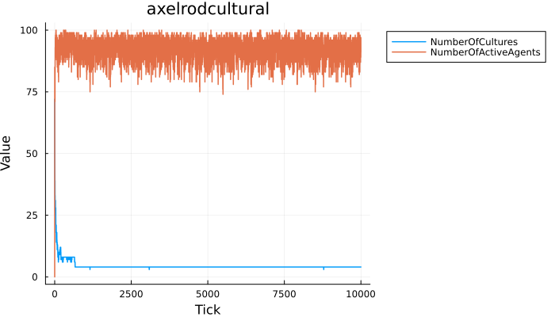
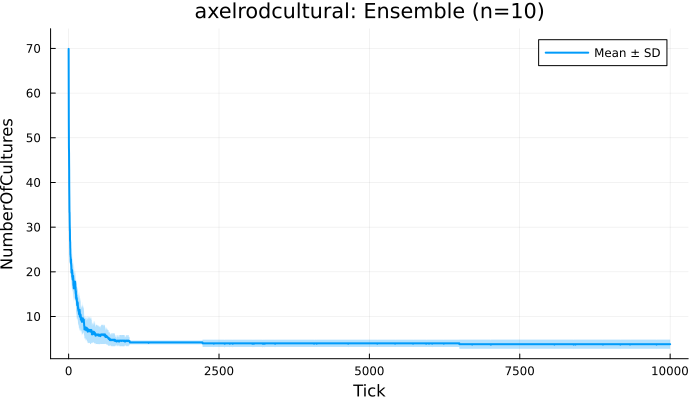
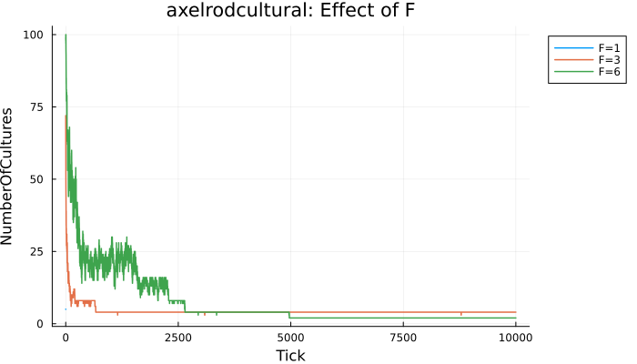

## Overview

### WHAT IS IT?

This is Axelrod’s model of cultural dissemination. See Reference at the end. It is an agent-model designed to investigate the dissemination of culture among interacting agents on a society.

Axelrod model consists in a population of agents, each one occupying a single node of a square network of size L. The culture of an agent is described by a vector of F integer variables called 'features'. Each feature can assume q different values between 0 and q-1. In the original Axelrod model the interaction topology is regular bounded (non-toroidal). Each agent can interact only with its four neighbors (von Neumann neighborhood).

Dynamics are based on two main mechanisms: (1) agents tend to chose culturally similar neighbors as interaction partners (homophily) and (2) during interaction agents influence each other in a way that they become more similar. 

The interplay of these mechanisms either leads to cultural homogeneity (all agents are perfectly similar) or the development of culturally distinct regions (multicultural society). The model allows studying to which degree the likelihood of these two outcomes depends on the size of the population, the number of features the agents hold, the number of traits (values) each feature can adopt and the neighborhood size (interaction range).

### HOW IT WORKS

Each agent is located at each patch of the grid with the default shape. Agents hold a number of features F. Each feature is a nominal variable that can adopt a certain number of values (called traits) from 0 to q - 1. Initially, agents adopt randomly chosen traits. At each time step (tick) agents update its cultural value in an asyncronous-random updating. That is that the computer makes a list where all agents are included in a random order and the list is followed until all agents are choosen. Each agent them become a focal agent and then, one of the focal agent’s neighbors is selected at random. Neighbor agents are those who are in distance less than the value of the parameter 'radius'. If radius = 1, then it is von Neumann neighborhood. The cultural overlap between these two agents is computed. The cultural overlap is equal to the percentage of similar features. With probability similar to the overlap, the two agents interact. Otherwise, the program continues with the next agent until the list is exhausted and it follows the next time step (next tick). An interaction consists of selecting at random one of the features on which the two agents differ and changing the focal agent’s feature to the interaction partner’s trait. Note that if the overlap is zero, interaction is not possible and the respective agents refuse to influence each other.

### THINGS TO NOTICE

Here we have setted toroidal boundaries, but the simulation can properly function as well in the original non-toroidal one. In our case, the four von Neumann neighbors are at distance 'radius' one. The model permits to change the value of 'radius' to explore the implications of other neighborhood sizes. It is also implemented the possiblity for agents to move. 

At the end, in the absorving final state, when calculating for the number of regions, the model makes different visible networks which include all neighbors agents with the same culture. Then, when counting the number of cultural domains it is considered that two domains are different if they are not connected, even if agents in both domains share same culture.

Note also that two agents could have similar (but with zero overlap) cultural values and then, its corresponding colors could be so similar that it could induce to think that the cultural values are the same. Just check to see that it is not.

### THINGS TO TRY

Vary the population size, the number of features, the number of traits, the range of interactions and also the movement of the agents. The program stops when the first absorving state is found (the number of active agents reaches zero), even if the agents are moving. Try toroidal and not toroidal borders activating ‘World wraps horizontally’ and ‘World wraps vertically’ in the Settings menu.

### EXTENDING THE MODEL

Many extensions of this model have been proposed (see e.g. references below). One of the most interesting is certainly the inclusion of 'social influence' instead of dyadic interaction. It has been shown that this makes the persistence of different cultural region very strong.

### RELATED MODELS

There are a lot of related models. You can follow the References here after or in the literature.

### CREDITS AND REFERENCES

This model has been developed by Robert Axelrod. 
It was implemented by Arezky H. Rodríguez (arezky@gmail.com).

This is the paper where Axelrod presented the model:

Axelrod, R. 1997. “The dissemination of culture - A model with local convergence and global polarization.” Journal of Conflict Resolution 41:203-226.

Extensions can be found at:

Flache, A., and M. Macy. 2008. “Local Convergence and Global Diversity: From Interpersonal to Social Influence”, Journal of Conflict Resolution December 2011 vol. 55 no. 6 970-995

Flache, A., and M. Macy. 2006. “What sustains cultural diversity and what undermines it? Axelrod and beyond.” arXiv:physics/0604201v1 [physics.soc-ph].

Flache, A., and M. Macy. 2007. “Local Convergence and Global Diversity: The Robustness of Cultural Homophily.” arXiv:physics/0701333v1 [physics.soc-ph].

Klemm, K., V. M. Eguiluz, R. Toral, and M. S. Miguel. 2003. “Global culture: A noise-induced transition in finite systems.” Phys. Rev. E 67, 045101.

Klemm, K., V. M. Eguiluz, R. Toral, and M. San Miguel. 2003. “Nonequilibrium transitions in complex networks: A model of social interaction.” Phys. Rev. E 67, 026120.

2013 by Arezky H. Rodríguez (arezky@gmail.com).

## Parameters

| Parameter | Type | Default | Description |
|-----------|------|---------|-------------|
| `F` | `Int` | `3` | number of cultural features (traits) |
| `q` | `Int` | `5` | number of values per trait |
| `world_size` | `Int` | `10` | 10x10 grid |
| `max_ticks` | `Int` | `10000` | max ticks |

## Source Code

The Julia code to run this model:

```julia
using ArkModelZoo
_, trajectory = run_axelrodcultural()
```

## Time Series

{width=100%}

## Ensemble Runs

Ten replicates with different random seeds, showing mean ± standard deviation.

{width=100%}

## Parameter Sensitivity

Varying `F`.

{width=100%}


## Appendix: Source Code

This model is implemented in the [Ark.jl](https://github.com/sdwfrost/Ark.jl) Entity-Component-System (ECS) framework. The code is split into five files, each with a distinct role:

- **Parameters**: a mutable struct holding all configurable values.
- **Components**: lightweight data types attached to individual entities (agents).
- **Resources**: world-level shared state accessible to all systems.
- **Systems**: functions that operate on entities each tick, defining model behavior.
- **Model**: wiring that assembles the world, registers resources and systems, and provides the run entry point.

### Parameters (`parameters.jl`)

The parameter struct uses `@kwdef` so that every field has a default value and can be overridden by keyword. These defaults match the original NetLogo model's slider settings.

```julia
Base.@kwdef mutable struct AxelrodParams
    F::Int = 3                  # number of cultural features (traits)
    q::Int = 5                  # number of values per trait
    world_size::Int = 10        # 10x10 grid
    max_ticks::Int = 10000
    seed::Int = 42
end
```

### Components (`components.jl`)

Components are lightweight data types attached to individual entities (agents). Mutable structs hold per-entity state, while empty tag structs act as markers for the ECS query system to efficiently filter entities.

```julia
# Axelrod Cultural Dissemination is purely patch-based
struct AxelrodDummy end
```

### Resources (`resources.jl`)

Resources are world-level singletons shared across all systems, used for global state and aggregate statistics.

```julia
mutable struct AxelrodGrid
    width::Int
    height::Int
    traits::Array{Int, 3}  # (F, width, height) — trait values 0..q-1
end

function AxelrodGrid(width::Int, height::Int, F::Int)
    AxelrodGrid(width, height, zeros(Int, F, width, height))
end

mutable struct AxelrodStats
    number_of_cultures::Int
    number_of_active_agents::Int
end
AxelrodStats() = AxelrodStats(0, 0)
```

### Systems (`systems.jl`)

Systems contain the model logic and execute in a defined order each tick. Each system struct implements either `initialize!` (run once at setup) or `update!` (run every tick).

```julia
# --- Initialization ---

struct InitAxelrodSystem <: System end

function initialize!(::InitAxelrodSystem, world::World)
    params = get_resource(world, AxelrodParams)
    rng = get_resource(world, RNGResource).rng
    grid = get_resource(world, AxelrodGrid)
    stats = get_resource(world, AxelrodStats)

    # Each patch gets random traits 0..q-1
    for x in 1:grid.width, y in 1:grid.height
        for f in 1:params.F
            grid.traits[f, x, y] = rand(rng, 0:params.q-1)
        end
    end

    # Count initial cultures
    _axelrod_count_cultures!(stats, grid, params)
    return nothing
end

function _axelrod_culture_id(grid::AxelrodGrid, x::Int, y::Int, q::Int)
    F = size(grid.traits, 1)
    id = 0
    for f in 1:F
        id = id * q + grid.traits[f, x, y]
    end
    return id
end

function _axelrod_count_cultures!(stats::AxelrodStats, grid::AxelrodGrid, params::AxelrodParams)
    cultures = Set{Int}()
    for x in 1:grid.width, y in 1:grid.height
        push!(cultures, _axelrod_culture_id(grid, x, y, params.q))
    end
    stats.number_of_cultures = length(cultures)
end

# --- Axelrod Update ---
# Each tick: ask patches in random order, each patch tries to interact with a Von Neumann neighbor.
# Non-wrapping grid.

struct AxelrodUpdateSystem <: System end

function update!(::AxelrodUpdateSystem, world::World)
    params = get_resource(world, AxelrodParams)
    rng = get_resource(world, RNGResource).rng
    grid = get_resource(world, AxelrodGrid)
    stats = get_resource(world, AxelrodStats)
    w, h = grid.width, grid.height
    F = params.F

    active_agents = 0

    # Random patch order (ask patches)
    patch_order = randperm(rng, w * h)

    for idx in patch_order
        x = mod1(idx, w)
        y = div(idx - 1, w) + 1

        # Get Von Neumann neighbors (non-wrapping)
        neighbors = Tuple{Int,Int}[]
        x > 1 && push!(neighbors, (x - 1, y))
        x < w && push!(neighbors, (x + 1, y))
        y > 1 && push!(neighbors, (x, y - 1))
        y < h && push!(neighbors, (x, y + 1))

        # Reservoir sample one active neighbor (0 < overlap < F)
        chosen_nx, chosen_ny = 0, 0
        chosen_overlap = 0
        count_active = 0

        for (nx, ny) in neighbors
            overlap = 0
            for f in 1:F
                if grid.traits[f, x, y] == grid.traits[f, nx, ny]
                    overlap += 1
                end
            end
            if overlap > 0 && overlap < F
                count_active += 1
                # Reservoir sampling: replace with probability 1/count_active
                if rand(rng, 1:count_active) == 1
                    chosen_nx, chosen_ny = nx, ny
                    chosen_overlap = overlap
                end
            end
        end

        if count_active > 0
            active_agents += 1
            # With probability overlap/F, adopt one differing trait
            if rand(rng) < chosen_overlap / F
                # Find differing traits
                differing = Int[]
                for f in 1:F
                    if grid.traits[f, x, y] != grid.traits[f, chosen_nx, chosen_ny]
                        push!(differing, f)
                    end
                end
                if !isempty(differing)
                    f_pick = differing[rand(rng, 1:length(differing))]
                    grid.traits[f_pick, x, y] = grid.traits[f_pick, chosen_nx, chosen_ny]
                end
            end
        end
    end

    stats.number_of_active_agents = active_agents
    return nothing
end

# --- Stats ---

struct AxelrodStatsSystem <: System end

function update!(::AxelrodStatsSystem, world::World)
    grid = get_resource(world, AxelrodGrid)
    params = get_resource(world, AxelrodParams)
    stats = get_resource(world, AxelrodStats)
    _axelrod_count_cultures!(stats, grid, params)
    return nothing
end

# --- Termination ---

struct AxelrodTerminationSystem <: System end

function update!(::AxelrodTerminationSystem, world::World)
    stats = get_resource(world, AxelrodStats)
    params = get_resource(world, AxelrodParams)
    tick = get_resource(world, Tick)
    if stats.number_of_active_agents == 0 || tick.tick + 1 >= params.max_ticks
        get_resource(world, Terminate).stop = true
    end
    return nothing
end
```

### Model (`model.jl`)

The model file assembles all pieces: it creates the ECS `World` with the required component types, registers resources, builds the `Scheduler` with systems in execution order, and exposes the public `run` entry point. The observer pattern records the trajectory each tick.

```julia
function axelrodcultural_world(; initial_capacity::Int = 128)
    return World(
        AxelrodDummy;
        initial_capacity = initial_capacity,
        allow_mutable = true,
    )
end

function axelrodcultural_systems()
    return (
        InitAxelrodSystem(),
        AxelrodUpdateSystem(),
        AxelrodStatsSystem(),
        AxelrodTerminationSystem(),
    )
end

function axelrodcultural_model(params::AxelrodParams = AxelrodParams())
    world = axelrodcultural_world()
    _add_standard_resources!(world, params)
    add_resource!(world, AxelrodGrid(params.world_size, params.world_size, params.F))
    add_resource!(world, AxelrodStats())
    scheduler = Scheduler(world, axelrodcultural_systems())
    initialize!(scheduler)
    return scheduler
end

struct AxelrodObserver end

function axelrodcultural_headers(::AxelrodObserver)
    return ["NumberOfCultures", "NumberOfActiveAgents"]
end

function axelrodcultural_values(::AxelrodObserver, world::World)
    stats = get_resource(world, AxelrodStats)
    return Float64[stats.number_of_cultures, stats.number_of_active_agents]
end

function run_axelrodcultural(; params::AxelrodParams = AxelrodParams(), observe::Bool = true)
    return _run_model(axelrodcultural_model, AxelrodObserver(), axelrodcultural_values; params, observe)
end
```
