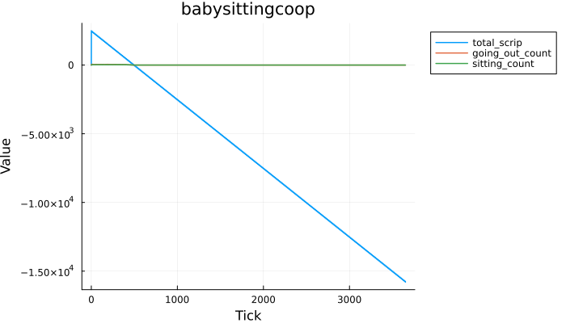
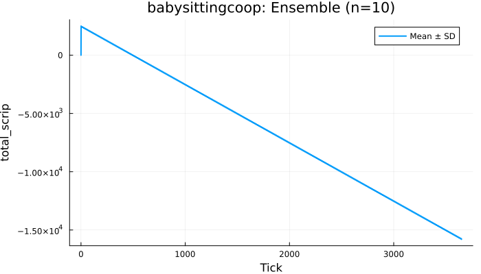
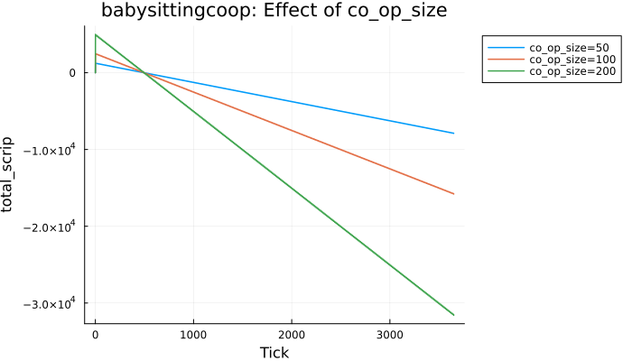

# Baby Sitting Coop


- [Overview](#overview)
- [Parameters](#parameters)
- [Source Code](#source-code)
- [Time Series](#time-series)
- [Ensemble Runs](#ensemble-runs)
- [Parameter Sensitivity](#parameter-sensitivity)
- [Appendix: Source Code](#appendix-source-code)
  - [Parameters (`parameters.jl`)](#parameters-parametersjl)
  - [Components (`components.jl`)](#components-componentsjl)
  - [Resources (`resources.jl`)](#resources-resourcesjl)
  - [Systems (`systems.jl`)](#systems-systemsjl)
  - [Model (`model.jl`)](#model-modeljl)

## Overview

This vignette demonstrates the **Baby Sitting Coop** model implemented
in [ArkModelZoo.jl](https://github.com/sdwfrost/ArkModelZoo.jl) using
the Ark.jl ECS framework.

## Parameters

| Parameter | Type | Default | Description |
|----|----|----|----|
| `co_op_size` | `Int` | `100` | co op size |
| `initial_scrip` | `Float64` | `25.0` | initial scrip |
| `mean_hours_out` | `Int` | `4` | mean hours out |
| `want_to_go_out_probability` | `Float64` | `0.5` | want to go out probability |
| `want_to_sit_probability` | `Float64` | `0.5` | want to sit probability |
| `monthly_dues` | `Float64` | `0.6` | monthly dues |
| `desired_times_out_reserve` | `Float64` | `0.0` | desired times out reserve |
| `willing_to_sit_prob` | `Float64` | `0.0` | willing to sit prob |
| `years` | `Int` | `10` | years |
| `cycle_amplitude` | `Float64` | `0.0` | cycle amplitude |
| `multiple_sitees` | `Bool` | `true` | multiple sitees |
| `clear_sitter_market` | `Bool` | `false` | clear sitter market |
| `auto_adjust` | `Bool` | `false` | auto adjust |
| `hours_out_distribution` | `String` | `"uniform"` | hours out distribution |
| `max_ticks` | `Int` | `3650` | 365 \* years |

## Source Code

The Julia code to run this model:

``` julia
using ArkModelZoo
_, trajectory = run_babysittingcoop()
```

## Time Series



## Ensemble Runs

Ten replicates with different random seeds, showing mean ± standard
deviation.



## Parameter Sensitivity

Varying `co_op_size`.



## Appendix: Source Code

This model is implemented in the
[Ark.jl](https://github.com/sdwfrost/Ark.jl) Entity-Component-System
(ECS) framework. The code is split into five files, each with a distinct
role:

- **Parameters**: a mutable struct holding all configurable values.
- **Components**: lightweight data types attached to individual entities
  (agents).
- **Resources**: world-level shared state accessible to all systems.
- **Systems**: functions that operate on entities each tick, defining
  model behavior.
- **Model**: wiring that assembles the world, registers resources and
  systems, and provides the run entry point.

### Parameters (`parameters.jl`)

The parameter struct uses `@kwdef` so that every field has a default
value and can be overridden by keyword. These defaults match the
original NetLogo model’s slider settings.

``` julia
Base.@kwdef mutable struct BSitParams
    co_op_size::Int = 100
    initial_scrip::Float64 = 25.0
    mean_hours_out::Int = 4
    want_to_go_out_probability::Float64 = 0.5
    want_to_sit_probability::Float64 = 0.5
    monthly_dues::Float64 = 0.6
    desired_times_out_reserve::Float64 = 0.0
    willing_to_sit_prob::Float64 = 0.0
    years::Int = 10
    cycle_amplitude::Float64 = 0.0
    multiple_sitees::Bool = true
    clear_sitter_market::Bool = false
    auto_adjust::Bool = false
    hours_out_distribution::String = "uniform"
    max_ticks::Int = 3650   # 365 * years
    seed::Int = 42
end
```

### Components (`components.jl`)

Components are lightweight data types attached to individual entities
(agents). Mutable structs hold per-entity state, while empty tag structs
act as markers for the ECS query system to efficiently filter entities.

``` julia
struct BSitDummy end
```

### Resources (`resources.jl`)

Resources are world-level singletons shared across all systems, used for
global state and aggregate statistics.

``` julia
mutable struct BSitState
    n_agents::Int
    scrip::Vector{Float64}
    scrip_needed::Vector{Float64}
    want_sitter::Vector{Bool}
    want_to_go_out::Vector{Bool}
    enough_scrip::Vector{Bool}
    going_out::Vector{Bool}
    want_to_sit::Vector{Bool}
    sitting::Vector{Bool}
    total_hours_out::Float64
    cycle_pos::Float64
    stop_run::Bool
end

function BSitState()
    BSitState(0, Float64[], Float64[], Bool[], Bool[], Bool[], Bool[], Bool[], Bool[], 0.0, 0.0, false)
end

function _bsit_add_agent!(state::BSitState, initial_scrip::Float64)
    state.n_agents += 1
    push!(state.scrip, initial_scrip)
    push!(state.scrip_needed, 0.0)
    push!(state.want_sitter, false)
    push!(state.want_to_go_out, false)
    push!(state.enough_scrip, false)
    push!(state.going_out, false)
    push!(state.want_to_sit, false)
    push!(state.sitting, false)
    return state.n_agents
end

function _bsit_reset_flags!(state::BSitState)
    n = state.n_agents
    @inbounds for i in 1:n
        state.scrip_needed[i] = 0.0
        state.want_sitter[i] = false
        state.want_to_go_out[i] = false
        state.enough_scrip[i] = false
        state.going_out[i] = false
        state.want_to_sit[i] = false
        state.sitting[i] = false
    end
end

mutable struct BSitStats
    total_scrip::Float64
    max_scrip::Float64
    going_out_count::Int
    sitting_count::Int
    want_sitter_count::Int
    want_to_sit_count::Int
    quiet_evening_count::Int
    no_sitter_count::Int
    no_sitting_jobs_count::Int
    not_enough_scrip_count::Int
    sitting_as_1st_choice_count::Int
    sitting_as_2nd_choice_count::Int
end

function BSitStats()
    BSitStats(0.0, 0.0, 0, 0, 0, 0, 0, 0, 0, 0, 0, 0)
end
```

### Systems (`systems.jl`)

Systems contain the model logic and execute in a defined order each
tick. Each system struct implements either `initialize!` (run once at
setup) or `update!` (run every tick).

``` julia
# --- Helpers ---

# NetLogo: (random 100) / 100 → 0.00, 0.01, ... 0.99
function _bsit_random_probability(rng)
    return rand(rng, 0:99) / 100.0
end

# NetLogo: seasonally-adjusted-prob [p cycle-p]
function _bsit_seasonally_adjusted_prob(p::Float64, cycle_p::Float64)
    diff = if cycle_p > 0
        1.0 - p
    elseif cycle_p == 0.0
        0.0
    else
        p
    end
    return p + diff * cycle_p
end

# NetLogo: percent-of-limit [amount limit]
function _bsit_percent_of_limit(amount::Float64, limit::Float64)
    return min(1.0, max(0.0, amount / limit))
end

# NetLogo: percent-of-desired-times-out-reserve (agent-level, depends on scrip)
function _bsit_percent_of_desired_times_out_reserve(scrip::Float64, params)
    if params.desired_times_out_reserve == 0.0
        return 1.0
    end
    return _bsit_percent_of_limit(scrip, Float64(params.mean_hours_out) * params.desired_times_out_reserve)
end

# NetLogo: get-want-to-go-out-probability (agent-level)
function _bsit_get_want_to_go_out_probability(scrip::Float64, params, cycle_pos::Float64)
    pct = _bsit_percent_of_desired_times_out_reserve(scrip, params)
    raw = min(pct, params.want_to_go_out_probability)
    return _bsit_seasonally_adjusted_prob(raw, cycle_pos)
end

# NetLogo: get-want-to-sit-probability (agent-level)
function _bsit_get_want_to_sit_probability(scrip::Float64, params, cycle_pos::Float64)
    pct = _bsit_percent_of_desired_times_out_reserve(scrip, params)
    raw = max(1.0 - pct, params.want_to_sit_probability)
    return _bsit_seasonally_adjusted_prob(raw, -cycle_pos)
end

# NetLogo: get-event-length — returns hours-out-wanted for one agent
function _bsit_get_event_length(rng, scrip::Float64, params, cycle_pos::Float64)
    if _bsit_random_probability(rng) > _bsit_get_want_to_go_out_probability(scrip, params, cycle_pos)
        return 0
    end
    dist = params.hours_out_distribution
    mho = params.mean_hours_out
    if dist == "uniform"
        # NetLogo integer arithmetic: mean-hours-out + mean-hours-out / 2
        # With mho=4: 4 + div(4,2) = 6, random 6 → 0..5, +1 → 1..6
        upper = mho + div(mho, 2)
        return rand(rng, 0:(upper - 1)) + 1
    elseif dist == "poisson"
        return _bsit_random_poisson(rng, mho - 1) + 1
    else  # "none"
        return mho
    end
end

# Simple Poisson sampler (Knuth algorithm) — no Distributions.jl needed
function _bsit_random_poisson(rng, lambda::Int)
    L = exp(-Float64(lambda))
    k = 0
    p = 1.0
    while true
        k += 1
        p *= rand(rng)
        if p < L
            return k - 1
        end
    end
end

# NetLogo: repeat-to [xs n] — double list until >= n, then take n random elements
function _bsit_repeat_to(rng, xs::Vector{Int}, n::Int)
    buf = copy(xs)
    while length(buf) < n
        append!(buf, xs)
    end
    shuffle!(rng, buf)
    return buf[1:n]
end

# NetLogo: pay-sitter [sittee sitter source]
function _bsit_pay_sitter!(state::BSitState, sittee::Int, sitter::Int)
    payment = state.scrip_needed[sittee]
    state.scrip[sittee] -= payment
    state.going_out[sittee] = true
    state.scrip[sitter] += payment
    state.sitting[sitter] = true
    state.total_hours_out += payment
end

# --- plan-evening (shuffled order, per NetLogo ask turtles) ---
function _bsit_plan_evening!(rng, state::BSitState, params, cycle_pos::Float64)
    order = collect(1:state.n_agents)
    shuffle!(rng, order)
    @inbounds for i in order
        hours = _bsit_get_event_length(rng, state.scrip[i], params, cycle_pos)
        state.scrip_needed[i] = Float64(hours)
        if hours > 0
            state.want_to_go_out[i] = true
            if state.scrip[i] >= state.scrip_needed[i]
                state.want_sitter[i] = true
                state.enough_scrip[i] = true
            end
        end
        if !state.want_sitter[i]
            sit_prob = _bsit_get_want_to_sit_probability(state.scrip[i], params, cycle_pos)
            if _bsit_random_probability(rng) < sit_prob
                state.want_to_sit[i] = true
            end
        end
    end
end

# --- match-sitees-and-sitters ---
function _bsit_match!(rng, state::BSitState, params)
    want_sitters = Int[]
    available_sitters = Int[]
    @inbounds for i in 1:state.n_agents
        if state.want_sitter[i]
            push!(want_sitters, i)
        end
        if state.want_to_sit[i]
            push!(available_sitters, i)
        end
    end

    nw = length(want_sitters)
    na = length(available_sitters)

    if nw == 0 || na == 0
        if nw > 0 && na == 0
            return  # no sitters available
        end
        return
    end

    if nw < na
        shuffle!(rng, available_sitters)
        available_sitters = available_sitters[1:nw]
        na = nw
    elseif nw > na
        if params.multiple_sitees && na > 0
            available_sitters = _bsit_repeat_to(rng, available_sitters, nw)
            na = nw
        else
            shuffle!(rng, want_sitters)
            want_sitters = want_sitters[1:na]
            nw = na
        end
    end

    # Shuffle want_sitters for random pairing (NetLogo n-of is random)
    shuffle!(rng, want_sitters)
    shuffle!(rng, available_sitters)

    @inbounds for i in 1:length(want_sitters)
        _bsit_pay_sitter!(state, want_sitters[i], available_sitters[i])
    end
end

# --- clear-sitter-market (only when clear_sitter_market is true) ---
function _bsit_clear_sitter_market!(rng, state::BSitState, params)
    # uncleared = want-sitter and not going-out
    uncleared = Int[]
    @inbounds for i in 1:state.n_agents
        if state.want_sitter[i] && !state.going_out[i]
            push!(uncleared, i)
        end
    end
    isempty(uncleared) && return

    # Split into sitters-set and sittees
    sitters_set = Int[]
    sittees = Int[]
    for i in uncleared
        if _bsit_random_probability(rng) < params.willing_to_sit_prob
            push!(sitters_set, i)
        else
            push!(sittees, i)
        end
    end

    sitters = copy(sitters_set)
    ns = length(sitters)
    nt = length(sittees)
    if ns > nt
        shuffle!(rng, sitters)
        sitters = sitters[1:nt]
    else
        shuffle!(rng, sittees)
        sittees = sittees[1:ns]
    end
    for i in 1:length(sittees)
        _bsit_pay_sitter!(state, sittees[i], sitters[i])
    end

    # Extra sitters: those from sitters_set not yet sitting
    extra = Int[]
    for i in sitters_set
        if !state.sitting[i]
            push!(extra, i)
        end
    end
    ne = length(extra)
    half = div(ne, 2)
    if half == 0
        return
    end
    shuffle!(rng, extra)
    sittees2 = extra[1:half]
    remaining = extra[(half + 1):end]
    shuffle!(rng, remaining)
    sitters2 = remaining[1:min(half, length(remaining))]
    for i in 1:length(sitters2)
        _bsit_pay_sitter!(state, sittees2[i], sitters2[i])
    end
end

# --- check-consistency ---
function _bsit_check_consistency!(state::BSitState, stats::BSitStats, params)
    n = state.n_agents

    # Count categories
    want_sitter_count = 0
    want_to_sit_count = 0
    quiet_evening_count = 0
    want_to_go_out_count = 0
    not_enough_scrip_count = 0
    going_out_count = 0
    sitting_count = 0
    sitting_as_1st_choice_count = 0
    sitting_as_2nd_choice_count = 0
    frustrated_want_sitter = 0
    frustrated_want_to_sit = 0

    @inbounds for i in 1:n
        ws = state.want_sitter[i]
        wts = state.want_to_sit[i]
        go = state.going_out[i]
        si = state.sitting[i]
        wtgo = state.want_to_go_out[i]
        es = state.enough_scrip[i]

        if ws
            want_sitter_count += 1
        end
        if wts
            want_to_sit_count += 1
        end
        if !ws && !wts
            quiet_evening_count += 1
        end
        if wtgo
            want_to_go_out_count += 1
            if !es
                not_enough_scrip_count += 1
            end
        end
        if go
            going_out_count += 1
        end
        if si
            sitting_count += 1
        end
        if ws && si
            sitting_as_2nd_choice_count += 1
        end
        if wts && si
            sitting_as_1st_choice_count += 1
        end
        if ws && !go && !si
            frustrated_want_sitter += 1
        end
        if wts && !si
            frustrated_want_to_sit += 1
        end
    end

    no_sitter_count = frustrated_want_sitter
    no_sitting_jobs_count = frustrated_want_to_sit

    # Store stats
    stats.want_sitter_count = want_sitter_count
    stats.want_to_sit_count = want_to_sit_count
    stats.quiet_evening_count = quiet_evening_count
    stats.going_out_count = going_out_count
    stats.sitting_count = sitting_count
    stats.no_sitter_count = no_sitter_count
    stats.no_sitting_jobs_count = no_sitting_jobs_count
    stats.not_enough_scrip_count = not_enough_scrip_count
    stats.sitting_as_1st_choice_count = sitting_as_1st_choice_count
    stats.sitting_as_2nd_choice_count = sitting_as_2nd_choice_count

    # Check consistency — set stop_run if violated
    if frustrated_want_sitter > 0 && frustrated_want_to_sit > 0
        state.stop_run = true
    end
    if want_sitter_count + want_to_sit_count + quiet_evening_count != n
        state.stop_run = true
    end
    if want_sitter_count + not_enough_scrip_count != want_to_go_out_count
        state.stop_run = true
    end
    if going_out_count + no_sitter_count + sitting_as_2nd_choice_count != want_sitter_count
        state.stop_run = true
    end
    if sitting_as_1st_choice_count + no_sitting_jobs_count != want_to_sit_count
        state.stop_run = true
    end
    if !params.multiple_sitees && going_out_count != sitting_count
        state.stop_run = true
    end
end

# --- Systems ---

struct InitBSitSystem <: System end

function initialize!(::InitBSitSystem, world::World)
    params = get_resource(world, BSitParams)
    state = get_resource(world, BSitState)
    for _ in 1:params.co_op_size
        _bsit_add_agent!(state, params.initial_scrip)
    end
    return nothing
end

struct BSitGoSystem <: System end

function update!(::BSitGoSystem, world::World)
    params = get_resource(world, BSitParams)
    rng = get_resource(world, RNGResource).rng
    state = get_resource(world, BSitState)
    stats = get_resource(world, BSitStats)
    tick = get_resource(world, Tick)
    my_ticks = tick.tick

    # Reset flags each tick
    _bsit_reset_flags!(state)

    # Compute cycle position
    state.cycle_pos = sin(deg2rad(my_ticks % 360)) * params.cycle_amplitude

    # Plan evening
    _bsit_plan_evening!(rng, state, params, state.cycle_pos)

    # Match sitees and sitters
    _bsit_match!(rng, state, params)

    # Clear sitter market (only if enabled)
    if params.clear_sitter_market
        _bsit_clear_sitter_market!(rng, state, params)
    end

    # Check consistency
    _bsit_check_consistency!(state, stats, params)

    # Compute aggregate stats
    stats.total_scrip = sum(state.scrip)
    max_scrip_now = maximum(state.scrip)
    stats.max_scrip = max(stats.max_scrip, ceil(max_scrip_now))

    # Auto-adjust monthly dues (only if enabled)
    if params.auto_adjust
        if stats.no_sitting_jobs_count > 10
            params.monthly_dues = -0.3
        end
        if stats.no_sitting_jobs_count < 5
            params.monthly_dues = 0.6
        end
    end

    # Monthly dues every 12 ticks
    if my_ticks % 12 == 0
        @inbounds for i in 1:state.n_agents
            state.scrip[i] -= params.monthly_dues
        end
    end

    # Stop condition
    if state.stop_run
        get_resource(world, Terminate).stop = true
    end

    return nothing
end

struct BSitTerminationSystem <: System end

function update!(::BSitTerminationSystem, world::World)
    params = get_resource(world, BSitParams)
    tick = get_resource(world, Tick)
    if tick.tick + 1 >= params.max_ticks
        get_resource(world, Terminate).stop = true
    end
    return nothing
end
```

### Model (`model.jl`)

The model file assembles all pieces: it creates the ECS `World` with the
required component types, registers resources, builds the `Scheduler`
with systems in execution order, and exposes the public `run` entry
point. The observer pattern records the trajectory each tick.

``` julia
function babysittingcoop_world(; initial_capacity::Int = 128)
    return World(BSitDummy; initial_capacity=initial_capacity, allow_mutable=true)
end

function babysittingcoop_systems()
    return (
        InitBSitSystem(),
        BSitGoSystem(),
        BSitTerminationSystem(),
    )
end

function babysittingcoop_model(params::BSitParams = BSitParams())
    world = babysittingcoop_world()
    _add_standard_resources!(world, params)
    add_resource!(world, BSitState())
    add_resource!(world, BSitStats())
    scheduler = Scheduler(world, babysittingcoop_systems())
    initialize!(scheduler)
    return scheduler
end

struct BabysittingCoopObserver end

function babysittingcoop_headers(::BabysittingCoopObserver)
    return ["total_scrip", "going_out_count", "sitting_count"]
end

function babysittingcoop_values(::BabysittingCoopObserver, world::World)
    stats = get_resource(world, BSitStats)
    return Float64[stats.total_scrip, stats.going_out_count, stats.sitting_count]
end

function run_babysittingcoop(; params::BSitParams = BSitParams(), observe::Bool = true)
    return _run_model(babysittingcoop_model, BabysittingCoopObserver(), babysittingcoop_values; params, observe)
end
```
