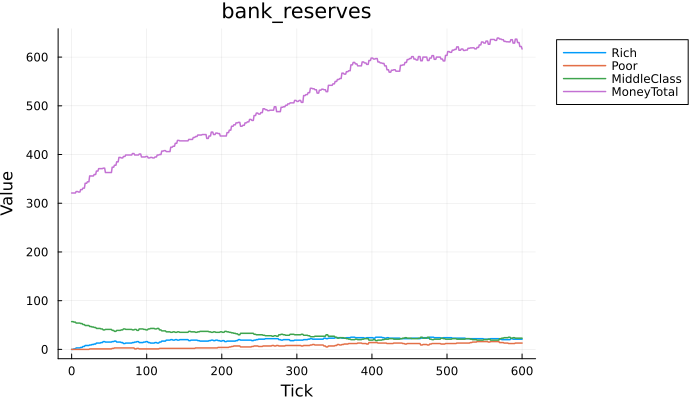
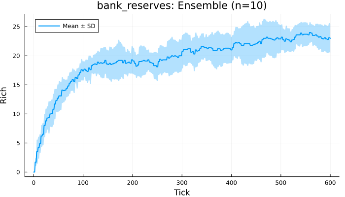
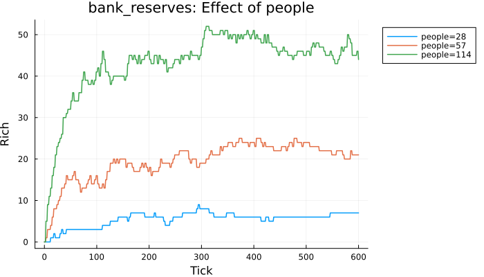

## Overview

### WHAT IS IT?

This program models the creation of money in an economy through a private banking system. As most of the money in the economy is kept in banks but only little of it needs to be used (i.e. in cash form) at any one time, the banks need only keep a small portion of their savings on-hand for those transactions. This portion of the total savings is known as the banks' reserves.

The banks are then able to loan out the rest of their savings. The government (the user in this case) sets a reserve ratio mandating how much of the banks' holdings must be kept in reserve at a given time. One 'super-bank' is used in this model to represent all banks in an economy. As this model demonstrates, the reserve ratio is the key determiner of how much money is created in the system.

### HOW IT WORKS

In each round, people (represented by turtles) interact with each other to simulate everyday economic activity. Given a randomly selected number, when a person is on the same patch as someone else it will either give the person two or five dollars, or no money at all. After this, people must then sort out the balance of their wallet with the bank. People will put a positive wallet balance in savings, or pay off a negative balance from funds already in savings. If the savings account is empty and the wallet has a negative balance, a person will take out a loan from the bank if funds are available to borrow (if bank-to-loan > 0). Otherwise the person maintains the negative balance until the next round. Lastly, if someone has money in savings and money borrowed from the bank, that person will pay off as much of the loan as possible using the savings.

### THINGS TO NOTICE

Note how much money is in MONEY-TOTAL after pressing SETUP, but before pressing GO. The total amount of money that can be created will be this figure:

(the initial money in the system) * (1 / RESERVES).

If the RESERVES remains constant through the run of the model, notice how the plot levels off at this value. Why is this equation descriptive of the system?

Once the amount of money in the system has hit the maximum (as calculated be the above equation), watch what happens when the RESERVES slider is set to 100. Now try setting the RESERVES slider back. Why does this happen?

The three monitors on the left of the interface (LOANS-TOTAL, BANK-TO-LOAN and RESERVES) represent the distribution of the bank's money at a given time. Try and track this distribution against SAVINGS-TOTAL, WALLETS-TOTAL and MONEY-TOTAL to understand fluctuations of money in the  system as they happen.

What effect does an increase in RESERVES generally have on TOTAL-MONEY?

Why do SAVINGS-TOTAL (yellow), LOANS-TOTAL (red) and MONEY-TOTAL (green) tend to rise and fall proportionately on the plot?

What happens to TOTAL-MONEY when the reserve ratio is initially set to 100 percent? Why?

### THINGS TO TRY

Vary the RESERVES rate as the model runs, and watch the effect this has on MONEY-TOTAL.

Set RESERVES initially to 100, and watch the effect on TOTAL-MONEY. Now try lowering RESERVES.

Try setting the reserve rate to 0. What would happen if this were done in a real economy?

### EXTENDING THE MODEL

Try extending the model to include payments of interest in the banking system. People with money deposited in savings should be credited with interest on their account (at a certain rate) from the bank from time to time. People with money on loan should make interest payments on their account to the bank from time to time.

This model has turtles interact in a very simple way to have money change hands (and create a need for loans). Try changing the model so that money moves around the system in a different way.

### RELATED MODELS

Wealth Distribution looks at how the reserve ratio affects the distribution of wealth.

### HOW TO CITE

If you mention this model or the NetLogo software in a publication, we ask that you include the citations below.

For the model itself:

* Wilensky, U. (1998).  NetLogo Bank Reserves model.  http://ccl.northwestern.edu/netlogo/models/BankReserves.  Center for Connected Learning and Computer-Based Modeling, Northwestern University, Evanston, IL.

Please cite the NetLogo software as:

* Wilensky, U. (1999). NetLogo. http://ccl.northwestern.edu/netlogo/. Center for Connected Learning and Computer-Based Modeling, Northwestern University, Evanston, IL.

### COPYRIGHT AND LICENSE

Copyright 1998 Uri Wilensky.


This model is licensed under the Creative Commons Attribution-NonCommercial-ShareAlike 3.0 License.  To view a copy of this license, visit https://creativecommons.org/licenses/by-nc-sa/3.0/ or send a letter to Creative Commons, 559 Nathan Abbott Way, Stanford, California 94305, USA.

NetLogo itself is free software for non-commercial use under the terms of the GNU General Public License ([see full license information here](https://ccl.northwestern.edu/netlogo/docs/copyright.html)).

To inquire about commercial licenses for either NetLogo or specific models from the models library, please contact netlogo-commercial-admin@ccl.northwestern.edu.

This model was created as part of the project: CONNECTED MATHEMATICS: MAKING SENSE OF COMPLEX PHENOMENA THROUGH BUILDING OBJECT-BASED PARALLEL MODELS (OBPML).  The project gratefully acknowledges the support of the National Science Foundation (Applications of Advanced Technologies Program) -- grant numbers RED #9552950 and REC #9632612.

This model was converted to NetLogo as part of the projects: PARTICIPATORY SIMULATIONS: NETWORK-BASED DESIGN FOR SYSTEMS LEARNING IN CLASSROOMS and/or INTEGRATED SIMULATION AND MODELING ENVIRONMENT. The project gratefully acknowledges the support of the National Science Foundation (REPP & ROLE programs) -- grant numbers REC #9814682 and REC-0126227. Converted from StarLogoT to NetLogo, 2001.

<!-- 1998 2001 -->

## Parameters

| Parameter | Type | Default | Description |
|-----------|------|---------|-------------|
| `people` | `Int` | `57` | people |
| `reserves` | `Float64` | `52.0` | reserve ratio percent |
| `grid_width` | `Int` | `17` | grid width |
| `grid_height` | `Int` | `17` | grid height |
| `rich_threshold` | `Int` | `10` | rich threshold |
| `max_ticks` | `Int` | `600` | 200 full cycles of 3 |

## Source Code

The Julia code to run this model:

```julia
using ArkModelZoo
_, trajectory = run_bank_reserves()
```

## Time Series

{width=100%}

## Ensemble Runs

Ten replicates with different random seeds, showing mean ± standard deviation.

{width=100%}

## Parameter Sensitivity

Varying `people`.

{width=100%}


## Appendix: Source Code

This model is implemented in the [Ark.jl](https://github.com/sdwfrost/Ark.jl) Entity-Component-System (ECS) framework. The code is split into five files, each with a distinct role:

- **Parameters**: a mutable struct holding all configurable values.
- **Components**: lightweight data types attached to individual entities (agents).
- **Resources**: world-level shared state accessible to all systems.
- **Systems**: functions that operate on entities each tick, defining model behavior.
- **Model**: wiring that assembles the world, registers resources and systems, and provides the run entry point.

### Parameters (`parameters.jl`)

The parameter struct uses `@kwdef` so that every field has a default value and can be overridden by keyword. These defaults match the original NetLogo model's slider settings.

```julia
Base.@kwdef mutable struct BRESParams
    people::Int = 57
    reserves::Float64 = 52.0  # reserve ratio percent
    grid_width::Int = 17
    grid_height::Int = 17
    rich_threshold::Int = 10
    max_ticks::Int = 600  # 200 full cycles of 3
    seed::Int = 42
end
```

### Components (`components.jl`)

Components are lightweight data types attached to individual entities (agents). Mutable structs hold per-entity state, while empty tag structs act as markers for the ECS query system to efficiently filter entities.

```julia
mutable struct BRESPosition
    x::Int
    y::Int
end
BRESPosition() = BRESPosition(0, 0)

mutable struct BRESAccount
    savings::Float64
    loans::Float64
    wallet::Float64
    wealth::Float64
end
BRESAccount() = BRESAccount(0.0, 0.0, 0.0, 0.0)
```

### Resources (`resources.jl`)

Resources are world-level singletons shared across all systems, used for global state and aggregate statistics.

```julia
mutable struct BRESBank
    bank_loans::Float64
    bank_reserves::Float64
    bank_deposits::Float64
    bank_to_loan::Float64
end
BRESBank() = BRESBank(0.0, 0.0, 0.0, 0.0)

mutable struct BRESStats
    rich::Int
    poor::Int
    middle_class::Int
    money_total::Float64
    savings_total::Float64
    loans_total::Float64
    wallets_total::Float64
end
BRESStats() = BRESStats(0, 0, 0, 0.0, 0.0, 0.0, 0.0)
```

### Systems (`systems.jl`)

Systems contain the model logic and execute in a defined order each tick. Each system struct implements either `initialize!` (run once at setup) or `update!` (run every tick).

```julia
# --- Initialization ---
struct InitBRESSystem <: System end

function initialize!(::InitBRESSystem, world::World)
    params = get_resource(world, BRESParams)
    rng = get_resource(world, RNGResource).rng

    for _ in 1:params.people
        x = rand(rng, 1:params.grid_width)
        y = rand(rng, 1:params.grid_height)
        wallet = Float64(rand(rng, 1:params.rich_threshold))
        new_entity!(world, (
            BRESPosition(x, y),
            BRESAccount(0.0, 0.0, wallet, 0.0),
        ))
    end

    _bres_bank_balance_sheet!(world)
    _bres_update_stats!(world)
    return nothing
end

# --- Go System ---
struct BRESGoSystem <: System end

function update!(::BRESGoSystem, world::World)
    rng = get_resource(world, RNGResource).rng
    bank = get_resource(world, BRESBank)
    tick = get_resource(world, Tick).tick

    _bres_update_stats!(world)

    # Collect and shuffle agents (NetLogo ask shuffles each tick)
    agent_eids = Entity[]
    for (eids, _, _) in Query(world, (BRESPosition, BRESAccount))
        append!(agent_eids, eids)
    end
    Random.shuffle!(rng, agent_eids)

    phase = tick % 3
    if phase == 0
        _bres_do_business!(world, rng, agent_eids, bank)
    elseif phase == 1
        _bres_balance_books!(world, agent_eids, bank)
    else
        _bres_bank_balance_sheet!(world)
    end
    return nothing
end

# --- Phase 0: do-business ---

function _bres_do_business!(world, rng, agent_eids, bank)
    params = get_resource(world, BRESParams)
    w, h = params.grid_width, params.grid_height
    for eid in agent_eids
        pos, acc = get_components(world, eid, (BRESPosition, BRESAccount))
        # Move: rt random-float 360; fd 1
        heading = rand(rng) * 360.0
        θ = deg2rad(heading)
        pos.x = mod1(round(Int, pos.x + sin(θ)), w)
        pos.y = mod1(round(Int, pos.y + cos(θ)), h)

        if acc.savings > 0 || acc.wallet > 0 || bank.bank_to_loan > 0
            # one-of other turtles-here
            customer_eid = _bres_find_customer(world, eid, pos.x, pos.y, rng)
            if !is_zero(customer_eid)
                if rand(rng, 0:1) == 0  # 50% chance to trade
                    customer_acc = get_components(world, customer_eid, (BRESAccount,))[1]
                    if rand(rng, 0:1) == 0
                        customer_acc.wallet += 5.0
                        acc.wallet -= 5.0
                    else
                        customer_acc.wallet += 2.0
                        acc.wallet -= 2.0
                    end
                end
            end
        end
    end
end

function _bres_find_customer(world, self_eid, x, y, rng)
    candidates = Entity[]
    for (eids, positions, _) in Query(world, (BRESPosition, BRESAccount))
        @inbounds for i in eachindex(positions)
            if positions[i].x == x && positions[i].y == y && eids[i] != self_eid
                push!(candidates, eids[i])
            end
        end
    end
    isempty(candidates) && return zero_entity
    return candidates[rand(rng, 1:length(candidates))]
end

# --- Phase 1: balance-books ---

function _bres_balance_books!(world, agent_eids, bank)
    for eid in agent_eids
        acc = get_components(world, eid, (BRESAccount,))[1]

        if acc.wallet < 0.0
            deficit = -acc.wallet
            if acc.savings >= deficit
                acc.savings -= deficit
                acc.wallet = 0.0
            else
                # Use all savings first, then try loan for remainder
                remaining = deficit - acc.savings
                acc.wallet += acc.savings
                acc.savings = 0.0
                if bank.bank_to_loan >= remaining
                    acc.loans += remaining
                    acc.wallet = 0.0
                    bank.bank_to_loan -= remaining
                elseif bank.bank_to_loan > 0.0
                    acc.loans += bank.bank_to_loan
                    acc.wallet += bank.bank_to_loan
                    bank.bank_to_loan = 0.0
                end
            end
        elseif acc.wallet > 0.0
            acc.savings += acc.wallet
            acc.wallet = 0.0
        end

        # Pay off loans from savings
        if acc.loans > 0.0 && acc.savings > 0.0
            if acc.loans >= acc.savings
                acc.loans -= acc.savings
                acc.savings = 0.0
            else
                acc.savings -= acc.loans
                acc.loans = 0.0
            end
        end

        # Update wealth (get-shape)
        acc.wealth = acc.savings + acc.wallet
    end
end

# --- Phase 2: bank-balance-sheet ---

function _bres_bank_balance_sheet!(world)
    params = get_resource(world, BRESParams)
    bank = get_resource(world, BRESBank)

    total_savings = 0.0
    total_loans = 0.0
    for (_, _, accounts) in Query(world, (BRESPosition, BRESAccount))
        @inbounds for i in eachindex(accounts)
            total_savings += accounts[i].savings
            total_loans += accounts[i].loans
        end
    end

    bank.bank_deposits = total_savings
    bank.bank_loans = total_loans
    bank.bank_reserves = (params.reserves / 100.0) * total_savings
    bank.bank_to_loan = total_savings - (bank.bank_reserves + total_loans)
end

# --- Stats ---

function _bres_update_stats!(world)
    params = get_resource(world, BRESParams)
    stats = get_resource(world, BRESStats)

    rich = 0; poor = 0; middle = 0
    total_savings = 0.0; total_loans = 0.0; total_wallets = 0.0
    for (_, _, accounts) in Query(world, (BRESPosition, BRESAccount))
        @inbounds for i in eachindex(accounts)
            a = accounts[i]
            total_savings += a.savings
            total_loans += a.loans
            total_wallets += a.wallet
            if a.savings > params.rich_threshold
                rich += 1
            elseif a.loans > 10
                poor += 1
            else
                middle += 1
            end
        end
    end
    stats.rich = rich
    stats.poor = poor
    stats.middle_class = middle
    stats.savings_total = total_savings
    stats.loans_total = total_loans
    stats.wallets_total = total_wallets
    stats.money_total = total_wallets + total_savings
end

# --- Termination ---
struct BRESTerminationSystem <: System end

function update!(::BRESTerminationSystem, world::World)
    params = get_resource(world, BRESParams)
    tick = get_resource(world, Tick)
    if tick.tick + 1 >= params.max_ticks
        get_resource(world, Terminate).stop = true
    end
    return nothing
end
```

### Model (`model.jl`)

The model file assembles all pieces: it creates the ECS `World` with the required component types, registers resources, builds the `Scheduler` with systems in execution order, and exposes the public `run` entry point. The observer pattern records the trajectory each tick.

```julia
function bank_reserves_world(; initial_capacity::Int = 256)
    return World(
        BRESPosition,
        BRESAccount;
        initial_capacity = initial_capacity,
        allow_mutable = true,
    )
end

function bank_reserves_systems()
    return (
        InitBRESSystem(),
        BRESGoSystem(),
        BRESTerminationSystem(),
    )
end

function bank_reserves_model(params::BRESParams = BRESParams())
    world = bank_reserves_world()
    _add_standard_resources!(world, params)
    add_resource!(world, BRESBank())
    add_resource!(world, BRESStats())
    scheduler = Scheduler(world, bank_reserves_systems())
    initialize!(scheduler)
    return scheduler
end

struct BRESObserver end

function bank_reserves_headers(::BRESObserver)
    return ["Rich", "Poor", "MiddleClass", "MoneyTotal"]
end

function bank_reserves_values(::BRESObserver, world::World)
    stats = get_resource(world, BRESStats)
    return Float64[stats.rich, stats.poor, stats.middle_class, stats.money_total]
end

function run_bank_reserves(; params::BRESParams = BRESParams(), observe::Bool = true)
    return _run_model(bank_reserves_model, BRESObserver(), bank_reserves_values; params, observe)
end
```
