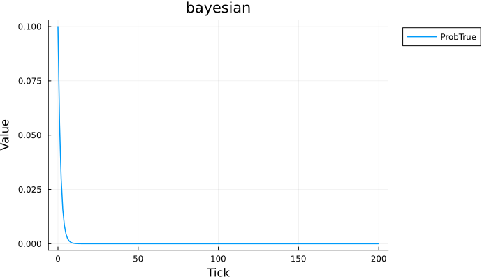
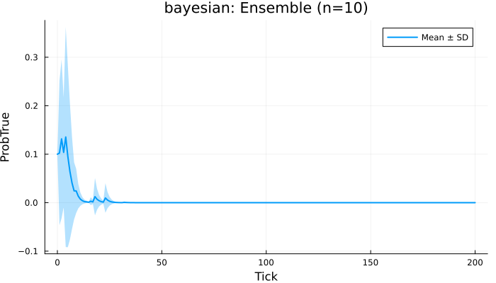
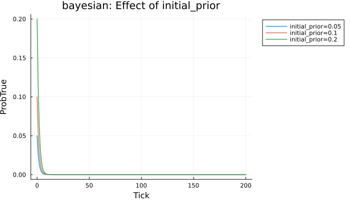

# Bayesian Updating


- [Overview](#overview)
- [Parameters](#parameters)
- [Source Code](#source-code)
- [Time Series](#time-series)
- [Ensemble Runs](#ensemble-runs)
- [Parameter Sensitivity](#parameter-sensitivity)
- [Appendix: Source Code](#appendix-source-code)
  - [Parameters (`parameters.jl`)](#parameters-parametersjl)
  - [Components (`components.jl`)](#components-componentsjl)
  - [Resources (`resources.jl`)](#resources-resourcesjl)
  - [Systems (`systems.jl`)](#systems-systemsjl)
  - [Model (`model.jl`)](#model-modeljl)

## Overview

This vignette demonstrates the **Bayesian Updating** model implemented
in [ArkModelZoo.jl](https://github.com/sdwfrost/ArkModelZoo.jl) using
the Ark.jl ECS framework.

## Parameters

| Parameter             | Type      | Default | Description         |
|-----------------------|-----------|---------|---------------------|
| `initial_prior`       | `Float64` | `0.1`   | initial prior       |
| `false_positive_rate` | `Float64` | `0.05`  | false positive rate |
| `power`               | `Float64` | `0.5`   | power               |
| `true_hypothesis`     | `Bool`    | `false` | true hypothesis     |
| `max_ticks`           | `Int`     | `200`   | max ticks           |

## Source Code

The Julia code to run this model:

``` julia
using ArkModelZoo
_, trajectory = run_bayesian()
```

## Time Series



## Ensemble Runs

Ten replicates with different random seeds, showing mean ± standard
deviation.



## Parameter Sensitivity

Varying `initial_prior`.



## Appendix: Source Code

This model is implemented in the
[Ark.jl](https://github.com/sdwfrost/Ark.jl) Entity-Component-System
(ECS) framework. The code is split into five files, each with a distinct
role:

- **Parameters**: a mutable struct holding all configurable values.
- **Components**: lightweight data types attached to individual entities
  (agents).
- **Resources**: world-level shared state accessible to all systems.
- **Systems**: functions that operate on entities each tick, defining
  model behavior.
- **Model**: wiring that assembles the world, registers resources and
  systems, and provides the run entry point.

### Parameters (`parameters.jl`)

The parameter struct uses `@kwdef` so that every field has a default
value and can be overridden by keyword. These defaults match the
original NetLogo model’s slider settings.

``` julia
Base.@kwdef mutable struct BayesianParams
    initial_prior::Float64 = 0.1
    false_positive_rate::Float64 = 0.05
    power::Float64 = 0.5
    true_hypothesis::Bool = false
    max_ticks::Int = 200
    seed::Int = 42
end
```

### Components (`components.jl`)

Components are lightweight data types attached to individual entities
(agents). Mutable structs hold per-entity state, while empty tag structs
act as markers for the ECS query system to efficiently filter entities.

``` julia
struct BayesianDummy end
```

### Resources (`resources.jl`)

Resources are world-level singletons shared across all systems, used for
global state and aggregate statistics.

``` julia
mutable struct BayesianState
    prob_true::Float64
end
BayesianState() = BayesianState(0.0)
```

### Systems (`systems.jl`)

Systems contain the model logic and execute in a defined order each
tick. Each system struct implements either `initialize!` (run once at
setup) or `update!` (run every tick).

``` julia
# --- Initialization ---

struct InitBayesianSystem <: System end

function initialize!(::InitBayesianSystem, world::World)
    params = get_resource(world, BayesianParams)
    state = get_resource(world, BayesianState)
    state.prob_true = params.initial_prior
    return nothing
end

# --- Bayesian Update ---

struct BayesianUpdateSystem <: System end

function update!(::BayesianUpdateSystem, world::World)
    params = get_resource(world, BayesianParams)
    rng = get_resource(world, RNGResource).rng
    state = get_resource(world, BayesianState)

    p = state.prob_true
    fpr = params.false_positive_rate
    pwr = params.power

    # Determine if we observe a positive result this tick
    if params.true_hypothesis
        positive = rand(rng) < pwr
    else
        positive = rand(rng) < fpr
    end

    if positive
        state.prob_true = (pwr * p) / (pwr * p + fpr * (1 - p))
    else
        state.prob_true = ((1 - pwr) * p) / ((1 - pwr) * p + (1 - fpr) * (1 - p))
    end

    return nothing
end

# --- Termination ---

struct BayesianTerminationSystem <: System end

function update!(::BayesianTerminationSystem, world::World)
    params = get_resource(world, BayesianParams)
    tick = get_resource(world, Tick)
    if tick.tick + 1 >= params.max_ticks
        get_resource(world, Terminate).stop = true
    end
    return nothing
end
```

### Model (`model.jl`)

The model file assembles all pieces: it creates the ECS `World` with the
required component types, registers resources, builds the `Scheduler`
with systems in execution order, and exposes the public `run` entry
point. The observer pattern records the trajectory each tick.

``` julia
function bayesian_world(; initial_capacity::Int = 128)
    return World(
        BayesianDummy;
        initial_capacity = initial_capacity,
        allow_mutable = true,
    )
end

function bayesian_systems()
    return (
        InitBayesianSystem(),
        BayesianUpdateSystem(),
        BayesianTerminationSystem(),
    )
end

function bayesian_model(params::BayesianParams = BayesianParams())
    world = bayesian_world()
    _add_standard_resources!(world, params)
    add_resource!(world, BayesianState())
    scheduler = Scheduler(world, bayesian_systems())
    initialize!(scheduler)
    return scheduler
end

struct BayesianObserver end

function bayesian_headers(::BayesianObserver)
    return ["ProbTrue"]
end

function bayesian_values(::BayesianObserver, world::World)
    state = get_resource(world, BayesianState)
    return Float64[state.prob_true]
end

function run_bayesian(; params::BayesianParams = BayesianParams(), observe::Bool = true)
    return _run_model(bayesian_model, BayesianObserver(), bayesian_values; params, observe)
end
```
