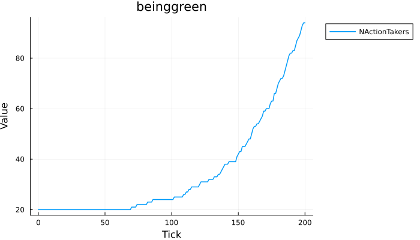
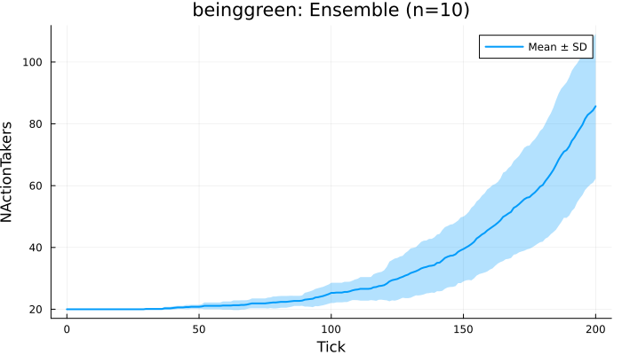
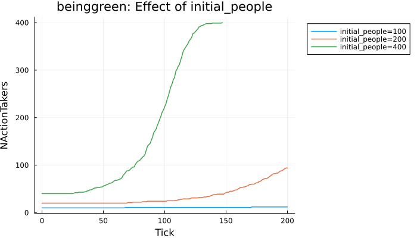

## Overview

This vignette demonstrates the **Being Green** model implemented in [ArkModelZoo.jl](https://github.com/sdwfrost/ArkModelZoo.jl) using the Ark.jl ECS framework.

## Parameters

| Parameter | Type | Default | Description |
|-----------|------|---------|-------------|
| `initial_people` | `Int` | `200` | initial people |
| `average_locus_of_control` | `Float64` | `50.0` | average locus of control |
| `average_social_pressure` | `Float64` | `50.0` | average social pressure |
| `average_sense_of_responsibility` | `Float64` | `50.0` | average sense of responsibility |
| `average_pbc` | `Float64` | `20.0` | average pbc |
| `initial_action_taker_frac` | `Float64` | `0.10` | initial action taker frac |
| `grid_width` | `Int` | `33` | grid width |
| `grid_height` | `Int` | `33` | grid height |
| `max_ticks` | `Int` | `200` | max ticks |

## Source Code

The Julia code to run this model:

```julia
using ArkModelZoo
_, trajectory = run_beinggreen()
```

## Time Series

{width=100%}

## Ensemble Runs

Ten replicates with different random seeds, showing mean ± standard deviation.

{width=100%}

## Parameter Sensitivity

Varying `initial_people`.

{width=100%}


## Appendix: Source Code

This model is implemented in the [Ark.jl](https://github.com/sdwfrost/Ark.jl) Entity-Component-System (ECS) framework. The code is split into five files, each with a distinct role:

- **Parameters**: a mutable struct holding all configurable values.
- **Components**: lightweight data types attached to individual entities (agents).
- **Resources**: world-level shared state accessible to all systems.
- **Systems**: functions that operate on entities each tick, defining model behavior.
- **Model**: wiring that assembles the world, registers resources and systems, and provides the run entry point.

### Parameters (`parameters.jl`)

The parameter struct uses `@kwdef` so that every field has a default value and can be overridden by keyword. These defaults match the original NetLogo model's slider settings.

```julia
Base.@kwdef mutable struct BeingGreenParams
    initial_people::Int = 200
    average_locus_of_control::Float64 = 50.0
    average_social_pressure::Float64 = 50.0
    average_sense_of_responsibility::Float64 = 50.0
    average_pbc::Float64 = 20.0
    initial_action_taker_frac::Float64 = 0.10
    grid_width::Int = 33
    grid_height::Int = 33
    max_ticks::Int = 200
    seed::Int = 42
end
```

### Components (`components.jl`)

Components are lightweight data types attached to individual entities (agents). Mutable structs hold per-entity state, while empty tag structs act as markers for the ECS query system to efficiently filter entities.

```julia
mutable struct GreenPosition
    x::Float64
    y::Float64
end
GreenPosition() = GreenPosition(0.0, 0.0)

mutable struct GreenHeading
    heading::Float64
end
GreenHeading() = GreenHeading(0.0)

mutable struct ActionTaker
    is_action_taker::Bool
end
ActionTaker() = ActionTaker(false)

mutable struct GreenProperties
    locus_of_control::Float64
    sense_of_responsibility::Float64
    pbc::Float64
    social_pressure::Float64
end
GreenProperties() = GreenProperties(0.0, 0.0, 0.0, 0.0)
```

### Resources (`resources.jl`)

Resources are world-level singletons shared across all systems, used for global state and aggregate statistics.

```julia
mutable struct BeingGreenGrid
    width::Int
    height::Int
    cells::Matrix{Vector{Entity}}
end

function BeingGreenGrid(w::Int, h::Int)
    cells = [Entity[] for _ in 1:w, _ in 1:h]
    BeingGreenGrid(w, h, cells)
end

function clear_grid!(grid::BeingGreenGrid)
    for col in grid.cells
        empty!(col)
    end
end

function pos_to_cell(x::Float64, y::Float64, w::Int, h::Int)
    gx = mod1(round(Int, x), w)
    gy = mod1(round(Int, y), h)
    return gx, gy
end

mutable struct BeingGreenStats
    n_action_takers::Int
end
BeingGreenStats() = BeingGreenStats(0)
```

### Systems (`systems.jl`)

Systems contain the model logic and execute in a defined order each tick. Each system struct implements either `initialize!` (run once at setup) or `update!` (run every tick).

```julia
# --- Helpers ---

function _green_wrap(v::Float64, span::Int)
    return mod(v - 0.5, Float64(span)) + 0.5
end

function _green_move!(rng, pos::GreenPosition, hdg::GreenHeading, w::Int, h::Int)
    hdg.heading = mod(hdg.heading + rand(rng) * 360.0, 360.0)
    θ = deg2rad(hdg.heading)
    pos.x = _green_wrap(pos.x + sin(θ), w)
    pos.y = _green_wrap(pos.y + cos(θ), h)
end

function _rebuild_grid!(world::World, grid::BeingGreenGrid)
    clear_grid!(grid)
    w, h = grid.width, grid.height
    for (eids, positions) in Query(world, (GreenPosition,))
        @inbounds for i in eachindex(eids)
            gx, gy = pos_to_cell(positions[i].x, positions[i].y, w, h)
            push!(grid.cells[gx, gy], eids[i])
        end
    end
end

# --- Initialization ---

struct InitBeingGreenSystem <: System end

function initialize!(::InitBeingGreenSystem, world::World)
    params = get_resource(world, BeingGreenParams)
    rng = get_resource(world, RNGResource).rng
    stats = get_resource(world, BeingGreenStats)
    grid = get_resource(world, BeingGreenGrid)
    w, h = params.grid_width, params.grid_height

    n_at = 0
    for who in 0:(params.initial_people - 1)
        x = rand(rng) * w + 0.5
        y = rand(rng) * h + 0.5
        is_at = who < round(Int, params.initial_people * params.initial_action_taker_frac)
        loc = randn(rng) * 10.0 + params.average_locus_of_control
        sor = randn(rng) * 10.0 + params.average_sense_of_responsibility
        pbc = randn(rng) * 10.0 + params.average_pbc
        sp  = randn(rng) * 10.0 + params.average_social_pressure
        new_entity!(world, (
            GreenPosition(x, y),
            GreenHeading(0.0),
            ActionTaker(is_at),
            GreenProperties(loc, sor, pbc, sp),
        ))
        if is_at; n_at += 1; end
    end
    stats.n_action_takers = n_at
    _rebuild_grid!(world, grid)
    return nothing
end

# --- Move All Turtles ---

struct MoveBeingGreenSystem <: System end

function update!(::MoveBeingGreenSystem, world::World)
    rng = get_resource(world, RNGResource).rng
    grid = get_resource(world, BeingGreenGrid)
    w, h = grid.width, grid.height

    # Collect and shuffle for random order
    agents = Tuple{GreenPosition, GreenHeading}[]
    for (_, positions, headings) in Query(world, (GreenPosition, GreenHeading))
        @inbounds for i in eachindex(positions)
            push!(agents, (positions[i], headings[i]))
        end
    end
    order = randperm(rng, length(agents))
    for idx in order
        pos, hdg = agents[idx]
        _green_move!(rng, pos, hdg, w, h)
    end

    _rebuild_grid!(world, grid)
    return nothing
end

# --- Interact ---
# Action-takers influence non-action-takers on neighboring patches.

struct InteractBeingGreenSystem <: System end

function update!(::InteractBeingGreenSystem, world::World)
    rng = get_resource(world, RNGResource).rng
    grid = get_resource(world, BeingGreenGrid)
    w, h = grid.width, grid.height

    # Cache boolean flags before any modifications this tick.
    # NetLogo's susceptible?/internal?/responsible? are set by evaluate-parameters
    # at the END of each tick and remain stale throughout the next tick's influence.
    cached_flags = Dict{Entity, Tuple{Bool, Bool, Bool}}()
    for (eids, ats, props_arr) in Query(world, (ActionTaker, GreenProperties))
        @inbounds for i in eachindex(eids)
            if !ats[i].is_action_taker
                p = props_arr[i]
                cached_flags[eids[i]] = (
                    p.social_pressure > 70,
                    p.locus_of_control > 70,
                    p.sense_of_responsibility > 70,
                )
            end
        end
    end

    # Collect action-taker positions
    at_list = Tuple{Entity, Int, Int}[]
    for (eids, positions, ats) in Query(world, (GreenPosition, ActionTaker))
        @inbounds for i in eachindex(eids)
            if ats[i].is_action_taker
                gx, gy = pos_to_cell(positions[i].x, positions[i].y, w, h)
                push!(at_list, (eids[i], gx, gy))
            end
        end
    end
    Random.shuffle!(rng, at_list)

    for (_, gx, gy) in at_list
        # Collect non-action-taker entities on 8 neighboring patches
        nearby_red = Entity[]
        for dx in -1:1, dy in -1:1
            (dx == 0 && dy == 0) && continue
            nx = mod1(gx + dx, w)
            ny = mod1(gy + dy, h)
            for eid in grid.cells[nx, ny]
                at = get_components(world, eid, (ActionTaker,))[1]
                if !at.is_action_taker
                    push!(nearby_red, eid)
                end
            end
        end
        isempty(nearby_red) && continue

        Random.shuffle!(rng, nearby_red)
        for eid in nearby_red
            props = get_components(world, eid, (GreenProperties,))[1]
            pos = get_components(world, eid, (GreenPosition,))[1]
            hdg = get_components(world, eid, (GreenHeading,))[1]

            susceptible, internal, responsible = cached_flags[eid]

            if !susceptible
                props.social_pressure += 1
            elseif !internal
                props.pbc += 5
                props.locus_of_control += 1
            elseif !responsible
                props.pbc += 5
                props.sense_of_responsibility += 5
            else
                props.pbc += 5
            end

            # Influenced turtle moves
            old_gx, old_gy = pos_to_cell(pos.x, pos.y, w, h)
            _green_move!(rng, pos, hdg, w, h)
            new_gx, new_gy = pos_to_cell(pos.x, pos.y, w, h)
            if old_gx != new_gx || old_gy != new_gy
                filter!(e -> !isequal(e, eid), grid.cells[old_gx, old_gy])
                push!(grid.cells[new_gx, new_gy], eid)
            end
        end
    end
    return nothing
end

# --- Test ---

struct TestBeingGreenSystem <: System end

function update!(::TestBeingGreenSystem, world::World)
    for (_, ats, props_arr) in Query(world, (ActionTaker, GreenProperties))
        @inbounds for i in eachindex(ats)
            if !ats[i].is_action_taker
                p = props_arr[i]
                if p.locus_of_control > 70 && p.sense_of_responsibility > 70 && p.pbc > 70
                    ats[i].is_action_taker = true
                end
            end
        end
    end
    return nothing
end

# --- Termination ---

struct BeingGreenTerminationSystem <: System end

function update!(::BeingGreenTerminationSystem, world::World)
    params = get_resource(world, BeingGreenParams)
    stats = get_resource(world, BeingGreenStats)
    tick = get_resource(world, Tick)

    n_at = 0
    n_total = 0
    for (_, ats) in Query(world, (ActionTaker,))
        @inbounds for i in eachindex(ats)
            n_total += 1
            if ats[i].is_action_taker
                n_at += 1
            end
        end
    end
    stats.n_action_takers = n_at

    if n_at == n_total || tick.tick + 1 >= params.max_ticks
        get_resource(world, Terminate).stop = true
    end
    return nothing
end
```

### Model (`model.jl`)

The model file assembles all pieces: it creates the ECS `World` with the required component types, registers resources, builds the `Scheduler` with systems in execution order, and exposes the public `run` entry point. The observer pattern records the trajectory each tick.

```julia
function beinggreen_world(; initial_capacity::Int = 512)
    return World(
        GreenPosition,
        GreenHeading,
        ActionTaker,
        GreenProperties;
        initial_capacity = initial_capacity,
        allow_mutable = true,
    )
end

function beinggreen_systems()
    return (
        InitBeingGreenSystem(),
        MoveBeingGreenSystem(),
        InteractBeingGreenSystem(),
        TestBeingGreenSystem(),
        BeingGreenTerminationSystem(),
    )
end

function beinggreen_model(params::BeingGreenParams = BeingGreenParams())
    world = beinggreen_world()
    _add_standard_resources!(world, params)
    add_resource!(world, BeingGreenGrid(params.grid_width, params.grid_height))
    add_resource!(world, BeingGreenStats())
    scheduler = Scheduler(world, beinggreen_systems())
    initialize!(scheduler)
    return scheduler
end

struct BeingGreenObserver end

function beinggreen_headers(::BeingGreenObserver)
    return ["NActionTakers"]
end

function beinggreen_values(::BeingGreenObserver, world::World)
    stats = get_resource(world, BeingGreenStats)
    return Float64[stats.n_action_takers]
end

function run_beinggreen(; params::BeingGreenParams = BeingGreenParams(), observe::Bool = true)
    return _run_model(beinggreen_model, BeingGreenObserver(), beinggreen_values; params, observe)
end
```
