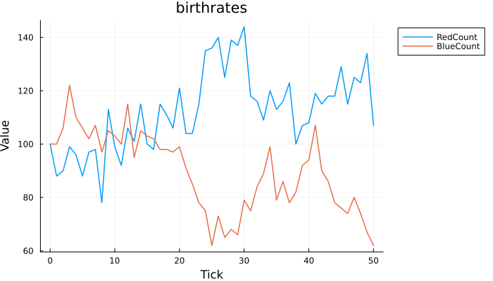
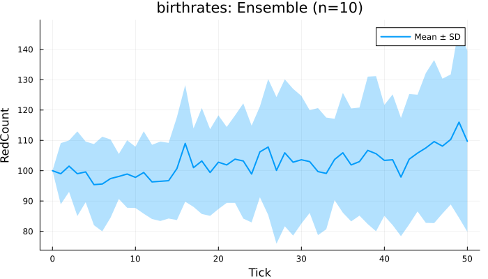
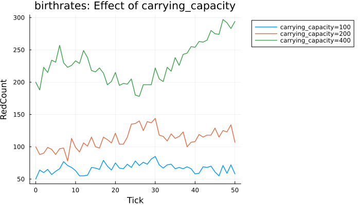

# Birthrates


- [Overview](#overview)
- [Parameters](#parameters)
- [Source Code](#source-code)
- [Time Series](#time-series)
- [Ensemble Runs](#ensemble-runs)
- [Parameter Sensitivity](#parameter-sensitivity)
- [Appendix: Source Code](#appendix-source-code)
  - [Parameters (`parameters.jl`)](#parameters-parametersjl)
  - [Components (`components.jl`)](#components-componentsjl)
  - [Resources (`resources.jl`)](#resources-resourcesjl)
  - [Systems (`systems.jl`)](#systems-systemsjl)
  - [Model (`model.jl`)](#model-modeljl)

## Overview

This vignette demonstrates the **Birthrates** model implemented in
[ArkModelZoo.jl](https://github.com/sdwfrost/ArkModelZoo.jl) using the
Ark.jl ECS framework.

## Parameters

| Parameter           | Type      | Default | Description                  |
|---------------------|-----------|---------|------------------------------|
| `carrying_capacity` | `Int`     | `200`   | carrying capacity            |
| `red_fertility`     | `Float64` | `2.0`   | red fertility                |
| `blue_fertility`    | `Float64` | `2.0`   | blue fertility               |
| `grid_width`        | `Int`     | `51`    | NetLogo -25..25 = 51 patches |
| `grid_height`       | `Int`     | `51`    | grid height                  |
| `max_ticks`         | `Int`     | `50`    | max ticks                    |

## Source Code

The Julia code to run this model:

``` julia
using ArkModelZoo
_, trajectory = run_birthrates()
```

## Time Series



## Ensemble Runs

Ten replicates with different random seeds, showing mean ± standard
deviation.



## Parameter Sensitivity

Varying `carrying_capacity`.



## Appendix: Source Code

This model is implemented in the
[Ark.jl](https://github.com/sdwfrost/Ark.jl) Entity-Component-System
(ECS) framework. The code is split into five files, each with a distinct
role:

- **Parameters**: a mutable struct holding all configurable values.
- **Components**: lightweight data types attached to individual entities
  (agents).
- **Resources**: world-level shared state accessible to all systems.
- **Systems**: functions that operate on entities each tick, defining
  model behavior.
- **Model**: wiring that assembles the world, registers resources and
  systems, and provides the run entry point.

### Parameters (`parameters.jl`)

The parameter struct uses `@kwdef` so that every field has a default
value and can be overridden by keyword. These defaults match the
original NetLogo model’s slider settings.

``` julia
Base.@kwdef mutable struct BirthRatesParams
    carrying_capacity::Int = 200
    red_fertility::Float64 = 2.0
    blue_fertility::Float64 = 2.0
    grid_width::Int = 51        # NetLogo -25..25 = 51 patches
    grid_height::Int = 51
    max_ticks::Int = 50
    seed::Int = 42
end
```

### Components (`components.jl`)

Components are lightweight data types attached to individual entities
(agents). Mutable structs hold per-entity state, while empty tag structs
act as markers for the ECS query system to efficiently filter entities.

``` julia
# Continuous position on toroidal grid (NetLogo world -25,25 → [0,51))
mutable struct BRPosition
    x::Float64
    y::Float64
end

# Persistent heading (degrees, 0=north, clockwise)
mutable struct BRHeading
    angle::Float64
end

# Tag components for breed
struct RedTurtle end
struct BlueTurtle end
```

### Resources (`resources.jl`)

Resources are world-level singletons shared across all systems, used for
global state and aggregate statistics.

``` julia
mutable struct BirthRatesStats
    red_count::Int
    blue_count::Int
end
BirthRatesStats() = BirthRatesStats(0, 0)
```

### Systems (`systems.jl`)

Systems contain the model logic and execute in a defined order each
tick. Each system struct implements either `initialize!` (run once at
setup) or `update!` (run every tick).

``` julia
# Birth Rates Model Systems
# Execution order: init → reproduce → grim-reaper → stats → termination
# NetLogo go: reproduce; grim-reaper; update-counts; tick

# --- Initialization ---
# NetLogo: create-turtles carrying-capacity [setxy random-xcor random-ycor;
#   ifelse who < (carrying-capacity / 2) [set color blue] [set color red]]
# Heading: random integer [0,359] from create-turtles

struct InitBirthRatesSystem <: System end

function initialize!(::InitBirthRatesSystem, world::World)
    params = get_resource(world, BirthRatesParams)
    rng = get_resource(world, RNGResource).rng
    stats = get_resource(world, BirthRatesStats)
    wf = Float64(params.grid_width)
    hf = Float64(params.grid_height)
    half = div(params.carrying_capacity, 2)

    for i in 1:params.carrying_capacity
        x = rand(rng) * wf
        y = rand(rng) * hf
        heading = Float64(rand(rng, 0:359))
        if i <= half
            new_entity!(world, (BRPosition(x, y), BRHeading(heading), BlueTurtle()))
        else
            new_entity!(world, (BRPosition(x, y), BRHeading(heading), RedTurtle()))
        end
    end

    stats.blue_count = half
    stats.red_count = params.carrying_capacity - half
    return nothing
end

# --- Reproduction ---
# NetLogo: ask turtles [
#   set fertility floor <breed>-fertility
#   set fertility-remainder <breed>-fertility - floor <breed>-fertility
#   ifelse (random-float 100) < (100 * fertility-remainder)
#     [ hatch fertility + 1 [ wander ] ]
#     [ hatch fertility     [ wander ] ]
# ]
# wander: rt random-float 30 - random-float 30; fd 1
# Two separate random-float 30 calls → triangular distribution on [-30,30)
# Offspring inherit parent position + heading, then wander independently.
# World is locked during Query; collect spawns, apply after.

mutable struct BRReproduceSystem <: System
    spawns::Vector{Tuple{Float64, Float64, Float64, Bool}}  # x, y, heading, is_red
end
BRReproduceSystem() = BRReproduceSystem(Tuple{Float64,Float64,Float64,Bool}[])

function update!(system::BRReproduceSystem, world::World)
    params = get_resource(world, BirthRatesParams)
    rng = get_resource(world, RNGResource).rng
    wf = Float64(params.grid_width)
    hf = Float64(params.grid_height)

    empty!(system.spawns)

    # Red turtles reproduce
    red_base = floor(Int, params.red_fertility)
    red_rem = params.red_fertility - red_base
    for (_, positions, headings) in Query(world, (BRPosition, BRHeading); with=(RedTurtle,))
        @inbounds for i in eachindex(positions)
            num = if rand(rng) * 100.0 < 100.0 * red_rem
                red_base + 1
            else
                red_base
            end
            px, py, ph = positions[i].x, positions[i].y, headings[i].angle
            for _ in 1:num
                turn = rand(rng) * 30.0 - rand(rng) * 30.0
                new_heading = ph + turn
                θ = deg2rad(new_heading)
                nx = mod(px + sin(θ), wf)
                ny = mod(py + cos(θ), hf)
                push!(system.spawns, (nx, ny, new_heading, true))
            end
        end
    end

    # Blue turtles reproduce
    blue_base = floor(Int, params.blue_fertility)
    blue_rem = params.blue_fertility - blue_base
    for (_, positions, headings) in Query(world, (BRPosition, BRHeading); with=(BlueTurtle,))
        @inbounds for i in eachindex(positions)
            num = if rand(rng) * 100.0 < 100.0 * blue_rem
                blue_base + 1
            else
                blue_base
            end
            px, py, ph = positions[i].x, positions[i].y, headings[i].angle
            for _ in 1:num
                turn = rand(rng) * 30.0 - rand(rng) * 30.0
                new_heading = ph + turn
                θ = deg2rad(new_heading)
                nx = mod(px + sin(θ), wf)
                ny = mod(py + cos(θ), hf)
                push!(system.spawns, (nx, ny, new_heading, false))
            end
        end
    end

    # Spawn all offspring after query iteration completes
    for (x, y, heading, is_red) in system.spawns
        if is_red
            new_entity!(world, (BRPosition(x, y), BRHeading(heading), RedTurtle()))
        else
            new_entity!(world, (BRPosition(x, y), BRHeading(heading), BlueTurtle()))
        end
    end
    return nothing
end

# --- Grim Reaper ---
# NetLogo: if count turtles > carrying-capacity [
#   let chance-to-die (num-turtles - carrying-capacity) / num-turtles
#   ask turtles [ if random-float 1.0 < chance-to-die [ die ] ]
# ]

struct BRGrimReaperSystem <: System end

function update!(::BRGrimReaperSystem, world::World)
    params = get_resource(world, BirthRatesParams)
    rng = get_resource(world, RNGResource).rng

    num_turtles = 0
    for (eids, _) in Query(world, (BRPosition,))
        num_turtles += length(eids)
    end

    num_turtles <= params.carrying_capacity && return nothing

    chance_to_die = (num_turtles - params.carrying_capacity) / num_turtles

    to_remove = Entity[]
    for (eids, _) in Query(world, (BRPosition,))
        @inbounds for i in eachindex(eids)
            if rand(rng) < chance_to_die
                push!(to_remove, eids[i])
            end
        end
    end

    for eid in to_remove
        is_alive(world, eid) && remove_entity!(world, eid)
    end
    return nothing
end

# --- Statistics ---
# NetLogo: update-counts

struct BRStatsSystem <: System end

function update!(::BRStatsSystem, world::World)
    stats = get_resource(world, BirthRatesStats)

    red = 0
    for (eids, _) in Query(world, (BRPosition,); with=(RedTurtle,))
        red += length(eids)
    end

    blue = 0
    for (eids, _) in Query(world, (BRPosition,); with=(BlueTurtle,))
        blue += length(eids)
    end

    stats.red_count = red
    stats.blue_count = blue
    return nothing
end

# --- Termination ---

struct BRTerminationSystem <: System end

function update!(::BRTerminationSystem, world::World)
    params = get_resource(world, BirthRatesParams)
    tick = get_resource(world, Tick)
    if tick.tick + 1 >= params.max_ticks
        get_resource(world, Terminate).stop = true
    end
    return nothing
end
```

### Model (`model.jl`)

The model file assembles all pieces: it creates the ECS `World` with the
required component types, registers resources, builds the `Scheduler`
with systems in execution order, and exposes the public `run` entry
point. The observer pattern records the trajectory each tick.

``` julia
function birthrates_world(; initial_capacity::Int = 2048)
    return World(
        BRPosition,
        BRHeading,
        RedTurtle,
        BlueTurtle;
        initial_capacity = initial_capacity,
        allow_mutable = true,
    )
end

function birthrates_systems()
    return (
        InitBirthRatesSystem(),
        BRReproduceSystem(),
        BRGrimReaperSystem(),
        BRStatsSystem(),
        BRTerminationSystem(),
    )
end

function birthrates_model(params::BirthRatesParams = BirthRatesParams())
    world = birthrates_world()
    _add_standard_resources!(world, params)
    add_resource!(world, BirthRatesStats())
    scheduler = Scheduler(world, birthrates_systems())
    initialize!(scheduler)
    return scheduler
end

struct BirthRatesObserver end

function birthrates_headers(::BirthRatesObserver)
    return ["RedCount", "BlueCount"]
end

function birthrates_values(::BirthRatesObserver, world::World)
    stats = get_resource(world, BirthRatesStats)
    return Float64[stats.red_count, stats.blue_count]
end

function run_birthrates(; params::BirthRatesParams = BirthRatesParams(), observe::Bool = true)
    return _run_model(birthrates_model, BirthRatesObserver(), birthrates_values; params, observe)
end
```
