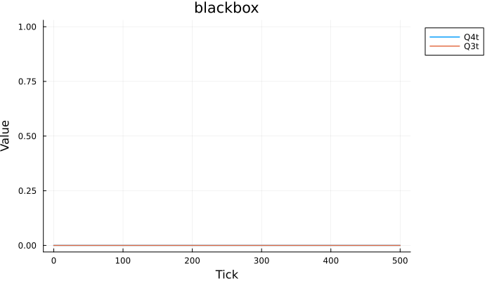
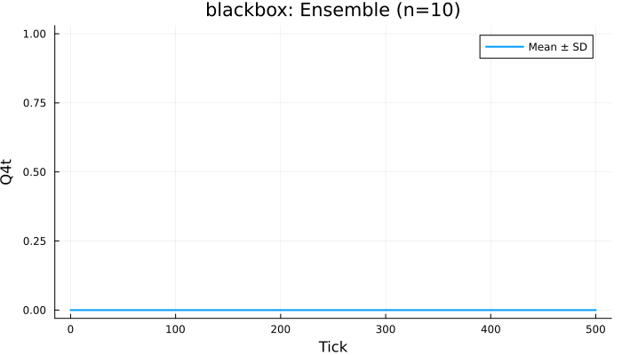

## Overview

This vignette demonstrates the **BlackBox** model implemented in [ArkModelZoo.jl](https://github.com/sdwfrost/ArkModelZoo.jl) using the Ark.jl ECS framework.

## Parameters

| Parameter | Type | Default | Description |
|-----------|------|---------|-------------|
| `grid_size` | `Int` | `20` | 0..19 = 20x20 |
| `max_ticks` | `Int` | `500` | max ticks |

## Source Code

The Julia code to run this model:

```julia
using ArkModelZoo
_, trajectory = run_blackbox()
```

## Time Series

{width=100%}

## Ensemble Runs

Ten replicates with different random seeds, showing mean ± standard deviation.

{width=100%}


## Appendix: Source Code

This model is implemented in the [Ark.jl](https://github.com/sdwfrost/Ark.jl) Entity-Component-System (ECS) framework. The code is split into five files, each with a distinct role:

- **Parameters**: a mutable struct holding all configurable values.
- **Components**: lightweight data types attached to individual entities (agents).
- **Resources**: world-level shared state accessible to all systems.
- **Systems**: functions that operate on entities each tick, defining model behavior.
- **Model**: wiring that assembles the world, registers resources and systems, and provides the run entry point.

### Parameters (`parameters.jl`)

The parameter struct uses `@kwdef` so that every field has a default value and can be overridden by keyword. These defaults match the original NetLogo model's slider settings.

```julia
Base.@kwdef mutable struct BBoxParams
    grid_size::Int = 20    # 0..19 = 20x20
    max_ticks::Int = 500
    seed::Int = 42
end
```

### Components (`components.jl`)

Components are lightweight data types attached to individual entities (agents). Mutable structs hold per-entity state, while empty tag structs act as markers for the ECS query system to efficiently filter entities.

```julia
struct BBoxDummy end
```

### Resources (`resources.jl`)

Resources are world-level singletons shared across all systems, used for global state and aggregate statistics.

```julia
mutable struct BBoxGrid
    width::Int
    height::Int
    pcolor::Matrix{Float64}       # patch colors (10 possible values)
    color_list::Vector{Float64}
    quad4_matrix::Matrix{Float64}
    quad3_matrix::Matrix{Float64}
    quad2_matrix::Matrix{Float64}
    nquad2_matrix::Matrix{Float64}
    q1self::Vector{Float64}
    q1neighbor::Float64
end

function BBoxGrid(w::Int, h::Int)
    color_list = [0.0, 4.0, 105.0, 125.0, 85.0, 55.0, 15.0, 25.0, 137.0, 139.9]

    quad4 = [
        1.0 0 0 0 0 0 0 0 0 0;
        .4 0 .1 .05 .1 .05 .1 .05 .1 .05;
        .55 0 0 0 .15 0 .15 0 .15 0;
        .4 .05 .1 0 .1 .05 .1 .05 .1 .05;
        .55 0 .15 0 0 0 .15 0 .15 0;
        .5 0 0 0 0 .5 0 0 0 0;
        .55 0 .15 0 .15 0 0 0 .15 0;
        .4 .05 .1 .05 .1 .05 .1 0 .1 .05;
        .55 0 .15 0 .15 0 .15 0 0 0;
        .4 .05 .1 .05 .1 .05 .1 .05 .1 0
    ]

    quad3 = [
        1.0 0 0 0 0 0 0 0 0 0;
        .71 0 .07 .05 .04 .03 .05 .02 .01 .02;
        .58 0 0 0 .25 0 .06 0 .11 0;
        .55 .03 .06 0 .03 .01 .07 .01 .05 .19;
        .6 0 .07 0 0 0 .25 0 .08 0;
        .5 0 0 0 0 .5 0 0 0 0;
        .77 0 .09 0 .09 0 0 0 .05 0;
        .52 .05 .09 .01 .07 .03 .01 0 .09 .13;
        .55 0 .16 0 .19 0 .1 0 0 0;
        .56 .12 .02 .02 .07 .01 .09 .03 .08 0
    ]

    quad2 = [
        1.0 0 0 0 0 0 0 0 0 0;
        .4 0 .1 .05 .1 .05 .1 .05 .1 .05;
        .55 0 0 0 .15 0 .15 0 .15 0;
        .4 .05 .1 0 .1 .05 .1 .05 .1 .05;
        .55 0 .15 0 0 0 .15 0 .15 0;
        .5 0 0 0 0 .5 0 0 0 0;
        .55 0 .15 0 .15 0 0 0 .15 0;
        .4 .05 .1 .05 .1 .05 .1 0 .1 .05;
        .55 0 .15 0 .15 0 .15 0 0 0;
        .4 .05 .1 .05 .1 .05 .1 .05 .1 0
    ]

    nquad2 = [
        1.0 0 0 0 0 0 0 0 0 0;
        0 0 .17 .08 .17 .08 .17 .08 .17 .08;
        0 0 0 0 .33 0 .33 0 .33 0;
        0 .08 .17 0 .17 .08 .17 .08 .17 .08;
        0 0 .33 0 0 0 .33 0 .33 0;
        0 0 0 0 0 1.0 0 0 0 0;
        0 0 .33 0 .33 0 0 0 .33 0;
        0 .08 .17 .08 .17 .08 .17 0 .17 .08;
        0 0 .33 0 .33 0 .33 0 0 0;
        0 .08 .17 .08 .17 .08 .17 .08 .17 0
    ]

    q1self = [.99, .99, .813, .705, .652, .610, .545, .537, .507, .5]

    BBoxGrid(w, h, zeros(Float64, w, h), color_list,
             quad4, quad3, quad2, nquad2, q1self, 0.499)
end

mutable struct BBoxStats
    q4t::Float64
    q3t::Float64
end
BBoxStats() = BBoxStats(0.0, 0.0)
```

### Systems (`systems.jl`)

Systems contain the model logic and execute in a defined order each tick. Each system struct implements either `initialize!` (run once at setup) or `update!` (run every tick).

```julia
# BlackBox — matrix-based quadrant simulation with weighted selection

struct InitBBoxSystem <: System end

@inline function _bbox_color_idx(grid::BBoxGrid, color::Float64)
    for i in 1:length(grid.color_list)
        if grid.color_list[i] == color
            return i
        end
    end
    return 1
end

function initialize!(::InitBBoxSystem, world::World)
    params = get_resource(world, BBoxParams)
    rng    = get_resource(world, RNGResource).rng
    grid   = get_resource(world, BBoxGrid)
    stats  = get_resource(world, BBoxStats)
    w, h = grid.width, grid.height

    # Random initial colors (NetLogo: 0-indexed x,y mapped to 1-indexed)
    for x in 1:w, y in 1:h
        grid.pcolor[x, y] = grid.color_list[rand(rng, 1:10)]
    end

    # Special initialization for Q2 upper-right quadrant stripe (x=13..18, y=11..20 in 1-indexed)
    # NetLogo: x in 12..17, y in 10..19 (0-indexed) → 1-indexed: x in 13..18, y in 11..20
    for i in 13:18
        for j in 11:20
            if i <= w && j <= h
                if rand(rng, 0:1) == 1
                    grid.pcolor[i, j] = 139.9
                else
                    grid.pcolor[i, j] = 0.0
                end
            end
        end
    end

    stats.q4t = 0.0
    stats.q3t = 0.0
    return nothing
end

function _bbox_weighted_select(rng, row_probs::AbstractVector{Float64}, color_list::Vector{Float64})
    indices = collect(1:length(color_list))
    weights = [row_probs[i] for i in 1:length(color_list)]
    idx = weighted_one_of(rng, indices, weights)
    return color_list[idx]
end

function _bbox_update_matrix!(matrix::Matrix{Float64}, color_list::Vector{Float64},
                               pcolor::Matrix{Float64}, x_range, y_range)
    nc = length(color_list)
    for cidx in 1:nc
        c = color_list[cidx]
        found = false
        for x in x_range, y in y_range
            if pcolor[x, y] == c
                found = true
                break
            end
        end
        if !found
            # Zero column
            for r in 1:nc
                matrix[r, cidx] = 0.0
            end
            # Renormalize rows
            for r in 1:nc
                rowsum = sum(matrix[r, :])
                if rowsum > 0.0
                    matrix[r, :] ./= rowsum
                end
            end
        end
    end
end

# Quad1: self + neighbor weighted max selection (non-wrapping, top-left quadrant)
function _bbox_quad1(grid::BBoxGrid, rng, x::Int, y::Int)
    w, h = grid.width, grid.height
    nc = length(grid.color_list)
    ctp = zeros(Float64, nc)
    temp = _bbox_color_idx(grid, grid.pcolor[x, y])
    ctp[temp] += grid.q1self[temp]

    # Moore neighbors in Q1 (x<=10, y>10 in 1-indexed)
    for dx in -1:1, dy in -1:1
        (dx == 0 && dy == 0) && continue
        nx, ny = x + dx, y + dy
        if 1 <= nx <= 10 && 11 <= ny <= h
            nidx = _bbox_color_idx(grid, grid.pcolor[nx, ny])
            ctp[nidx] += grid.q1neighbor
        end
    end

    # Border bonus: missing neighbors contribute to color 0 (index 1)
    n_actual = 0
    for dx in -1:1, dy in -1:1
        (dx == 0 && dy == 0) && continue
        nx, ny = x + dx, y + dy
        if 1 <= nx <= 10 && 11 <= ny <= h
            n_actual += 1
        end
    end
    missing = 8 - n_actual
    ctp[1] += missing * grid.q1neighbor

    # Return color with max weight
    _, max_idx = findmax(ctp)
    return grid.color_list[max_idx]
end

# Quad2: complex rules based on x-position
function _bbox_quad2(grid::BBoxGrid, rng, x::Int, y::Int)
    w, h = grid.width, grid.height
    cidx = _bbox_color_idx(grid, grid.pcolor[x, y])

    # NetLogo: pxcor=18 → 1-indexed x=19
    if x == 19
        grid.pcolor[x, y] == 0.0 && return 0.0
        # Check if left two neighbors are 139.9
        if x - 1 >= 1 && x - 2 >= 1
            if grid.pcolor[x-1, y] == 139.9 && grid.pcolor[x-2, y] == 139.9
                rev_idx = 11 - cidx
                rev_idx < 1 && (rev_idx = 1)
                rev_idx > 10 && (rev_idx = 10)
                return grid.color_list[rev_idx]
            else
                if rand(rng, 0:9) == 0
                    return 0.0
                else
                    rev_idx = 11 - cidx
                    rev_idx < 1 && (rev_idx = 1)
                    rev_idx > 10 && (rev_idx = 10)
                    return grid.color_list[rev_idx]
                end
            end
        end
    end

    # NetLogo: pxcor=10 or 11 → 1-indexed x=11 or 12
    if x == 11 || x == 12
        row_probs = grid.quad2_matrix[cidx, :]
        return _bbox_weighted_select(rng, row_probs, grid.color_list)
    end

    # NetLogo: pxcor=19 → 1-indexed x=20
    if x == 20
        if x - 1 >= 1 && x - 2 >= 1
            if grid.pcolor[x-1, y] == 139.9 && grid.pcolor[x-2, y] == 139.9
                row_probs = grid.nquad2_matrix[cidx, :]
                return _bbox_weighted_select(rng, row_probs, grid.color_list)
            else
                row_probs = grid.quad2_matrix[cidx, :]
                return _bbox_weighted_select(rng, row_probs, grid.color_list)
            end
        end
    end

    # NetLogo: pxcor > 11 and pxcor < 18 → 1-indexed x in 13..18
    if 13 <= x <= 18
        return 139.9
    end

    return grid.pcolor[x, y]
end

struct BBoxGoSystem <: System end

function update!(::BBoxGoSystem, world::World)
    params = get_resource(world, BBoxParams)
    rng    = get_resource(world, RNGResource).rng
    grid   = get_resource(world, BBoxGrid)
    stats  = get_resource(world, BBoxStats)
    tick   = get_resource(world, Tick)
    w, h = grid.width, grid.height

    # Q4: bottom-right (x>10, y<=10 in 1-indexed → x=11..20, y=1..10)
    q4_cells = [(x, y) for x in 11:w for y in 1:10]
    if !isempty(q4_cells)
        cx, cy = q4_cells[rand(rng, 1:length(q4_cells))]
        cidx = _bbox_color_idx(grid, grid.pcolor[cx, cy])
        row_probs = grid.quad4_matrix[cidx, :]
        grid.pcolor[cx, cy] = _bbox_weighted_select(rng, row_probs, grid.color_list)
    end
    _bbox_update_matrix!(grid.quad4_matrix, grid.color_list, grid.pcolor, 11:w, 1:10)

    # Q3: bottom-left (x<=10, y<=10 → x=1..10, y=1..10)
    q3_cells = [(x, y) for x in 1:10 for y in 1:10]
    if !isempty(q3_cells)
        cx, cy = q3_cells[rand(rng, 1:length(q3_cells))]
        cidx = _bbox_color_idx(grid, grid.pcolor[cx, cy])
        row_probs = grid.quad3_matrix[cidx, :]
        grid.pcolor[cx, cy] = _bbox_weighted_select(rng, row_probs, grid.color_list)
    end
    _bbox_update_matrix!(grid.quad3_matrix, grid.color_list, grid.pcolor, 1:10, 1:10)

    # Q1: top-left (x<=10, y>10 → x=1..10, y=11..20)
    q1_cells = [(x, y) for x in 1:10 for y in 11:h]
    if !isempty(q1_cells)
        cx, cy = q1_cells[rand(rng, 1:length(q1_cells))]
        grid.pcolor[cx, cy] = _bbox_quad1(grid, rng, cx, cy)
    end

    # Q2: top-right (x>10, y>10 → x=11..20, y=11..20)
    q2_cells = [(x, y) for x in 11:w for y in 11:h]
    if !isempty(q2_cells)
        cx, cy = q2_cells[rand(rng, 1:length(q2_cells))]
        grid.pcolor[cx, cy] = _bbox_quad2(grid, rng, cx, cy)
    end

    # Check Q4 extinction
    q4_sum = 0.0
    for x in 11:w, y in 1:10
        q4_sum += grid.pcolor[x, y]
    end
    if q4_sum == 0.0
        stats.q4t = Float64(tick.tick)
    end

    # Check Q3 extinction
    q3_sum = 0.0
    for x in 1:10, y in 1:10
        q3_sum += grid.pcolor[x, y]
    end
    if q3_sum == 0.0
        stats.q3t = Float64(tick.tick)
    end

    return nothing
end

struct BBoxTerminationSystem <: System end

function update!(::BBoxTerminationSystem, world::World)
    params = get_resource(world, BBoxParams)
    tick   = get_resource(world, Tick)
    if tick.tick + 1 >= params.max_ticks
        get_resource(world, Terminate).stop = true
    end
    return nothing
end
```

### Model (`model.jl`)

The model file assembles all pieces: it creates the ECS `World` with the required component types, registers resources, builds the `Scheduler` with systems in execution order, and exposes the public `run` entry point. The observer pattern records the trajectory each tick.

```julia
function blackbox_world(; initial_capacity::Int = 128)
    return World(BBoxDummy; initial_capacity = initial_capacity, allow_mutable = true)
end

function blackbox_systems()
    return (InitBBoxSystem(), BBoxGoSystem(), BBoxTerminationSystem())
end

function blackbox_model(params::BBoxParams = BBoxParams())
    world = blackbox_world()
    _add_standard_resources!(world, params)
    add_resource!(world, BBoxGrid(params.grid_size, params.grid_size))
    add_resource!(world, BBoxStats())
    scheduler = Scheduler(world, blackbox_systems())
    initialize!(scheduler)
    return scheduler
end

struct BBoxObserver end

function blackbox_headers(::BBoxObserver)
    return ["Q4t", "Q3t"]
end

function blackbox_values(::BBoxObserver, world::World)
    stats = get_resource(world, BBoxStats)
    return Float64[stats.q4t, stats.q3t]
end

function run_blackbox(; params::BBoxParams = BBoxParams(), observe::Bool = true)
    return _run_model(blackbox_model, BBoxObserver(), blackbox_values; params, observe)
end
```
