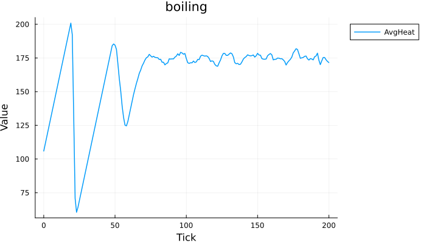
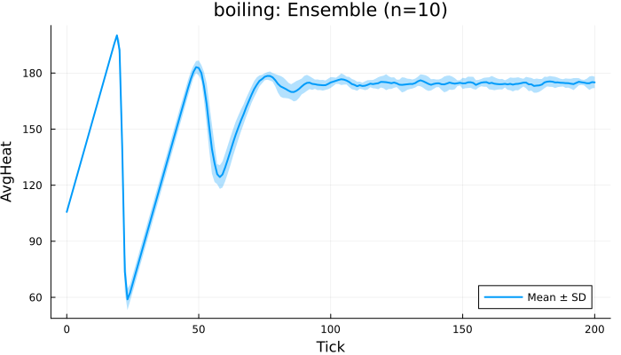

# Boiling


- [Overview](#overview)
  - [WHAT IS IT?](#what-is-it)
  - [HOW IT WORKS](#how-it-works)
  - [THINGS TO NOTICE](#things-to-notice)
  - [EXTENDING THE MODEL](#extending-the-model)
  - [CREDITS AND REFERENCES](#credits-and-references)
  - [HOW TO CITE](#how-to-cite)
  - [COPYRIGHT AND LICENSE](#copyright-and-license)
- [Parameters](#parameters)
- [Source Code](#source-code)
- [Time Series](#time-series)
- [Ensemble Runs](#ensemble-runs)
- [Appendix: Source Code](#appendix-source-code)
  - [Parameters (`parameters.jl`)](#parameters-parametersjl)
  - [Components (`components.jl`)](#components-componentsjl)
  - [Resources (`resources.jl`)](#resources-resourcesjl)
  - [Systems (`systems.jl`)](#systems-systemsjl)
  - [Model (`model.jl`)](#model-modeljl)

## Overview

### WHAT IS IT?

This project depicts a simple cellular automata model that resembles a
pot of boiling water. Heat is applied evenly to the entire pot, but when
the temperature of a patch reaches the boiling temperature, the bubble
pops and that patch’s temperature drops to zero.

This process is analogous to the way in which a hot enough region of
water gives up some heat by forming a bubble of steam. The water right
around the steam bubble cools off for a moment.

### HOW IT WORKS

If all of a cell’s neighbors are at the maximum value of 212, then that
cell’s new value will be 213 which gets wrapped down to zero. At the
next tick, the presence of this zero-valued cell will lower the values
of the cell’s nearest neighbors.

### THINGS TO NOTICE

Watch how the added heat diffuses through the pot. When bubbles pop, the
resulting drop in heat affects nearby patches too by taking away their
heat.

What happens to the average heat in the pot?

### EXTENDING THE MODEL

Try diffusing the heat more slowly through the system.

Change the diffuse parameter from 1 to a smaller fraction.

Add “ice cubes”.

Add a heat sink, such as edges that constantly cool the liquid.

### CREDITS AND REFERENCES

This model is described on page 79 in “Artificial Life Lab”, by Rudy
Rucker, published in 1993 by Waite Group Press.

### HOW TO CITE

If you mention this model or the NetLogo software in a publication, we
ask that you include the citations below.

For the model itself:

- Wilensky, U. (1998). NetLogo Boiling model.
  http://ccl.northwestern.edu/netlogo/models/Boiling. Center for
  Connected Learning and Computer-Based Modeling, Northwestern
  University, Evanston, IL.

Please cite the NetLogo software as:

- Wilensky, U. (1999). NetLogo. http://ccl.northwestern.edu/netlogo/.
  Center for Connected Learning and Computer-Based Modeling,
  Northwestern University, Evanston, IL.

### COPYRIGHT AND LICENSE

Copyright 1998 Uri Wilensky.


This model is licensed under the Creative Commons
Attribution-NonCommercial-ShareAlike 3.0 License. To view a copy of this
license, visit https://creativecommons.org/licenses/by-nc-sa/3.0/ or
send a letter to Creative Commons, 559 Nathan Abbott Way, Stanford,
California 94305, USA.

NetLogo itself is free software for non-commercial use under the terms
of the GNU General Public License ([see full license information
here](https://ccl.northwestern.edu/netlogo/docs/copyright.html)).

To inquire about commercial licenses for either NetLogo or specific
models from the models library, please contact
netlogo-commercial-admin@ccl.northwestern.edu.

This model was created as part of the project: CONNECTED MATHEMATICS:
MAKING SENSE OF COMPLEX PHENOMENA THROUGH BUILDING OBJECT-BASED PARALLEL
MODELS (OBPML). The project gratefully acknowledges the support of the
National Science Foundation (Applications of Advanced Technologies
Program) – grant numbers RED \#9552950 and REC \#9632612.

This model was converted to NetLogo as part of the projects:
PARTICIPATORY SIMULATIONS: NETWORK-BASED DESIGN FOR SYSTEMS LEARNING IN
CLASSROOMS and/or INTEGRATED SIMULATION AND MODELING ENVIRONMENT. The
project gratefully acknowledges the support of the National Science
Foundation (REPP & ROLE programs) – grant numbers REC \#9814682 and
REC-0126227. Converted from StarLogoT to NetLogo, 2001.

<!-- 1998 2001 -->

## Parameters

| Parameter     | Type  | Default | Description |
|---------------|-------|---------|-------------|
| `grid_width`  | `Int` | `81`    | grid width  |
| `grid_height` | `Int` | `81`    | grid height |
| `max_ticks`   | `Int` | `200`   | max ticks   |

## Source Code

The Julia code to run this model:

``` julia
using ArkModelZoo
_, trajectory = run_boiling()
```

## Time Series



## Ensemble Runs

Ten replicates with different random seeds, showing mean ± standard
deviation.



## Appendix: Source Code

This model is implemented in the
[Ark.jl](https://github.com/sdwfrost/Ark.jl) Entity-Component-System
(ECS) framework. The code is split into five files, each with a distinct
role:

- **Parameters**: a mutable struct holding all configurable values.
- **Components**: lightweight data types attached to individual entities
  (agents).
- **Resources**: world-level shared state accessible to all systems.
- **Systems**: functions that operate on entities each tick, defining
  model behavior.
- **Model**: wiring that assembles the world, registers resources and
  systems, and provides the run entry point.

### Parameters (`parameters.jl`)

The parameter struct uses `@kwdef` so that every field has a default
value and can be overridden by keyword. These defaults match the
original NetLogo model’s slider settings.

``` julia
Base.@kwdef mutable struct BoilingParams
    grid_width::Int = 81
    grid_height::Int = 81
    max_ticks::Int = 200
    seed::Int = 42
end
```

### Components (`components.jl`)

Components are lightweight data types attached to individual entities
(agents). Mutable structs hold per-entity state, while empty tag structs
act as markers for the ECS query system to efficiently filter entities.

``` julia
# Boiling model has no entity components — purely patch-based
struct BoilingDummy end
```

### Resources (`resources.jl`)

Resources are world-level singletons shared across all systems, used for
global state and aggregate statistics.

``` julia
mutable struct BoilingGrid
    width::Int
    height::Int
    heat::Matrix{Float64}
end
BoilingGrid(w, h) = BoilingGrid(w, h, zeros(Float64, w, h))

mutable struct BoilingStats
    avg_heat::Float64
end
BoilingStats() = BoilingStats(0.0)
```

### Systems (`systems.jl`)

Systems contain the model logic and execute in a defined order each
tick. Each system struct implements either `initialize!` (run once at
setup) or `update!` (run every tick).

``` julia
# --- Initialization ---

struct InitBoilingSystem <: System end

function initialize!(::InitBoilingSystem, world::World)
    params = get_resource(world, BoilingParams)
    rng = get_resource(world, RNGResource).rng
    grid = get_resource(world, BoilingGrid)
    stats = get_resource(world, BoilingStats)

    # NetLogo: set heat random 212 → integer in [0, 211]
    for x in 1:grid.width, y in 1:grid.height
        grid.heat[x, y] = Float64(rand(rng, 0:211))
    end

    stats.avg_heat = Statistics.mean(grid.heat)
    return nothing
end

# --- Diffuse + Phase Transition ---
# NetLogo: diffuse heat 1 → new[p] = (1/8) * sum of 8 Moore neighbors (toroidal)
# Then: set heat (heat + 5) mod 212

struct BoilingUpdateSystem <: System end

function update!(::BoilingUpdateSystem, world::World)
    grid = get_resource(world, BoilingGrid)
    w, h = grid.width, grid.height

    # Full diffusion: diffuse heat 1
    diffuse!(grid.heat, 1.0, w, h)

    # Phase transition: (heat + 5) mod 212
    for x in 1:w, y in 1:h
        grid.heat[x, y] = mod(grid.heat[x, y] + 5.0, 212.0)
    end

    return nothing
end

# --- Stats ---

struct BoilingStatsSystem <: System end

function update!(::BoilingStatsSystem, world::World)
    grid = get_resource(world, BoilingGrid)
    stats = get_resource(world, BoilingStats)
    stats.avg_heat = Statistics.mean(grid.heat)
    return nothing
end

# --- Termination ---

struct BoilingTerminationSystem <: System end

function update!(::BoilingTerminationSystem, world::World)
    params = get_resource(world, BoilingParams)
    tick = get_resource(world, Tick)

    if tick.tick + 1 >= params.max_ticks
        get_resource(world, Terminate).stop = true
    end
    return nothing
end
```

### Model (`model.jl`)

The model file assembles all pieces: it creates the ECS `World` with the
required component types, registers resources, builds the `Scheduler`
with systems in execution order, and exposes the public `run` entry
point. The observer pattern records the trajectory each tick.

``` julia
function boiling_world(; initial_capacity::Int = 128)
    return World(
        BoilingDummy;
        initial_capacity = initial_capacity,
        allow_mutable = true,
    )
end

function boiling_systems()
    return (
        InitBoilingSystem(),
        BoilingUpdateSystem(),
        BoilingStatsSystem(),
        BoilingTerminationSystem(),
    )
end

function boiling_model(params::BoilingParams = BoilingParams())
    world = boiling_world()
    _add_standard_resources!(world, params)
    add_resource!(world, BoilingGrid(params.grid_width, params.grid_height))
    add_resource!(world, BoilingStats())
    scheduler = Scheduler(world, boiling_systems())
    initialize!(scheduler)
    return scheduler
end

struct BoilingObserver end

function boiling_headers(::BoilingObserver)
    return ["AvgHeat"]
end

function boiling_values(::BoilingObserver, world::World)
    stats = get_resource(world, BoilingStats)
    return Float64[stats.avg_heat]
end

function run_boiling(; params::BoilingParams = BoilingParams(), observe::Bool = true)
    return _run_model(boiling_model, BoilingObserver(), boiling_values; params, observe)
end
```
