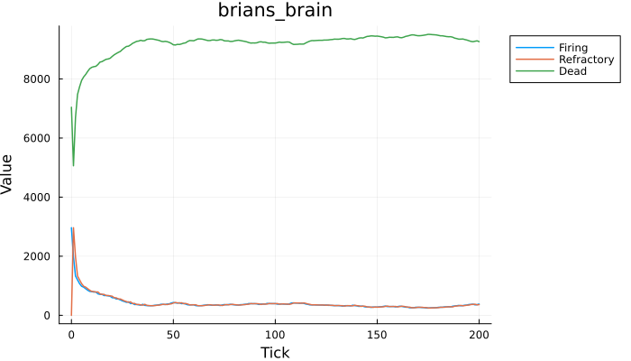
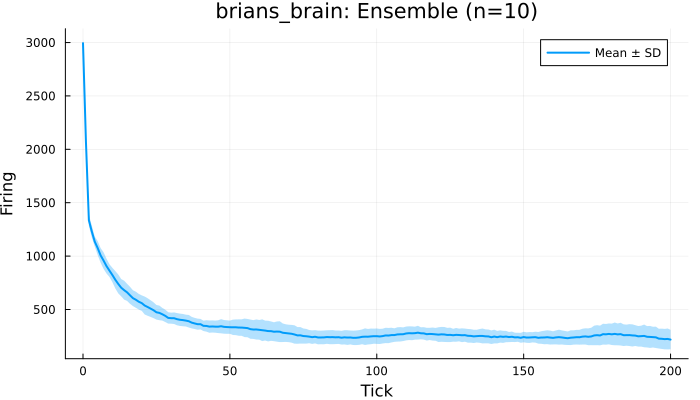
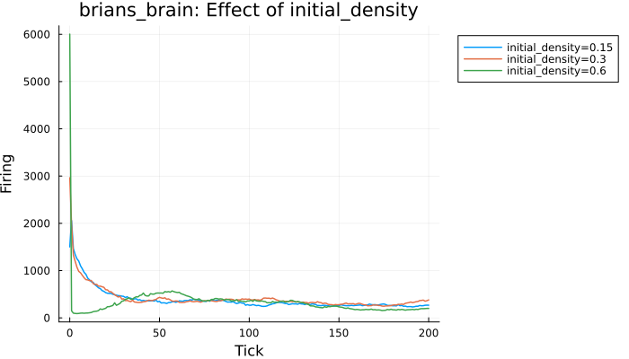

## Overview

### WHAT IS IT?

This program is an example of a two-dimensional cellular automaton.  If you are not already familiar with 2D CA, see the model "Life" for a basic discussion.

Typical CAs use two cell states (live and dead), but Brian's Brian uses three: firing (white), refractory (red), and dead (black).

This CA is especially interesting to watch because it has many configurations that move steadily across the grid (as opposed to Life, which has only relatively few such configurations).

### HOW IT WORKS

Firing (white) cells always become refractory (red) at the next time step.

Refractory (red) cells always die (turn black) at the next time step.

A new firing (white) cell is born in any black cell that has exactly two firing (white) neighbors (of its eight surrounding cells).

### THINGS TO NOTICE

Lots of patterns stay stable and move steadily across the grid.  Such patterns are often referred to as "gliders".  How many different types of gliders do you see?  Why does this happen?  How do the rules of the CA result in this behavior?

### THINGS TO TRY

Are there any stable shapes that don't move?

Are there any "glider guns" (objects that emit a steady stream of gliders)?

On a small enough grid, usually the CA reaches a steady state where there may be movement but nothing new happens.  In Brian's Brain, a square grid usually reaches a steady state more quickly than a rectangular grid (try it!).  Why?

### EXTENDING THE MODEL

Many other interesting 3-state 2D automata exist.  Experiment with variations on the rules in this model.

### RELATED MODELS

See all of the other models in the Cellular Automata subsection of the Computer Science section of the NetLogo Models Library.

### CREDITS AND REFERENCES

Brian's Brain was invented by Brian Silverman.

### HOW TO CITE

If you mention this model or the NetLogo software in a publication, we ask that you include the citations below.

For the model itself:

* Wilensky, U. (2002).  NetLogo Brian's Brain model.  http://ccl.northwestern.edu/netlogo/models/Brian'sBrain.  Center for Connected Learning and Computer-Based Modeling, Northwestern University, Evanston, IL.

Please cite the NetLogo software as:

* Wilensky, U. (1999). NetLogo. http://ccl.northwestern.edu/netlogo/. Center for Connected Learning and Computer-Based Modeling, Northwestern University, Evanston, IL.

### COPYRIGHT AND LICENSE

Copyright 2002 Uri Wilensky.


This model is licensed under the Creative Commons Attribution-NonCommercial-ShareAlike 3.0 License.  To view a copy of this license, visit https://creativecommons.org/licenses/by-nc-sa/3.0/ or send a letter to Creative Commons, 559 Nathan Abbott Way, Stanford, California 94305, USA.

NetLogo itself is free software for non-commercial use under the terms of the GNU General Public License ([see full license information here](https://ccl.northwestern.edu/netlogo/docs/copyright.html)).

To inquire about commercial licenses for either NetLogo or specific models from the models library, please contact netlogo-commercial-admin@ccl.northwestern.edu.

This model was created as part of the projects: PARTICIPATORY SIMULATIONS: NETWORK-BASED DESIGN FOR SYSTEMS LEARNING IN CLASSROOMS and/or INTEGRATED SIMULATION AND MODELING ENVIRONMENT. The project gratefully acknowledges the support of the National Science Foundation (REPP & ROLE programs) -- grant numbers REC #9814682 and REC-0126227.

<!-- 2002 -->

## Parameters

| Parameter | Type | Default | Description |
|-----------|------|---------|-------------|
| `grid_width` | `Int` | `87` | -43..43 = 87 patches |
| `grid_height` | `Int` | `115` | -57..57 = 115 patches |
| `initial_density` | `Float64` | `0.3` | initial density |
| `max_ticks` | `Int` | `200` | max ticks |

## Source Code

The Julia code to run this model:

```julia
using ArkModelZoo
_, trajectory = run_brians_brain()
```

## Time Series

{width=100%}

## Ensemble Runs

Ten replicates with different random seeds, showing mean ± standard deviation.

{width=100%}

## Parameter Sensitivity

Varying `initial_density`.

{width=100%}


## Appendix: Source Code

This model is implemented in the [Ark.jl](https://github.com/sdwfrost/Ark.jl) Entity-Component-System (ECS) framework. The code is split into five files, each with a distinct role:

- **Parameters**: a mutable struct holding all configurable values.
- **Components**: lightweight data types attached to individual entities (agents).
- **Resources**: world-level shared state accessible to all systems.
- **Systems**: functions that operate on entities each tick, defining model behavior.
- **Model**: wiring that assembles the world, registers resources and systems, and provides the run entry point.

### Parameters (`parameters.jl`)

The parameter struct uses `@kwdef` so that every field has a default value and can be overridden by keyword. These defaults match the original NetLogo model's slider settings.

```julia
Base.@kwdef mutable struct BBParams
    grid_width::Int = 87        # -43..43 = 87 patches
    grid_height::Int = 115      # -57..57 = 115 patches
    initial_density::Float64 = 0.3
    max_ticks::Int = 200
    seed::Int = 42
end
```

### Components (`components.jl`)

Components are lightweight data types attached to individual entities (agents). Mutable structs hold per-entity state, while empty tag structs act as markers for the ECS query system to efficiently filter entities.

```julia
# Brian's Brain is purely patch-based; no ECS agent components needed.
```

### Resources (`resources.jl`)

Resources are world-level singletons shared across all systems, used for global state and aggregate statistics.

```julia
# Cell states: 0 = dead (black), 1 = firing (white), 2 = refractory (red)
mutable struct BBGrid
    width::Int
    height::Int
    state::Matrix{Int}
    firing_neighbors::Matrix{Int}
end

function BBGrid(w::Int, h::Int)
    BBGrid(w, h, zeros(Int, w, h), zeros(Int, w, h))
end

mutable struct BBStats
    firing_count::Int
    refractory_count::Int
    dead_count::Int
end
BBStats() = BBStats(0, 0, 0)
```

### Systems (`systems.jl`)

Systems contain the model logic and execute in a defined order each tick. Each system struct implements either `initialize!` (run once at setup) or `update!` (run every tick).

```julia
# --- Initialization ---

struct InitBBSystem <: System end

function initialize!(::InitBBSystem, world::World)
    params = get_resource(world, BBParams)
    rng = get_resource(world, RNGResource).rng
    grid = get_resource(world, BBGrid)
    w, h = grid.width, grid.height

    for x in 1:w, y in 1:h
        if rand(rng) < params.initial_density
            grid.state[x, y] = 1  # firing
        else
            grid.state[x, y] = 0  # dead
        end
    end

    _bb_update_stats!(world)
    return nothing
end

# --- Go ---

struct BBGoSystem <: System end

function update!(::BBGoSystem, world::World)
    grid = get_resource(world, BBGrid)
    w, h = grid.width, grid.height

    # Phase 1: count firing neighbors
    for x in 1:w, y in 1:h
        grid.firing_neighbors[x, y] = moore_neighbor_count(==(1), grid.state, x, y, w, h)
    end

    # Phase 2: update states
    for x in 1:w, y in 1:h
        s = grid.state[x, y]
        if s == 1
            # firing -> refractory
            grid.state[x, y] = 2
        elseif s == 2
            # refractory -> dead
            grid.state[x, y] = 0
        else
            # dead -> firing if exactly 2 firing neighbors
            if grid.firing_neighbors[x, y] == 2
                grid.state[x, y] = 1
            end
        end
    end

    _bb_update_stats!(world)
    return nothing
end

function _bb_update_stats!(world::World)
    grid = get_resource(world, BBGrid)
    stats = get_resource(world, BBStats)
    firing = 0; refractory = 0; dead = 0
    for x in 1:grid.width, y in 1:grid.height
        s = grid.state[x, y]
        if s == 1
            firing += 1
        elseif s == 2
            refractory += 1
        else
            dead += 1
        end
    end
    stats.firing_count = firing
    stats.refractory_count = refractory
    stats.dead_count = dead
end

# --- Termination ---

struct BBTerminationSystem <: System end

function update!(::BBTerminationSystem, world::World)
    params = get_resource(world, BBParams)
    tick = get_resource(world, Tick)
    if tick.tick + 1 >= params.max_ticks
        get_resource(world, Terminate).stop = true
    end
    return nothing
end
```

### Model (`model.jl`)

The model file assembles all pieces: it creates the ECS `World` with the required component types, registers resources, builds the `Scheduler` with systems in execution order, and exposes the public `run` entry point. The observer pattern records the trajectory each tick.

```julia
function bb_world(; initial_capacity::Int = 64)
    return World(; initial_capacity = initial_capacity, allow_mutable = true)
end

function bb_systems()
    return (
        InitBBSystem(),
        BBGoSystem(),
        BBTerminationSystem(),
    )
end

function bb_model(params::BBParams = BBParams())
    world = bb_world()
    _add_standard_resources!(world, params)
    add_resource!(world, BBGrid(params.grid_width, params.grid_height))
    add_resource!(world, BBStats())
    scheduler = Scheduler(world, bb_systems())
    initialize!(scheduler)
    return scheduler
end

struct BBObserver end

function bb_headers(::BBObserver)
    return ["Firing", "Refractory", "Dead"]
end

function bb_values(::BBObserver, world::World)
    stats = get_resource(world, BBStats)
    return Float64[Float64(stats.firing_count), Float64(stats.refractory_count),
                    Float64(stats.dead_count)]
end

function run_brians_brain(; params::BBParams = BBParams(), observe::Bool = true)
    return _run_model(bb_model, BBObserver(), bb_values; params, observe)
end
```
