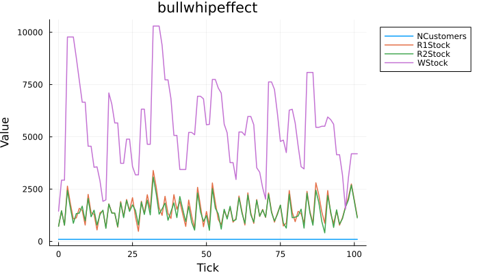
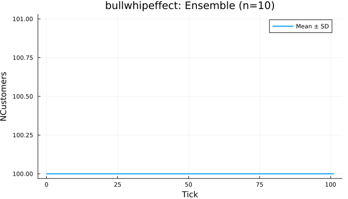
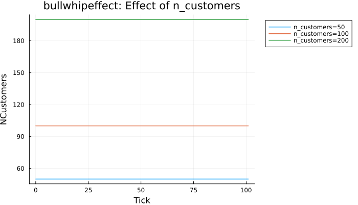

## Overview

This vignette demonstrates the **Bullwhip Effect** model implemented in [ArkModelZoo.jl](https://github.com/sdwfrost/ArkModelZoo.jl) using the Ark.jl ECS framework.

## Parameters

| Parameter | Type | Default | Description |
|-----------|------|---------|-------------|
| `n_customers` | `Int` | `100` | n customers |
| `max_purchase` | `Float64` | `50.0` | max purchase |
| `n_retailers` | `Int` | `1` | n retailers |
| `n_wholesalers` | `Int` | `1` | n wholesalers |
| `n_distributors` | `Int` | `1` | n distributors |
| `retailers_increment` | `Int` | `3` | retailers increment |
| `wholesalers_increment` | `Int` | `3` | wholesalers increment |
| `alien_amount` | `Int` | `400` | alien amount |
| `return_in_weeks` | `Int` | `10` | return in weeks |
| `num_ticks` | `Int` | `100` | num ticks |

## Source Code

The Julia code to run this model:

```julia
using ArkModelZoo
_, trajectory = run_bullwhip()
```

## Time Series

{width=100%}

## Ensemble Runs

Ten replicates with different random seeds, showing mean ± standard deviation.

{width=100%}

## Parameter Sensitivity

Varying `n_customers`.

{width=100%}


## Appendix: Source Code

This model is implemented in the [Ark.jl](https://github.com/sdwfrost/Ark.jl) Entity-Component-System (ECS) framework. The code is split into five files, each with a distinct role:

- **Parameters**: a mutable struct holding all configurable values.
- **Components**: lightweight data types attached to individual entities (agents).
- **Resources**: world-level shared state accessible to all systems.
- **Systems**: functions that operate on entities each tick, defining model behavior.
- **Model**: wiring that assembles the world, registers resources and systems, and provides the run entry point.

### Parameters (`parameters.jl`)

The parameter struct uses `@kwdef` so that every field has a default value and can be overridden by keyword. These defaults match the original NetLogo model's slider settings.

```julia
Base.@kwdef mutable struct BullwhipParams
    seed::Int = 47822
    n_customers::Int = 100
    max_purchase::Float64 = 50.0
    n_retailers::Int = 1
    n_wholesalers::Int = 1
    n_distributors::Int = 1
    retailers_increment::Int = 3
    wholesalers_increment::Int = 3
    alien_amount::Int = 400
    return_in_weeks::Int = 10
    num_ticks::Int = 100
end
```

### Components (`components.jl`)

Components are lightweight data types attached to individual entities (agents). Mutable structs hold per-entity state, while empty tag structs act as markers for the ECS query system to efficiently filter entities.

```julia
struct BullwhipDummy end
```

### Resources (`resources.jl`)

Resources are world-level singletons shared across all systems, used for global state and aggregate statistics.

```julia
mutable struct BullwhipState
    # Customer arrays
    frequency::Vector{Int}
    order_to_retailer::Vector{Float64}
    lucky_number::Vector{Int}
    n_customers::Int

    # Retailer 1 (continuous growth forecast)
    r1_stock::Float64
    r1_buffer::Float64
    r1_backorder::Float64
    r1_demand_log::Vector{Float64}
    r1_prediction::Float64
    r1_prediction_log::Vector{Float64}
    r1_order_to_wholesaler::Float64

    # Retailer 2 (linear growth forecast)
    r2_stock::Float64
    r2_buffer::Float64
    r2_backorder::Float64
    r2_demand_log::Vector{Float64}
    r2_prediction::Float64
    r2_prediction_log::Vector{Float64}
    r2_order_to_wholesaler::Float64

    # Wholesaler
    w_stock::Float64
    w_buffer::Float64
    w_backorder::Float64
    w_demand_log::Vector{Float64}
    w_prediction::Float64
    w_prediction_log::Vector{Float64}
    w_order_to_distributor::Float64

    # Distributor
    d_demand_log::Vector{Float64}
    d_prediction::Float64
    d_prediction_log::Vector{Float64}

    # Return flag for alien strike recovery
    return_flag::Int
end

function BullwhipState()
    return BullwhipState(
        Int[], Float64[], Int[], 0,
        0.0, 0.0, 0.0, Float64[], 0.0, Float64[], 0.0,
        0.0, 0.0, 0.0, Float64[], 0.0, Float64[], 0.0,
        0.0, 0.0, 0.0, Float64[], 0.0, Float64[], 0.0,
        Float64[], 0.0, Float64[],
        0
    )
end

mutable struct BullwhipStats
    n_customers::Int
    r1_stock::Float64
    r2_stock::Float64
    w_stock::Float64
end

BullwhipStats() = BullwhipStats(0, 0.0, 0.0, 0.0)
```

### Systems (`systems.jl`)

Systems contain the model logic and execute in a defined order each tick. Each system struct implements either `initialize!` (run once at setup) or `update!` (run every tick).

```julia
# --- Helper functions ---

function _bullwhip_frequency_chooser(rng)
    temp = round(Int, randn(rng) * 2 + 2)
    return temp > 0 ? temp : 1
end

function _bullwhip_order_chooser(rng, max_purchase::Float64)
    mean_order = round(max_purchase / 2)
    std_order = (max_purchase - mean_order) / 3
    temp = randn(rng) * std_order + mean_order
    if temp > 0
        return min(temp, max_purchase)
    else
        return rand(rng) * (max_purchase - 0.1) + 0.1
    end
end

function _bullwhip_predict_linear(demand_log::Vector{Float64})
    n = length(demand_log)
    if n == 0
        return 0.0
    elseif n == 1
        return demand_log[1]
    else
        # Simple linear extrapolation from last two values
        return demand_log[end] + (demand_log[end] - demand_log[end-1])
    end
end

function _bullwhip_predict_continuous(demand_log::Vector{Float64})
    n = length(demand_log)
    if n == 0
        return 0.0
    elseif n == 1
        return demand_log[1]
    else
        # Exponential growth extrapolation from last two values
        if demand_log[end-1] > 0 && demand_log[end] > 0
            ratio = demand_log[end] / demand_log[end-1]
            return demand_log[end] * ratio
        else
            return demand_log[end] + (demand_log[end] - demand_log[end-1])
        end
    end
end

# --- Systems ---

struct InitBullwhipSystem <: System end

function initialize!(::InitBullwhipSystem, world::World)
    params = get_resource(world, BullwhipParams)
    rng = get_resource(world, RNGResource).rng
    state = get_resource(world, BullwhipState)

    nc = params.n_customers
    state.n_customers = nc

    # Initialize customer arrays
    state.frequency = [_bullwhip_frequency_chooser(rng) for _ in 1:nc]
    state.order_to_retailer = [_bullwhip_order_chooser(rng, params.max_purchase) for _ in 1:nc]
    state.lucky_number = zeros(Int, nc)

    # Compute initial stocks and buffers
    stocks = nc * (rand(rng) * params.max_purchase * 0.5 + 1)
    buffers = nc * rand(rng) * params.max_purchase * 0.5

    # Retailer 1 (continuous growth)
    state.r1_stock = stocks
    state.r1_buffer = buffers
    state.r1_backorder = 0.0
    state.r1_demand_log = Float64[]
    state.r1_prediction = 0.0
    state.r1_prediction_log = Float64[]
    state.r1_order_to_wholesaler = 0.0

    # Retailer 2 (linear growth)
    state.r2_stock = stocks
    state.r2_buffer = buffers
    state.r2_backorder = 0.0
    state.r2_demand_log = Float64[]
    state.r2_prediction = 0.0
    state.r2_prediction_log = Float64[]
    state.r2_order_to_wholesaler = 0.0

    # Wholesaler
    state.w_stock = stocks * 2
    state.w_buffer = buffers * 2
    state.w_backorder = 0.0
    state.w_demand_log = Float64[]
    state.w_prediction = 0.0
    state.w_prediction_log = Float64[]
    state.w_order_to_distributor = 0.0

    # Distributor
    state.d_demand_log = Float64[]
    state.d_prediction = 0.0
    state.d_prediction_log = Float64[]

    state.return_flag = 0

    # Update stats
    stats = get_resource(world, BullwhipStats)
    stats.n_customers = state.n_customers
    stats.r1_stock = state.r1_stock
    stats.r2_stock = state.r2_stock
    stats.w_stock = state.w_stock
end

struct BullwhipStepSystem <: System end

function update!(::BullwhipStepSystem, world::World)
    params = get_resource(world, BullwhipParams)
    rng = get_resource(world, RNGResource).rng
    state = get_resource(world, BullwhipState)

    nc = state.n_customers

    # --- Return flag logic (respawn customers after alien strike) ---
    if state.return_flag >= 1
        if state.return_flag == 1
            # Respawn missing customers
            while state.n_customers < params.n_customers
                state.n_customers += 1
                push!(state.frequency, _bullwhip_frequency_chooser(rng))
                push!(state.order_to_retailer, _bullwhip_order_chooser(rng, params.max_purchase))
                push!(state.lucky_number, 0)
            end
        end
        state.return_flag -= 1
    end
    if state.n_customers < params.n_customers && state.return_flag == 0
        state.return_flag = params.return_in_weeks
    end

    nc = state.n_customers

    # --- Customers: who's shopping ---
    for i in 1:nc
        state.lucky_number[i] = rand(rng, 0:2)
    end

    # --- Update retailer demand logs ---
    # Demand = sum of orders from customers whose lucky_number == 0
    demand = 0.0
    for i in 1:nc
        if state.lucky_number[i] == 0
            demand += state.order_to_retailer[i]
        end
    end
    push!(state.r1_demand_log, demand)
    push!(state.r2_demand_log, demand)

    # --- Retailer predictions ---
    state.r1_prediction = _bullwhip_predict_continuous(state.r1_demand_log)
    push!(state.r1_prediction_log, state.r1_prediction)

    state.r2_prediction = _bullwhip_predict_linear(state.r2_demand_log)
    push!(state.r2_prediction_log, state.r2_prediction)

    # --- Update retailer 1 inventory ---
    state.r1_order_to_wholesaler = 0.0
    d1 = state.r1_demand_log[end]
    if (d1 + state.r1_backorder) > state.r1_stock
        state.r1_backorder = d1 - state.r1_stock
        state.r1_stock = 0.0
        deficit = state.r1_backorder + max(0.0, state.r1_buffer - state.r1_stock)
        state.r1_order_to_wholesaler = deficit
        state.r1_stock += deficit
    else
        state.r1_stock -= d1
        state.r1_backorder = 0.0
        if (state.r1_buffer - state.r1_stock) > 0
            deficit = state.r1_backorder + (state.r1_buffer - state.r1_stock)
            state.r1_order_to_wholesaler = deficit
            state.r1_stock += deficit
        end
    end
    if (state.r1_stock - state.r1_prediction) < state.r1_buffer
        extra = state.r1_prediction - state.r1_stock
        state.r1_order_to_wholesaler += extra
        state.r1_stock += state.r1_order_to_wholesaler + extra
    end

    # --- Update retailer 2 inventory ---
    state.r2_order_to_wholesaler = 0.0
    d2 = state.r2_demand_log[end]
    if (d2 + state.r2_backorder) > state.r2_stock
        state.r2_backorder = d2 - state.r2_stock
        state.r2_stock = 0.0
        deficit = state.r2_backorder + max(0.0, state.r2_buffer - state.r2_stock)
        state.r2_order_to_wholesaler = deficit
        state.r2_stock += deficit
    else
        state.r2_stock -= d2
        state.r2_backorder = 0.0
        if (state.r2_buffer - state.r2_stock) > 0
            deficit = state.r2_backorder + (state.r2_buffer - state.r2_stock)
            state.r2_order_to_wholesaler = deficit
            state.r2_stock += deficit
        end
    end
    if (state.r2_stock - state.r2_prediction) < state.r2_buffer
        extra = state.r2_prediction - state.r2_stock
        state.r2_order_to_wholesaler += extra
        state.r2_stock += state.r2_order_to_wholesaler + extra
    end

    # --- Update wholesaler demand log ---
    w_demand = state.r1_order_to_wholesaler + state.r2_order_to_wholesaler
    push!(state.w_demand_log, w_demand)

    # --- Wholesaler prediction ---
    state.w_prediction = _bullwhip_predict_linear(state.w_demand_log)
    push!(state.w_prediction_log, state.w_prediction)

    # --- Update wholesaler inventory ---
    state.w_order_to_distributor = 0.0
    wd = state.w_demand_log[end]
    if (wd + state.w_backorder) > state.w_stock
        state.w_backorder = wd - state.w_stock
        state.w_stock = 0.0
        deficit = state.w_backorder + max(0.0, state.w_buffer - state.w_stock)
        state.w_order_to_distributor = deficit
        state.w_stock += deficit
    else
        state.w_stock -= wd
        state.w_backorder = 0.0
        if (state.w_buffer - state.w_stock) > 0
            deficit = state.w_backorder + (state.w_buffer - state.w_stock)
            state.w_order_to_distributor = deficit
            state.w_stock += deficit
        end
    end
    if (state.w_stock - state.w_prediction) < state.w_buffer
        extra = state.w_prediction - state.w_stock
        state.w_order_to_distributor += extra
        state.w_stock += state.w_order_to_distributor + extra
    end

    # --- Update distributor demand log ---
    push!(state.d_demand_log, state.w_order_to_distributor)

    # --- Distributor prediction ---
    state.d_prediction = _bullwhip_predict_linear(state.d_demand_log)
    push!(state.d_prediction_log, state.d_prediction)

    # --- Customers update frequency and orders ---
    for i in 1:nc
        state.frequency[i] = _bullwhip_frequency_chooser(rng)
        state.order_to_retailer[i] = _bullwhip_order_chooser(rng, params.max_purchase)
    end
end

struct BullwhipStatsSystem <: System end

function update!(::BullwhipStatsSystem, world::World)
    state = get_resource(world, BullwhipState)
    stats = get_resource(world, BullwhipStats)
    stats.n_customers = state.n_customers
    stats.r1_stock = state.r1_stock
    stats.r2_stock = state.r2_stock
    stats.w_stock = state.w_stock
end

struct BullwhipTerminationSystem <: System end

function update!(::BullwhipTerminationSystem, world::World)
    params = get_resource(world, BullwhipParams)
    tick = get_resource(world, Tick).tick
    if tick >= params.num_ticks
        get_resource(world, Terminate).stop = true
    end
end
```

### Model (`model.jl`)

The model file assembles all pieces: it creates the ECS `World` with the required component types, registers resources, builds the `Scheduler` with systems in execution order, and exposes the public `run` entry point. The observer pattern records the trajectory each tick.

```julia
function bullwhip_world(; initial_capacity::Int = 128)
    return World(BullwhipDummy; initial_capacity=initial_capacity, allow_mutable=true)
end

function bullwhip_systems()
    return (
        InitBullwhipSystem(),
        BullwhipStepSystem(),
        BullwhipStatsSystem(),
        BullwhipTerminationSystem(),
    )
end

function bullwhip_model(params::BullwhipParams = BullwhipParams())
    world = bullwhip_world()
    _add_standard_resources!(world, params)
    add_resource!(world, BullwhipState())
    add_resource!(world, BullwhipStats())
    scheduler = Scheduler(world, bullwhip_systems())
    initialize!(scheduler)
    return scheduler
end

struct BullwhipObserver end

function bullwhip_headers(::BullwhipObserver)
    return ["NCustomers", "R1Stock", "R2Stock", "WStock"]
end

function bullwhip_values(::BullwhipObserver, world::World)
    stats = get_resource(world, BullwhipStats)
    return Float64[stats.n_customers, stats.r1_stock, stats.r2_stock, stats.w_stock]
end

function run_bullwhip(; params::BullwhipParams = BullwhipParams(), observe::Bool = true)
    return _run_model(bullwhip_model, BullwhipObserver(), bullwhip_values; params, observe)
end
```
