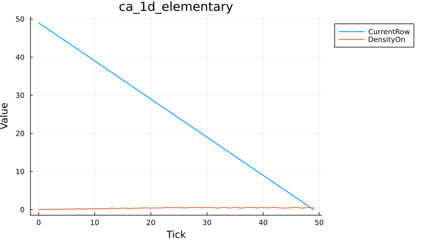
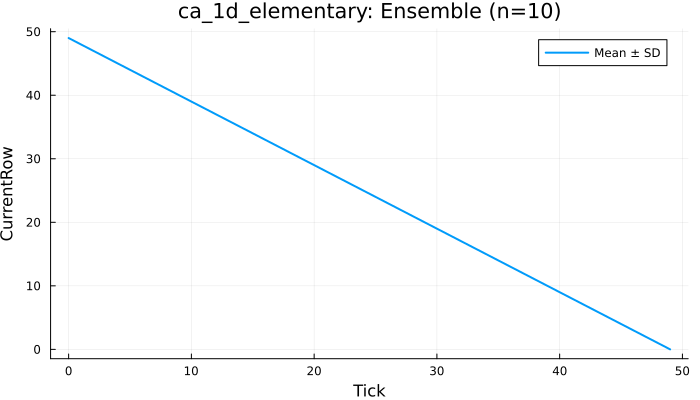
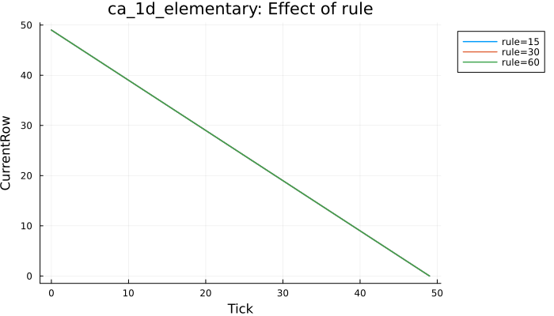

# CA 1D Elementary


- [Overview](#overview)
  - [WHAT IS IT?](#what-is-it)
  - [THINGS TO NOTICE](#things-to-notice)
  - [THINGS TO TRY](#things-to-try)
  - [EXTENDING THE MODEL](#extending-the-model)
  - [NETLOGO FEATURES](#netlogo-features)
  - [RELATED MODELS](#related-models)
  - [CREDITS AND REFERENCES](#credits-and-references)
  - [HOW TO CITE](#how-to-cite)
  - [COPYRIGHT AND LICENSE](#copyright-and-license)
- [Parameters](#parameters)
- [Source Code](#source-code)
- [Time Series](#time-series)
- [Ensemble Runs](#ensemble-runs)
- [Parameter Sensitivity](#parameter-sensitivity)
- [Appendix: Source Code](#appendix-source-code)
  - [Parameters (`parameters.jl`)](#parameters-parametersjl)
  - [Components (`components.jl`)](#components-componentsjl)
  - [Resources (`resources.jl`)](#resources-resourcesjl)
  - [Systems (`systems.jl`)](#systems-systemsjl)
  - [Model (`model.jl`)](#model-modeljl)

## Overview

### WHAT IS IT?

This program models one-dimensional cellular automata. A cellular
automaton (CA) is a computational machine that performs actions based on
certain rules. The automaton is divided into cells, like the square
cells of a checkerboard. Each cell can be either on or off (its
“state”). The board is initialized with some cells on and some off. At
each time step (or “tick”) some rules “fire” and this results in some
cells turning “on” and some turning “off”.

There are many kinds of cellular automata. In this model, we explore
one-dimensional CA – the simplest types of CA. In this case of
one-dimensional cellular automata, each cell checks the state of itself
and its neighbors to the left and right, and then sets the cell below
itself to either “on” or “off”, depending upon the rule. This is done in
parallel and continues until the bottom of the board.

This model explores all 256 possible CA rules that can be constructed by
each cell checking only its immediate left and immediate right neighbor.
Cellular automata can be created on any board size and dimension.

This model is one of a collection of 1D CA models. It is meant for the
more sophisticated user. If you are seeing CA for the first time, we
suggest you check out one of the simpler CA models such as CA 1D Rule
30.

In his book, “A New Kind of Science”, Stephen Wolfram argues that simple
computational devices such as CA lie at the heart of nature’s patterns
and that CAs are a better tool than mathematical equations for the
purpose of scientifically describing the world.

### THINGS TO NOTICE

What different patterns are formed by using a random setup versus a
single setup?

Why do some rules always end up the same, regardless of the initial
setup?

Are there rules that repeat a pattern indefinitely?

Are there rules that produce seemingly chaotic, random results?

Can all rules be classified into these above types? Are there more rule
types than these?

Note that the pictures generated by this model do not exactly match the
pictures in Wolfram’s book, “A New Kind of Science”. That’s because
Wolfram’s book computes the CA as an infinite grid while the NetLogo
model “wraps” around the horizontal boundaries. To get pictures closer
to the ones in the book, you may need to increase the size of the world.
You can increase the size of the world up to the available memory on
your computer. However, the larger the world, the longer time it will
take NetLogo to compute and display the results.

### THINGS TO TRY

Find some rules that converge to all cells “on” or to all cells “off”.

Are there any rules that conditionally converge to all cells “on” or all
cells “off”, depending upon the initial percentage of on/off cells?

A classic automaton is used to compute various things. Can these
cellular automata be used to compute anything? How?

Experiment with the density variable and various types of rules. What
are some relationships?

### EXTENDING THE MODEL

What if a cell’s neighborhood was five cells – two to the left, itself,
and two to the right?

Classical CA use an “infinite board”. The CAs shown here “wrap” around
the horizontal edges of the world (sometimes known as a periodic CA or
CA with periodic boundary condition). How would you implement a CA in
NetLogo that comes closer to the infinite board?

Try making a two-dimensional cellular automaton. The neighborhood could
be the eight cells around it, or just the cardinal cells (the cells to
the right, left, above, and below).

Can you develop some tools to analyze the behavior of CAs? Compare
different iterations from one continuation to the next of the same CA?
Compare different rules?

### NETLOGO FEATURES

This model takes advantage of a special optimization in the NetLogo
compiler that makes the expression “ask patches with \[px/ycor =
<local variable>\]” run much faster than it would otherwise.

### RELATED MODELS

Life - an example of a two-dimensional cellular automaton CA 1D Rule
30 - the basic rule 30 model CA 1D Rule 30 Turtle - the basic rule 30
model implemented using turtles CA 1D Rule 90 - the basic rule 90 model
CA 1D Rule 110 - the basic rule 110 model CA 1D Rule 250 - the basic
rule 250 model CA 1D Totalistic - a model that shows all 2,187 possible
1D 3-color totalistic cellular automata. CA Stochastic- the
probabalistic counterpart to this model

### CREDITS AND REFERENCES

Thanks to Eytan Bakshy, Geoff Hulette, and Erich Neuwirth for their help
with this model.

The first cellular automaton was conceived by John Von Neumann in the
late 1940’s for his analysis of machine reproduction under the
suggestion of Stanislaw M. Ulam. It was later completed and documented
by Arthur W. Burks in the 1960’s. Other two-dimensional cellular
automata, and particularly the game of “Life,” were explored by John
Conway in the 1970’s. Many others have since researched CA’s. In the
late 1970’s and 1980’s Chris Langton, Tom Toffoli and Stephen Wolfram
did some notable research. Wolfram classified all 256 one-dimensional
two-state single-neighbor cellular automata. In his recent book, “A New
Kind of Science,” Wolfram presents many examples of cellular automata
and argues for their fundamental importance in doing science.

See also:

Von Neumann, J. and Burks, A. W., Eds, 1966. Theory of Self-Reproducing
Automata. University of Illinois Press, Champaign, IL.

Toffoli, T. 1977. Computation and construction universality of
reversible cellular automata. J. Comput. Syst. Sci. 15, 213-231.

Langton, C. 1984. Self-reproduction in cellular automata. Physica D 10,
134-144

Wolfram, S. 1986. Theory and Applications of Cellular Automata:
Including Selected Papers 1983-1986. World Scientific Publishing Co.,
Inc., River Edge, NJ.

Bar-Yam, Y. 1997. Dynamics of Complex Systems. Perseus Press. Reading,
Ma.

Wolfram, S. 2002. A New Kind of Science. Wolfram Media Inc. Champaign,
IL.

### HOW TO CITE

If you mention this model or the NetLogo software in a publication, we
ask that you include the citations below.

For the model itself:

- Wilensky, U. (1998). NetLogo CA 1D Elementary model.
  http://ccl.northwestern.edu/netlogo/models/CA1DElementary. Center for
  Connected Learning and Computer-Based Modeling, Northwestern
  University, Evanston, IL.

Please cite the NetLogo software as:

- Wilensky, U. (1999). NetLogo. http://ccl.northwestern.edu/netlogo/.
  Center for Connected Learning and Computer-Based Modeling,
  Northwestern University, Evanston, IL.

### COPYRIGHT AND LICENSE

Copyright 1998 Uri Wilensky.


This model is licensed under the Creative Commons
Attribution-NonCommercial-ShareAlike 3.0 License. To view a copy of this
license, visit https://creativecommons.org/licenses/by-nc-sa/3.0/ or
send a letter to Creative Commons, 559 Nathan Abbott Way, Stanford,
California 94305, USA.

NetLogo itself is free software for non-commercial use under the terms
of the GNU General Public License ([see full license information
here](https://ccl.northwestern.edu/netlogo/docs/copyright.html)).

To inquire about commercial licenses for either NetLogo or specific
models from the models library, please contact
netlogo-commercial-admin@ccl.northwestern.edu.

This model was created as part of the project: CONNECTED MATHEMATICS:
MAKING SENSE OF COMPLEX PHENOMENA THROUGH BUILDING OBJECT-BASED PARALLEL
MODELS (OBPML). The project gratefully acknowledges the support of the
National Science Foundation (Applications of Advanced Technologies
Program) – grant numbers RED \#9552950 and REC \#9632612.

This model was converted to NetLogo as part of the projects:
PARTICIPATORY SIMULATIONS: NETWORK-BASED DESIGN FOR SYSTEMS LEARNING IN
CLASSROOMS and/or INTEGRATED SIMULATION AND MODELING ENVIRONMENT. The
project gratefully acknowledges the support of the National Science
Foundation (REPP & ROLE programs) – grant numbers REC \#9814682 and
REC-0126227. Converted from StarLogoT to NetLogo, 2001.

<!-- 1998 2001 -->

## Parameters

| Parameter     | Type      | Default | Description                                 |
|---------------|-----------|---------|---------------------------------------------|
| `grid_width`  | `Int`     | `51`    | number of cells in 1D row (NetLogo -25..25) |
| `grid_height` | `Int`     | `50`    | number of time steps (rows) (NetLogo 0..49) |
| `rule`        | `Int`     | `30`    | Wolfram rule number (0-255)                 |
| `density`     | `Float64` | `50.0`  | percent on for random init                  |
| `random_init` | `Bool`    | `false` | false = single center cell                  |
| `max_ticks`   | `Int`     | `49`    | grid_height - 1 time steps                  |

## Source Code

The Julia code to run this model:

``` julia
using ArkModelZoo
_, trajectory = run_ca_1d_elementary()
```

## Time Series



## Ensemble Runs

Ten replicates with different random seeds, showing mean ± standard
deviation.



## Parameter Sensitivity

Varying `rule`.



## Appendix: Source Code

This model is implemented in the
[Ark.jl](https://github.com/sdwfrost/Ark.jl) Entity-Component-System
(ECS) framework. The code is split into five files, each with a distinct
role:

- **Parameters**: a mutable struct holding all configurable values.
- **Components**: lightweight data types attached to individual entities
  (agents).
- **Resources**: world-level shared state accessible to all systems.
- **Systems**: functions that operate on entities each tick, defining
  model behavior.
- **Model**: wiring that assembles the world, registers resources and
  systems, and provides the run entry point.

### Parameters (`parameters.jl`)

The parameter struct uses `@kwdef` so that every field has a default
value and can be overridden by keyword. These defaults match the
original NetLogo model’s slider settings.

``` julia
Base.@kwdef mutable struct CA1DParams
    grid_width::Int = 51       # number of cells in 1D row (NetLogo -25..25)
    grid_height::Int = 50      # number of time steps (rows) (NetLogo 0..49)
    rule::Int = 30             # Wolfram rule number (0-255)
    density::Float64 = 50.0    # percent on for random init
    random_init::Bool = false  # false = single center cell
    max_ticks::Int = 49        # grid_height - 1 time steps
    seed::Int = 42
end
```

### Components (`components.jl`)

Components are lightweight data types attached to individual entities
(agents). Mutable structs hold per-entity state, while empty tag structs
act as markers for the ECS query system to efficiently filter entities.

``` julia
mutable struct CA1DDummy
    val::Int
end
CA1DDummy() = CA1DDummy(0)
```

### Resources (`resources.jl`)

Resources are world-level singletons shared across all systems, used for
global state and aggregate statistics.

``` julia
mutable struct CA1DGrid
    width::Int
    height::Int
    cells::Matrix{Bool}   # cells[x, row] — row 1 is the top
end

function CA1DGrid(w::Int, h::Int)
    CA1DGrid(w, h, falses(w, h))
end

mutable struct CA1DStats
    current_row::Int
    density_on::Float64
end
CA1DStats() = CA1DStats(1, 0.0)
```

### Systems (`systems.jl`)

Systems contain the model logic and execute in a defined order each
tick. Each system struct implements either `initialize!` (run once at
setup) or `update!` (run every tick).

``` julia
struct InitCA1DSystem <: System end

function _ca1d_rule_bit(rule::Int, left::Bool, center::Bool, right::Bool)
    idx = (left ? 4 : 0) + (center ? 2 : 0) + (right ? 1 : 0)
    return (rule >> idx) & 1 == 1
end

function initialize!(::InitCA1DSystem, world::World)
    params = get_resource(world, CA1DParams)
    rng = get_resource(world, RNGResource).rng
    g = get_resource(world, CA1DGrid)
    stats = get_resource(world, CA1DStats)

    fill!(g.cells, false)
    stats.current_row = 1

    # Initialize first row
    if params.random_init
        for x in 1:g.width
            g.cells[x, 1] = rand(rng, Float64) * 100.0 < params.density
        end
    else
        mid = div(g.width, 2) + 1
        g.cells[mid, 1] = true
    end

    _ca1d_update_stats!(world)
    return nothing
end

struct CA1DGoSystem <: System end

function update!(::CA1DGoSystem, world::World)
    params = get_resource(world, CA1DParams)
    g = get_resource(world, CA1DGrid)
    stats = get_resource(world, CA1DStats)
    row = stats.current_row

    row >= g.height && return nothing

    # Apply rule to current row, write to next row (wrapping at edges)
    next_row = row + 1
    w = g.width
    for x in 1:w
        left = g.cells[mod1(x - 1, w), row]
        center = g.cells[x, row]
        right = g.cells[mod1(x + 1, w), row]
        g.cells[x, next_row] = _ca1d_rule_bit(params.rule, left, center, right)
    end

    stats.current_row = next_row
    _ca1d_update_stats!(world)
    return nothing
end

function _ca1d_update_stats!(world::World)
    g = get_resource(world, CA1DGrid)
    stats = get_resource(world, CA1DStats)
    row = stats.current_row
    on_count = 0
    for x in 1:g.width
        if g.cells[x, row]
            on_count += 1
        end
    end
    stats.density_on = g.width > 0 ? on_count / g.width : 0.0
end

struct CA1DTerminationSystem <: System end

function update!(::CA1DTerminationSystem, world::World)
    params = get_resource(world, CA1DParams)
    g = get_resource(world, CA1DGrid)
    stats = get_resource(world, CA1DStats)
    tick = get_resource(world, Tick)
    if stats.current_row >= g.height || tick.tick + 1 >= params.max_ticks
        get_resource(world, Terminate).stop = true
    end
    return nothing
end
```

### Model (`model.jl`)

The model file assembles all pieces: it creates the ECS `World` with the
required component types, registers resources, builds the `Scheduler`
with systems in execution order, and exposes the public `run` entry
point. The observer pattern records the trajectory each tick.

``` julia
function ca1d_world(; initial_capacity::Int = 64)
    return World(CA1DDummy; initial_capacity = initial_capacity, allow_mutable = true)
end

function ca1d_systems()
    return (InitCA1DSystem(), CA1DGoSystem(), CA1DTerminationSystem())
end

function ca1d_model(params::CA1DParams = CA1DParams())
    world = ca1d_world()
    _add_standard_resources!(world, params)
    add_resource!(world, CA1DGrid(params.grid_width, params.grid_height))
    add_resource!(world, CA1DStats())
    scheduler = Scheduler(world, ca1d_systems())
    initialize!(scheduler)
    return scheduler
end

struct CA1DObserver end

function ca1d_headers(::CA1DObserver)
    return ["CurrentRow", "DensityOn"]
end

function ca1d_values(::CA1DObserver, world::World)
    stats = get_resource(world, CA1DStats)
    g = get_resource(world, CA1DGrid)
    # NetLogo current-row counts down from max-pycor (grid_height - 1)
    nl_current_row = Float64(g.height - stats.current_row)
    return Float64[nl_current_row, stats.density_on]
end

function run_ca_1d_elementary(; params::CA1DParams = CA1DParams(), observe::Bool = true)
    return _run_model(ca1d_model, CA1DObserver(), ca1d_values; params, observe)
end
```
