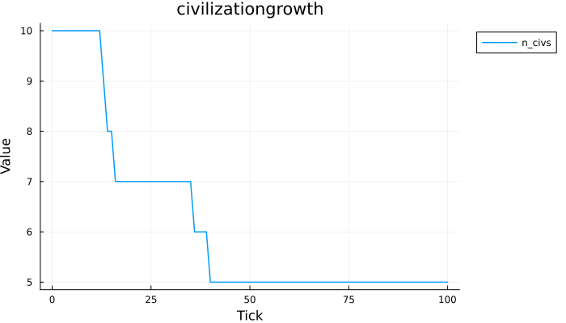
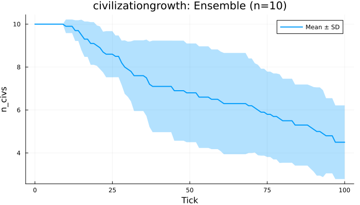
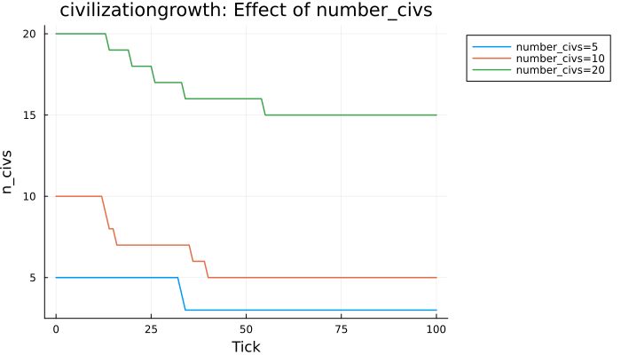

## Overview

This vignette demonstrates the **Civilization Growth** model implemented in [ArkModelZoo.jl](https://github.com/sdwfrost/ArkModelZoo.jl) using the Ark.jl ECS framework.

## Parameters

| Parameter | Type | Default | Description |
|-----------|------|---------|-------------|
| `number_civs` | `Int` | `10` | number civs |
| `farm_size_uniform` | `Bool` | `false` | farm size uniform |
| `SoL_uniform` | `Bool` | `true` | SoL uniform |
| `grid_width` | `Int` | `65` | -32..32 |
| `grid_height` | `Int` | `65` | -32..32 |
| `max_ticks` | `Int` | `100` | max ticks |

## Source Code

The Julia code to run this model:

```julia
using ArkModelZoo
_, trajectory = run_civilizationgrowth()
```

## Time Series

{width=100%}

## Ensemble Runs

Ten replicates with different random seeds, showing mean ± standard deviation.

{width=100%}

## Parameter Sensitivity

Varying `number_civs`.

{width=100%}


## Appendix: Source Code

This model is implemented in the [Ark.jl](https://github.com/sdwfrost/Ark.jl) Entity-Component-System (ECS) framework. The code is split into five files, each with a distinct role:

- **Parameters**: a mutable struct holding all configurable values.
- **Components**: lightweight data types attached to individual entities (agents).
- **Resources**: world-level shared state accessible to all systems.
- **Systems**: functions that operate on entities each tick, defining model behavior.
- **Model**: wiring that assembles the world, registers resources and systems, and provides the run entry point.

### Parameters (`parameters.jl`)

The parameter struct uses `@kwdef` so that every field has a default value and can be overridden by keyword. These defaults match the original NetLogo model's slider settings.

```julia
Base.@kwdef mutable struct CivGrowthParams
    number_civs::Int = 10
    farm_size_uniform::Bool = false
    SoL_uniform::Bool = true
    grid_width::Int = 65   # -32..32
    grid_height::Int = 65  # -32..32
    max_ticks::Int = 100
    seed::Int = 42
end
```

### Components (`components.jl`)

Components are lightweight data types attached to individual entities (agents). Mutable structs hold per-entity state, while empty tag structs act as markers for the ECS query system to efficiently filter entities.

```julia
mutable struct CivAgent
    farm_size::Int
    farm_RoP::Float64
    farm_RoC::Float64
    farm_excess::Float64
    excess_prev_tick::Float64
    SoL::Float64
    SoL_max::Float64
    SoL_min::Float64
    RoExp::Float64
    RoExp_prev_tick::Float64
    fs_prev_tick::Int
    choice::Int
    px::Int  # patch x position (1-indexed)
    py::Int  # patch y position (1-indexed)
end
CivAgent() = CivAgent(1, 0.0, 0.0, 0.0, 0.0, 0.0, 5.0, -5.0, 0.0, 0.0, 0, 0, 1, 1)
```

### Resources (`resources.jl`)

Resources are world-level singletons shared across all systems, used for global state and aggregate statistics.

```julia
mutable struct CivGrid
    RoP::Matrix{Float64}          # productivity per patch
    belongs_to::Matrix{Entity}     # zero_entity = nobody, else civ entity
    conflict_value::Matrix{Int}    # 0 or 1
    width::Int
    height::Int
end

function CivGrid(w::Int, h::Int)
    CivGrid(
        zeros(Float64, w, h),
        fill(zero_entity, w, h),
        zeros(Int, w, h),
        w, h
    )
end

mutable struct CivStats
    n_civs::Int
end
CivStats() = CivStats(0)
```

### Systems (`systems.jl`)

Systems contain the model logic and execute in a defined order each tick. Each system struct implements either `initialize!` (run once at setup) or `update!` (run every tick).

```julia
# Helper: get all patches within Euclidean distance d of (cx,cy) on a non-wrapping grid
function patches_in_radius(cx::Int, cy::Int, d::Int, w::Int, h::Int)
    result = Tuple{Int,Int}[]
    for dx in -d:d
        for dy in -d:d
            if dx*dx + dy*dy <= d*d
                nx, ny = cx + dx, cy + dy
                if 1 <= nx <= w && 1 <= ny <= h
                    push!(result, (nx, ny))
                end
            end
        end
    end
    return result
end

# Helper: get Moore neighbors (non-wrapping)
function civ_neighbors(x::Int, y::Int, w::Int, h::Int)
    result = Tuple{Int,Int}[]
    for dx in -1:1
        for dy in -1:1
            if dx == 0 && dy == 0
                continue
            end
            nx, ny = x + dx, y + dy
            if 1 <= nx <= w && 1 <= ny <= h
                push!(result, (nx, ny))
            end
        end
    end
    return result
end

struct InitCivGrowthSystem <: System end

function initialize!(::InitCivGrowthSystem, world::World)
    params = get_resource(world, CivGrowthParams)
    rng_res = get_resource(world, RNGResource)
    rng = rng_res.rng
    grid = get_resource(world, CivGrid)
    stats = get_resource(world, CivStats)
    w, h = grid.width, grid.height

    # Setup land: random RoP, then smooth 5 times
    for x in 1:w, y in 1:h
        grid.RoP[x, y] = rand(rng, 0:49)
    end
    # NetLogo: repeat 5 [ ask patches [ set RoP mean [RoP] of neighbors ] ]
    # ask patches shuffles; each patch updates RoP in-place (asynchronous smoothing).
    n_patches = w * h
    patch_order = Vector{Int}(undef, n_patches)
    for i in 1:n_patches
        patch_order[i] = i
    end
    for _ in 1:5
        # Fisher-Yates shuffle to match NetLogo's ask patches
        for i in n_patches:-1:2
            j = rand(rng, 1:i)
            patch_order[i], patch_order[j] = patch_order[j], patch_order[i]
        end
        for idx in patch_order
            x = mod1(idx, w)
            y = div(idx - 1, w) + 1
            nbrs = civ_neighbors(x, y, w, h)
            if !isempty(nbrs)
                grid.RoP[x, y] = mean(grid.RoP[nx, ny] for (nx, ny) in nbrs)
            end
        end
    end

    # Reset ownership
    fill!(grid.belongs_to, zero_entity)
    fill!(grid.conflict_value, 0)

    # Create civs
    civ_eids = Entity[]
    for i in 1:params.number_civs
        fs = params.farm_size_uniform ? 3 : rand(rng, 1:5)
        civ = CivAgent()
        civ.farm_size = fs
        civ.px = rand(rng, 1:w)
        civ.py = rand(rng, 1:h)
        eid = new_entity!(world, (civ,))
        push!(civ_eids, eid)
    end

    # Place civs: set-farm-in-radius for each (random order in NetLogo: ask turtles)
    order = randperm(rng, length(civ_eids))
    for idx in order
        eid = civ_eids[idx]
        civ = get_components(world, eid, (CivAgent,))[1]
        set_farm_in_radius!(civ, eid, grid, rng, params, w, h)
    end

    # After all civs placed, set SoL
    for eid in civ_eids
        civ = get_components(world, eid, (CivAgent,))[1]
        if params.SoL_uniform
            civ.SoL = 0.0
        else
            civ.SoL = civ.farm_excess > 0 ? rand(rng) * 5.0 : rand(rng) * -5.0
        end
        civ.SoL_max = 5.0
        civ.SoL_min = -5.0
    end

    stats.n_civs = params.number_civs
end

function set_farm_in_radius!(civ::CivAgent, eid::Entity, grid::CivGrid, rng, params, w::Int, h::Int)
    d = civ.farm_size

    # Find valid placement: patch where no OTHER nearby patch is claimed
    # NetLogo: `not any? other patches in-radius d with [belongs-to != nobody]`
    # `other` excludes the candidate patch itself
    candidates = Tuple{Int,Int}[]
    for x in 1:w, y in 1:h
        nbrs = patches_in_radius(x, y, d, w, h)
        ok = true
        for (nx, ny) in nbrs
            (nx, ny) == (x, y) && continue  # skip center (NetLogo 'other')
            if !is_zero(grid.belongs_to[nx, ny])
                ok = false
                break
            end
        end
        if ok
            push!(candidates, (x, y))
        end
    end

    if !isempty(candidates)
        cx, cy = candidates[rand(rng, 1:length(candidates))]
        civ.px = cx
        civ.py = cy
    end

    # Claim patches in radius
    farm = patches_in_radius(civ.px, civ.py, civ.farm_size, w, h)
    for (fx, fy) in farm
        grid.belongs_to[fx, fy] = eid
    end

    # Calculate farm stats
    civ.farm_RoP = sum(grid.RoP[fx, fy] for (fx, fy) in farm)
    civ.farm_RoC = Float64(length(farm) * 23)
    civ.farm_excess = civ.farm_RoP - civ.farm_RoC
end

struct CivInvestSystem <: System end

function update!(::CivInvestSystem, world::World)
    params = get_resource(world, CivGrowthParams)
    rng_res = get_resource(world, RNGResource)
    rng = rng_res.rng
    grid = get_resource(world, CivGrid)
    tick = get_resource(world, Tick)
    w, h = grid.width, grid.height

    all_eids = Entity[]
    for (eids,) in Query(world, (CivAgent,))
        append!(all_eids, eids)
    end

    shuffle!(rng, all_eids)
    to_kill = Set{Entity}()

    for eid in all_eids
        eid in to_kill && continue
        civ = get_components(world, eid, (CivAgent,))[1]

        # invest
        p = rand(rng, 0:99)
        civ.excess_prev_tick = civ.farm_excess
        civ.RoExp_prev_tick = civ.RoExp
        civ.fs_prev_tick = civ.farm_size

        farm_count = length(patches_in_radius(civ.px, civ.py, civ.farm_size, w, h))

        # invest: sequential if blocks match NetLogo cascading semantics
        if civ.choice == 0
            if civ.farm_excess > 0 && p <= 40
                civ.farm_RoP += civ.farm_excess
                civ.choice = 1
            end
            if civ.farm_excess > 0 && p > 60 && civ.SoL < civ.SoL_max
                civ.SoL += 0.50
                civ.choice = 2
            end
            if civ.farm_excess > 0 && p > 60
                civ.farm_RoC += farm_count * 2.0
                civ.choice = 2
            end
            if civ.farm_excess < 0 && civ.SoL >= civ.SoL_min
                civ.SoL -= 0.10
                civ.choice = 0
            end
        end
        if civ.choice == 1
            if civ.farm_excess > 0 && p <= 40
                civ.farm_RoP += civ.farm_excess
                civ.SoL += 0.10
                civ.choice = 1
            end
        end
        if civ.choice == 2
            if civ.farm_excess > 0 && p > 60 && civ.SoL < civ.SoL_max
                civ.SoL += 0.50
                civ.choice = 2
            end
            if civ.farm_excess > 0 && p > 60
                civ.farm_RoC += farm_count * 2.0
                civ.choice = 2
            end
        end

        civ.farm_excess = civ.farm_RoP - civ.farm_RoC
        if civ.excess_prev_tick != 0.0
            civ.RoExp = (civ.farm_excess - civ.excess_prev_tick) / civ.excess_prev_tick
        else
            civ.RoExp = 0.0
        end

        # expand
        if civ.RoExp >= 0.50 && civ.RoExp_prev_tick >= 0.50 && tick.tick >= 5
            civ.farm_size += 1
            # assess: mark conflict on new territory
            new_farm = patches_in_radius(civ.px, civ.py, civ.farm_size, w, h)
            for (fx, fy) in new_farm
                if !is_zero(grid.belongs_to[fx, fy]) && grid.belongs_to[fx, fy] != eid
                    grid.conflict_value[fx, fy] = 1
                end
            end
        end

        # conflict
        if civ.farm_size <= civ.fs_prev_tick
            farm = patches_in_radius(civ.px, civ.py, civ.farm_size, w, h)
            has_conflict = any(grid.conflict_value[fx, fy] == 1 for (fx, fy) in farm)
            if has_conflict
                for (fx, fy) in farm
                    grid.conflict_value[fx, fy] = 0
                end
                push!(to_kill, eid)
            end
        else
            # expand-civ
            if civ.RoExp >= 0.50 && civ.RoExp_prev_tick >= 0.50 && tick.tick >= 5
                new_farm = patches_in_radius(civ.px, civ.py, civ.farm_size, w, h)
                for (fx, fy) in new_farm
                    grid.belongs_to[fx, fy] = eid
                end
            end
        end
    end

    # Kill dead civs (NetLogo: conflict_value already cleared above; territory remains claimed)
    for eid in to_kill
        is_alive(world, eid) && remove_entity!(world, eid)
    end
end

struct CivStatsSystem <: System end

function update!(::CivStatsSystem, world::World)
    stats = get_resource(world, CivStats)
    n = 0
    for (eids,) in Query(world, (CivAgent,))
        n += length(eids)
    end
    stats.n_civs = n
end

struct CivTerminationSystem <: System end

function update!(::CivTerminationSystem, world::World)
    params = get_resource(world, CivGrowthParams)
    tick = get_resource(world, Tick)
    term = get_resource(world, Terminate)
    if tick.tick + 1 >= params.max_ticks
        term.stop = true
    end
end
```

### Model (`model.jl`)

The model file assembles all pieces: it creates the ECS `World` with the required component types, registers resources, builds the `Scheduler` with systems in execution order, and exposes the public `run` entry point. The observer pattern records the trajectory each tick.

```julia
function civilizationgrowth_world(; initial_capacity::Int = 128)
    World(
        CivAgent;
        initial_capacity = initial_capacity,
        allow_mutable = true
    )
end

function civilizationgrowth_systems()
    return (
        InitCivGrowthSystem(),
        CivInvestSystem(),
        CivStatsSystem(),
        CivTerminationSystem()
    )
end

function civilizationgrowth_model(params::CivGrowthParams = CivGrowthParams())
    world = civilizationgrowth_world()
    _add_standard_resources!(world, params)
    add_resource!(world, CivGrid(params.grid_width, params.grid_height))
    add_resource!(world, CivStats())
    scheduler = Scheduler(world, civilizationgrowth_systems())
    initialize!(scheduler)
    return scheduler
end

struct CivGrowthObserver end

function civilizationgrowth_headers(::CivGrowthObserver)
    return ["n_civs"]
end

function civilizationgrowth_values(::CivGrowthObserver, world::World)
    stats = get_resource(world, CivStats)
    return Float64[Float64(stats.n_civs)]
end

function run_civilizationgrowth(; params::CivGrowthParams = CivGrowthParams(), observe::Bool = true)
    return _run_model(civilizationgrowth_model, CivGrowthObserver(), civilizationgrowth_values; params, observe)
end
```
