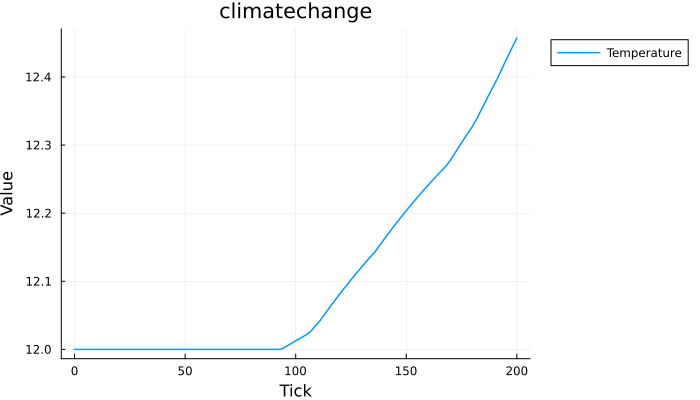
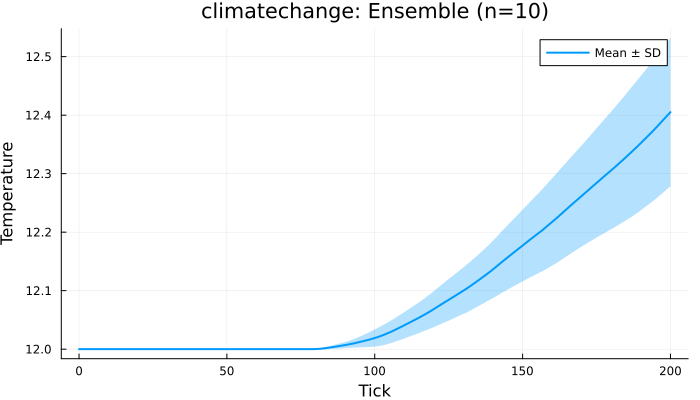
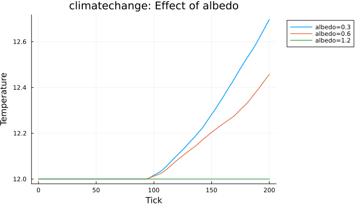

# Climate Change


- [Overview](#overview)
  - [WHAT IS IT?](#what-is-it)
  - [HOW IT WORKS](#how-it-works)
  - [THINGS TO NOTICE](#things-to-notice)
  - [THINGS TO TRY](#things-to-try)
  - [EXTENDING THE MODEL](#extending-the-model)
  - [NETLOGO FEATURES](#netlogo-features)
  - [RELATED MODELS](#related-models)
  - [CREDITS AND REFERENCES](#credits-and-references)
  - [HOW TO CITE](#how-to-cite)
  - [COPYRIGHT AND LICENSE](#copyright-and-license)
- [Parameters](#parameters)
- [Source Code](#source-code)
- [Time Series](#time-series)
- [Ensemble Runs](#ensemble-runs)
- [Parameter Sensitivity](#parameter-sensitivity)
- [Appendix: Source Code](#appendix-source-code)
  - [Parameters (`parameters.jl`)](#parameters-parametersjl)
  - [Components (`components.jl`)](#components-componentsjl)
  - [Resources (`resources.jl`)](#resources-resourcesjl)
  - [Systems (`systems.jl`)](#systems-systemsjl)
  - [Model (`model.jl`)](#model-modeljl)

## Overview

### WHAT IS IT?

This is a model of energy flow in the earth, particularly heat energy.
It shows the earth as rose colored, and the surface of the planet is
represented by a black strip. Above the strip there is a blue atmosphere
and black space at the top. Clouds and carbon dioxide (CO2) molecules
can be added to the atmosphere. The CO2 molecules represent greenhouse
gases that block infrared light that is emitted by the earth. Clouds
block incoming or outgoing sun rays, influencing the heating up or
cooling down of the planet.

### HOW IT WORKS

Yellow arrowheads stream downward representing sunlight energy. Some of
the sunlight reflects off clouds and more can reflect off the earth’s
surface.

If sunlight is absorbed by the earth, it turns into a red dot,
representing heat energy. Each dot represents the energy of one yellow
sunlight arrowhead. The red dots randomly move around the earth, and its
temperature is related to the total number of red dots.

Sometimes the red dots transform themselves into infrared (IR) light
that heads toward space, carrying off energy. The probability of a red
dot becoming IR light depends on the earth’s temperature. When the earth
is cold, few red dots generate IR light; when it is hot, most do. The IR
energy is represented by a magenta arrowhead. Each carries the same
energy as a yellow arrowhead and as a red dot. The IR light goes through
clouds but can bounce off CO2 molecules.

There is a relation between the number of red dots in the earth and the
temperature of the earth. This is because the earth temperature goes up
as the total thermal energy is increased. Thermal energy is added by
sunlight that reaches the earth as well as from infrared (IR) light
reflected down to the earth. Thermal energy is removed by IR emitted by
the earth. The balance of these determines the energy in the earth,
which is proportional to its temperature.

There are, of course, many simplifications in this model. The earth is
not a single temperature, does not have a single albedo, and does not
have a single heat capacity. Visible light is somewhat absorbed by CO2
and some IR light does bounce off clouds. No model is completely
accurate. What is important is that a model reacts in some ways like the
system it is supposed to model. This model does that, showing how the
greenhouse effect is caused by CO2 and other gases that absorb IR.

### THINGS TO NOTICE

Watch a single sunlight arrowhead. This is easier if you slow down the
model using the slider at the top of the model. You can also use the
WATCH A RAY button.

What happens to the arrowhead when it hits the earth? Describe its later
path. Does it escape the earth? What happens then? Do all arrowheads
follow similar paths?

### THINGS TO TRY

1.  Play with the model. Change the albedo and run the model. Add clouds
    and CO2 to the model and then watch a single sunlight arrowhead.
    What is the highest earth temperature you can produce?

2.  Run the model with a bright sun but no clouds and no CO2. What
    happens to the temperature? It should rise quickly and then settle
    down around 37 degrees. Why does it stop rising? Why does the
    temperature continue to bounce around? Remember, the temperature
    reflects the number of red dots in the earth. When the temperature
    is constant, there are about as many incoming yellow arrowheads as
    outgoing IR ones. Why?

3.  Explore the effect of albedo holding everything else constant. Does
    increasing the albedo increase or decrease the earth temperature?
    When you experiment, be sure to run the model long enough for the
    temperature to settle down.

4.  Explore the effect of clouds holding everything else constant.

5.  Explore the effect of adding 100 CO2 molecules. What is the cause of
    the change you observe? Follow one sunlight arrowhead now.

### EXTENDING THE MODEL

Try to add some other factors influencing the earth’s temperature. For
example, you could add patches of vegetation and then see what happens
as they are consumed for human occupation. Also, you could try to add
variable albedo to the model, instead of having one value for the whole
planet. You could have glaciers with high albedo, and seas with low
albedo, and then evaluate what happens when the glaciers melt into the
seas.

### NETLOGO FEATURES

Note that clouds are actually made up of lots of small circular turtles.

### RELATED MODELS

Daisyworld

### CREDITS AND REFERENCES

This model is based on an earlier version created in 2005 by Robert
Tinker for the TELS project.

### HOW TO CITE

If you mention this model or the NetLogo software in a publication, we
ask that you include the citations below.

For the model itself:

- Tinker, R. and Wilensky, U. (2007). NetLogo Climate Change model.
  http://ccl.northwestern.edu/netlogo/models/ClimateChange. Center for
  Connected Learning and Computer-Based Modeling, Northwestern
  University, Evanston, IL.

Please cite the NetLogo software as:

- Wilensky, U. (1999). NetLogo. http://ccl.northwestern.edu/netlogo/.
  Center for Connected Learning and Computer-Based Modeling,
  Northwestern University, Evanston, IL.

### COPYRIGHT AND LICENSE

Copyright 2007 Uri Wilensky.


This model is licensed under the Creative Commons
Attribution-NonCommercial-ShareAlike 3.0 License. To view a copy of this
license, visit https://creativecommons.org/licenses/by-nc-sa/3.0/ or
send a letter to Creative Commons, 559 Nathan Abbott Way, Stanford,
California 94305, USA.

NetLogo itself is free software for non-commercial use under the terms
of the GNU General Public License ([see full license information
here](https://ccl.northwestern.edu/netlogo/docs/copyright.html)).

To inquire about commercial licenses for either NetLogo or specific
models from the models library, please contact
netlogo-commercial-admin@ccl.northwestern.edu.

<!-- 2007 Cite: Tinker, R. -->

## Parameters

| Parameter | Type | Default | Description |
|----|----|----|----|
| `albedo` | `Float64` | `0.6` | albedo |
| `sun_brightness` | `Float64` | `1.0` | sun brightness |
| `num_CO2` | `Int` | `0` | CO2 molecules added at setup (0 by default) |
| `grid_width` | `Int` | `49` | (-24..24) |
| `grid_height` | `Int` | `31` | (-8..22) |
| `earth_top_y` | `Int` | `9` | pycor=0 → y=9 in 1-based |
| `sky_top_y` | `Int` | `26` | pycor=17 → y=26 in 1-based |
| `max_ticks` | `Int` | `200` | max ticks |

## Source Code

The Julia code to run this model:

``` julia
using ArkModelZoo
_, trajectory = run_climatechange()
```

## Time Series



## Ensemble Runs

Ten replicates with different random seeds, showing mean ± standard
deviation.



## Parameter Sensitivity

Varying `albedo`.



## Appendix: Source Code

This model is implemented in the
[Ark.jl](https://github.com/sdwfrost/Ark.jl) Entity-Component-System
(ECS) framework. The code is split into five files, each with a distinct
role:

- **Parameters**: a mutable struct holding all configurable values.
- **Components**: lightweight data types attached to individual entities
  (agents).
- **Resources**: world-level shared state accessible to all systems.
- **Systems**: functions that operate on entities each tick, defining
  model behavior.
- **Model**: wiring that assembles the world, registers resources and
  systems, and provides the run entry point.

### Parameters (`parameters.jl`)

The parameter struct uses `@kwdef` so that every field has a default
value and can be overridden by keyword. These defaults match the
original NetLogo model’s slider settings.

``` julia
Base.@kwdef mutable struct ClimateChangeParams
    albedo::Float64 = 0.6
    sun_brightness::Float64 = 1.0
    num_CO2::Int = 0           # CO2 molecules added at setup (0 by default)
    grid_width::Int = 49       # (-24..24)
    grid_height::Int = 31      # (-8..22)
    earth_top_y::Int = 9       # pycor=0 → y=9 in 1-based
    sky_top_y::Int = 26        # pycor=17 → y=26 in 1-based
    max_ticks::Int = 200
    seed::Int = 42
end
```

### Components (`components.jl`)

Components are lightweight data types attached to individual entities
(agents). Mutable structs hold per-entity state, while empty tag structs
act as markers for the ECS query system to efficiently filter entities.

``` julia
# All climate particles share the same component set.
# Breed: 1=ray, 2=heat, 3=IR, 4=CO2

const BREED_RAY  = 1
const BREED_HEAT = 2
const BREED_IR   = 3
const BREED_CO2  = 4

mutable struct ClimateParticle
    breed::Int
    x::Float64
    y::Float64
    heading::Float64
end
ClimateParticle() = ClimateParticle(BREED_RAY, 1.0, 1.0, 0.0)
```

### Resources (`resources.jl`)

Resources are world-level singletons shared across all systems, used for
global state and aggregate statistics.

``` julia
mutable struct ClimateStats
    temperature::Float64
end
ClimateStats() = ClimateStats(12.0)
```

### Systems (`systems.jl`)

Systems contain the model logic and execute in a defined order each
tick. Each system struct implements either `initialize!` (run once at
setup) or `update!` (run every tick).

``` julia
# --- Helpers ---

function _climate_can_move(x::Float64, y::Float64, heading::Float64, dist::Float64, w::Int, h::Int)
    θ = deg2rad(heading)
    nx = x + sin(θ) * dist
    ny = y + cos(θ) * dist
    px = round(Int, nx)
    py = round(Int, ny)
    return 1 <= px <= w && 1 <= py <= h
end

function _climate_forward!(p::ClimateParticle, dist::Float64)
    θ = deg2rad(p.heading)
    p.x += sin(θ) * dist
    p.y += cos(θ) * dist
end

function _climate_is_blue(y::Float64, earth_top_y::Int)
    return round(Int, y) > earth_top_y
end

# --- Initialization ---

struct InitClimateChangeSystem <: System end

function initialize!(::InitClimateChangeSystem, world::World)
    params = get_resource(world, ClimateChangeParams)
    rng = get_resource(world, RNGResource).rng

    # Optionally create CO2 molecules in the atmosphere
    for _ in 1:params.num_CO2
        x = Float64(rand(rng, 1:params.grid_width))
        y = Float64(rand(rng, (params.earth_top_y + 1):params.sky_top_y))
        heading = rand(rng) * 360.0
        new_entity!(world, (ClimateParticle(BREED_CO2, x, y, heading),))
    end
    return nothing
end

# --- Sunshine ---

struct RunSunshineSystem <: System end

function update!(::RunSunshineSystem, world::World)
    params = get_resource(world, ClimateChangeParams)
    rng = get_resource(world, RNGResource).rng
    w, h = params.grid_width, params.grid_height
    earth_top_y = params.earth_top_y

    # Move existing rays; die if can't move
    to_remove = Entity[]
    to_convert = Entity[]  # rays that hit earth
    for (eids, particles) in Query(world, (ClimateParticle,))
        @inbounds for i in eachindex(eids)
            p = particles[i]
            p.breed == BREED_RAY || continue
            if !_climate_can_move(p.x, p.y, p.heading, 0.3, w, h)
                push!(to_remove, eids[i])
            else
                _climate_forward!(p, 0.3)
                if p.y <= Float64(earth_top_y)
                    push!(to_convert, eids[i])
                end
            end
        end
    end

    for eid in to_remove
        remove_entity!(world, eid)
    end

    # Encounter earth: reflect (albedo) or absorb (become heat)
    for eid in to_convert
        p = get_components(world, eid, (ClimateParticle,))[1]
        if rand(rng, 0:99) < round(Int, 100 * params.albedo)
            p.heading = 180.0 - p.heading
        else
            p.heading += Float64(rand(rng, 0:44) - rand(rng, 0:44))
            p.breed = BREED_HEAT
        end
    end

    # Create new sunshine
    if 10.0 * params.sun_brightness > rand(rng, 0:49)
        # NetLogo: setxy (random 10) + min-pxcor max-pycor
        # min-pxcor=-24 → 1-based x = random(10)+1, y = max_y
        x = Float64(rand(rng, 0:9) + 1)
        y = Float64(h)
        new_entity!(world, (ClimateParticle(BREED_RAY, x, y, 160.0),))
    end
    return nothing
end

# --- Heat ---

struct RunHeatSystem <: System end

function update!(::RunHeatSystem, world::World)
    params = get_resource(world, ClimateChangeParams)
    rng = get_resource(world, RNGResource).rng
    stats = get_resource(world, ClimateStats)
    w, h = params.grid_width, params.grid_height
    earth_top_y = params.earth_top_y

    # Count heats for temperature update
    n_heats = 0
    for (_, particles) in Query(world, (ClimateParticle,))
        @inbounds for i in eachindex(particles)
            if particles[i].breed == BREED_HEAT
                n_heats += 1
            end
        end
    end
    stats.temperature = 0.99 * stats.temperature + 0.01 * (12.0 + 0.1 * n_heats)

    # Process each heat
    heat_list = Entity[]
    for (eids, particles) in Query(world, (ClimateParticle,))
        @inbounds for i in eachindex(eids)
            if particles[i].breed == BREED_HEAT
                push!(heat_list, eids[i])
            end
        end
    end
    Random.shuffle!(rng, heat_list)

    for eid in heat_list
        p = get_components(world, eid, (ClimateParticle,))[1]
        dist = 0.5 * rand(rng)
        if _climate_can_move(p.x, p.y, p.heading, dist, w, h)
            _climate_forward!(p, dist)
        else
            p.heading = 180.0 - p.heading
        end
        if p.y >= Float64(earth_top_y)
            # pxcor = x - 25; condition: pxcor > 0 and pxcor < max_pxcor - 8 = 16
            pxcor = p.x - 25.0
            if stats.temperature > 20.0 + rand(rng, 0:39) && pxcor > 0.0 && pxcor < 16.0
                p.breed = BREED_IR
                p.heading = 20.0
            else
                p.heading = Float64(100 + rand(rng, 0:159))
            end
        end
    end
    return nothing
end

# --- IR ---

struct RunIRSystem <: System end

function update!(::RunIRSystem, world::World)
    params = get_resource(world, ClimateChangeParams)
    rng = get_resource(world, RNGResource).rng
    w, h = params.grid_width, params.grid_height
    earth_top_y = params.earth_top_y

    ir_list = Entity[]
    for (eids, particles) in Query(world, (ClimateParticle,))
        @inbounds for i in eachindex(eids)
            if particles[i].breed == BREED_IR
                push!(ir_list, eids[i])
            end
        end
    end
    Random.shuffle!(rng, ir_list)

    to_remove = Entity[]
    for eid in ir_list
        p = get_components(world, eid, (ClimateParticle,))[1]
        if !_climate_can_move(p.x, p.y, p.heading, 0.3, w, h)
            push!(to_remove, eid)
            continue
        end
        _climate_forward!(p, 0.3)

        if p.y <= Float64(earth_top_y)
            p.breed = BREED_HEAT
            p.heading += Float64(rand(rng, 0:44) - rand(rng, 0:44))
        end

        # Check for CO2 on same patch
        my_px = round(Int, p.x)
        my_py = round(Int, p.y)
        co2_here = false
        for (_, particles2) in Query(world, (ClimateParticle,))
            @inbounds for j in eachindex(particles2)
                q = particles2[j]
                if q.breed == BREED_CO2 && round(Int, q.x) == my_px && round(Int, q.y) == my_py
                    co2_here = true
                    break
                end
            end
            co2_here && break
        end
        if co2_here
            p.heading = 180.0 - p.heading
        end
    end

    for eid in to_remove
        remove_entity!(world, eid)
    end
    return nothing
end

# --- CO2 ---

struct RunCO2System <: System end

function update!(::RunCO2System, world::World)
    params = get_resource(world, ClimateChangeParams)
    rng = get_resource(world, RNGResource).rng
    w, h = params.grid_width, params.grid_height
    earth_top_y = params.earth_top_y

    co2_list = Entity[]
    for (eids, particles) in Query(world, (ClimateParticle,))
        @inbounds for i in eachindex(eids)
            if particles[i].breed == BREED_CO2
                push!(co2_list, eids[i])
            end
        end
    end
    Random.shuffle!(rng, co2_list)

    for eid in co2_list
        p = get_components(world, eid, (ClimateParticle,))[1]
        p.heading += Float64(rand(rng, 0:50) - 25)
        dist = 0.05 + rand(rng) * 0.1
        # Bounce off non-blue patches (earth and underground)
        if !_climate_is_blue(p.y + cos(deg2rad(p.heading)) * dist, earth_top_y)
            p.heading = 180.0 - p.heading
        end
        if _climate_can_move(p.x, p.y, p.heading, dist, w, h)
            _climate_forward!(p, dist)
        end
    end
    return nothing
end

# --- Termination ---

struct ClimateChangeTerminationSystem <: System end

function update!(::ClimateChangeTerminationSystem, world::World)
    params = get_resource(world, ClimateChangeParams)
    tick = get_resource(world, Tick)
    if tick.tick + 1 >= params.max_ticks
        get_resource(world, Terminate).stop = true
    end
    return nothing
end
```

### Model (`model.jl`)

The model file assembles all pieces: it creates the ECS `World` with the
required component types, registers resources, builds the `Scheduler`
with systems in execution order, and exposes the public `run` entry
point. The observer pattern records the trajectory each tick.

``` julia
function climatechange_world(; initial_capacity::Int = 1024)
    return World(
        ClimateParticle;
        initial_capacity = initial_capacity,
        allow_mutable = true,
    )
end

function climatechange_systems()
    return (
        InitClimateChangeSystem(),
        RunSunshineSystem(),
        RunHeatSystem(),
        RunIRSystem(),
        RunCO2System(),
        ClimateChangeTerminationSystem(),
    )
end

function climatechange_model(params::ClimateChangeParams = ClimateChangeParams())
    world = climatechange_world()
    _add_standard_resources!(world, params)
    add_resource!(world, ClimateStats())
    scheduler = Scheduler(world, climatechange_systems())
    initialize!(scheduler)
    return scheduler
end

struct ClimateChangeObserver end

function climatechange_headers(::ClimateChangeObserver)
    return ["Temperature"]
end

function climatechange_values(::ClimateChangeObserver, world::World)
    stats = get_resource(world, ClimateStats)
    return Float64[stats.temperature]
end

function run_climatechange(; params::ClimateChangeParams = ClimateChangeParams(), observe::Bool = true)
    return _run_model(climatechange_model, ClimateChangeObserver(), climatechange_values; params, observe)
end
```
