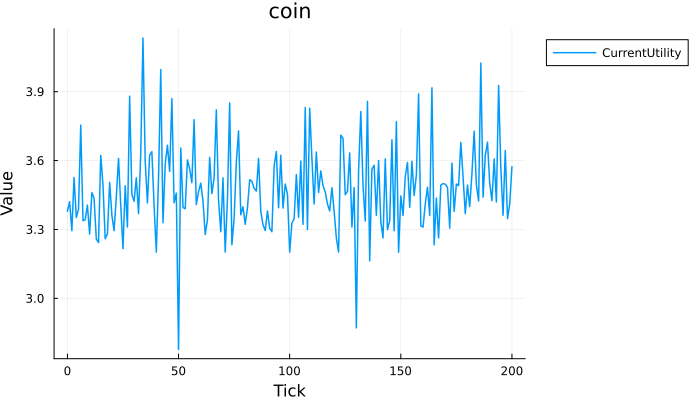
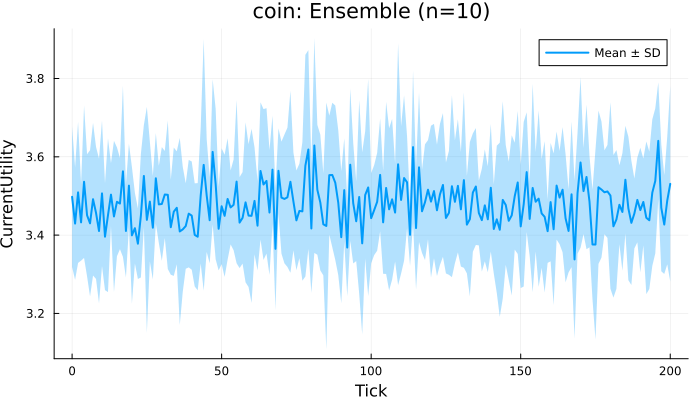
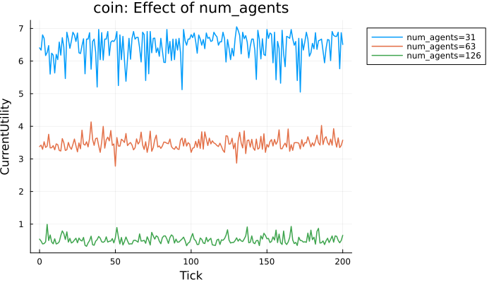

## Overview

This vignette demonstrates the **COIN Learning** model implemented in [ArkModelZoo.jl](https://github.com/sdwfrost/ArkModelZoo.jl) using the Ark.jl ECS framework.

## Parameters

| Parameter | Type | Default | Description |
|-----------|------|---------|-------------|
| `num_agents` | `Int` | `63` | num agents |
| `discount_rate` | `Float64` | `0.98` | discount rate |
| `warmup` | `Int` | `100` | warmup |
| `max_ticks` | `Int` | `200` | max ticks |

## Source Code

The Julia code to run this model:

```julia
using ArkModelZoo
_, trajectory = run_coin()
```

## Time Series

{width=100%}

## Ensemble Runs

Ten replicates with different random seeds, showing mean ± standard deviation.

{width=100%}

## Parameter Sensitivity

Varying `num_agents`.

{width=100%}


## Appendix: Source Code

This model is implemented in the [Ark.jl](https://github.com/sdwfrost/Ark.jl) Entity-Component-System (ECS) framework. The code is split into five files, each with a distinct role:

- **Parameters**: a mutable struct holding all configurable values.
- **Components**: lightweight data types attached to individual entities (agents).
- **Resources**: world-level shared state accessible to all systems.
- **Systems**: functions that operate on entities each tick, defining model behavior.
- **Model**: wiring that assembles the world, registers resources and systems, and provides the run entry point.

### Parameters (`parameters.jl`)

The parameter struct uses `@kwdef` so that every field has a default value and can be overridden by keyword. These defaults match the original NetLogo model's slider settings.

```julia
Base.@kwdef mutable struct CoinParams
    num_agents::Int = 63
    discount_rate::Float64 = 0.98
    warmup::Int = 100
    max_ticks::Int = 200
    seed::Int = 42
end
```

### Components (`components.jl`)

Components are lightweight data types attached to individual entities (agents). Mutable structs hold per-entity state, while empty tag structs act as markers for the ECS query system to efficiently filter entities.

```julia
# Utility weights for 7 days, and last chosen action (1-indexed, 0 = not yet acted)
mutable struct CoinAgent
    u::Vector{Float64}
    last_action::Int
end
CoinAgent() = CoinAgent(fill(100.0, 7), 0)
```

### Resources (`resources.jl`)

Resources are world-level singletons shared across all systems, used for global state and aggregate statistics.

```julia
# Global COIN state: attendance per day, rewards per day, current global utility
mutable struct CoinState
    attendance::Vector{Int}
    rewards::Vector{Float64}
    current_utility::Float64
end
CoinState() = CoinState(zeros(Int, 7), zeros(Float64, 7), 0.0)
```

### Systems (`systems.jl`)

Systems contain the model logic and execute in a defined order each tick. Each system struct implements either `initialize!` (run once at setup) or `update!` (run every tick).

```julia
# --- Helpers ---

"""Day utility: x * exp(-x/3)"""
function day_utility(x::Real)
    return x * exp(-x / 3.0)
end

"""Global utility = sum of day_utility over 7 days."""
function global_utility(attendance::AbstractVector)
    s = 0.0
    @inbounds for i in 1:7
        s += day_utility(attendance[i])
    end
    return s
end

"""Weighted stochastic choice: returns 1-indexed action."""
function stochastic_choice(rng, weights::AbstractVector{Float64})
    total = 0.0
    @inbounds for w in weights
        total += w
    end
    r = rand(rng) * total
    cumulative = 0.0
    @inbounds for i in eachindex(weights)
        cumulative += weights[i]
        if r < cumulative
            return i
        end
    end
    return length(weights)
end

# --- Recompute attendance from all agents ---

function recompute_attendance!(world::World, state::CoinState)
    fill!(state.attendance, 0)
    for (_, agents) in Query(world, (CoinAgent,))
        @inbounds for i in eachindex(agents)
            a = agents[i].last_action
            if a >= 1 && a <= 7
                state.attendance[a] += 1
            end
        end
    end
    return nothing
end

# --- Recompute Wonderful Life rewards ---

function recompute_rewards!(state::CoinState)
    g_actual = global_utility(state.attendance)
    state.current_utility = g_actual
    cf = zeros(Float64, 7)
    @inbounds for day in 1:7
        # Counterfactual: remove one agent from day `day`, distribute 1/7 to each day
        for j in 1:7
            cf[j] = state.attendance[j] + 1.0 / 7.0
        end
        cf[day] -= 1.0  # remove the agent from this day (net: -1 + 1/7 = -6/7)
        g_cf = global_utility(cf)
        state.rewards[day] = 1.0 + g_actual - g_cf
    end
    return nothing
end

# --- Learning: decay utilities and reinforce chosen action ---

function learn_agents!(world::World, params::CoinParams, state::CoinState)
    dr = params.discount_rate
    for (_, agents) in Query(world, (CoinAgent,))
        @inbounds for i in eachindex(agents)
            agent = agents[i]
            for j in 1:7
                agent.u[j] *= dr
            end
            a = agent.last_action
            if a >= 1 && a <= 7
                agent.u[a] += state.rewards[a]
            end
        end
    end
    return nothing
end

# --- Initialization ---

struct InitCoinSystem <: System end

function initialize!(::InitCoinSystem, world::World)
    params = get_resource(world, CoinParams)
    rng = get_resource(world, RNGResource).rng
    state = get_resource(world, CoinState)

    # Create agents
    for _ in 1:params.num_agents
        new_entity!(world, (CoinAgent(),))
    end

    # Warmup phase: random actions → recompute → learn
    for _ in 1:params.warmup
        # Random actions
        for (_, agents) in Query(world, (CoinAgent,))
            @inbounds for i in eachindex(agents)
                agents[i].last_action = rand(rng, 1:7)
            end
        end
        recompute_attendance!(world, state)
        recompute_rewards!(state)
        learn_agents!(world, params, state)
    end

    # Final attendance and utility after warmup
    recompute_attendance!(world, state)
    state.current_utility = global_utility(state.attendance)
    return nothing
end

# --- Main tick: action → recompute → learn ---

struct CoinActionSystem <: System end

function update!(::CoinActionSystem, world::World)
    rng = get_resource(world, RNGResource).rng
    for (_, agents) in Query(world, (CoinAgent,))
        @inbounds for i in eachindex(agents)
            agents[i].last_action = stochastic_choice(rng, agents[i].u)
        end
    end
    return nothing
end

struct CoinRecomputeSystem <: System end

function update!(::CoinRecomputeSystem, world::World)
    state = get_resource(world, CoinState)
    params = get_resource(world, CoinParams)
    recompute_attendance!(world, state)
    recompute_rewards!(state)
    learn_agents!(world, params, state)
    return nothing
end

# --- Termination ---

struct CoinTerminationSystem <: System end

function update!(::CoinTerminationSystem, world::World)
    params = get_resource(world, CoinParams)
    tick = get_resource(world, Tick)
    if tick.tick + 1 >= params.max_ticks
        get_resource(world, Terminate).stop = true
    end
    return nothing
end
```

### Model (`model.jl`)

The model file assembles all pieces: it creates the ECS `World` with the required component types, registers resources, builds the `Scheduler` with systems in execution order, and exposes the public `run` entry point. The observer pattern records the trajectory each tick.

```julia
function coin_world(; initial_capacity::Int = 128)
    return World(
        CoinAgent;
        initial_capacity = initial_capacity,
        allow_mutable = true,
    )
end

function coin_systems()
    return (
        InitCoinSystem(),
        CoinActionSystem(),
        CoinRecomputeSystem(),
        CoinTerminationSystem(),
    )
end

function coin_model(params::CoinParams = CoinParams())
    world = coin_world()
    _add_standard_resources!(world, params)
    add_resource!(world, CoinState())
    scheduler = Scheduler(world, coin_systems())
    initialize!(scheduler)
    return scheduler
end

struct CoinObserver end

function coin_headers(::CoinObserver)
    return ["CurrentUtility"]
end

function coin_values(::CoinObserver, world::World)
    state = get_resource(world, CoinState)
    return Float64[state.current_utility]
end

function run_coin(; params::CoinParams = CoinParams(), observe::Bool = true)
    return _run_model(coin_model, CoinObserver(), coin_values; params, observe)
end
```
