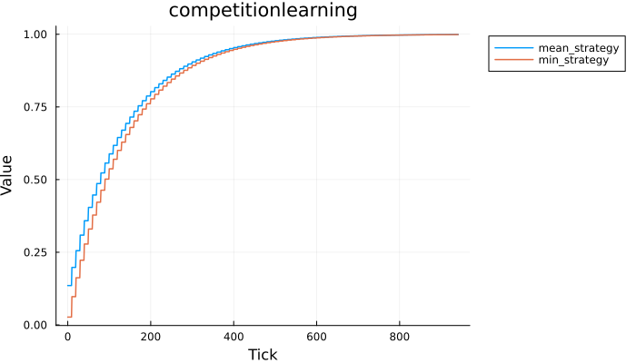
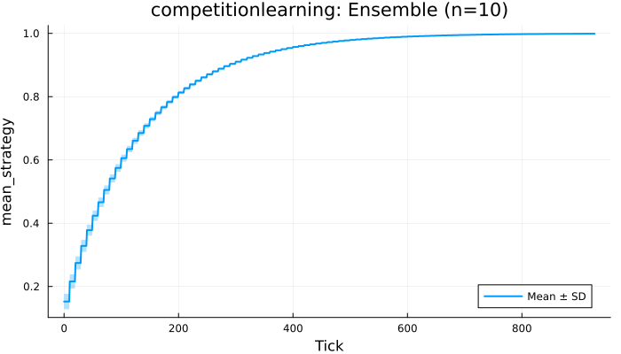
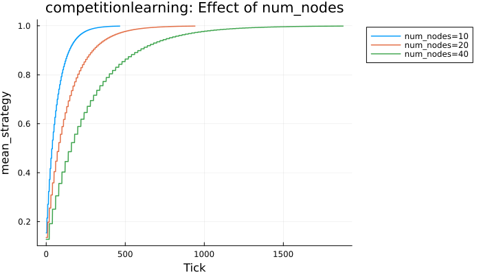

# Competition Learning


- [Overview](#overview)
- [Parameters](#parameters)
- [Source Code](#source-code)
- [Time Series](#time-series)
- [Ensemble Runs](#ensemble-runs)
- [Parameter Sensitivity](#parameter-sensitivity)
- [Appendix: Source Code](#appendix-source-code)
  - [Parameters (`parameters.jl`)](#parameters-parametersjl)
  - [Components (`components.jl`)](#components-componentsjl)
  - [Resources (`resources.jl`)](#resources-resourcesjl)
  - [Systems (`systems.jl`)](#systems-systemsjl)
  - [Model (`model.jl`)](#model-modeljl)

## Overview

This vignette demonstrates the **Competition Learning** model
implemented in
[ArkModelZoo.jl](https://github.com/sdwfrost/ArkModelZoo.jl) using the
Ark.jl ECS framework.

## Parameters

| Parameter         | Type      | Default | Description     |
|-------------------|-----------|---------|-----------------|
| `num_nodes`       | `Int`     | `20`    | num nodes       |
| `start_wt`        | `Float64` | `0.05`  | start wt        |
| `match_wt`        | `Float64` | `15.0`  | match wt        |
| `start_strat_max` | `Float64` | `0.3`   | start strat max |
| `base_learn`      | `Float64` | `0.07`  | base learn      |
| `partner_learn`   | `Float64` | `0.07`  | partner learn   |
| `max_ticks`       | `Int`     | `10000` | max ticks       |

## Source Code

The Julia code to run this model:

``` julia
using ArkModelZoo
_, trajectory = run_competitionlearning()
```

## Time Series



## Ensemble Runs

Ten replicates with different random seeds, showing mean ± standard
deviation.



## Parameter Sensitivity

Varying `num_nodes`.



## Appendix: Source Code

This model is implemented in the
[Ark.jl](https://github.com/sdwfrost/Ark.jl) Entity-Component-System
(ECS) framework. The code is split into five files, each with a distinct
role:

- **Parameters**: a mutable struct holding all configurable values.
- **Components**: lightweight data types attached to individual entities
  (agents).
- **Resources**: world-level shared state accessible to all systems.
- **Systems**: functions that operate on entities each tick, defining
  model behavior.
- **Model**: wiring that assembles the world, registers resources and
  systems, and provides the run entry point.

### Parameters (`parameters.jl`)

The parameter struct uses `@kwdef` so that every field has a default
value and can be overridden by keyword. These defaults match the
original NetLogo model’s slider settings.

``` julia
Base.@kwdef mutable struct CLParams
    num_nodes::Int = 20
    start_wt::Float64 = 0.05
    match_wt::Float64 = 15.0
    start_strat_max::Float64 = 0.3
    base_learn::Float64 = 0.07
    partner_learn::Float64 = 0.07
    max_ticks::Int = 10000
    seed::Int = 42
end
```

### Components (`components.jl`)

Components are lightweight data types attached to individual entities
(agents). Mutable structs hold per-entity state, while empty tag structs
act as markers for the ECS query system to efficiently filter entities.

``` julia
struct CLDummy end
```

### Resources (`resources.jl`)

Resources are world-level singletons shared across all systems, used for
global state and aggregate statistics.

``` julia
mutable struct CLState
    n_agents::Int
    strategy::Vector{Float64}
    plays::Vector{Int}
    plays_to_99::Vector{Int}
    wins::Vector{Int}
    played::Vector{Bool}
    # Symmetric link weights stored as upper-triangular matrices indexed by (i,j) i<j
    matches_for_choosing::Matrix{Float64}
    matches_real::Matrix{Float64}
end

function CLState()
    CLState(0, Float64[], Int[], Int[], Int[], Bool[],
            Matrix{Float64}(undef, 0, 0), Matrix{Float64}(undef, 0, 0))
end

function _cl_init_agents!(state::CLState, n::Int, rng, start_strat_max::Float64, start_wt::Float64)
    state.n_agents = n
    state.strategy = [rand(rng) * start_strat_max for _ in 1:n]
    state.plays = zeros(Int, n)
    state.plays_to_99 = zeros(Int, n)
    state.wins = zeros(Int, n)
    state.played = falses(n)
    # Fully connected graph — symmetric weight matrices
    state.matches_for_choosing = fill(start_wt, n, n)
    state.matches_real = zeros(Float64, n, n)
    # Zero the diagonal (no self-links)
    for i in 1:n
        state.matches_for_choosing[i, i] = 0.0
    end
    return nothing
end

mutable struct CLStats
    mean_strategy::Float64
    min_strategy::Float64
end

CLStats() = CLStats(0.0, 0.0)
```

### Systems (`systems.jl`)

Systems contain the model logic and execute in a defined order each
tick. Each system struct implements either `initialize!` (run once at
setup) or `update!` (run every tick).

``` julia
# --- Helpers ---

function _cl_weighted_one_of(rng, weights::Vector{Float64}, indices::Vector{Int})
    total = 0.0
    for idx in indices
        total += weights[idx]
    end
    total <= 0.0 && return 0
    r = rand(rng) * total
    cumul = 0.0
    for idx in indices
        cumul += weights[idx]
        if r <= cumul
            return idx
        end
    end
    return indices[end]
end

function _cl_compete!(state::CLState, i::Int, j::Int, base_learn::Float64, partner_learn::Float64)
    state.played[i] = true
    state.played[j] = true
    state.plays[i] += 1
    state.plays[j] += 1

    strategy_i = state.strategy[i]
    strategy_j = state.strategy[j]

    # Both players learn from base learning
    state.strategy[i] += (1.0 - state.strategy[i]) * base_learn
    state.strategy[j] += (1.0 - state.strategy[j]) * base_learn

    # Winner/loser partner learning
    if strategy_i > strategy_j
        state.wins[i] += 1
        state.strategy[j] += (strategy_i - strategy_j) * partner_learn
    elseif strategy_j > strategy_i
        state.wins[j] += 1
        state.strategy[i] += (strategy_j - strategy_i) * partner_learn
    end

    # Track plays before reaching 0.99
    if state.strategy[i] < 0.99
        state.plays_to_99[i] += 1
    end
    if state.strategy[j] < 0.99
        state.plays_to_99[j] += 1
    end
    return nothing
end

function _cl_update_stats!(state::CLState, stats::CLStats)
    stats.mean_strategy = sum(state.strategy) / state.n_agents
    stats.min_strategy = minimum(state.strategy)
    return nothing
end

# --- Systems ---

struct InitCLSystem <: System end

function initialize!(::InitCLSystem, world::World)
    params = get_resource(world, CLParams)
    rng = get_resource(world, RNGResource).rng
    state = get_resource(world, CLState)
    stats = get_resource(world, CLStats)

    _cl_init_agents!(state, params.num_nodes, rng, params.start_strat_max, params.start_wt)
    _cl_update_stats!(state, stats)
    return nothing
end

struct CLGoSystem <: System end

function update!(::CLGoSystem, world::World)
    params = get_resource(world, CLParams)
    rng = get_resource(world, RNGResource).rng
    state = get_resource(world, CLState)
    stats = get_resource(world, CLStats)
    n = state.n_agents

    # Pick one unplayed turtle (NetLogo ask one-of shuffles)
    unplayed = [i for i in 1:n if !state.played[i]]
    length(unplayed) < 2 && return nothing
    player1 = unplayed[rand(rng, 1:length(unplayed))]

    # Find eligible opponents (unplayed neighbors, i.e. all other unplayed agents)
    eligible = [j for j in 1:n if j != player1 && !state.played[j]]
    if !isempty(eligible)
        # Weighted selection by matches_for_choosing
        weights = [state.matches_for_choosing[player1, j] for j in eligible]
        player2 = eligible[_cl_weighted_one_of(rng, weights, collect(1:length(eligible)))]

        # Update match link
        state.matches_for_choosing[player1, player2] += params.match_wt
        state.matches_for_choosing[player2, player1] += params.match_wt
        state.matches_real[player1, player2] += 1.0
        state.matches_real[player2, player1] += 1.0

        _cl_compete!(state, player1, player2, params.base_learn, params.partner_learn)
    end

    # Check if round is over (fewer than 2 unplayed)
    unplayed_count = count(!, state.played)
    if unplayed_count < 2
        for i in 1:n
            state.played[i] = false
        end
        _cl_update_stats!(state, stats)
    end

    # Check termination: min strategy >= 0.999
    if minimum(state.strategy) >= 0.999
        _cl_update_stats!(state, stats)
        get_resource(world, Terminate).stop = true
    end

    return nothing
end

struct CLTerminationSystem <: System end

function update!(::CLTerminationSystem, world::World)
    params = get_resource(world, CLParams)
    tick = get_resource(world, Tick)
    if tick.tick + 1 >= params.max_ticks
        get_resource(world, Terminate).stop = true
    end
    return nothing
end
```

### Model (`model.jl`)

The model file assembles all pieces: it creates the ECS `World` with the
required component types, registers resources, builds the `Scheduler`
with systems in execution order, and exposes the public `run` entry
point. The observer pattern records the trajectory each tick.

``` julia
function competitionlearning_world(; initial_capacity::Int = 128)
    return World(CLDummy; initial_capacity=initial_capacity, allow_mutable=true)
end

function competitionlearning_systems()
    return (
        InitCLSystem(),
        CLGoSystem(),
        CLTerminationSystem(),
    )
end

function competitionlearning_model(params::CLParams = CLParams())
    world = competitionlearning_world()
    _add_standard_resources!(world, params)
    add_resource!(world, CLState())
    add_resource!(world, CLStats())
    scheduler = Scheduler(world, competitionlearning_systems())
    initialize!(scheduler)
    return scheduler
end

struct CLObserver end

function competitionlearning_headers(::CLObserver)
    return ["mean_strategy", "min_strategy"]
end

function competitionlearning_values(::CLObserver, world::World)
    stats = get_resource(world, CLStats)
    return Float64[stats.mean_strategy, stats.min_strategy]
end

function run_competitionlearning(; params::CLParams = CLParams(), observe::Bool = true)
    return _run_model(competitionlearning_model, CLObserver(), competitionlearning_values; params, observe)
end
```
