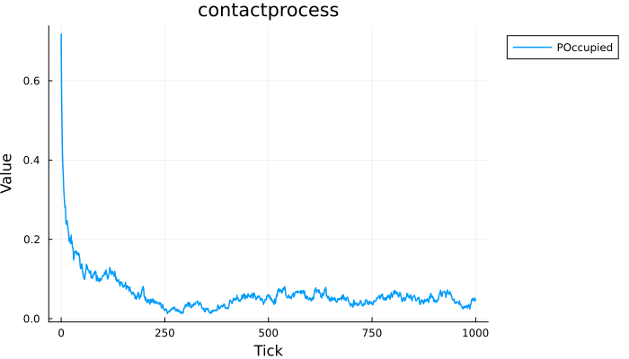
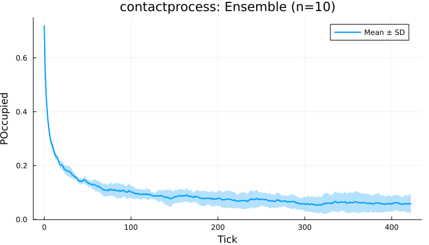
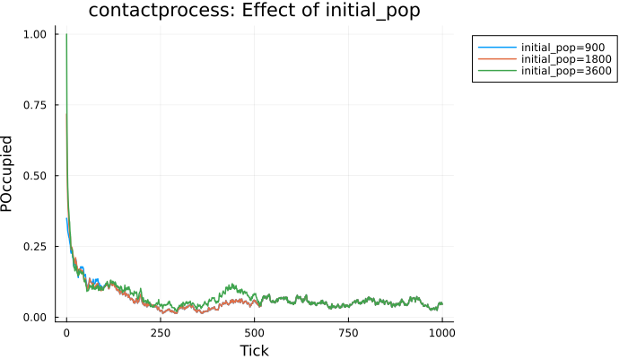

# Contact Process 2D


- [Overview](#overview)
- [Parameters](#parameters)
- [Source Code](#source-code)
- [Time Series](#time-series)
- [Ensemble Runs](#ensemble-runs)
- [Parameter Sensitivity](#parameter-sensitivity)
- [Appendix: Source Code](#appendix-source-code)
  - [Parameters (`parameters.jl`)](#parameters-parametersjl)
  - [Components (`components.jl`)](#components-componentsjl)
  - [Resources (`resources.jl`)](#resources-resourcesjl)
  - [Systems (`systems.jl`)](#systems-systemsjl)
  - [Model (`model.jl`)](#model-modeljl)

## Overview

This vignette demonstrates the **Contact Process 2D** model implemented
in [ArkModelZoo.jl](https://github.com/sdwfrost/ArkModelZoo.jl) using
the Ark.jl ECS framework.

## Parameters

| Parameter     | Type      | Default | Description |
|---------------|-----------|---------|-------------|
| `initial_pop` | `Int`     | `1800`  | initial pop |
| `p_death`     | `Float64` | `0.607` | p death     |
| `grid_width`  | `Int`     | `50`    | grid width  |
| `grid_height` | `Int`     | `50`    | grid height |
| `max_ticks`   | `Int`     | `1000`  | max ticks   |

## Source Code

The Julia code to run this model:

``` julia
using ArkModelZoo
_, trajectory = run_contactprocess()
```

## Time Series



## Ensemble Runs

Ten replicates with different random seeds, showing mean ± standard
deviation.



## Parameter Sensitivity

Varying `initial_pop`.



## Appendix: Source Code

This model is implemented in the
[Ark.jl](https://github.com/sdwfrost/Ark.jl) Entity-Component-System
(ECS) framework. The code is split into five files, each with a distinct
role:

- **Parameters**: a mutable struct holding all configurable values.
- **Components**: lightweight data types attached to individual entities
  (agents).
- **Resources**: world-level shared state accessible to all systems.
- **Systems**: functions that operate on entities each tick, defining
  model behavior.
- **Model**: wiring that assembles the world, registers resources and
  systems, and provides the run entry point.

### Parameters (`parameters.jl`)

The parameter struct uses `@kwdef` so that every field has a default
value and can be overridden by keyword. These defaults match the
original NetLogo model’s slider settings.

``` julia
Base.@kwdef mutable struct ContactProcessParams
    initial_pop::Int = 1800
    p_death::Float64 = 0.607
    grid_width::Int = 50
    grid_height::Int = 50
    max_ticks::Int = 1000
    seed::Int = 42
end
```

### Components (`components.jl`)

Components are lightweight data types attached to individual entities
(agents). Mutable structs hold per-entity state, while empty tag structs
act as markers for the ECS query system to efficiently filter entities.

``` julia
struct ContactDummy end
```

### Resources (`resources.jl`)

Resources are world-level singletons shared across all systems, used for
global state and aggregate statistics.

``` julia
mutable struct ContactGrid
    width::Int
    height::Int
    occupied::Matrix{Bool}  # true = occupied (black), false = empty (white)
end
ContactGrid(w, h) = ContactGrid(w, h, falses(w, h))

mutable struct ContactStats
    p_occupied::Float64
end
ContactStats() = ContactStats(0.0)
```

### Systems (`systems.jl`)

Systems contain the model logic and execute in a defined order each
tick. Each system struct implements either `initialize!` (run once at
setup) or `update!` (run every tick).

``` julia
# --- Initialization ---
# NetLogo: ask patches [ ifelse random N < initial-pop [ black ] [ white ] ]
# random N returns integer in [0, N-1]

struct InitContactSystem <: System end

function initialize!(::InitContactSystem, world::World)
    params = get_resource(world, ContactProcessParams)
    rng = get_resource(world, RNGResource).rng
    grid = get_resource(world, ContactGrid)
    stats = get_resource(world, ContactStats)

    N = grid.width * grid.height
    for x in 1:grid.width, y in 1:grid.height
        grid.occupied[x, y] = rand(rng, 0:N-1) < params.initial_pop
    end

    stats.p_occupied = count(grid.occupied) / N
    return nothing
end

# --- Contact Process Update ---
# NetLogo: repeat N [ ask one-of patches [ ifelse pcolor = black [ death-event ] [ birth-event ] ] ]
# N individual random patch picks per tick. A patch can be picked multiple times.
# death-event: if random-float 1 < p-death → set pcolor white
# birth-event: set pcolor [pcolor] of one-of neighbors4

struct ContactUpdateSystem <: System end

function update!(::ContactUpdateSystem, world::World)
    params = get_resource(world, ContactProcessParams)
    rng = get_resource(world, RNGResource).rng
    grid = get_resource(world, ContactGrid)
    w, h = grid.width, grid.height
    N = w * h

    for _ in 1:N
        x = rand(rng, 1:w)
        y = rand(rng, 1:h)

        if grid.occupied[x, y]
            # death-event: random-float 1 < p-death → become empty
            if rand(rng) < params.p_death
                grid.occupied[x, y] = false
            end
        else
            # birth-event: copy state from random Von Neumann neighbor (toroidal)
            dir = rand(rng, 1:4)
            nx, ny = if dir == 1
                (mod1(x - 1, w), y)       # left
            elseif dir == 2
                (mod1(x + 1, w), y)       # right
            elseif dir == 3
                (x, mod1(y - 1, h))       # down
            else
                (x, mod1(y + 1, h))       # up
            end
            grid.occupied[x, y] = grid.occupied[nx, ny]
        end
    end
    return nothing
end

# --- Stats ---

struct ContactStatsSystem <: System end

function update!(::ContactStatsSystem, world::World)
    grid = get_resource(world, ContactGrid)
    stats = get_resource(world, ContactStats)
    N = grid.width * grid.height
    stats.p_occupied = count(grid.occupied) / N
    return nothing
end

# --- Termination ---
# Stop if no occupied patches or max_ticks reached

struct ContactTerminationSystem <: System end

function update!(::ContactTerminationSystem, world::World)
    grid = get_resource(world, ContactGrid)
    params = get_resource(world, ContactProcessParams)
    tick = get_resource(world, Tick)

    if !any(grid.occupied) || tick.tick + 1 >= params.max_ticks
        get_resource(world, Terminate).stop = true
    end
    return nothing
end
```

### Model (`model.jl`)

The model file assembles all pieces: it creates the ECS `World` with the
required component types, registers resources, builds the `Scheduler`
with systems in execution order, and exposes the public `run` entry
point. The observer pattern records the trajectory each tick.

``` julia
function contactprocess_world(; initial_capacity::Int = 128)
    return World(
        ContactDummy;
        initial_capacity = initial_capacity,
        allow_mutable = true,
    )
end

function contactprocess_systems()
    return (
        InitContactSystem(),
        ContactUpdateSystem(),
        ContactStatsSystem(),
        ContactTerminationSystem(),
    )
end

function contactprocess_model(params::ContactProcessParams = ContactProcessParams())
    world = contactprocess_world()
    _add_standard_resources!(world, params)
    add_resource!(world, ContactGrid(params.grid_width, params.grid_height))
    add_resource!(world, ContactStats())
    scheduler = Scheduler(world, contactprocess_systems())
    initialize!(scheduler)
    return scheduler
end

struct ContactProcessObserver end

function contactprocess_headers(::ContactProcessObserver)
    return ["POccupied"]
end

function contactprocess_values(::ContactProcessObserver, world::World)
    stats = get_resource(world, ContactStats)
    return Float64[stats.p_occupied]
end

function run_contactprocess(; params::ContactProcessParams = ContactProcessParams(), observe::Bool = true)
    return _run_model(contactprocess_model, ContactProcessObserver(), contactprocess_values; params, observe)
end
```
