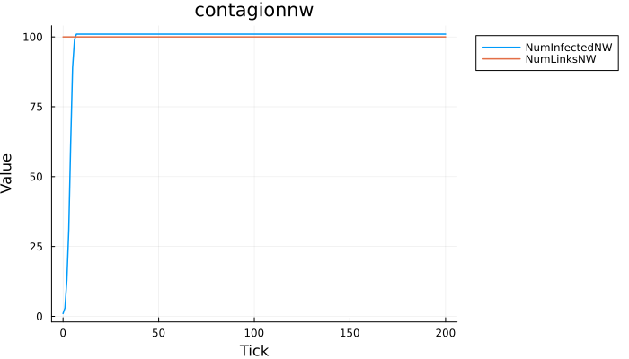
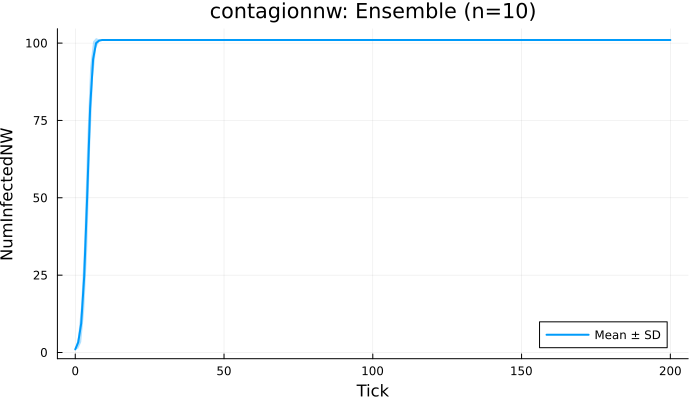
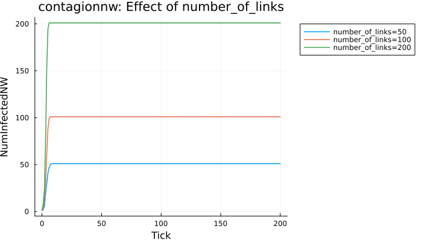

## Overview

This vignette demonstrates the **Contagion NW** model implemented in [ArkModelZoo.jl](https://github.com/sdwfrost/ArkModelZoo.jl) using the Ark.jl ECS framework.

## Parameters

| Parameter | Type | Default | Description |
|-----------|------|---------|-------------|
| `number_of_links` | `Int` | `100` | number of links |
| `probability_linked_affected` | `Int` | `50` | probability linked affected |
| `probability_other_affected` | `Int` | `1` | probability other affected |
| `max_ticks` | `Int` | `200` | max ticks |

## Source Code

The Julia code to run this model:

```julia
using ArkModelZoo
_, trajectory = run_contagionnw()
```

## Time Series

{width=100%}

## Ensemble Runs

Ten replicates with different random seeds, showing mean ± standard deviation.

{width=100%}

## Parameter Sensitivity

Varying `number_of_links`.

{width=100%}


## Appendix: Source Code

This model is implemented in the [Ark.jl](https://github.com/sdwfrost/Ark.jl) Entity-Component-System (ECS) framework. The code is split into five files, each with a distinct role:

- **Parameters**: a mutable struct holding all configurable values.
- **Components**: lightweight data types attached to individual entities (agents).
- **Resources**: world-level shared state accessible to all systems.
- **Systems**: functions that operate on entities each tick, defining model behavior.
- **Model**: wiring that assembles the world, registers resources and systems, and provides the run entry point.

### Parameters (`parameters.jl`)

The parameter struct uses `@kwdef` so that every field has a default value and can be overridden by keyword. These defaults match the original NetLogo model's slider settings.

```julia
Base.@kwdef mutable struct ContagionNWParams
    number_of_links::Int = 100
    probability_linked_affected::Int = 50
    probability_other_affected::Int = 1
    max_ticks::Int = 200
    seed::Int = 42
end
```

### Components (`components.jl`)

Components are lightweight data types attached to individual entities (agents). Mutable structs hold per-entity state, while empty tag structs act as markers for the ECS query system to efficiently filter entities.

```julia
struct CNWDummy end
```

### Resources (`resources.jl`)

Resources are world-level singletons shared across all systems, used for global state and aggregate statistics.

```julia
mutable struct CNWNetwork
    n::Int
    adj::Vector{Set{Int}}
    infected::Vector{Bool}
end
CNWNetwork() = CNWNetwork(0, Set{Int}[], Bool[])

function _cnw_add_node!(net::CNWNetwork; infected::Bool=false)
    net.n += 1
    push!(net.adj, Set{Int}())
    push!(net.infected, infected)
    return net.n
end

function _cnw_add_edge!(net::CNWNetwork, i::Int, j::Int)
    i == j && return
    push!(net.adj[i], j)
    push!(net.adj[j], i)
end

function _cnw_num_links(net::CNWNetwork)
    s = 0
    for a in net.adj
        s += length(a)
    end
    return div(s, 2)
end

mutable struct CNWStats
    num_infected::Int
    num_links::Int
end
CNWStats() = CNWStats(0, 0)
```

### Systems (`systems.jl`)

Systems contain the model logic and execute in a defined order each tick. Each system struct implements either `initialize!` (run once at setup) or `update!` (run every tick).

```julia
# Contagion on Network (Preferential Attachment)
# NetLogo: grows network via preferential attachment, then spreads contagion

struct InitContagionNWSystem <: System end

function initialize!(::InitContagionNWSystem, world::World)
    params = get_resource(world, ContagionNWParams)
    rng = get_resource(world, RNGResource).rng
    net = get_resource(world, CNWNetwork)
    stats = get_resource(world, CNWStats)

    # NetLogo setup: make-node nobody; make-node turtle 0
    # Start with 2 nodes connected by 1 link, N=1
    _cnw_add_node!(net)  # node 1
    _cnw_add_node!(net)  # node 2
    _cnw_add_edge!(net, 1, 2)

    # NetLogo go: while [N < number-of-links] grow network
    # N starts at 1 (from second make-node), increments each make-node call
    link_count = 1
    while link_count < params.number_of_links
        # find-partner: [one-of both-ends] of one-of links
        # Pick a random edge, then pick one end
        total_links = _cnw_num_links(net)
        if total_links == 0
            break
        end
        # Flatten edges for uniform random pick
        target_idx = rand(rng, 1:total_links)
        edge_count = 0
        partner = 1
        found = false
        for i in 1:net.n
            for j in net.adj[i]
                j > i || continue  # count each edge once
                edge_count += 1
                if edge_count == target_idx
                    partner = rand(rng, (i, j))
                    found = true
                    break
                end
            end
            found && break
        end

        # make-node: create turtle, link to partner, N += 1
        new_id = _cnw_add_node!(net)
        _cnw_add_edge!(net, new_id, partner)
        link_count += 1
    end

    # All turtles start red (uninfected); mark all as not infected initially
    # NetLogo: after growth loop, ask one-of turtles [set color green]
    if net.n > 0
        initial = rand(rng, 1:net.n)
        net.infected[initial] = true
    end

    stats.num_infected = count(net.infected)
    stats.num_links = _cnw_num_links(net)
    return nothing
end

struct CNWSpreadSystem <: System end

function update!(::CNWSpreadSystem, world::World)
    params = get_resource(world, ContagionNWParams)
    rng = get_resource(world, RNGResource).rng
    net = get_resource(world, CNWNetwork)
    stats = get_resource(world, CNWStats)

    # NetLogo go (after growth):
    # ask one-of turtles [set color green]  — pick one turtle to start spreading from
    # if any? turtles with [color = red] — if uninfected exist
    #   ask turtles with [color = green] — each infected turtle
    #     ask link-neighbors — linked neighbors
    #       if random 100 <= probability-linked-affected [set color green]
    #       ask other turtles — ALL other turtles (non-link)
    #         if random 100 < probability-other-affected [set color green]
    #
    # NOTE: The NetLogo code has nested ask: for each infected turtle,
    # for each link-neighbor, it asks ALL other turtles. This is unusual
    # but faithful to the original. We implement the effect:
    # infected turtles try to infect link-neighbors with p_linked,
    # and also try to infect all non-link turtles with p_other.

    any_uninfected = any(!, net.infected)
    if !any_uninfected
        return nothing
    end

    new_infected = copy(net.infected)

    # Shuffle infected indices (NetLogo ask shuffles)
    infected_ids = findall(net.infected)
    Random.shuffle!(rng, infected_ids)

    for i in infected_ids
        # Try to infect link-neighbors
        neighbors = collect(net.adj[i])
        Random.shuffle!(rng, neighbors)
        for j in neighbors
            if !new_infected[j]
                if rand(rng, 0:99) <= params.probability_linked_affected
                    new_infected[j] = true
                end
            end
            # Each link-neighbor also triggers asks to "other turtles" 
            # For efficiency, we just do the other-turtles pass once per infected
        end
        # Try to infect all other (non-link) turtles with lower probability
        for j in 1:net.n
            j == i && continue
            j in net.adj[i] && continue
            if !new_infected[j]
                if rand(rng, 0:99) < params.probability_other_affected
                    new_infected[j] = true
                end
            end
        end
    end

    copy!(net.infected, new_infected)
    stats.num_infected = count(net.infected)
    stats.num_links = _cnw_num_links(net)
    return nothing
end

struct CNWTerminationSystem <: System end

function update!(::CNWTerminationSystem, world::World)
    params = get_resource(world, ContagionNWParams)
    tick = get_resource(world, Tick)
    if tick.tick + 1 >= params.max_ticks
        get_resource(world, Terminate).stop = true
    end
    return nothing
end
```

### Model (`model.jl`)

The model file assembles all pieces: it creates the ECS `World` with the required component types, registers resources, builds the `Scheduler` with systems in execution order, and exposes the public `run` entry point. The observer pattern records the trajectory each tick.

```julia
function contagionnw_world(; initial_capacity::Int = 128)
    return World(CNWDummy; initial_capacity = initial_capacity, allow_mutable = true)
end

function contagionnw_systems()
    return (InitContagionNWSystem(), CNWSpreadSystem(), CNWTerminationSystem())
end

function contagionnw_model(params::ContagionNWParams = ContagionNWParams())
    world = contagionnw_world()
    _add_standard_resources!(world, params)
    add_resource!(world, CNWNetwork())
    add_resource!(world, CNWStats())
    scheduler = Scheduler(world, contagionnw_systems())
    initialize!(scheduler)
    return scheduler
end

struct ContagionNWObserver end

function contagionnw_headers(::ContagionNWObserver)
    return ["NumInfectedNW", "NumLinksNW"]
end

function contagionnw_values(::ContagionNWObserver, world::World)
    stats = get_resource(world, CNWStats)
    return Float64[stats.num_infected, stats.num_links]
end

function run_contagionnw(; params::ContagionNWParams = ContagionNWParams(), observe::Bool = true)
    return _run_model(contagionnw_model, ContagionNWObserver(), contagionnw_values; params, observe)
end
```
