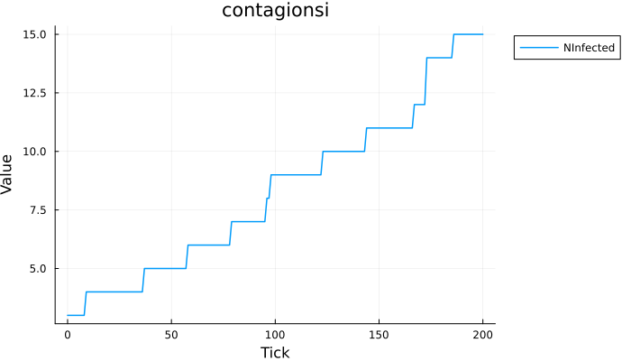
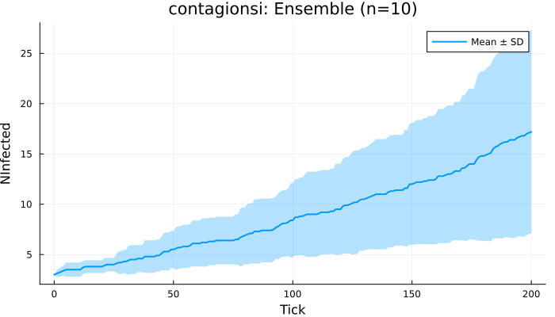
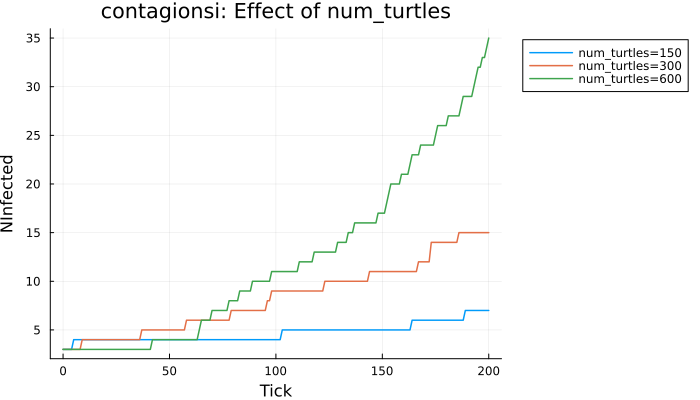

# Contagion SI


- [Overview](#overview)
- [Parameters](#parameters)
- [Source Code](#source-code)
- [Time Series](#time-series)
- [Ensemble Runs](#ensemble-runs)
- [Parameter Sensitivity](#parameter-sensitivity)
- [Appendix: Source Code](#appendix-source-code)
  - [Parameters (`parameters.jl`)](#parameters-parametersjl)
  - [Components (`components.jl`)](#components-componentsjl)
  - [Resources (`resources.jl`)](#resources-resourcesjl)
  - [Systems (`systems.jl`)](#systems-systemsjl)
  - [Model (`model.jl`)](#model-modeljl)

## Overview

This vignette demonstrates the **Contagion SI** model implemented in
[ArkModelZoo.jl](https://github.com/sdwfrost/ArkModelZoo.jl) using the
Ark.jl ECS framework.

## Parameters

| Parameter            | Type      | Default | Description        |
|----------------------|-----------|---------|--------------------|
| `num_turtles`        | `Int`     | `300`   | num turtles        |
| `init_infected`      | `Int`     | `3`     | init infected      |
| `speed`              | `Float64` | `0.5`   | speed              |
| `turning_angle`      | `Int`     | `60`    | turning angle      |
| `transmissibility`   | `Float64` | `0.01`  | transmissibility   |
| `spontaneous_infect` | `Float64` | `0.0`   | spontaneous infect |
| `grid_width`         | `Int`     | `33`    | grid width         |
| `grid_height`        | `Int`     | `33`    | grid height        |
| `max_ticks`          | `Int`     | `200`   | max ticks          |

## Source Code

The Julia code to run this model:

``` julia
using ArkModelZoo
_, trajectory = run_contagionsi()
```

## Time Series



## Ensemble Runs

Ten replicates with different random seeds, showing mean ± standard
deviation.



## Parameter Sensitivity

Varying `num_turtles`.



## Appendix: Source Code

This model is implemented in the
[Ark.jl](https://github.com/sdwfrost/Ark.jl) Entity-Component-System
(ECS) framework. The code is split into five files, each with a distinct
role:

- **Parameters**: a mutable struct holding all configurable values.
- **Components**: lightweight data types attached to individual entities
  (agents).
- **Resources**: world-level shared state accessible to all systems.
- **Systems**: functions that operate on entities each tick, defining
  model behavior.
- **Model**: wiring that assembles the world, registers resources and
  systems, and provides the run entry point.

### Parameters (`parameters.jl`)

The parameter struct uses `@kwdef` so that every field has a default
value and can be overridden by keyword. These defaults match the
original NetLogo model’s slider settings.

``` julia
Base.@kwdef mutable struct ContagionSIParams
    num_turtles::Int = 300
    init_infected::Int = 3
    speed::Float64 = 0.5
    turning_angle::Int = 60
    transmissibility::Float64 = 0.01
    spontaneous_infect::Float64 = 0.0
    grid_width::Int = 33
    grid_height::Int = 33
    max_ticks::Int = 200
    seed::Int = 42
end
```

### Components (`components.jl`)

Components are lightweight data types attached to individual entities
(agents). Mutable structs hold per-entity state, while empty tag structs
act as markers for the ECS query system to efficiently filter entities.

``` julia
# Position on continuous space (NetLogo world -16,16 → [0,33))
mutable struct CIPosition
    x::Float64
    y::Float64
end

# Persistent heading (degrees, 0=north, clockwise)
mutable struct CIHeading
    angle::Float64
end

# Tag components for disease state (CI = Contagion Infection)
struct CISusceptible end
struct CIInfected end
```

### Resources (`resources.jl`)

Resources are world-level singletons shared across all systems, used for
global state and aggregate statistics.

``` julia
mutable struct CIStats
    n_infected::Int
end
CIStats() = CIStats(0)
```

### Systems (`systems.jl`)

Systems contain the model logic and execute in a defined order each
tick. Each system struct implements either `initialize!` (run once at
setup) or `update!` (run every tick).

``` julia
# Contagion SI Model Systems
# NetLogo go order: check-all-infected → infect-susceptibles → recolor → move → count → tick
# Execution order: infection → movement → stats → termination

# --- Initialization ---
# NetLogo: create-turtles 300; ask n-of 3 turtles [set infected? true]

struct InitContagionSISystem <: System end

function initialize!(::InitContagionSISystem, world::World)
    params = get_resource(world, ContagionSIParams)
    rng = get_resource(world, RNGResource).rng
    stats = get_resource(world, CIStats)
    wf = Float64(params.grid_width)
    hf = Float64(params.grid_height)

    init_infected = min(params.init_infected, params.num_turtles)

    # Create all agents as susceptible with random positions and headings
    for _ in 1:params.num_turtles
        x = rand(rng) * wf
        y = rand(rng) * hf
        heading = Float64(rand(rng, 0:359))
        new_entity!(world, (CIPosition(x, y), CIHeading(heading), CISusceptible()))
    end

    # Select initial infected: n-of init-infected turtles
    all_entities = Entity[]
    for (eids, _) in Query(world, (CIPosition,); with=(CISusceptible,))
        @inbounds for i in eachindex(eids)
            push!(all_entities, eids[i])
        end
    end
    Random.shuffle!(rng, all_entities)
    for i in 1:init_infected
        exchange_components!(world, all_entities[i];
            add = (CIInfected(),),
            remove = (CISusceptible,),
        )
    end

    stats.n_infected = init_infected
    return nothing
end

# --- Infection ---
# NetLogo: ask turtles with [not infected?] [
#   let infected-neighbors (count other turtles with [color = red] in-radius 1)
#   if random-float 1 < 1 - (((1 - transmissibility) ^ infected-neighbors) * (1 - spontaneous-infect))
#     [set infected? true]
# ]
#
# `color = red` reflects previous tick's recolor, so new infections this tick
# are NOT counted as infected neighbors. We batch: all decisions use the
# start-of-tick infected set, then apply transitions at the end.

struct CIInfectionSystem <: System
    infected_cells::Dict{Tuple{Int,Int}, Vector{Tuple{Entity, Float64, Float64}}}
    to_infect::Vector{Entity}
end
CIInfectionSystem() = CIInfectionSystem(
    Dict{Tuple{Int,Int}, Vector{Tuple{Entity, Float64, Float64}}}(),
    Entity[],
)

function update!(system::CIInfectionSystem, world::World)
    params = get_resource(world, ContagionSIParams)
    rng = get_resource(world, RNGResource).rng
    w = params.grid_width
    h = params.grid_height
    wf = Float64(w)
    hf = Float64(h)

    empty!(system.infected_cells)
    empty!(system.to_infect)

    # Build spatial index of infected turtles (start-of-tick snapshot)
    for (eids, positions) in Query(world, (CIPosition,); with=(CIInfected,))
        @inbounds for i in eachindex(positions)
            cx = mod(floor(Int, positions[i].x), w) + 1
            cy = mod(floor(Int, positions[i].y), h) + 1
            key = (cx, cy)
            if !haskey(system.infected_cells, key)
                system.infected_cells[key] = Tuple{Entity, Float64, Float64}[]
            end
            push!(system.infected_cells[key], (eids[i], positions[i].x, positions[i].y))
        end
    end

    # Collect susceptible turtles
    susceptibles = Tuple{Entity, Float64, Float64}[]
    for (eids, positions) in Query(world, (CIPosition,); with=(CISusceptible,))
        @inbounds for i in eachindex(positions)
            push!(susceptibles, (eids[i], positions[i].x, positions[i].y))
        end
    end

    # NetLogo `ask` shuffles the agentset
    Random.shuffle!(rng, susceptibles)

    transmissibility = params.transmissibility
    spontaneous_infect = params.spontaneous_infect

    for (eid, sx, sy) in susceptibles
        # Count infected neighbors within radius 1 (toroidal, excluding self)
        cx = mod(floor(Int, sx), w) + 1
        cy = mod(floor(Int, sy), h) + 1

        infected_neighbors = 0
        for dx in -1:1, dy in -1:1
            nx = mod(cx - 1 + dx, w) + 1
            ny = mod(cy - 1 + dy, h) + 1
            targets = get(system.infected_cells, (nx, ny), nothing)
            targets === nothing && continue

            for (target_eid, tx, ty) in targets
                target_eid == eid && continue  # `other` keyword
                ddx = abs(sx - tx)
                ddx = min(ddx, wf - ddx)
                ddy = abs(sy - ty)
                ddy = min(ddy, hf - ddy)
                dist_sq = ddx * ddx + ddy * ddy
                if dist_sq <= 1.0  # in-radius 1
                    infected_neighbors += 1
                end
            end
        end

        # Infection probability: 1 - ((1 - τ)^n * (1 - σ))
        prob = 1.0 - ((1.0 - transmissibility) ^ infected_neighbors * (1.0 - spontaneous_infect))
        if rand(rng) < prob
            push!(system.to_infect, eid)
        end
    end

    # Apply all infection transitions (Susceptible → Infected)
    for eid in system.to_infect
        is_alive(world, eid) || continue
        exchange_components!(world, eid;
            add = (CIInfected(),),
            remove = (CISusceptible,),
        )
    end
    return nothing
end

# --- Movement ---
# NetLogo: left random turning-angle; right random turning-angle; fd speed
# Two independent integer draws in [0, turning_angle-1].

struct CIMovementSystem <: System end

function update!(::CIMovementSystem, world::World)
    rng = get_resource(world, RNGResource).rng
    params = get_resource(world, ContagionSIParams)
    wf = Float64(params.grid_width)
    hf = Float64(params.grid_height)
    ta = params.turning_angle
    spd = params.speed

    for (_, positions, headings) in Query(world, (CIPosition, CIHeading))
        @inbounds for i in eachindex(positions)
            headings[i].angle -= Float64(rand(rng, 0:ta-1))
            headings[i].angle += Float64(rand(rng, 0:ta-1))
            θ = deg2rad(headings[i].angle)
            positions[i].x = mod(positions[i].x + sin(θ) * spd, wf)
            positions[i].y = mod(positions[i].y + cos(θ) * spd, hf)
        end
    end
    return nothing
end

# --- Statistics ---
# NetLogo: set n-infected count turtles with [infected?]

struct CIStatsSystem <: System end

function update!(::CIStatsSystem, world::World)
    stats = get_resource(world, CIStats)
    i_count = 0
    for (eids, _) in Query(world, (CIPosition,); with=(CIInfected,))
        i_count += length(eids)
    end
    stats.n_infected = i_count
    return nothing
end

# --- Termination ---
# NetLogo: if (count turtles with [infected?]) = num-turtles [stop]

struct CITerminationSystem <: System end

function update!(::CITerminationSystem, world::World)
    params = get_resource(world, ContagionSIParams)
    tick = get_resource(world, Tick)
    stats = get_resource(world, CIStats)
    if stats.n_infected == params.num_turtles || tick.tick + 1 >= params.max_ticks
        get_resource(world, Terminate).stop = true
    end
    return nothing
end
```

### Model (`model.jl`)

The model file assembles all pieces: it creates the ECS `World` with the
required component types, registers resources, builds the `Scheduler`
with systems in execution order, and exposes the public `run` entry
point. The observer pattern records the trajectory each tick.

``` julia
function contagionsi_world(; initial_capacity::Int = 1024)
    return World(
        CIPosition,
        CIHeading,
        CISusceptible,
        CIInfected;
        initial_capacity = initial_capacity,
        allow_mutable = true,
    )
end

function contagionsi_systems()
    return (
        InitContagionSISystem(),
        CIInfectionSystem(),
        CIMovementSystem(),
        CIStatsSystem(),
        CITerminationSystem(),
    )
end

function contagionsi_model(params::ContagionSIParams = ContagionSIParams())
    world = contagionsi_world()
    _add_standard_resources!(world, params)
    add_resource!(world, CIStats())
    scheduler = Scheduler(world, contagionsi_systems())
    initialize!(scheduler)
    return scheduler
end

struct ContagionSIObserver end

function contagionsi_headers(::ContagionSIObserver)
    return ["NInfected"]
end

function contagionsi_values(::ContagionSIObserver, world::World)
    stats = get_resource(world, CIStats)
    return Float64[stats.n_infected]
end

function run_contagionsi(; params::ContagionSIParams = ContagionSIParams(), observe::Bool = true)
    return _run_model(contagionsi_model, ContagionSIObserver(), contagionsi_values; params, observe)
end
```
