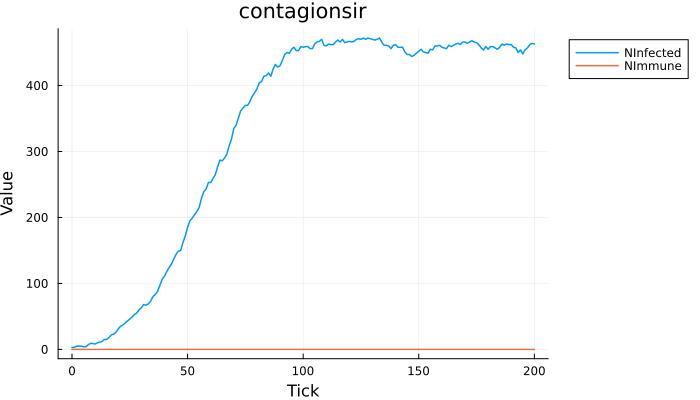
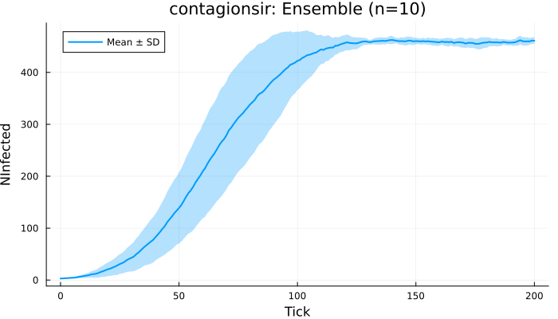
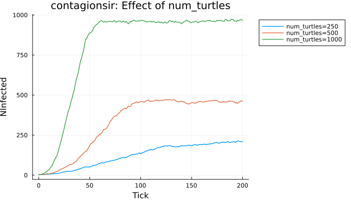

## Overview

This vignette demonstrates the **Contagion SIR** model implemented in [ArkModelZoo.jl](https://github.com/sdwfrost/ArkModelZoo.jl) using the Ark.jl ECS framework.

## Parameters

| Parameter | Type | Default | Description |
|-----------|------|---------|-------------|
| `num_turtles` | `Int` | `500` | num turtles |
| `init_infected` | `Int` | `3` | init infected |
| `speed` | `Float64` | `1.0` | speed |
| `turning_angle` | `Int` | `360` | turning angle |
| `transmissibility` | `Float64` | `0.1` | transmissibility |
| `spontaneous_infect` | `Float64` | `0.0` | spontaneous infect |
| `recovery_rate` | `Float64` | `0.01` | recovery rate |
| `remove_recovered` | `Bool` | `false` | remove recovered |
| `grid_width` | `Int` | `33` | grid width |
| `grid_height` | `Int` | `33` | grid height |
| `max_ticks` | `Int` | `200` | max ticks |

## Source Code

The Julia code to run this model:

```julia
using ArkModelZoo
_, trajectory = run_contagionsir()
```

## Time Series

{width=100%}

## Ensemble Runs

Ten replicates with different random seeds, showing mean ± standard deviation.

{width=100%}

## Parameter Sensitivity

Varying `num_turtles`.

{width=100%}


## Appendix: Source Code

This model is implemented in the [Ark.jl](https://github.com/sdwfrost/Ark.jl) Entity-Component-System (ECS) framework. The code is split into five files, each with a distinct role:

- **Parameters**: a mutable struct holding all configurable values.
- **Components**: lightweight data types attached to individual entities (agents).
- **Resources**: world-level shared state accessible to all systems.
- **Systems**: functions that operate on entities each tick, defining model behavior.
- **Model**: wiring that assembles the world, registers resources and systems, and provides the run entry point.

### Parameters (`parameters.jl`)

The parameter struct uses `@kwdef` so that every field has a default value and can be overridden by keyword. These defaults match the original NetLogo model's slider settings.

```julia
Base.@kwdef mutable struct ContagionSIRParams
    num_turtles::Int = 500
    init_infected::Int = 3
    speed::Float64 = 1.0
    turning_angle::Int = 360
    transmissibility::Float64 = 0.1
    spontaneous_infect::Float64 = 0.0
    recovery_rate::Float64 = 0.01
    remove_recovered::Bool = false
    grid_width::Int = 33
    grid_height::Int = 33
    max_ticks::Int = 200
    seed::Int = 42
end
```

### Components (`components.jl`)

Components are lightweight data types attached to individual entities (agents). Mutable structs hold per-entity state, while empty tag structs act as markers for the ECS query system to efficiently filter entities.

```julia
# Position on continuous space (NetLogo world -16,16 → 33×33, coordinates [0,33))
mutable struct CSIRPosition
    x::Float64
    y::Float64
end

# Persistent heading (degrees, 0=north, clockwise)
mutable struct CSIRHeading
    angle::Float64
end

# Disease state: infected? and immune? booleans (mirrors NetLogo turtles-own)
mutable struct CSIRState
    infected::Bool
    immune::Bool
end
```

### Resources (`resources.jl`)

Resources are world-level singletons shared across all systems, used for global state and aggregate statistics.

```julia
mutable struct CSIRStats
    n_infected::Int
    n_immune::Int
end
CSIRStats() = CSIRStats(0, 0)
```

### Systems (`systems.jl`)

Systems contain the model logic and execute in a defined order each tick. Each system struct implements either `initialize!` (run once at setup) or `update!` (run every tick).

```julia
# Contagion SIR Model Systems
# Execution order: init → infection/recovery → movement → stats → termination
#
# NetLogo go order: infect-susceptibles, recover-infecteds, recolor, move, count stats, tick
# "color = red" timing: recolor runs at end of previous tick, so only agents that
# were infected before this tick appear red. Newly infected this tick have
# infected?=true but color≠red, so they cannot recover this same tick.

# --- Initialization ---
# NetLogo: create-turtles 500 [...]; ask n-of 3 turtles [set infected? true]

struct InitContagionSIRSystem <: System end

function initialize!(::InitContagionSIRSystem, world::World)
    params = get_resource(world, ContagionSIRParams)
    rng = get_resource(world, RNGResource).rng
    stats = get_resource(world, CSIRStats)
    wf = Float64(params.grid_width)
    hf = Float64(params.grid_height)

    for _ in 1:params.num_turtles
        x = rand(rng) * wf
        y = rand(rng) * hf
        heading = Float64(rand(rng, 0:359))
        new_entity!(world, (CSIRPosition(x, y), CSIRHeading(heading), CSIRState(false, false)))
    end

    # Select initial infected: n-of init-infected turtles
    all_entities = Entity[]
    for (eids, _) in Query(world, (CSIRState,))
        @inbounds for i in eachindex(eids)
            push!(all_entities, eids[i])
        end
    end
    n_infect = min(params.init_infected, params.num_turtles)
    Random.shuffle!(rng, all_entities)
    for i in 1:n_infect
        state = get_components(world, all_entities[i], (CSIRState,))[1]
        state.infected = true
    end

    stats.n_infected = n_infect
    stats.n_immune = 0
    return nothing
end

# --- Infection & Recovery ---
# Combined into one system because both phases share the "red" snapshot:
# agents infected at tick start (before this tick's infection step).
#
# NetLogo infect-susceptibles:
#   ask turtles with [not infected? and not immune?] [
#     let infected-neighbors (count other turtles with [color = red] in-radius 1)
#     if (random-float 1 < 1 - (((1 - transmissibility) ^ infected-neighbors) * (1 - spontaneous-infect)))
#       [set infected? true]
#   ]
#
# NetLogo recover-infecteds:
#   ask turtles with [infected? and color = red] [
#     if random-float 1 < recovery-rate [
#       set infected? false
#       if remove-recovered? [set immune? true]
#     ]
#   ]

struct CSIRInfectionRecoverySystem <: System
    red_cells::Dict{Tuple{Int,Int}, Vector{Tuple{Float64, Float64}}}
    red_entities::Vector{Entity}
    to_infect::Vector{Entity}
    to_recover::Vector{Entity}
end

CSIRInfectionRecoverySystem() = CSIRInfectionRecoverySystem(
    Dict{Tuple{Int,Int}, Vector{Tuple{Float64, Float64}}}(),
    Entity[], Entity[], Entity[],
)

function update!(system::CSIRInfectionRecoverySystem, world::World)
    params = get_resource(world, ContagionSIRParams)
    rng = get_resource(world, RNGResource).rng
    w = params.grid_width
    h = params.grid_height
    wf = Float64(w)
    hf = Float64(h)

    empty!(system.red_cells)
    empty!(system.red_entities)
    empty!(system.to_infect)
    empty!(system.to_recover)

    # Classify all entities: "red" (infected at tick start) vs susceptible
    susceptible_entries = Tuple{Entity, Float64, Float64}[]

    for (eids, positions, states) in Query(world, (CSIRPosition, CSIRState))
        @inbounds for i in eachindex(eids)
            if states[i].infected
                px = positions[i].x
                py = positions[i].y
                push!(system.red_entities, eids[i])
                cx = mod(floor(Int, px), w) + 1
                cy = mod(floor(Int, py), h) + 1
                key = (cx, cy)
                if !haskey(system.red_cells, key)
                    system.red_cells[key] = Tuple{Float64, Float64}[]
                end
                push!(system.red_cells[key], (px, py))
            elseif !states[i].immune
                push!(susceptible_entries, (eids[i], positions[i].x, positions[i].y))
            end
        end
    end

    # Phase 1: Infect susceptibles (NetLogo ask shuffles)
    Random.shuffle!(rng, susceptible_entries)

    for (eid, sx, sy) in susceptible_entries
        cx = mod(floor(Int, sx), w) + 1
        cy = mod(floor(Int, sy), h) + 1
        n_red = 0

        for dx in -1:1, dy in -1:1
            nx = mod(cx - 1 + dx, w) + 1
            ny = mod(cy - 1 + dy, h) + 1
            reds = get(system.red_cells, (nx, ny), nothing)
            reds === nothing && continue
            for (rx, ry) in reds
                ddx = abs(sx - rx)
                ddx = min(ddx, wf - ddx)
                ddy = abs(sy - ry)
                ddy = min(ddy, hf - ddy)
                if ddx * ddx + ddy * ddy <= 1.0
                    n_red += 1
                end
            end
        end

        p_infect = 1.0 - ((1.0 - params.transmissibility) ^ n_red * (1.0 - params.spontaneous_infect))
        if rand(rng) < p_infect
            push!(system.to_infect, eid)
        end
    end

    # Phase 2: Recover red agents (NetLogo ask shuffles)
    Random.shuffle!(rng, system.red_entities)

    for eid in system.red_entities
        if rand(rng) < params.recovery_rate
            push!(system.to_recover, eid)
        end
    end

    # Apply infections
    for eid in system.to_infect
        is_alive(world, eid) || continue
        state = get_components(world, eid, (CSIRState,))[1]
        state.infected = true
    end

    # Apply recoveries
    for eid in system.to_recover
        is_alive(world, eid) || continue
        state = get_components(world, eid, (CSIRState,))[1]
        state.infected = false
        if params.remove_recovered
            state.immune = true
        end
    end

    return nothing
end

# --- Movement ---
# NetLogo: left random turning-angle; right random turning-angle; fd speed
# turning-angle=360 → left random(0:359), right random(0:359), net = right - left

struct CSIRMoveSystem <: System end

function update!(::CSIRMoveSystem, world::World)
    params = get_resource(world, ContagionSIRParams)
    rng = get_resource(world, RNGResource).rng
    wf = Float64(params.grid_width)
    hf = Float64(params.grid_height)
    ta = params.turning_angle

    for (_, positions, headings) in Query(world, (CSIRPosition, CSIRHeading))
        @inbounds for i in eachindex(positions)
            if ta > 0
                headings[i].angle += Float64(rand(rng, 0:ta-1)) - Float64(rand(rng, 0:ta-1))
            end
            θ = deg2rad(headings[i].angle)
            positions[i].x = mod(positions[i].x + sin(θ) * params.speed, wf)
            positions[i].y = mod(positions[i].y + cos(θ) * params.speed, hf)
        end
    end
    return nothing
end

# --- Statistics ---
# NetLogo: set n-infected count turtles with [infected?]
#          set n-immune count turtles with [immune?]

struct CSIRStatsSystem <: System end

function update!(::CSIRStatsSystem, world::World)
    stats = get_resource(world, CSIRStats)
    n_inf = 0
    n_imm = 0
    for (_, states) in Query(world, (CSIRState,))
        @inbounds for i in eachindex(states)
            if states[i].infected
                n_inf += 1
            end
            if states[i].immune
                n_imm += 1
            end
        end
    end
    stats.n_infected = n_inf
    stats.n_immune = n_imm
    return nothing
end

# --- Termination ---

struct CSIRTerminationSystem <: System end

function update!(::CSIRTerminationSystem, world::World)
    params = get_resource(world, ContagionSIRParams)
    tick = get_resource(world, Tick)
    if tick.tick + 1 >= params.max_ticks
        get_resource(world, Terminate).stop = true
    end
    return nothing
end
```

### Model (`model.jl`)

The model file assembles all pieces: it creates the ECS `World` with the required component types, registers resources, builds the `Scheduler` with systems in execution order, and exposes the public `run` entry point. The observer pattern records the trajectory each tick.

```julia
function contagionsir_world(; initial_capacity::Int = 1024)
    return World(
        CSIRPosition,
        CSIRHeading,
        CSIRState;
        initial_capacity = initial_capacity,
        allow_mutable = true,
    )
end

function contagionsir_systems()
    return (
        InitContagionSIRSystem(),
        CSIRInfectionRecoverySystem(),
        CSIRMoveSystem(),
        CSIRStatsSystem(),
        CSIRTerminationSystem(),
    )
end

function contagionsir_model(params::ContagionSIRParams = ContagionSIRParams())
    world = contagionsir_world()
    _add_standard_resources!(world, params)
    add_resource!(world, CSIRStats())
    scheduler = Scheduler(world, contagionsir_systems())
    initialize!(scheduler)
    return scheduler
end

struct ContagionSIRObserver end

function contagionsir_headers(::ContagionSIRObserver)
    return ["NInfected", "NImmune"]
end

function contagionsir_values(::ContagionSIRObserver, world::World)
    stats = get_resource(world, CSIRStats)
    return Float64[stats.n_infected, stats.n_immune]
end

function run_contagionsir(; params::ContagionSIRParams = ContagionSIRParams(), observe::Bool = true)
    return _run_model(contagionsir_model, ContagionSIRObserver(), contagionsir_values; params, observe)
end
```
