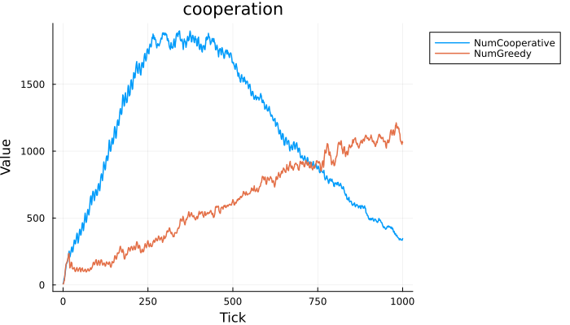
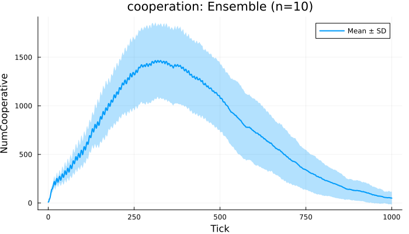
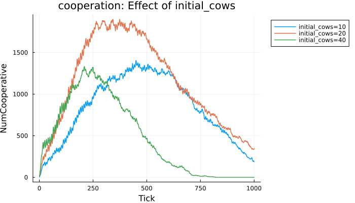

# Cooperation


- [Overview](#overview)
  - [WHAT IS IT?](#what-is-it)
  - [HOW IT WORKS](#how-it-works)
  - [THINGS TO NOTICE](#things-to-notice)
  - [THINGS TO TRY](#things-to-try)
  - [EXTENDING THE MODEL](#extending-the-model)
  - [NETLOGO FEATURES](#netlogo-features)
  - [RELATED MODELS](#related-models)
  - [CREDITS AND REFERENCES](#credits-and-references)
  - [HOW TO CITE](#how-to-cite)
  - [COPYRIGHT AND LICENSE](#copyright-and-license)
- [Parameters](#parameters)
- [Source Code](#source-code)
- [Time Series](#time-series)
- [Ensemble Runs](#ensemble-runs)
- [Parameter Sensitivity](#parameter-sensitivity)
- [Appendix: Source Code](#appendix-source-code)
  - [Parameters (`parameters.jl`)](#parameters-parametersjl)
  - [Components (`components.jl`)](#components-componentsjl)
  - [Resources (`resources.jl`)](#resources-resourcesjl)
  - [Systems (`systems.jl`)](#systems-systemsjl)
  - [Model (`model.jl`)](#model-modeljl)

## Overview

### WHAT IS IT?

This is an evolutionary biology model. In it, agents (cows) compete for
natural resources (grass). Cows that are more successful in getting
grass reproduce more often, and will thus be more evolutionarily
successful. This model includes two kinds of cows, greedy and
cooperative. It shows how these two different strategies do when
competing against each other within a population that evolves over time.

This model (and Altruism and Divide the Cake) are part of the EACH unit
(“Evolution of Altruistic and Cooperative Habits: Learning About
Complexity in Evolution”). See
http://ccl.northwestern.edu/rp/each/index.shtml for more information on
the EACH unit. The EACH unit is embedded within the BEAGLE (Biological
Experiments in Adaptation, Genetics, Learning and Evolution) evolution
curriculum. See http://ccl.northwestern.edu/rp/beagle/index.shtml.

### HOW IT WORKS

Every turn, each cow looks at the patch that it is currently on, and
eats a unit of grass. The greedy cows eat the grass regardless of the
length of the grass on the current patch. The cooperative cows won’t eat
the grass below a certain height. This behavior is significant because
below a certain height (called the “growth threshold”), the grass grows
at a far slower rate than above it. Thus, the cooperative agents leave
more food for the overall population at a cost to their individual
well-being, while the greedy agents eat the grass down to the nub,
regardless of the effect on the overall population.

### THINGS TO NOTICE

Run the model with the default settings. Watch the different growth
curves on the population plot. Which population expands first? Which
population wins in the end?

### THINGS TO TRY

Slowly decrease the STRIDE-LENGTH slider. What happens to the
populations?

At what value of STRIDE-LENGTH do the populations’ growth rates change
dramatically? What does this indicate about the evolutionary advantages
of cooperating versus being greedy? What are the important environmental
factors?

Change the METABOLISM and the GRASS-ENERGY values. How do these values
affect the model?

Change the LOW-GROWTH-CHANCE and the HIGH-GROWTH-CHANCE values. How do
these values affect the model?

How does the LOW-HIGH-THRESHOLD value affect the growth of the
populations?

Can you find settings that maximize the advantage of the cooperative
cows?

### EXTENDING THE MODEL

This model explores only one type of cooperative behavior, namely eating
the grass above the growth threshold (the LOW-HIGH-THRESHOLD value).
What other cooperative, or altruistic, behaviors could be modeled that
hurt individual fitness, while helping the group overall? What
environmental conditions other than grass length could be used to affect
the health of a population?

This model relies primarily upon population “viscosity” (the
STRIDE-LENGTH slider) to alter the behavior of the cows to allow for the
success of the cooperative agents. What other variables could have such
a drastic effect on the evolutionary success of populations?

Also, consider that in this model the behaviors are fixed. What would
happen if the agents learned, or changed their behavior based on food
availability?

### NETLOGO FEATURES

Breeds are used to represent the two different kinds of agents. The
`turtles` primitive is used to refer to both breeds together.

### RELATED MODELS

- Altruism
- Divide the Cake

### CREDITS AND REFERENCES

This model, the Altruism model and the Divide the Cake model are part of
the curriculum unit “Evolution of Altruistic and Cooperative Habits:
Learning About Complexity in Evolution”. See
http://ccl.northwestern.edu/rp/each/index.shtml for more information.
The EACH unit is embedded within the BEAGLE (Biological Experiments in
Adaptation, Genetics, Learning and Evolution) evolution curriculum. See
http://ccl.northwestern.edu/rp/beagle/index.shtml.

Thanks to Damon Centola, Eamon McKenzie, Josh Mitteldorf, and Scott
Styles.

### HOW TO CITE

If you mention this model or the NetLogo software in a publication, we
ask that you include the citations below.

For the model itself:

- Wilensky, U. (1997). NetLogo Cooperation model.
  http://ccl.northwestern.edu/netlogo/models/Cooperation. Center for
  Connected Learning and Computer-Based Modeling, Northwestern
  University, Evanston, IL.

Please cite the NetLogo software as:

- Wilensky, U. (1999). NetLogo. http://ccl.northwestern.edu/netlogo/.
  Center for Connected Learning and Computer-Based Modeling,
  Northwestern University, Evanston, IL.

### COPYRIGHT AND LICENSE

Copyright 1997 Uri Wilensky.


This model is licensed under the Creative Commons
Attribution-NonCommercial-ShareAlike 3.0 License. To view a copy of this
license, visit https://creativecommons.org/licenses/by-nc-sa/3.0/ or
send a letter to Creative Commons, 559 Nathan Abbott Way, Stanford,
California 94305, USA.

NetLogo itself is free software for non-commercial use under the terms
of the GNU General Public License ([see full license information
here](https://ccl.northwestern.edu/netlogo/docs/copyright.html)).

To inquire about commercial licenses for either NetLogo or specific
models from the models library, please contact
netlogo-commercial-admin@ccl.northwestern.edu.

This model was created as part of the project: CONNECTED MATHEMATICS:
MAKING SENSE OF COMPLEX PHENOMENA THROUGH BUILDING OBJECT-BASED PARALLEL
MODELS (OBPML). The project gratefully acknowledges the support of the
National Science Foundation (Applications of Advanced Technologies
Program) – grant numbers RED \#9552950 and REC \#9632612.

This model was converted to NetLogo as part of the projects:
PARTICIPATORY SIMULATIONS: NETWORK-BASED DESIGN FOR SYSTEMS LEARNING IN
CLASSROOMS and/or INTEGRATED SIMULATION AND MODELING ENVIRONMENT. The
project gratefully acknowledges the support of the National Science
Foundation (REPP & ROLE programs) – grant numbers REC \#9814682 and
REC-0126227. Converted from StarLogoT to NetLogo, 2001.

<!-- 1997 2001 -->

## Parameters

| Parameter                 | Type      | Default | Description             |
|---------------------------|-----------|---------|-------------------------|
| `initial_cows`            | `Int`     | `20`    | initial cows            |
| `cooperative_probability` | `Float64` | `0.5`   | cooperative probability |
| `stride_length`           | `Float64` | `0.08`  | stride length           |
| `metabolism`              | `Float64` | `6.0`   | metabolism              |
| `reproduction_threshold`  | `Float64` | `102.0` | reproduction threshold  |
| `reproduction_cost`       | `Float64` | `54.0`  | reproduction cost       |
| `grass_energy`            | `Float64` | `51.0`  | grass energy            |
| `low_high_threshold`      | `Int`     | `5`     | low high threshold      |
| `high_growth_chance`      | `Float64` | `77.0`  | high growth chance      |
| `low_growth_chance`       | `Float64` | `30.0`  | low growth chance       |
| `max_grass_height`        | `Int`     | `10`    | max grass height        |
| `grid_width`              | `Int`     | `21`    | grid width              |
| `grid_height`             | `Int`     | `21`    | grid height             |
| `max_ticks`               | `Int`     | `1000`  | max ticks               |

## Source Code

The Julia code to run this model:

``` julia
using ArkModelZoo
_, trajectory = run_cooperation()
```

## Time Series



## Ensemble Runs

Ten replicates with different random seeds, showing mean ± standard
deviation.



## Parameter Sensitivity

Varying `initial_cows`.



## Appendix: Source Code

This model is implemented in the
[Ark.jl](https://github.com/sdwfrost/Ark.jl) Entity-Component-System
(ECS) framework. The code is split into five files, each with a distinct
role:

- **Parameters**: a mutable struct holding all configurable values.
- **Components**: lightweight data types attached to individual entities
  (agents).
- **Resources**: world-level shared state accessible to all systems.
- **Systems**: functions that operate on entities each tick, defining
  model behavior.
- **Model**: wiring that assembles the world, registers resources and
  systems, and provides the run entry point.

### Parameters (`parameters.jl`)

The parameter struct uses `@kwdef` so that every field has a default
value and can be overridden by keyword. These defaults match the
original NetLogo model’s slider settings.

``` julia
Base.@kwdef mutable struct COOPParams
    initial_cows::Int = 20
    cooperative_probability::Float64 = 0.5
    stride_length::Float64 = 0.08
    metabolism::Float64 = 6.0
    reproduction_threshold::Float64 = 102.0
    reproduction_cost::Float64 = 54.0
    grass_energy::Float64 = 51.0
    low_high_threshold::Int = 5
    high_growth_chance::Float64 = 77.0
    low_growth_chance::Float64 = 30.0
    max_grass_height::Int = 10
    grid_width::Int = 21
    grid_height::Int = 21
    max_ticks::Int = 1000
    seed::Int = 42
end
```

### Components (`components.jl`)

Components are lightweight data types attached to individual entities
(agents). Mutable structs hold per-entity state, while empty tag structs
act as markers for the ECS query system to efficiently filter entities.

``` julia
# Continuous position on the toroidal grid
mutable struct COOPPosition
    x::Float64
    y::Float64
end
COOPPosition() = COOPPosition(0.0, 0.0)

# Cow breed: cooperative (true) or greedy (false)
mutable struct COOPCowType
    cooperative::Bool
end
COOPCowType() = COOPCowType(true)

# Energy level
mutable struct COOPEnergy
    energy::Float64
end
COOPEnergy() = COOPEnergy(0.0)
```

### Resources (`resources.jl`)

Resources are world-level singletons shared across all systems, used for
global state and aggregate statistics.

``` julia
mutable struct COOPGrassGrid
    width::Int
    height::Int
    grass::Matrix{Int}
end

function COOPGrassGrid(width::Int, height::Int)
    COOPGrassGrid(width, height, zeros(Int, width, height))
end

mutable struct COOPStats
    num_cooperative::Int
    num_greedy::Int
    total_cows::Int
end
COOPStats() = COOPStats(0, 0, 0)
```

### Systems (`systems.jl`)

Systems contain the model logic and execute in a defined order each
tick. Each system struct implements either `initialize!` (run once at
setup) or `update!` (run every tick).

``` julia
# --- Initialization ---

struct InitCOOPSystem <: System end

function initialize!(::InitCOOPSystem, world::World)
    params = get_resource(world, COOPParams)
    rng = get_resource(world, RNGResource).rng
    grass_grid = get_resource(world, COOPGrassGrid)
    w, h = grass_grid.width, grass_grid.height

    # Initialize all patches to max grass height
    for x in 1:w, y in 1:h
        grass_grid.grass[x, y] = params.max_grass_height
    end

    # Create cows with random continuous positions
    for _ in 1:params.initial_cows
        cx = rand(rng) * w
        cy = rand(rng) * h
        e = params.metabolism * 4.0
        is_coop = rand(rng) < params.cooperative_probability
        new_entity!(world, (
            COOPPosition(cx, cy),
            COOPCowType(is_coop),
            COOPEnergy(e),
        ))
    end

    # Compute initial stats
    _coop_update_stats!(world)
    return nothing
end

function _coop_update_stats!(world::World)
    stats = get_resource(world, COOPStats)
    nc = 0
    ng = 0
    for (_, _, cow_types) in Query(world, (COOPPosition, COOPCowType))
        @inbounds for i in eachindex(cow_types)
            if cow_types[i].cooperative
                nc += 1
            else
                ng += 1
            end
        end
    end
    stats.num_cooperative = nc
    stats.num_greedy = ng
    stats.total_cows = nc + ng
    return nothing
end

# --- Main Go System ---

mutable struct COOPGoSystem <: System
    new_cows::Vector{Tuple{Float64, Float64, Bool, Float64}}  # x, y, cooperative, energy
end
COOPGoSystem() = COOPGoSystem(Tuple{Float64, Float64, Bool, Float64}[])

function update!(system::COOPGoSystem, world::World)
    params = get_resource(world, COOPParams)
    rng = get_resource(world, RNGResource).rng
    grass_grid = get_resource(world, COOPGrassGrid)
    w, h = grass_grid.width, grass_grid.height

    empty!(system.new_cows)
    to_remove = Entity[]

    # --- Ask turtles (shuffled): move, eat, reproduce ---
    all_indices = Tuple{Entity, Int}[]
    archetype_data = collect(Query(world, (COOPPosition, COOPCowType, COOPEnergy)))
    for (eids, positions, cow_types, energies) in archetype_data
        for i in eachindex(positions)
            push!(all_indices, (eids[i], i))
        end
    end
    Random.shuffle!(rng, all_indices)

    # Build lookup from entity to archetype data
    eid_to_arch = Dict{Entity, Tuple{Int, Int}}()
    for (arch_idx, (eids, _, _, _)) in enumerate(archetype_data)
        for i in eachindex(eids)
            eid_to_arch[eids[i]] = (arch_idx, i)
        end
    end

    for (eid, _) in all_indices
        !is_alive(world, eid) && continue
        arch_idx, i = eid_to_arch[eid]
        (_, positions, cow_types, energies) = archetype_data[arch_idx]

        pos = positions[i]
        cow_type = cow_types[i]
        energy = energies[i]

        # Move: rt random 360, fd stride-length (NetLogo heading model)
        heading = rand(rng) * 360.0
        θ = deg2rad(heading)
        pos.x = mod(pos.x + sin(θ) * params.stride_length, Float64(w))
        pos.y = mod(pos.y + cos(θ) * params.stride_length, Float64(h))

        # Lose energy
        energy.energy -= params.metabolism

        # Die if energy < 0
        if energy.energy < 0.0
            push!(to_remove, eid)
            continue
        end

        # Eat: lookup grass at current patch
        gx = clamp(floor(Int, pos.x) + 1, 1, w)
        gy = clamp(floor(Int, pos.y) + 1, 1, h)
        current_grass = grass_grid.grass[gx, gy]

        if cow_type.cooperative
            # Cooperative: only eat if grass > low_high_threshold
            if current_grass > params.low_high_threshold
                grass_grid.grass[gx, gy] -= 1
                energy.energy += params.grass_energy
            end
        else
            # Greedy: eat if grass > 0
            if current_grass > 0
                grass_grid.grass[gx, gy] -= 1
                energy.energy += params.grass_energy
            end
        end

        # Reproduce: if energy > reproduction_threshold
        if energy.energy > params.reproduction_threshold
            energy.energy -= params.reproduction_cost
            # Hatch 1: child gets parent's current (post-cost) energy and same position/breed
            push!(system.new_cows, (pos.x, pos.y, cow_type.cooperative, energy.energy))
        end
    end

    # Remove dead cows
    for e in to_remove
        is_alive(world, e) && remove_entity!(world, e)
    end

    # Spawn offspring
    for (cx, cy, is_coop, e) in system.new_cows
        new_entity!(world, (
            COOPPosition(cx, cy),
            COOPCowType(is_coop),
            COOPEnergy(e),
        ))
    end

    # --- Ask patches: grow grass ---
    for x in 1:w, y in 1:h
        g = grass_grid.grass[x, y]
        if g >= params.low_high_threshold
            if params.high_growth_chance >= rand(rng) * 100.0
                g += 1
            end
        else
            if params.low_growth_chance >= rand(rng) * 100.0
                g += 1
            end
        end
        if g > params.max_grass_height
            g = params.max_grass_height
        end
        grass_grid.grass[x, y] = g
    end

    # Update population stats
    _coop_update_stats!(world)
    return nothing
end

# --- Termination ---

struct COOPTerminationSystem <: System end

function update!(::COOPTerminationSystem, world::World)
    stats = get_resource(world, COOPStats)
    params = get_resource(world, COOPParams)
    tick = get_resource(world, Tick)

    if stats.total_cows == 0 || tick.tick + 1 >= params.max_ticks
        get_resource(world, Terminate).stop = true
    end
    return nothing
end
```

### Model (`model.jl`)

The model file assembles all pieces: it creates the ECS `World` with the
required component types, registers resources, builds the `Scheduler`
with systems in execution order, and exposes the public `run` entry
point. The observer pattern records the trajectory each tick.

``` julia
function cooperation_world(; initial_capacity::Int = 4096)
    return World(
        COOPPosition,
        COOPCowType,
        COOPEnergy;
        initial_capacity = initial_capacity,
        allow_mutable = true,
    )
end

function cooperation_systems()
    return (
        InitCOOPSystem(),
        COOPGoSystem(),
        COOPTerminationSystem(),
    )
end

function cooperation_model(params::COOPParams = COOPParams())
    world = cooperation_world()
    _add_standard_resources!(world, params)
    add_resource!(world, COOPGrassGrid(params.grid_width, params.grid_height))
    add_resource!(world, COOPStats())
    scheduler = Scheduler(world, cooperation_systems())
    initialize!(scheduler)
    return scheduler
end

struct COOPObserver end

function cooperation_headers(::COOPObserver)
    return ["NumCooperative", "NumGreedy"]
end

function cooperation_values(::COOPObserver, world::World)
    stats = get_resource(world, COOPStats)
    return Float64[stats.num_cooperative, stats.num_greedy]
end

function run_cooperation(; params::COOPParams = COOPParams(), observe::Bool = true)
    return _run_model(cooperation_model, COOPObserver(), cooperation_values; params, observe)
end
```
