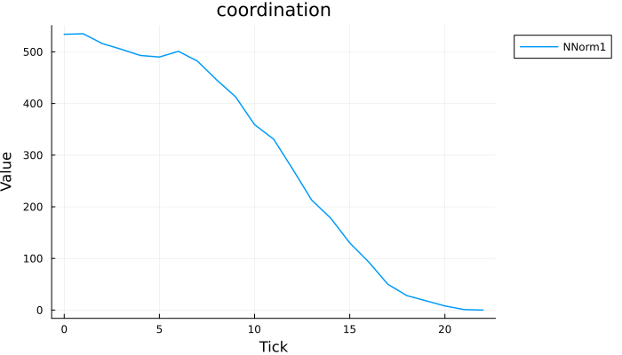
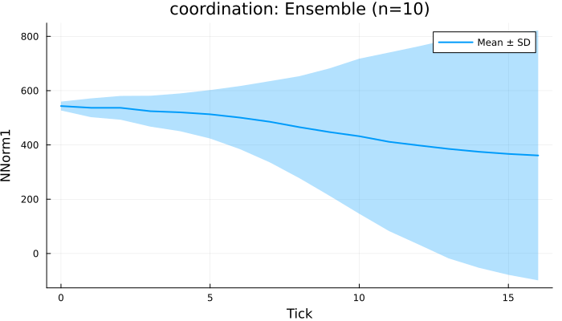
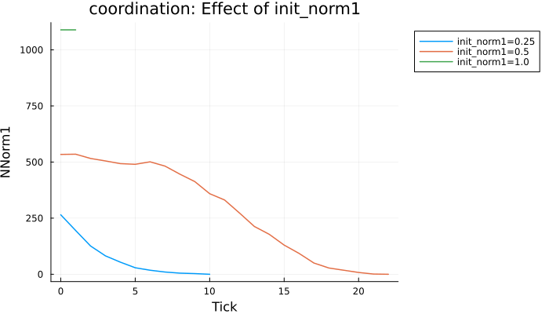

## Overview

This vignette demonstrates the **Coordination** model implemented in [ArkModelZoo.jl](https://github.com/sdwfrost/ArkModelZoo.jl) using the Ark.jl ECS framework.

## Parameters

| Parameter | Type | Default | Description |
|-----------|------|---------|-------------|
| `init_norm1` | `Float64` | `0.5` | init norm1 |
| `coordination_benefit` | `Float64` | `1.0` | coordination benefit |
| `grid_size` | `Int` | `33` | 33×33 = (-16,16,-16,16) |
| `max_ticks` | `Int` | `200` | max ticks |

## Source Code

The Julia code to run this model:

```julia
using ArkModelZoo
_, trajectory = run_coordination()
```

## Time Series

{width=100%}

## Ensemble Runs

Ten replicates with different random seeds, showing mean ± standard deviation.

{width=100%}

## Parameter Sensitivity

Varying `init_norm1`.

{width=100%}


## Appendix: Source Code

This model is implemented in the [Ark.jl](https://github.com/sdwfrost/Ark.jl) Entity-Component-System (ECS) framework. The code is split into five files, each with a distinct role:

- **Parameters**: a mutable struct holding all configurable values.
- **Components**: lightweight data types attached to individual entities (agents).
- **Resources**: world-level shared state accessible to all systems.
- **Systems**: functions that operate on entities each tick, defining model behavior.
- **Model**: wiring that assembles the world, registers resources and systems, and provides the run entry point.

### Parameters (`parameters.jl`)

The parameter struct uses `@kwdef` so that every field has a default value and can be overridden by keyword. These defaults match the original NetLogo model's slider settings.

```julia
Base.@kwdef mutable struct CoordinationParams
    init_norm1::Float64 = 0.5
    coordination_benefit::Float64 = 1.0
    grid_size::Int = 33          # 33×33 = (-16,16,-16,16)
    max_ticks::Int = 200
    seed::Int = 42
end
```

### Components (`components.jl`)

Components are lightweight data types attached to individual entities (agents). Mutable structs hold per-entity state, while empty tag structs act as markers for the ECS query system to efficiently filter entities.

```julia
# Grid position (fixed, one turtle per patch)
mutable struct CoordPosition
    x::Int
    y::Int
end
CoordPosition() = CoordPosition(0, 0)

# Norm: true = Norm1, false = Norm2
mutable struct CoordNorm
    norm1::Bool
end
CoordNorm() = CoordNorm(false)

# Payoff accumulated each tick
mutable struct CoordPayoff
    value::Float64
end
CoordPayoff() = CoordPayoff(0.0)
```

### Resources (`resources.jl`)

Resources are world-level singletons shared across all systems, used for global state and aggregate statistics.

```julia
# Running statistics
mutable struct CoordStats
    n_norm1::Int
end
CoordStats() = CoordStats(0)
```

### Systems (`systems.jl`)

Systems contain the model logic and execute in a defined order each tick. Each system struct implements either `initialize!` (run once at setup) or `update!` (run every tick).

```julia
# --- Initialization ---

struct InitCoordSystem <: System end

function initialize!(::InitCoordSystem, world::World)
    params = get_resource(world, CoordinationParams)
    rng = get_resource(world, RNGResource).rng
    stats = get_resource(world, CoordStats)

    # One turtle per patch
    for x in 1:params.grid_size, y in 1:params.grid_size
        is_norm1 = rand(rng) < params.init_norm1
        new_entity!(world, (
            CoordPosition(x, y),
            CoordNorm(is_norm1),
            CoordPayoff(0.0),
        ))
    end

    # Initial count
    n1 = 0
    for (_, _, norms) in Query(world, (CoordPosition, CoordNorm))
        @inbounds for i in eachindex(norms)
            norms[i].norm1 && (n1 += 1)
        end
    end
    stats.n_norm1 = n1
    return nothing
end

# --- Calculate Payoffs ---

struct CalcPayoffsSystem <: System end

function update!(::CalcPayoffsSystem, world::World)
    params = get_resource(world, CoordinationParams)

    # Count norm1 agents
    total = 0
    n1 = 0
    for (_, _, norms) in Query(world, (CoordPosition, CoordNorm))
        @inbounds for i in eachindex(norms)
            total += 1
            norms[i].norm1 && (n1 += 1)
        end
    end

    total == 0 && return nothing
    p1 = n1 / total
    norm1_payoff = 1.0 + p1 * params.coordination_benefit
    norm2_payoff = 1.0 + (1.0 - p1) * params.coordination_benefit

    for (_, _, norms, payoffs) in Query(world, (CoordPosition, CoordNorm, CoordPayoff))
        @inbounds for i in eachindex(norms)
            payoffs[i].value = norms[i].norm1 ? norm1_payoff : norm2_payoff
        end
    end
    return nothing
end

# --- Evolve (Fermi imitation, sequential with immediate updates) ---

struct EvolveSystem <: System end

function update!(::EvolveSystem, world::World)
    rng = get_resource(world, RNGResource).rng

    # Collect all entity IDs
    all_entities = Entity[]
    for (eids, _) in Query(world, (CoordPosition,))
        append!(all_entities, eids)
    end

    n = length(all_entities)
    n <= 1 && return nothing

    # Shuffle for NetLogo-style `ask turtles`
    for i in n:-1:2
        j = rand(rng, 1:i)
        all_entities[i], all_entities[j] = all_entities[j], all_entities[i]
    end

    # Process each turtle sequentially (immediate updates)
    for idx in 1:n
        eid = all_entities[idx]
        !is_alive(world, eid) && continue

        my_norm, my_payoff = get_components(world, eid, (CoordNorm, CoordPayoff))

        # Pick a random model from all OTHER turtles
        model_eid = eid
        while model_eid == eid
            model_eid = all_entities[rand(rng, 1:n)]
        end
        !is_alive(world, model_eid) && continue

        model_norm, model_payoff = get_components(world, model_eid, (CoordNorm, CoordPayoff))

        # Only consider copying if different norm
        model_norm.norm1 == my_norm.norm1 && continue

        # Fermi function: probability of copying
        prob_copy = 1.0 / (1.0 + exp(-(model_payoff.value - my_payoff.value)))
        if rand(rng) < prob_copy
            my_norm.norm1 = model_norm.norm1
        end
    end
    return nothing
end

# --- Statistics ---

struct CoordStatsSystem <: System end

function update!(::CoordStatsSystem, world::World)
    stats = get_resource(world, CoordStats)
    n1 = 0
    for (_, _, norms) in Query(world, (CoordPosition, CoordNorm))
        @inbounds for i in eachindex(norms)
            norms[i].norm1 && (n1 += 1)
        end
    end
    stats.n_norm1 = n1
    return nothing
end

# --- Termination ---

struct CoordTerminationSystem <: System end

function update!(::CoordTerminationSystem, world::World)
    params = get_resource(world, CoordinationParams)
    tick = get_resource(world, Tick)
    stats = get_resource(world, CoordStats)

    total = params.grid_size * params.grid_size
    # Stop if all same norm or max ticks reached
    if stats.n_norm1 == total || stats.n_norm1 == 0 || tick.tick + 1 >= params.max_ticks
        get_resource(world, Terminate).stop = true
    end
    return nothing
end
```

### Model (`model.jl`)

The model file assembles all pieces: it creates the ECS `World` with the required component types, registers resources, builds the `Scheduler` with systems in execution order, and exposes the public `run` entry point. The observer pattern records the trajectory each tick.

```julia
function coordination_world(; initial_capacity::Int = 2048)
    return World(
        CoordPosition,
        CoordNorm,
        CoordPayoff;
        initial_capacity = initial_capacity,
        allow_mutable = true,
    )
end

function coordination_systems()
    return (
        InitCoordSystem(),
        CalcPayoffsSystem(),
        EvolveSystem(),
        CoordStatsSystem(),
        CoordTerminationSystem(),
    )
end

function coordination_model(params::CoordinationParams = CoordinationParams())
    world = coordination_world()
    _add_standard_resources!(world, params)
    add_resource!(world, CoordStats())
    scheduler = Scheduler(world, coordination_systems())
    initialize!(scheduler)
    return scheduler
end

struct CoordinationObserver end

function coordination_headers(::CoordinationObserver)
    return ["NNorm1"]
end

function coordination_values(::CoordinationObserver, world::World)
    stats = get_resource(world, CoordStats)
    return Float64[stats.n_norm1]
end

function run_coordination(; params::CoordinationParams = CoordinationParams(), observe::Bool = true)
    return _run_model(coordination_model, CoordinationObserver(), coordination_values; params, observe)
end
```
