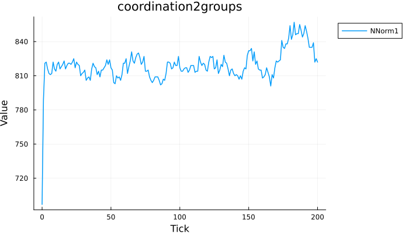
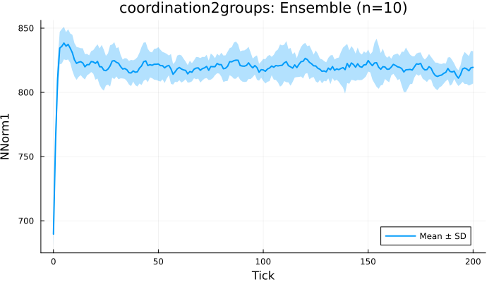
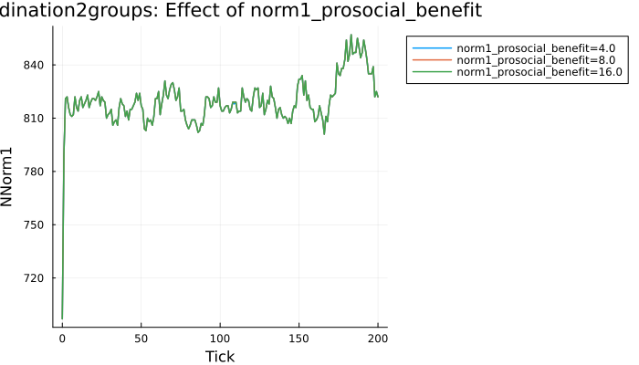

# Coordination 2 Groups


- [Overview](#overview)
- [Parameters](#parameters)
- [Source Code](#source-code)
- [Time Series](#time-series)
- [Ensemble Runs](#ensemble-runs)
- [Parameter Sensitivity](#parameter-sensitivity)
- [Appendix: Source Code](#appendix-source-code)
  - [Parameters (`parameters.jl`)](#parameters-parametersjl)
  - [Components (`components.jl`)](#components-componentsjl)
  - [Resources (`resources.jl`)](#resources-resourcesjl)
  - [Systems (`systems.jl`)](#systems-systemsjl)
  - [Model (`model.jl`)](#model-modeljl)

## Overview

This vignette demonstrates the **Coordination 2 Groups** model
implemented in
[ArkModelZoo.jl](https://github.com/sdwfrost/ArkModelZoo.jl) using the
Ark.jl ECS framework.

## Parameters

| Parameter | Type | Default | Description |
|----|----|----|----|
| `norm1_prosocial_benefit` | `Float64` | `8.0` | norm1 prosocial benefit |
| `norm1_coord_benefit` | `Float64` | `1.0` | norm1 coord benefit |
| `norm1_rarity_cost` | `Float64` | `0.5` | norm1 rarity cost |
| `init_norm1_groupA` | `Float64` | `0.8` | init norm1 groupA |
| `init_norm1_groupB` | `Float64` | `0.22` | init norm1 groupB |
| `prob_outgroup_observation` | `Float64` | `0.018` | prob outgroup observation |
| `grid_width` | `Int` | `33` | grid width |
| `grid_height` | `Int` | `33` | grid height |
| `border_x` | `Int` | `25` | 1-based column for pxcor = max_pxcor/2 = 8 |
| `max_ticks` | `Int` | `200` | max ticks |

## Source Code

The Julia code to run this model:

``` julia
using ArkModelZoo
_, trajectory = run_coordination2groups()
```

## Time Series



## Ensemble Runs

Ten replicates with different random seeds, showing mean ± standard
deviation.



## Parameter Sensitivity

Varying `norm1_prosocial_benefit`.



## Appendix: Source Code

This model is implemented in the
[Ark.jl](https://github.com/sdwfrost/Ark.jl) Entity-Component-System
(ECS) framework. The code is split into five files, each with a distinct
role:

- **Parameters**: a mutable struct holding all configurable values.
- **Components**: lightweight data types attached to individual entities
  (agents).
- **Resources**: world-level shared state accessible to all systems.
- **Systems**: functions that operate on entities each tick, defining
  model behavior.
- **Model**: wiring that assembles the world, registers resources and
  systems, and provides the run entry point.

### Parameters (`parameters.jl`)

The parameter struct uses `@kwdef` so that every field has a default
value and can be overridden by keyword. These defaults match the
original NetLogo model’s slider settings.

``` julia
Base.@kwdef mutable struct Coordination2GroupsParams
    norm1_prosocial_benefit::Float64 = 8.0
    norm1_coord_benefit::Float64 = 1.0
    norm1_rarity_cost::Float64 = 0.5
    init_norm1_groupA::Float64 = 0.8
    init_norm1_groupB::Float64 = 0.22
    prob_outgroup_observation::Float64 = 0.018
    grid_width::Int = 33
    grid_height::Int = 33
    border_x::Int = 25       # 1-based column for pxcor = max_pxcor/2 = 8
    max_ticks::Int = 200
    seed::Int = 42
end
```

### Components (`components.jl`)

Components are lightweight data types attached to individual entities
(agents). Mutable structs hold per-entity state, while empty tag structs
act as markers for the ECS query system to efficiently filter entities.

``` julia
mutable struct Coord2GroupID
    id::Int  # 0 or 1
end
Coord2GroupID() = Coord2GroupID(0)

mutable struct Coord2Norm1
    has_norm::Bool
end
Coord2Norm1() = Coord2Norm1(false)

mutable struct Coord2Payoff
    value::Float64
end
Coord2Payoff() = Coord2Payoff(0.0)
```

### Resources (`resources.jl`)

Resources are world-level singletons shared across all systems, used for
global state and aggregate statistics.

``` julia
mutable struct Coordination2GroupsStats
    n_norm1::Int
end
Coordination2GroupsStats() = Coordination2GroupsStats(0)
```

### Systems (`systems.jl`)

Systems contain the model logic and execute in a defined order each
tick. Each system struct implements either `initialize!` (run once at
setup) or `update!` (run every tick).

``` julia
# --- Initialization ---

struct InitCoordination2GroupsSystem <: System end

function initialize!(::InitCoordination2GroupsSystem, world::World)
    params = get_resource(world, Coordination2GroupsParams)
    rng = get_resource(world, RNGResource).rng
    stats = get_resource(world, Coordination2GroupsStats)

    n_norm1 = 0
    for x in 1:params.grid_width, y in 1:params.grid_height
        x == params.border_x && continue
        group = x < params.border_x ? 0 : 1
        init_prob = group == 0 ? params.init_norm1_groupA : params.init_norm1_groupB
        has_norm = rand(rng) < init_prob
        new_entity!(world, (
            Coord2GroupID(group),
            Coord2Norm1(has_norm),
            Coord2Payoff(0.0),
        ))
        if has_norm
            n_norm1 += 1
        end
    end
    stats.n_norm1 = n_norm1
    return nothing
end

# --- Calculate Payoffs ---

struct Coord2CalculatePayoffsSystem <: System end

function update!(::Coord2CalculatePayoffsSystem, world::World)
    params = get_resource(world, Coordination2GroupsParams)

    # Count turtles and norm1 per group
    count_0 = 0; count_1 = 0
    norm1_0 = 0; norm1_1 = 0
    for (_, groups, norms) in Query(world, (Coord2GroupID, Coord2Norm1))
        @inbounds for i in eachindex(groups)
            if groups[i].id == 0
                count_0 += 1
                if norms[i].has_norm; norm1_0 += 1; end
            else
                count_1 += 1
                if norms[i].has_norm; norm1_1 += 1; end
            end
        end
    end

    num_agents = (count_0 + count_1) / 2.0

    p1_0 = norm1_0 / num_agents
    norm1_payoff_0 = p1_0 * (1 + params.norm1_prosocial_benefit + params.norm1_coord_benefit) +
                     (1 - p1_0) * (1 - params.norm1_rarity_cost)
    norm2_payoff_0 = p1_0 * (1 + params.norm1_prosocial_benefit) + (1 - p1_0) * 1.0

    p1_1 = norm1_1 / num_agents
    norm1_payoff_1 = p1_1 * (1 + params.norm1_prosocial_benefit + params.norm1_coord_benefit) +
                     (1 - p1_1) * (1 - params.norm1_rarity_cost)
    norm2_payoff_1 = p1_1 * (1 + params.norm1_prosocial_benefit) + (1 - p1_1) * 1.0

    for (_, groups, norms, payoffs) in Query(world, (Coord2GroupID, Coord2Norm1, Coord2Payoff))
        @inbounds for i in eachindex(groups)
            if groups[i].id == 0
                payoffs[i].value = norms[i].has_norm ? norm1_payoff_0 : norm2_payoff_0
            else
                payoffs[i].value = norms[i].has_norm ? norm1_payoff_1 : norm2_payoff_1
            end
        end
    end
    return nothing
end

# --- Evolve ---
# NetLogo: ask turtles [ pick model from own/other group, copy norm with Fermi probability ]

struct Coord2EvolveSystem <: System end

function update!(::Coord2EvolveSystem, world::World)
    params = get_resource(world, Coordination2GroupsParams)
    rng = get_resource(world, RNGResource).rng

    # Snapshot all entities into parallel vectors
    all_eids = Entity[]
    all_groups = Int[]
    all_norms = Bool[]
    all_payoffs = Float64[]
    for (eids, groups, norms, payoffs) in Query(world, (Coord2GroupID, Coord2Norm1, Coord2Payoff))
        @inbounds for i in eachindex(eids)
            push!(all_eids, eids[i])
            push!(all_groups, groups[i].id)
            push!(all_norms, norms[i].has_norm)
            push!(all_payoffs, payoffs[i].value)
        end
    end

    n = length(all_eids)
    group0_idx = [i for i in 1:n if all_groups[i] == 0]
    group1_idx = [i for i in 1:n if all_groups[i] == 1]
    group_indices = (group0_idx, group1_idx)  # tuple indexed by groupID+1

    order = randperm(rng, n)
    for idx in order
        myID = all_groups[idx]
        my_payoff = all_payoffs[idx]

        otherID = myID
        if rand(rng) < params.prob_outgroup_observation
            otherID = (myID + 1) % 2
        end

        target = group_indices[otherID + 1]
        # "other turtles" excludes self
        model_i = target[rand(rng, 1:length(target))]
        while model_i == idx && length(target) > 1
            model_i = target[rand(rng, 1:length(target))]
        end
        model_i == idx && continue

        model_payoff = all_payoffs[model_i]
        model_norm = all_norms[model_i]

        prob_copy = 1.0 / (1.0 + exp(-(model_payoff - my_payoff)))
        if rand(rng) < prob_copy
            all_norms[idx] = model_norm
            get_components(world, all_eids[idx], (Coord2Norm1,))[1].has_norm = model_norm
        end
    end
    return nothing
end

# --- Termination ---

struct Coordination2GroupsTerminationSystem <: System end

function update!(::Coordination2GroupsTerminationSystem, world::World)
    params = get_resource(world, Coordination2GroupsParams)
    stats = get_resource(world, Coordination2GroupsStats)
    tick = get_resource(world, Tick)

    n_norm1 = 0
    n_total = 0
    for (_, norms) in Query(world, (Coord2Norm1,))
        @inbounds for i in eachindex(norms)
            n_total += 1
            if norms[i].has_norm
                n_norm1 += 1
            end
        end
    end
    stats.n_norm1 = n_norm1

    if n_norm1 == n_total || tick.tick + 1 >= params.max_ticks
        get_resource(world, Terminate).stop = true
    end
    return nothing
end
```

### Model (`model.jl`)

The model file assembles all pieces: it creates the ECS `World` with the
required component types, registers resources, builds the `Scheduler`
with systems in execution order, and exposes the public `run` entry
point. The observer pattern records the trajectory each tick.

``` julia
function coordination2groups_world(; initial_capacity::Int = 2048)
    return World(
        Coord2GroupID,
        Coord2Norm1,
        Coord2Payoff;
        initial_capacity = initial_capacity,
        allow_mutable = true,
    )
end

function coordination2groups_systems()
    return (
        InitCoordination2GroupsSystem(),
        Coord2CalculatePayoffsSystem(),
        Coord2EvolveSystem(),
        Coordination2GroupsTerminationSystem(),
    )
end

function coordination2groups_model(params::Coordination2GroupsParams = Coordination2GroupsParams())
    world = coordination2groups_world()
    _add_standard_resources!(world, params)
    add_resource!(world, Coordination2GroupsStats())
    scheduler = Scheduler(world, coordination2groups_systems())
    initialize!(scheduler)
    return scheduler
end

struct Coordination2GroupsObserver end

function coordination2groups_headers(::Coordination2GroupsObserver)
    return ["NNorm1"]
end

function coordination2groups_values(::Coordination2GroupsObserver, world::World)
    stats = get_resource(world, Coordination2GroupsStats)
    return Float64[stats.n_norm1]
end

function run_coordination2groups(; params::Coordination2GroupsParams = Coordination2GroupsParams(), observe::Bool = true)
    return _run_model(coordination2groups_model, Coordination2GroupsObserver(), coordination2groups_values; params, observe)
end
```
