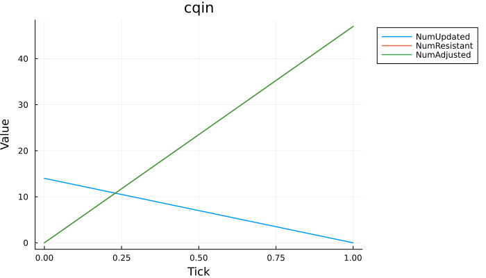
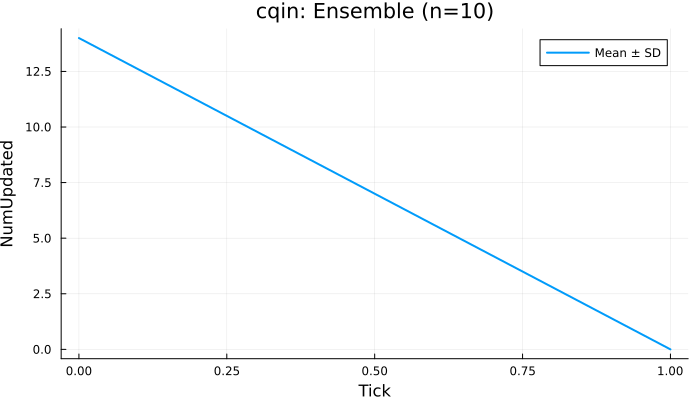
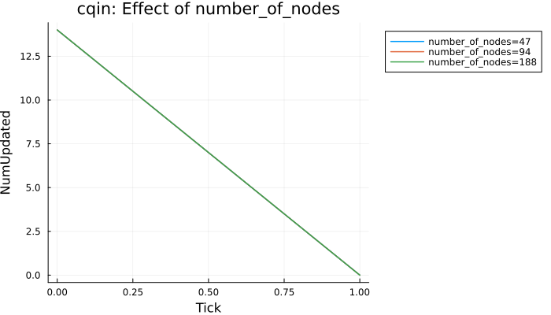

## Overview

This vignette demonstrates the **Quality Improvement Network** model implemented in [ArkModelZoo.jl](https://github.com/sdwfrost/ArkModelZoo.jl) using the Ark.jl ECS framework.

## Parameters

| Parameter | Type | Default | Description |
|-----------|------|---------|-------------|
| `number_of_nodes` | `Int` | `94` | number of nodes |
| `node_degree` | `Int` | `3` | node degree |
| `schema_share_effectiveness` | `Float64` | `85.0` | schema share effectiveness |
| `schema_check_frequency` | `Int` | `1` | schema check frequency |
| `rejection_chance` | `Float64` | `10.0` | rejection chance |
| `rejection_threshold` | `Float64` | `25.0` | rejection threshold |
| `problem_space_complexity` | `Float64` | `90.0` | problem space complexity |
| `problem_solving_effectiveness` | `Float64` | `60.0` | problem solving effectiveness |
| `coevolution_constraints` | `Float64` | `50.0` | coevolution constraints |
| `initial_detection_size` | `Int` | `14` | initial detection size |
| `learning_gain` | `Float64` | `1.1` | learning gain |
| `planned_iterations` | `Int` | `20` | planned iterations |
| `signal_base` | `Float64` | `0.0` | signal base |
| `signal_increment` | `Float64` | `10.0` | signal increment |
| `signal_target` | `Float64` | `100.0` | signal target |
| `max_non_cooperating` | `Float64` | `0.5` | max non cooperating |
| `max_ticks` | `Int` | `100` | max ticks |

## Source Code

The Julia code to run this model:

```julia
using ArkModelZoo
_, trajectory = run_cqin()
```

## Time Series

{width=100%}

## Ensemble Runs

Ten replicates with different random seeds, showing mean ± standard deviation.

{width=100%}

## Parameter Sensitivity

Varying `number_of_nodes`.

{width=100%}


## Appendix: Source Code

This model is implemented in the [Ark.jl](https://github.com/sdwfrost/Ark.jl) Entity-Component-System (ECS) framework. The code is split into five files, each with a distinct role:

- **Parameters**: a mutable struct holding all configurable values.
- **Components**: lightweight data types attached to individual entities (agents).
- **Resources**: world-level shared state accessible to all systems.
- **Systems**: functions that operate on entities each tick, defining model behavior.
- **Model**: wiring that assembles the world, registers resources and systems, and provides the run entry point.

### Parameters (`parameters.jl`)

The parameter struct uses `@kwdef` so that every field has a default value and can be overridden by keyword. These defaults match the original NetLogo model's slider settings.

```julia
Base.@kwdef mutable struct CQINParams
    number_of_nodes::Int = 94
    node_degree::Int = 3
    schema_share_effectiveness::Float64 = 85.0
    schema_check_frequency::Int = 1
    rejection_chance::Float64 = 10.0
    rejection_threshold::Float64 = 25.0
    problem_space_complexity::Float64 = 90.0
    problem_solving_effectiveness::Float64 = 60.0
    coevolution_constraints::Float64 = 50.0
    initial_detection_size::Int = 14
    learning_gain::Float64 = 1.1
    planned_iterations::Int = 20
    signal_base::Float64 = 0.0
    signal_increment::Float64 = 10.0
    signal_target::Float64 = 100.0
    max_non_cooperating::Float64 = 0.5
    max_ticks::Int = 100
    seed::Int = 42
end
```

### Components (`components.jl`)

Components are lightweight data types attached to individual entities (agents). Mutable structs hold per-entity state, while empty tag structs act as markers for the ECS query system to efficiently filter entities.

```julia
struct CQINDummy end
```

### Resources (`resources.jl`)

Resources are world-level singletons shared across all systems, used for global state and aggregate statistics.

```julia
# Node state constants
const CQIN_SUSCEPTIBLE = 0
const CQIN_UPDATED = 1
const CQIN_AGREED = 2
const CQIN_IMPLEMENTED = 3
const CQIN_REVIEWED = 4
const CQIN_ADJUSTED = 5
const CQIN_RESISTANT = 6

mutable struct CQINNetwork
    n_nodes::Int
    states::Vector{Int}          # node state (0-6)
    schema_check_timer::Vector{Int}
    adj::Vector{Set{Int}}        # adjacency list
    degree::Vector{Int}          # cached degree per node
    iteration_count::Int
    signal::Float64
end

function CQINNetwork()
    CQINNetwork(0, Int[], Int[], Set{Int}[], Int[], 0, 0.0)
end

function _cqin_add_node!(net::CQINNetwork, state::Int)
    push!(net.states, state)
    push!(net.schema_check_timer, 0)
    push!(net.adj, Set{Int}())
    push!(net.degree, 0)
    net.n_nodes += 1
    return net.n_nodes
end

function _cqin_add_edge!(net::CQINNetwork, i::Int, j::Int)
    if i != j && j ∉ net.adj[i]
        push!(net.adj[i], j)
        push!(net.adj[j], i)
        net.degree[i] += 1
        net.degree[j] += 1
    end
end

mutable struct CQINStats
    num_updated::Int
    num_resistant::Int
    num_adjusted::Int
end
CQINStats() = CQINStats(0, 0, 0)

function _cqin_update_counts!(net::CQINNetwork, stats::CQINStats)
    stats.num_updated = count(==(CQIN_UPDATED), net.states)
    stats.num_resistant = count(==(CQIN_RESISTANT), net.states)
    stats.num_adjusted = count(==(CQIN_ADJUSTED), net.states)
end
```

### Systems (`systems.jl`)

Systems contain the model logic and execute in a defined order each tick. Each system struct implements either `initialize!` (run once at setup) or `update!` (run every tick).

```julia
struct InitCQINSystem <: System end

function _cqin_build_pa!(net::CQINNetwork, rng, n::Int, m::Int)
    # Build preferential-attachment network (Barabási-Albert)
    # Start with m+1 fully connected nodes
    for _ in 1:(m+1)
        _cqin_add_node!(net, CQIN_SUSCEPTIBLE)
    end
    for i in 1:(m+1), j in (i+1):(m+1)
        _cqin_add_edge!(net, i, j)
    end
    # Add remaining nodes with preferential attachment
    for _ in (m+2):n
        new_id = _cqin_add_node!(net, CQIN_SUSCEPTIBLE)
        total_degree = sum(net.degree[1:new_id-1])
        targets = Set{Int}()
        attempts = 0
        while length(targets) < m && attempts < 10000
            attempts += 1
            r = rand(rng) * total_degree
            cumulative = 0.0
            for j in 1:(new_id-1)
                cumulative += net.degree[j]
                if cumulative >= r
                    push!(targets, j)
                    break
                end
            end
        end
        for t in targets
            _cqin_add_edge!(net, new_id, t)
        end
    end
end

function initialize!(::InitCQINSystem, world::World)
    params = get_resource(world, CQINParams)
    rng = get_resource(world, RNGResource).rng
    net = get_resource(world, CQINNetwork)
    stats = get_resource(world, CQINStats)

    _cqin_build_pa!(net, rng, params.number_of_nodes, params.node_degree)
    net.signal = params.signal_base

    # Run initial cycle
    _cqin_cycle!(net, rng, params)
    _cqin_update_counts!(net, stats)
    return nothing
end

function _cqin_cycle!(net::CQINNetwork, rng, params::CQINParams)
    # Reset all nodes to susceptible, reset timers
    for i in 1:net.n_nodes
        net.states[i] = CQIN_SUSCEPTIBLE
        net.schema_check_timer[i] = 0
    end
    net.iteration_count += 1
    # Pick initial_detection_size random nodes → set to UPDATED
    indices = shuffle!(rng, collect(1:net.n_nodes))
    for k in 1:min(params.initial_detection_size, net.n_nodes)
        net.states[indices[k]] = CQIN_UPDATED
    end
end

# Check whether any stop condition is met
function _cqin_should_stop(net::CQINNetwork, params::CQINParams, target_state::Int)
    n_resistant = count(==(CQIN_RESISTANT), net.states)
    if n_resistant >= net.n_nodes * params.max_non_cooperating
        return true
    end
    # All nodes are in target state or resistant
    if all(s -> s == target_state || s == CQIN_RESISTANT, net.states)
        return true
    end
    if net.iteration_count == params.planned_iterations + 1
        return true
    end
    if net.signal >= params.signal_target
        return true
    end
    return false
end

# Schema check: node may become resistant or advance to next_state
function _cqin_schema_check!(net::CQINNetwork, rng, params::CQINParams, i::Int, current_state::Int, next_state::Int)
    complexity = params.problem_space_complexity
    threshold_mod = params.rejection_threshold * (0.8 + complexity / 100.0)
    chance_mod = params.rejection_chance * (0.8 + complexity / 100.0)
    if rand(rng) * 100.0 < threshold_mod
        if rand(rng) * 100.0 < chance_mod
            net.states[i] = CQIN_RESISTANT
        else
            net.states[i] = next_state
        end
    end
end

# Phase 1: spread-signal (updated nodes spread to susceptible neighbors)
function _cqin_phase1!(net::CQINNetwork, rng, params::CQINParams)
    effectiveness = params.schema_share_effectiveness * params.learning_gain ^ net.iteration_count
    order = shuffle!(rng, collect(1:net.n_nodes))
    for i in order
        net.states[i] == CQIN_UPDATED || continue
        net.schema_check_timer[i] += 1
        neighbors = shuffle!(rng, collect(net.adj[i]))
        for j in neighbors
            if net.states[j] == CQIN_SUSCEPTIBLE
                if rand(rng) * 100.0 < effectiveness
                    net.states[j] = CQIN_UPDATED
                end
            end
        end
    end
    # Schema checks for updated nodes
    order2 = shuffle!(rng, collect(1:net.n_nodes))
    for i in order2
        net.states[i] == CQIN_UPDATED || continue
        if net.schema_check_timer[i] > 0 && mod(net.schema_check_timer[i], params.schema_check_frequency) == 0
            _cqin_schema_check!(net, rng, params, i, CQIN_UPDATED, CQIN_AGREED)
        end
    end
end

# Phase 2: problem-solve (updated → agreed spread)
function _cqin_phase2!(net::CQINNetwork, rng, params::CQINParams)
    effectiveness = params.schema_share_effectiveness * params.learning_gain ^ net.iteration_count
    ps_factor = (params.problem_solving_effectiveness * params.learning_gain ^ net.iteration_count) / params.problem_space_complexity
    prob = effectiveness * ps_factor
    order = shuffle!(rng, collect(1:net.n_nodes))
    for i in order
        net.states[i] == CQIN_AGREED || continue
        net.schema_check_timer[i] += 1
        neighbors = shuffle!(rng, collect(net.adj[i]))
        for j in neighbors
            if net.states[j] == CQIN_UPDATED
                if rand(rng) * 100.0 < prob
                    net.states[j] = CQIN_AGREED
                end
            end
        end
    end
    # Schema checks for agreed nodes
    order2 = shuffle!(rng, collect(1:net.n_nodes))
    for i in order2
        net.states[i] == CQIN_AGREED || continue
        if net.schema_check_timer[i] > 0 && mod(net.schema_check_timer[i], params.schema_check_frequency) == 0
            _cqin_schema_check!(net, rng, params, i, CQIN_AGREED, CQIN_IMPLEMENTED)
        end
    end
end

# Phase 3: implement (agreed → implemented spread)
function _cqin_phase3!(net::CQINNetwork, rng, params::CQINParams)
    effectiveness = params.schema_share_effectiveness * params.learning_gain ^ net.iteration_count
    ps_factor = (params.problem_solving_effectiveness * params.learning_gain ^ net.iteration_count) / params.problem_space_complexity
    coev_factor = (100.0 - params.coevolution_constraints) / 100.0
    prob = effectiveness * ps_factor * coev_factor
    order = shuffle!(rng, collect(1:net.n_nodes))
    for i in order
        net.states[i] == CQIN_IMPLEMENTED || continue
        net.schema_check_timer[i] += 1
        neighbors = shuffle!(rng, collect(net.adj[i]))
        for j in neighbors
            if net.states[j] == CQIN_AGREED
                if rand(rng) * 100.0 < prob
                    net.states[j] = CQIN_IMPLEMENTED
                end
            end
        end
    end
    # Schema checks for implemented nodes
    order2 = shuffle!(rng, collect(1:net.n_nodes))
    for i in order2
        net.states[i] == CQIN_IMPLEMENTED || continue
        if net.schema_check_timer[i] > 0 && mod(net.schema_check_timer[i], params.schema_check_frequency) == 0
            _cqin_schema_check!(net, rng, params, i, CQIN_IMPLEMENTED, CQIN_REVIEWED)
        end
    end
end

# Phase 4: review (implemented → reviewed spread)
function _cqin_phase4!(net::CQINNetwork, rng, params::CQINParams)
    effectiveness = params.schema_share_effectiveness * params.learning_gain ^ net.iteration_count
    order = shuffle!(rng, collect(1:net.n_nodes))
    for i in order
        net.states[i] == CQIN_REVIEWED || continue
        net.schema_check_timer[i] += 1
        neighbors = shuffle!(rng, collect(net.adj[i]))
        for j in neighbors
            if net.states[j] == CQIN_IMPLEMENTED
                if rand(rng) * 100.0 < effectiveness
                    net.states[j] = CQIN_REVIEWED
                end
            end
        end
    end
    # Schema checks for reviewed nodes
    order2 = shuffle!(rng, collect(1:net.n_nodes))
    for i in order2
        net.states[i] == CQIN_REVIEWED || continue
        if net.schema_check_timer[i] > 0 && mod(net.schema_check_timer[i], params.schema_check_frequency) == 0
            _cqin_schema_check!(net, rng, params, i, CQIN_REVIEWED, CQIN_ADJUSTED)
        end
    end
end

# Phase 5: adjust (reviewed → adjusted spread, update signal)
function _cqin_phase5!(net::CQINNetwork, rng, params::CQINParams)
    effectiveness = params.schema_share_effectiveness * params.learning_gain ^ net.iteration_count
    ps_factor = (params.problem_solving_effectiveness * params.learning_gain ^ net.iteration_count) / params.problem_space_complexity
    coev_factor = (100.0 - params.coevolution_constraints) / 100.0
    prob = effectiveness * ps_factor * coev_factor
    order = shuffle!(rng, collect(1:net.n_nodes))
    for i in order
        net.states[i] == CQIN_ADJUSTED || continue
        net.schema_check_timer[i] += 1
        neighbors = shuffle!(rng, collect(net.adj[i]))
        for j in neighbors
            if net.states[j] == CQIN_REVIEWED
                if rand(rng) * 100.0 < prob
                    net.states[j] = CQIN_ADJUSTED
                end
            end
        end
    end
    # Schema checks for adjusted nodes — also update signal
    order2 = shuffle!(rng, collect(1:net.n_nodes))
    for i in order2
        net.states[i] == CQIN_ADJUSTED || continue
        if net.schema_check_timer[i] > 0 && mod(net.schema_check_timer[i], params.schema_check_frequency) == 0
            _cqin_schema_check!(net, rng, params, i, CQIN_ADJUSTED, CQIN_ADJUSTED)
            # Signal update after schema check in phase 5
            if net.states[i] == CQIN_ADJUSTED
                net.signal = min(net.signal + params.signal_increment, params.signal_target)
            end
        end
    end
end

struct CQINGoSystem <: System end

function update!(::CQINGoSystem, world::World)
    params = get_resource(world, CQINParams)
    rng = get_resource(world, RNGResource).rng
    net = get_resource(world, CQINNetwork)
    stats = get_resource(world, CQINStats)

    # Each tick is one full PDSA cycle: cycle → 5×phase1 → 5×phase2 → 5×phase3 → 5×phase4 → 5×phase5
    _cqin_cycle!(net, rng, params)

    # Phase 1: spread-signal (go), repeat 5
    for _ in 1:5
        _cqin_should_stop(net, params, CQIN_UPDATED) && break
        _cqin_phase1!(net, rng, params)
    end

    # Phase 2: problem-solve (go-2), repeat 5
    for _ in 1:5
        _cqin_should_stop(net, params, CQIN_AGREED) && break
        _cqin_phase2!(net, rng, params)
    end

    # Phase 3: implement (go-3), repeat 5
    for _ in 1:5
        _cqin_should_stop(net, params, CQIN_IMPLEMENTED) && break
        _cqin_phase3!(net, rng, params)
    end

    # Phase 4: review (go-4), repeat 5
    for _ in 1:5
        _cqin_should_stop(net, params, CQIN_REVIEWED) && break
        _cqin_phase4!(net, rng, params)
    end

    # Phase 5: adjust (go-5), repeat 5
    for _ in 1:5
        _cqin_should_stop(net, params, CQIN_ADJUSTED) && break
        _cqin_phase5!(net, rng, params)
    end

    _cqin_update_counts!(net, stats)
    return nothing
end

struct CQINTerminationSystem <: System end

function update!(::CQINTerminationSystem, world::World)
    params = get_resource(world, CQINParams)
    tick = get_resource(world, Tick)
    net = get_resource(world, CQINNetwork)
    if tick.tick + 1 >= params.max_ticks || net.signal >= params.signal_target || net.iteration_count >= params.planned_iterations + 1
        get_resource(world, Terminate).stop = true
    end
    return nothing
end
```

### Model (`model.jl`)

The model file assembles all pieces: it creates the ECS `World` with the required component types, registers resources, builds the `Scheduler` with systems in execution order, and exposes the public `run` entry point. The observer pattern records the trajectory each tick.

```julia
function cqin_world(; initial_capacity::Int = 128)
    return World(CQINDummy; initial_capacity = initial_capacity, allow_mutable = true)
end

function cqin_systems()
    return (InitCQINSystem(), CQINGoSystem(), CQINTerminationSystem())
end

function cqin_model(params::CQINParams = CQINParams())
    world = cqin_world()
    _add_standard_resources!(world, params)
    add_resource!(world, CQINNetwork())
    add_resource!(world, CQINStats())
    scheduler = Scheduler(world, cqin_systems())
    initialize!(scheduler)
    return scheduler
end

struct CQINObserver end

function cqin_headers(::CQINObserver)
    return ["NumUpdated", "NumResistant", "NumAdjusted"]
end

function cqin_values(::CQINObserver, world::World)
    stats = get_resource(world, CQINStats)
    return Float64[stats.num_updated, stats.num_resistant, stats.num_adjusted]
end

function run_cqin(; params::CQINParams = CQINParams(), observe::Bool = true)
    return _run_model(cqin_model, CQINObserver(), cqin_values; params, observe)
end
```
