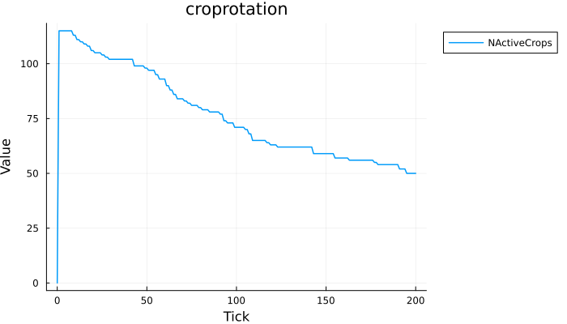
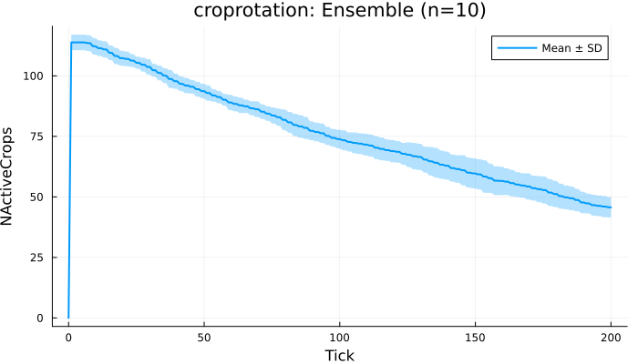
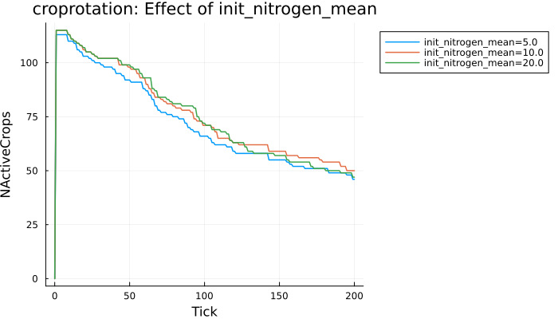

# Crop Rotation


- [Overview](#overview)
- [Parameters](#parameters)
- [Source Code](#source-code)
- [Time Series](#time-series)
- [Ensemble Runs](#ensemble-runs)
- [Parameter Sensitivity](#parameter-sensitivity)
- [Appendix: Source Code](#appendix-source-code)
  - [Parameters (`parameters.jl`)](#parameters-parametersjl)
  - [Components (`components.jl`)](#components-componentsjl)
  - [Resources (`resources.jl`)](#resources-resourcesjl)
  - [Systems (`systems.jl`)](#systems-systemsjl)
  - [Model (`model.jl`)](#model-modeljl)

## Overview

This vignette demonstrates the **Crop Rotation** model implemented in
[ArkModelZoo.jl](https://github.com/sdwfrost/ArkModelZoo.jl) using the
Ark.jl ECS framework.

## Parameters

| Parameter             | Type      | Default | Description         |
|-----------------------|-----------|---------|---------------------|
| `grid_size`           | `Int`     | `11`    | grid size           |
| `init_nitrogen_mean`  | `Float64` | `10.0`  | init nitrogen mean  |
| `init_nitrogen_sd`    | `Float64` | `2.0`   | init nitrogen sd    |
| `fallow_chance`       | `Float64` | `0.05`  | fallow chance       |
| `low_yield_threshold` | `Float64` | `0.1`   | low yield threshold |
| `max_ticks`           | `Int`     | `200`   | max ticks           |

## Source Code

The Julia code to run this model:

``` julia
using ArkModelZoo
_, trajectory = run_croprotation()
```

## Time Series



## Ensemble Runs

Ten replicates with different random seeds, showing mean ± standard
deviation.



## Parameter Sensitivity

Varying `init_nitrogen_mean`.



## Appendix: Source Code

This model is implemented in the
[Ark.jl](https://github.com/sdwfrost/Ark.jl) Entity-Component-System
(ECS) framework. The code is split into five files, each with a distinct
role:

- **Parameters**: a mutable struct holding all configurable values.
- **Components**: lightweight data types attached to individual entities
  (agents).
- **Resources**: world-level shared state accessible to all systems.
- **Systems**: functions that operate on entities each tick, defining
  model behavior.
- **Model**: wiring that assembles the world, registers resources and
  systems, and provides the run entry point.

### Parameters (`parameters.jl`)

The parameter struct uses `@kwdef` so that every field has a default
value and can be overridden by keyword. These defaults match the
original NetLogo model’s slider settings.

``` julia
Base.@kwdef mutable struct CRParams
    grid_size::Int = 11
    init_nitrogen_mean::Float64 = 10.0
    init_nitrogen_sd::Float64 = 2.0
    fallow_chance::Float64 = 0.05
    low_yield_threshold::Float64 = 0.1
    max_ticks::Int = 200
    seed::Int = 42
end
```

### Components (`components.jl`)

Components are lightweight data types attached to individual entities
(agents). Mutable structs hold per-entity state, while empty tag structs
act as markers for the ECS query system to efficiently filter entities.

``` julia
struct CRDummy end
```

### Resources (`resources.jl`)

Resources are world-level singletons shared across all systems, used for
global state and aggregate statistics.

``` julia
# Crop IDs: 0=fallow, 1=beet, 2=buckwheat, 3=carrot, 4=cucurbit, 5=grass,
#            6=legume, 7=lettuce, 8=lily, 9=mustard, 10=nightshade, 11=rose,
#            12=cover_crop
const CR_FALLOW = 0
const CR_COVER = 12
const CR_NUM_CROPS = 13  # 0..12

# Crop properties stored in a struct for efficient lookup
struct CRCropInfo
    name::String
    nitrogen_req::Float64
    weed_suscept::Float64
    disease_suscept::Float64
    harvest_weeks::Int        # weeks until harvest
    nitrogen_fix::Float64     # nitrogen added after harvest (legumes add nitrogen)
end

function _cr_build_crop_table()
    # Properties: name, nitrogen_req, weed_suscept, disease_suscept, harvest_weeks, nitrogen_fix
    crops = CRCropInfo[
        CRCropInfo("fallow",     0.0, 0.0, 0.0, 8,  1.0),  # 0: fallow restores some nitrogen
        CRCropInfo("beet",       3.0, 0.6, 0.4, 16, 0.0),  # 1
        CRCropInfo("buckwheat",  2.0, 0.3, 0.2, 10, 0.0),  # 2
        CRCropInfo("carrot",     3.0, 0.5, 0.5, 14, 0.0),  # 3
        CRCropInfo("cucurbit",   4.0, 0.4, 0.6, 18, 0.0),  # 4
        CRCropInfo("grass",      1.0, 0.2, 0.1,  6, 0.5),  # 5
        CRCropInfo("legume",     1.0, 0.3, 0.3, 12, 3.0),  # 6: fixes nitrogen
        CRCropInfo("lettuce",    2.0, 0.7, 0.3, 8,  0.0),  # 7
        CRCropInfo("lily",       3.0, 0.4, 0.5, 14, 0.0),  # 8
        CRCropInfo("mustard",    2.0, 0.3, 0.4, 10, 1.0),  # 9: cover-like
        CRCropInfo("nightshade", 4.0, 0.5, 0.7, 16, 0.0),  # 10
        CRCropInfo("rose",       3.0, 0.4, 0.4, 14, 0.0),  # 11
        CRCropInfo("cover_crop", 0.5, 0.1, 0.1, 8,  2.0),  # 12: cover crop
    ]
    return crops
end

mutable struct CRState
    width::Int
    height::Int
    n_patches::Int
    crop_table::Vector{CRCropInfo}
    nitrogen::Vector{Float64}
    current_crop::Vector{Int}        # crop ID (0-12)
    previous_crop::Vector{Int}
    harvest_week::Vector{Int}        # tick when harvest/plant occurs
    last_yield::Vector{Float64}
    crop_history::Vector{Vector{Int}} # history of planted crops
    available_crops::Vector{Set{Int}} # crops still available (not removed by disease/weeds)
end

function CRState(w::Int, h::Int)
    n = w * h
    crop_table = _cr_build_crop_table()
    CRState(
        w, h, n,
        crop_table,
        zeros(Float64, n),
        fill(CR_FALLOW, n),
        fill(CR_FALLOW, n),
        zeros(Int, n),
        ones(Float64, n),
        [Int[] for _ in 1:n],
        [Set(1:12) for _ in 1:n],  # all non-fallow crops available initially
    )
end

mutable struct CRStats
    n_active_crops::Int  # patches with non-fallow crops
end
CRStats() = CRStats(0)
```

### Systems (`systems.jl`)

Systems contain the model logic and execute in a defined order each
tick. Each system struct implements either `initialize!` (run once at
setup) or `update!` (run every tick).

``` julia
# --- Initialization ---

struct InitCRSystem <: System end

function initialize!(::InitCRSystem, world::World)
    params = get_resource(world, CRParams)
    rng = get_resource(world, RNGResource).rng
    state = get_resource(world, CRState)
    stats = get_resource(world, CRStats)

    for i in 1:state.n_patches
        state.nitrogen[i] = max(0.0, randn(rng) * params.init_nitrogen_sd + params.init_nitrogen_mean)
        state.current_crop[i] = CR_FALLOW
        state.previous_crop[i] = CR_FALLOW
        state.harvest_week[i] = 0  # will plant at tick 0
        state.last_yield[i] = 1.0
        empty!(state.crop_history[i])
        state.available_crops[i] = Set(1:12)
    end

    stats.n_active_crops = 0
    return nothing
end

# --- Weekly step: check if harvest/plant time ---

struct CRWeeklySystem <: System end

function update!(::CRWeeklySystem, world::World)
    params = get_resource(world, CRParams)
    rng = get_resource(world, RNGResource).rng
    state = get_resource(world, CRState)
    tick = get_resource(world, Tick).tick

    for i in 1:state.n_patches
        if tick == state.harvest_week[i]
            if state.current_crop[i] != CR_FALLOW || tick == 0
                if tick > 0
                    _cr_harvest!(state, params, rng, i)
                end
                _cr_plant!(state, params, rng, i, tick)
            end
        end
    end
    return nothing
end

function _cr_harvest!(state::CRState, params::CRParams, rng, idx::Int)
    crop_id = state.current_crop[idx]
    if crop_id == CR_FALLOW
        return
    end

    crop_info = state.crop_table[crop_id + 1]  # +1 for 1-based indexing

    # Weed loss
    weed_loss = tanh(rand(rng) * crop_info.weed_suscept)
    # Disease loss
    disease_loss = tanh(rand(rng) * crop_info.disease_suscept)

    yield_val = (1.0 - weed_loss) * (1.0 - disease_loss)
    state.last_yield[idx] = yield_val

    # Nitrogen depletion from crop
    state.nitrogen[idx] -= crop_info.nitrogen_req * yield_val
    # Nitrogen fixation (legumes, cover crops)
    state.nitrogen[idx] += crop_info.nitrogen_fix
    state.nitrogen[idx] = max(0.0, state.nitrogen[idx])

    # Remove crop from available if heavily damaged by disease or weeds
    if disease_loss > 0.5 || weed_loss > 0.5
        delete!(state.available_crops[idx], crop_id)
    end

    state.previous_crop[idx] = crop_id
    push!(state.crop_history[idx], crop_id)
end

function _cr_plant!(state::CRState, params::CRParams, rng, idx::Int, tick::Int)
    crop_id = _cr_select_crop(state, params, rng, idx)
    state.current_crop[idx] = crop_id

    crop_info = state.crop_table[crop_id + 1]
    state.harvest_week[idx] = tick + crop_info.harvest_weeks
end

function _cr_select_crop(state::CRState, params::CRParams, rng, idx::Int)
    available = state.available_crops[idx]
    prev = state.previous_crop[idx]
    nitrogen = state.nitrogen[idx]
    last_yield = state.last_yield[idx]

    # Rule 2: no possible crops → fallow
    if isempty(available)
        return CR_FALLOW
    end

    # Rule 3: previous yield very low → fallow
    if last_yield < params.low_yield_threshold && prev != CR_FALLOW
        return CR_FALLOW
    end

    # Rule 4: random fallow chance (5%)
    if rand(rng) < params.fallow_chance
        return CR_FALLOW
    end

    # Rule 5a/b: low nitrogen → cover crop or legume
    if nitrogen < 3.0
        if CR_COVER in available
            return CR_COVER
        end
        if 6 in available  # legume
            return 6
        end
        return CR_FALLOW
    end

    # Rule 6: filter by nitrogen requirement
    feasible = Set{Int}()
    for c in available
        if state.crop_table[c + 1].nitrogen_req <= nitrogen
            push!(feasible, c)
        end
    end

    if isempty(feasible)
        return CR_FALLOW
    end

    # Rule 7: remove previous crop (no immediate repeat)
    if prev in feasible && length(feasible) > 1
        delete!(feasible, prev)
    end

    # Rule 8: filter by oversaturation (same family planted recently)
    if length(state.crop_history[idx]) >= 3
        recent = state.crop_history[idx][max(1, end-2):end]
        oversaturated = Set{Int}()
        for c in feasible
            if count(==(c), recent) >= 2
                push!(oversaturated, c)
            end
        end
        if length(feasible) > length(oversaturated)
            setdiff!(feasible, oversaturated)
        end
    end

    if isempty(feasible)
        return CR_FALLOW
    end

    # Rule 9-12: preference for nitrogen fixers when nitrogen is moderate
    if nitrogen < 6.0
        n_fixers = filter(c -> state.crop_table[c + 1].nitrogen_fix > 0.0, collect(feasible))
        if !isempty(n_fixers)
            return n_fixers[rand(rng, 1:length(n_fixers))]
        end
    end

    # Rule 13: random from feasible
    feasible_vec = collect(feasible)
    return feasible_vec[rand(rng, 1:length(feasible_vec))]
end

# --- Stats ---

struct CRStatsSystem <: System end

function update!(::CRStatsSystem, world::World)
    state = get_resource(world, CRState)
    stats = get_resource(world, CRStats)
    n_active = 0
    for i in 1:state.n_patches
        if state.current_crop[i] != CR_FALLOW
            n_active += 1
        end
    end
    stats.n_active_crops = n_active
    return nothing
end

# --- Termination ---

struct CRTerminationSystem <: System end

function update!(::CRTerminationSystem, world::World)
    params = get_resource(world, CRParams)
    tick = get_resource(world, Tick)
    if tick.tick + 1 >= params.max_ticks
        get_resource(world, Terminate).stop = true
    end
    return nothing
end
```

### Model (`model.jl`)

The model file assembles all pieces: it creates the ECS `World` with the
required component types, registers resources, builds the `Scheduler`
with systems in execution order, and exposes the public `run` entry
point. The observer pattern records the trajectory each tick.

``` julia
function croprotation_world(; initial_capacity::Int = 128)
    return World(CRDummy; initial_capacity=initial_capacity, allow_mutable=true)
end

function croprotation_systems()
    return (
        InitCRSystem(),
        CRWeeklySystem(),
        CRStatsSystem(),
        CRTerminationSystem(),
    )
end

function croprotation_model(params::CRParams = CRParams())
    world = croprotation_world()
    _add_standard_resources!(world, params)
    add_resource!(world, CRState(params.grid_size, params.grid_size))
    add_resource!(world, CRStats())
    scheduler = Scheduler(world, croprotation_systems())
    initialize!(scheduler)
    return scheduler
end

struct CRObserver end

function croprotation_headers(::CRObserver)
    return ["NActiveCrops"]
end

function croprotation_values(::CRObserver, world::World)
    stats = get_resource(world, CRStats)
    return Float64[Float64(stats.n_active_crops)]
end

function run_croprotation(; params::CRParams = CRParams(), observe::Bool = true)
    return _run_model(croprotation_model, CRObserver(), croprotation_values; params, observe)
end
```
