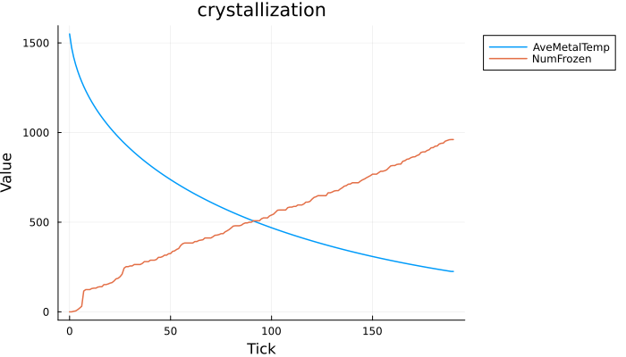
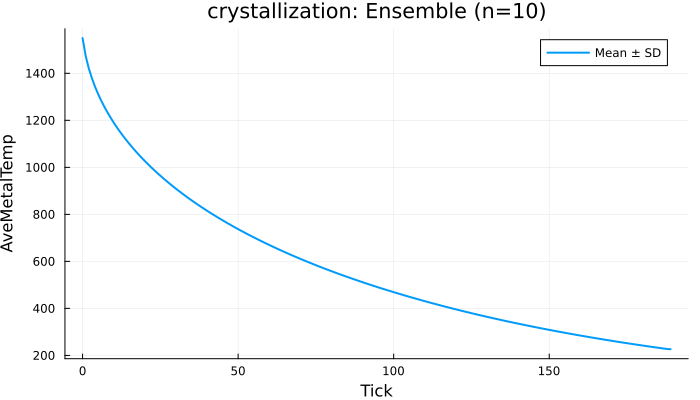
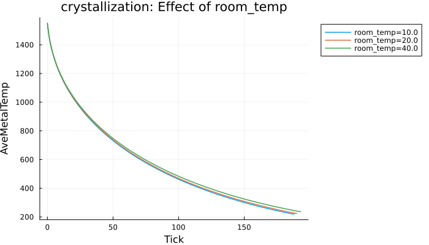

# Crystallization


- [Overview](#overview)
  - [WHAT IS IT?](#what-is-it)
  - [HOW IT WORKS](#how-it-works)
  - [THINGS TO TRY](#things-to-try)
  - [EXTENDING THE MODEL](#extending-the-model)
  - [NETLOGO FEATURES](#netlogo-features)
  - [RELATED MODELS](#related-models)
  - [CREDITS AND REFERENCES](#credits-and-references)
  - [HOW TO CITE](#how-to-cite)
  - [COPYRIGHT AND LICENSE](#copyright-and-license)
- [Parameters](#parameters)
- [Source Code](#source-code)
- [Time Series](#time-series)
- [Ensemble Runs](#ensemble-runs)
- [Parameter Sensitivity](#parameter-sensitivity)
- [Appendix: Source Code](#appendix-source-code)
  - [Parameters (`parameters.jl`)](#parameters-parametersjl)
  - [Components (`components.jl`)](#components-componentsjl)
  - [Resources (`resources.jl`)](#resources-resourcesjl)
  - [Systems (`systems.jl`)](#systems-systemsjl)
  - [Model (`model.jl`)](#model-modeljl)

## Overview

### WHAT IS IT?

This model shows how grains are formed as a metal crystallizes.

As a metal cools, it solidifies. The first atoms to solidify have a
random orientation. But when an atom solidifies next to an already
solidified atom, the first atom orients itself with the solid atom, thus
creating a crystal “grain”. As more atoms solidify, the grains grow.
Within each grain, all the atoms are oriented the same, but different
grains have different orientations.

Two grains next to each other form what is called a grain boundary. When
a metal is stressed, such as when it is pulled from both ends,
deformations occur in the crystal structure. As more stress is applied,
these deformations pass through the crystal structure, allowing the
metal to bend. Grain boundaries prevent deformations from flowing
through the metal. Therefore, pieces of metal with fewer grain
boundaries tend to be ductile, while pieces of metal with more grain
boundaries tend to be brittle.

### HOW IT WORKS

Liquid metal is placed in a room with a constant temperature much lower
than that of the metal. As heat leaves the metal, the metal begins to
solidify. Liquid atoms are free to rotate, but solid atoms (gray) are
literally frozen. If a liquid atom is next to a solid atom, it will
orient itself with it, otherwise it will rotate randomly.

Note that the actual number of atoms is small compared to a real metal
sample and the metal is only two-dimensional.

### THINGS TO TRY

Set HEIGHT to 19. Try to obtain the largest grains possible by
systematically changing the three temperature variables. Are there
multiple settings that achieve this affect? Now find the settings that
result in the smallest grains. Are there multiple settings that achieve
this affect?

Compare the time it takes for the metal to completely crystallize using
each of the settings you found in the above paragraph. To do this, use
the TIME monitor. How does crystallization time relate to grain size?

Keeping the HEIGHT 19, what is the fewest number of grains you can make?
Why can you not make only one grain? From what part of the metal does
crystallization always start from? Does setting CIRCLE? to OFF make any
difference?

Set the ROOM-TEMP to be 20, the INIT-METAL-TEMP to be 1550, and the
MELTING-TEMP to be 500. Set CIRCLE? to OFF. Now try various settings for
HEIGHT and WIDTH. Which setting achieves the largest size of grains?
Which setting achieves the fewest number of grains?

### EXTENDING THE MODEL

Some metal applications require that the metal’s grains form long strips
across the metal. To achieve this, only one side of the metal is cooled.
This causes all of the crystals to begin on one side of the metal, and
consequently grow across its length. This is called directional
solidification. In the Procedures window, change the code so one side of
the room is much cooler than the others.

Other metal applications require that metal consist of a single grain.
One way to do this is to crystallize the metal in a magnetic field. This
induces polarization in the metal atoms, causing them to line up. Add a
procedure to the code that creates a magnetic field in the room.

### NETLOGO FEATURES

In the setup procedure, a turtle is created on every patch within the
requested dimensions. This is achieved by asking every patch satisfying
certain conditions to `sprout 1`.

Note how we can draw a multi-colored histogram. The `histogram`
primitive can only draw in one color at a time, but we work around this
by calling it over and over again, plotting only one bar each time,
changing the pen color each time.

With every time step, each atom’s temperature changes to the average of
everything around it. To do this, each turtle has a list of all of its
neighboring turtles. In this model, every patch surrounding a given
turtle is either occupied by a turtle or considered to be outside the
metal. Therefore, the new temperature is then taken as the average of
the temperatures of the neighbor list, plus the room temperature
multiplied by the maximum number of neighbors minus the number of
neighbors that particular turtle has. Therefore, turtles completely
surrounded by other turtles don’t average in the room temperature to
their temperature, but turtles on the edge of the metal will.

### RELATED MODELS

Crystallization Directed Crystallization Moving

### CREDITS AND REFERENCES

Original implementation: Carrie Hobbs, for the Center for Connected
Learning and Computer-Based Modeling.

### HOW TO CITE

If you mention this model or the NetLogo software in a publication, we
ask that you include the citations below.

For the model itself:

- Wilensky, U. (2002). NetLogo Crystallization Basic model.
  http://ccl.northwestern.edu/netlogo/models/CrystallizationBasic.
  Center for Connected Learning and Computer-Based Modeling,
  Northwestern University, Evanston, IL.

Please cite the NetLogo software as:

- Wilensky, U. (1999). NetLogo. http://ccl.northwestern.edu/netlogo/.
  Center for Connected Learning and Computer-Based Modeling,
  Northwestern University, Evanston, IL.

### COPYRIGHT AND LICENSE

Copyright 2002 Uri Wilensky.


This model is licensed under the Creative Commons
Attribution-NonCommercial-ShareAlike 3.0 License. To view a copy of this
license, visit https://creativecommons.org/licenses/by-nc-sa/3.0/ or
send a letter to Creative Commons, 559 Nathan Abbott Way, Stanford,
California 94305, USA.

NetLogo itself is free software for non-commercial use under the terms
of the GNU General Public License ([see full license information
here](https://ccl.northwestern.edu/netlogo/docs/copyright.html)).

To inquire about commercial licenses for either NetLogo or specific
models from the models library, please contact
netlogo-commercial-admin@ccl.northwestern.edu.

This model was created as part of the projects: PARTICIPATORY
SIMULATIONS: NETWORK-BASED DESIGN FOR SYSTEMS LEARNING IN CLASSROOMS
and/or INTEGRATED SIMULATION AND MODELING ENVIRONMENT. The project
gratefully acknowledges the support of the National Science Foundation
(REPP & ROLE programs) – grant numbers REC \#9814682 and REC-0126227.

<!-- 2002 -->

## Parameters

| Parameter         | Type      | Default  | Description       |
|-------------------|-----------|----------|-------------------|
| `room_temp`       | `Float64` | `20.0`   | room temp         |
| `init_metal_temp` | `Float64` | `1550.0` | init metal temp   |
| `melting_temp`    | `Float64` | `500.0`  | melting temp      |
| `metal_size`      | `Int`     | `31`     | 31x31 metal block |
| `max_ticks`       | `Int`     | `200`    | max ticks         |

## Source Code

The Julia code to run this model:

``` julia
using ArkModelZoo
_, trajectory = run_crystallization()
```

## Time Series



## Ensemble Runs

Ten replicates with different random seeds, showing mean ± standard
deviation.



## Parameter Sensitivity

Varying `room_temp`.



## Appendix: Source Code

This model is implemented in the
[Ark.jl](https://github.com/sdwfrost/Ark.jl) Entity-Component-System
(ECS) framework. The code is split into five files, each with a distinct
role:

- **Parameters**: a mutable struct holding all configurable values.
- **Components**: lightweight data types attached to individual entities
  (agents).
- **Resources**: world-level shared state accessible to all systems.
- **Systems**: functions that operate on entities each tick, defining
  model behavior.
- **Model**: wiring that assembles the world, registers resources and
  systems, and provides the run entry point.

### Parameters (`parameters.jl`)

The parameter struct uses `@kwdef` so that every field has a default
value and can be overridden by keyword. These defaults match the
original NetLogo model’s slider settings.

``` julia
Base.@kwdef mutable struct CrystallizationParams
    room_temp::Float64 = 20.0
    init_metal_temp::Float64 = 1550.0
    melting_temp::Float64 = 500.0
    metal_size::Int = 31  # 31x31 metal block
    max_ticks::Int = 200
    seed::Int = 42
end
```

### Components (`components.jl`)

Components are lightweight data types attached to individual entities
(agents). Mutable structs hold per-entity state, while empty tag structs
act as markers for the ECS query system to efficiently filter entities.

``` julia
struct CrystDummy end
```

### Resources (`resources.jl`)

Resources are world-level singletons shared across all systems, used for
global state and aggregate statistics.

``` julia
mutable struct CrystGrid
    metal_size::Int  # 31 (the metal block is metal_size x metal_size)
    temp::Matrix{Float64}
    heading::Matrix{Float64}
    neighbor_count::Matrix{Int}  # precomputed: number of metal neighbors (Moore, excluding self)
    sides_exposed::Matrix{Int}   # precomputed: 8 - neighbor_count
end

function CrystGrid(metal_size::Int)
    n = metal_size
    temp = zeros(Float64, n, n)
    heading = zeros(Float64, n, n)
    nc = zeros(Int, n, n)
    se = zeros(Int, n, n)
    # Precompute neighbor counts
    for x in 1:n, y in 1:n
        count = 0
        for dx in -1:1, dy in -1:1
            (dx == 0 && dy == 0) && continue
            nx, ny = x + dx, y + dy
            if 1 <= nx <= n && 1 <= ny <= n
                count += 1
            end
        end
        nc[x, y] = count
        se[x, y] = 8 - count
    end
    CrystGrid(n, temp, heading, nc, se)
end

mutable struct CrystStats
    ave_metal_temp::Float64
    num_frozen::Int
end
CrystStats() = CrystStats(0.0, 0)
```

### Systems (`systems.jl`)

Systems contain the model logic and execute in a defined order each
tick. Each system struct implements either `initialize!` (run once at
setup) or `update!` (run every tick).

``` julia
struct InitCrystSystem <: System end

function initialize!(::InitCrystSystem, world::World)
    params = get_resource(world, CrystallizationParams)
    rng = get_resource(world, RNGResource).rng
    grid = get_resource(world, CrystGrid)
    stats = get_resource(world, CrystStats)
    n = grid.metal_size

    for x in 1:n, y in 1:n
        grid.temp[x, y] = params.init_metal_temp
        grid.heading[x, y] = 0.0  # NetLogo default heading is 0
    end

    stats.ave_metal_temp = params.init_metal_temp
    stats.num_frozen = 0
    return nothing
end

# --- Cool ---

struct CrystCoolSystem <: System end

function update!(::CrystCoolSystem, world::World)
    params = get_resource(world, CrystallizationParams)
    rng = get_resource(world, RNGResource).rng
    grid = get_resource(world, CrystGrid)
    stats = get_resource(world, CrystStats)
    n = grid.metal_size
    temp = grid.temp

    # Early termination check: if max temp < melting-temp, stop BEFORE updating
    max_temp = -Inf
    for i in eachindex(temp)
        temp[i] > max_temp && (max_temp = temp[i])
    end
    if max_temp < params.melting_temp
        get_resource(world, Terminate).stop = true
        return nothing
    end

    # Cool turtles in random order (sequential, reads current temps)
    # NetLogo: neighboring-turtles includes self (at-points includes [0,0])
    # Formula: total-temp = sum(neighboring-turtles temps) + room-temp * sides-exposed + own-temp
    #          new-temp = total-temp / (count neighboring-turtles + sides-exposed + 1)
    # This counts self temp TWICE (in sum and in +temp), divisor is always 10
    perm = randperm(rng, n * n)
    for idx in perm
        y = (idx - 1) ÷ n + 1
        x = (idx - 1) % n + 1

        # Sum of current neighbor temps INCLUDING self (matching NetLogo's at-points with [0,0])
        neighbor_sum = temp[x, y]  # self included
        for dx in -1:1, dy in -1:1
            (dx == 0 && dy == 0) && continue
            nx, ny = x + dx, y + dy
            if 1 <= nx <= n && 1 <= ny <= n
                neighbor_sum += temp[nx, ny]
            end
        end

        # NetLogo adds own temp AGAIN: total = sum(neighbors+self) + room*exposed + temp
        total_temp = neighbor_sum + params.room_temp * grid.sides_exposed[x, y] + temp[x, y]
        # Divisor: count(neighbors+self) + sides_exposed + 1 = always 10
        divisor = (grid.neighbor_count[x, y] + 1) + grid.sides_exposed[x, y] + 1
        temp[x, y] = total_temp / divisor
    end

    return nothing
end

# --- Rotate ---

struct CrystRotateSystem <: System end

function update!(::CrystRotateSystem, world::World)
    params = get_resource(world, CrystallizationParams)
    rng = get_resource(world, RNGResource).rng
    grid = get_resource(world, CrystGrid)
    n = grid.metal_size
    temp = grid.temp
    heading = grid.heading

    # Check termination (may have been set in cool phase)
    term = get_resource(world, Terminate)
    term.stop && return nothing

    # Random order
    perm = randperm(rng, n * n)
    for idx in perm
        y = (idx - 1) ÷ n + 1
        x = (idx - 1) % n + 1

        temp[x, y] < params.melting_temp && continue  # only process non-frozen (temp >= melting)

        # Find frozen neighbors (temp <= melting_temp)
        # NetLogo: neighboring-turtles includes self via [0,0] offset
        frozen = Tuple{Int,Int}[]
        # Include self if frozen
        if temp[x, y] <= params.melting_temp
            push!(frozen, (x, y))
        end
        for dx in -1:1, dy in -1:1
            (dx == 0 && dy == 0) && continue
            nx, ny = x + dx, y + dy
            if 1 <= nx <= n && 1 <= ny <= n && temp[nx, ny] <= params.melting_temp
                push!(frozen, (nx, ny))
            end
        end

        if !isempty(frozen)
            fx, fy = frozen[rand(rng, 1:length(frozen))]
            heading[x, y] = heading[fx, fy]
        else
            heading[x, y] = mod(heading[x, y] + rand(rng) * 360.0, 360.0)
        end
    end
    return nothing
end

# --- Stats ---

struct CrystStatsSystem <: System end

function update!(::CrystStatsSystem, world::World)
    params = get_resource(world, CrystallizationParams)
    grid = get_resource(world, CrystGrid)
    stats = get_resource(world, CrystStats)
    temp = grid.temp

    total = 0.0
    nf = 0
    for i in eachindex(temp)
        total += temp[i]
        if temp[i] < params.melting_temp
            nf += 1
        end
    end
    n = grid.metal_size
    stats.ave_metal_temp = total / (n * n)
    stats.num_frozen = nf
    return nothing
end

# --- Termination ---

struct CrystTerminationSystem <: System end

function update!(::CrystTerminationSystem, world::World)
    params = get_resource(world, CrystallizationParams)
    tick = get_resource(world, Tick)
    if tick.tick + 1 >= params.max_ticks
        get_resource(world, Terminate).stop = true
    end
    return nothing
end
```

### Model (`model.jl`)

The model file assembles all pieces: it creates the ECS `World` with the
required component types, registers resources, builds the `Scheduler`
with systems in execution order, and exposes the public `run` entry
point. The observer pattern records the trajectory each tick.

``` julia
function crystallization_world(; initial_capacity::Int = 128)
    return World(CrystDummy; initial_capacity=initial_capacity, allow_mutable=true)
end

function crystallization_systems()
    return (
        InitCrystSystem(),
        CrystCoolSystem(),
        CrystRotateSystem(),
        CrystStatsSystem(),
        CrystTerminationSystem(),
    )
end

function crystallization_model(params::CrystallizationParams = CrystallizationParams())
    world = crystallization_world()
    _add_standard_resources!(world, params)
    add_resource!(world, CrystGrid(params.metal_size))
    add_resource!(world, CrystStats())
    scheduler = Scheduler(world, crystallization_systems())
    initialize!(scheduler)
    return scheduler
end

struct CrystallizationObserver end

function crystallization_headers(::CrystallizationObserver)
    return ["AveMetalTemp", "NumFrozen"]
end

function crystallization_values(::CrystallizationObserver, world::World)
    stats = get_resource(world, CrystStats)
    return Float64[stats.ave_metal_temp, Float64(stats.num_frozen)]
end

function run_crystallization(; params::CrystallizationParams = CrystallizationParams(), observe::Bool = true)
    return _run_model(crystallization_model, CrystallizationObserver(), crystallization_values; params, observe)
end
```
