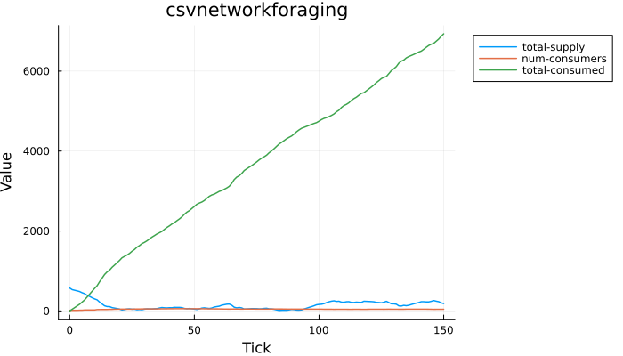
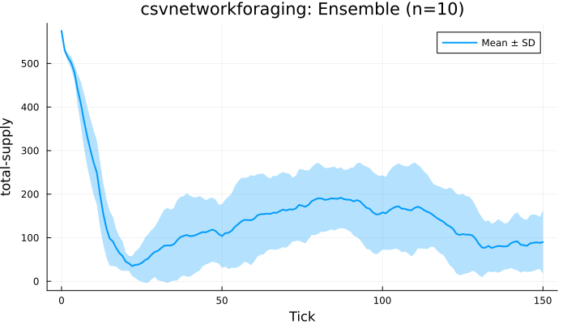
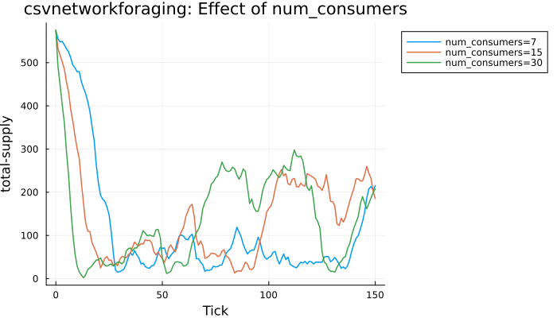

# CSV Network Foraging


- [Overview](#overview)
- [Parameters](#parameters)
- [Source Code](#source-code)
- [Time Series](#time-series)
- [Ensemble Runs](#ensemble-runs)
- [Parameter Sensitivity](#parameter-sensitivity)
- [Appendix: Source Code](#appendix-source-code)
  - [Parameters (`parameters.jl`)](#parameters-parametersjl)
  - [Components (`components.jl`)](#components-componentsjl)
  - [Resources (`resources.jl`)](#resources-resourcesjl)
  - [Systems (`systems.jl`)](#systems-systemsjl)
  - [Model (`model.jl`)](#model-modeljl)

## Overview

This vignette demonstrates the **CSV Network Foraging** model
implemented in
[ArkModelZoo.jl](https://github.com/sdwfrost/ArkModelZoo.jl) using the
Ark.jl ECS framework.

## Parameters

| Parameter       | Type  | Default | Description   |
|-----------------|-------|---------|---------------|
| `num_consumers` | `Int` | `15`    | num consumers |
| `max_ticks`     | `Int` | `150`   | max ticks     |

## Source Code

The Julia code to run this model:

``` julia
using ArkModelZoo
_, trajectory = run_csvnetworkforaging()
```

## Time Series



## Ensemble Runs

Ten replicates with different random seeds, showing mean ± standard
deviation.



## Parameter Sensitivity

Varying `num_consumers`.



## Appendix: Source Code

This model is implemented in the
[Ark.jl](https://github.com/sdwfrost/Ark.jl) Entity-Component-System
(ECS) framework. The code is split into five files, each with a distinct
role:

- **Parameters**: a mutable struct holding all configurable values.
- **Components**: lightweight data types attached to individual entities
  (agents).
- **Resources**: world-level shared state accessible to all systems.
- **Systems**: functions that operate on entities each tick, defining
  model behavior.
- **Model**: wiring that assembles the world, registers resources and
  systems, and provides the run entry point.

### Parameters (`parameters.jl`)

The parameter struct uses `@kwdef` so that every field has a default
value and can be overridden by keyword. These defaults match the
original NetLogo model’s slider settings.

``` julia
Base.@kwdef mutable struct CNFParams
    num_consumers::Int = 15
    max_ticks::Int = 150
    seed::Int = 42
end
```

### Components (`components.jl`)

Components are lightweight data types attached to individual entities
(agents). Mutable structs hold per-entity state, while empty tag structs
act as markers for the ECS query system to efficiently filter entities.

``` julia
struct CNFDummy end
```

### Resources (`resources.jl`)

Resources are world-level singletons shared across all systems, used for
global state and aggregate statistics.

``` julia
struct CNFNodeData
    id::Int
    x::Int
    y::Int
    capacity::Int
    regrow_rate::Int
end

const CNF_NODES = [
    CNFNodeData(1,-8,-8,40,3), CNFNodeData(2,-4,-4,50,4), CNFNodeData(3,0,0,60,5),
    CNFNodeData(4,4,-4,50,4), CNFNodeData(5,8,-8,40,3), CNFNodeData(6,-8,4,45,3),
    CNFNodeData(7,-4,8,55,5), CNFNodeData(8,0,4,65,6), CNFNodeData(9,4,8,55,5),
    CNFNodeData(10,8,4,45,3), CNFNodeData(11,-6,0,35,2), CNFNodeData(12,6,0,35,2),
]

const CNF_EDGES = [
    (1,2),(2,3),(3,4),(4,5),(1,6),(6,7),(7,8),(8,9),(9,10),
    (2,11),(11,6),(4,12),(12,10),(3,8),(11,3),(12,3),
]

mutable struct CNFNode
    id::Int
    x::Int
    y::Int
    capacity::Int
    supply::Float64
    regrow_rate::Int
    neighbors::Vector{Int}
end

mutable struct CNFConsumer
    energy::Float64
    consumption_rate::Int
    node_idx::Int
    alive::Bool
end

mutable struct CNFNetwork
    nodes::Vector{CNFNode}
    consumers::Vector{CNFConsumer}
end
CNFNetwork() = CNFNetwork(CNFNode[], CNFConsumer[])

mutable struct CNFStats
    total_supply::Float64
    num_consumers::Int
    total_consumed::Float64
end
CNFStats() = CNFStats(0.0, 0, 0.0)
```

### Systems (`systems.jl`)

Systems contain the model logic and execute in a defined order each
tick. Each system struct implements either `initialize!` (run once at
setup) or `update!` (run every tick).

``` julia
struct InitCNFSystem <: System end

function initialize!(::InitCNFSystem, world::World)
    params = get_resource(world, CNFParams)
    rng = get_resource(world, RNGResource).rng
    net = get_resource(world, CNFNetwork)
    stats = get_resource(world, CNFStats)

    # Create nodes from embedded data
    for nd in CNF_NODES
        push!(net.nodes, CNFNode(nd.id, nd.x, nd.y, nd.capacity, Float64(nd.capacity), nd.regrow_rate, Int[]))
    end

    # Build adjacency from edge list (undirected)
    for (a, b) in CNF_EDGES
        push!(net.nodes[a].neighbors, b)
        push!(net.nodes[b].neighbors, a)
    end

    # Create consumers at random nodes
    for _ in 1:params.num_consumers
        node_idx = rand(rng, 1:length(net.nodes))
        cr = 2 + rand(rng, 0:2)
        push!(net.consumers, CNFConsumer(30.0, cr, node_idx, true))
    end

    stats.total_consumed = 0.0
    _cnf_update_stats!(net, stats)
    return nothing
end

function _cnf_update_stats!(net::CNFNetwork, stats::CNFStats)
    s = 0.0
    for node in net.nodes
        s += node.supply
    end
    stats.total_supply = round(s; digits=4)
    stats.num_consumers = count(c -> c.alive, net.consumers)
    return nothing
end

struct CNFGoSystem <: System end

function update!(::CNFGoSystem, world::World)
    rng = get_resource(world, RNGResource).rng
    net = get_resource(world, CNFNetwork)
    stats = get_resource(world, CNFStats)

    # Regrow resources at each node
    for node in net.nodes
        node.supply = min(Float64(node.capacity), node.supply + node.regrow_rate)
    end

    # Shuffle alive consumer indices for NetLogo ask semantics
    alive_idxs = [i for i in eachindex(net.consumers) if net.consumers[i].alive]
    Random.shuffle!(rng, alive_idxs)

    for ci in alive_idxs
        c = net.consumers[ci]
        !c.alive && continue

        # Consume from current node
        node = net.nodes[c.node_idx]
        take = min(Float64(c.consumption_rate), node.supply)
        node.supply -= take
        c.energy += take
        stats.total_consumed += take

        # Metabolism
        c.energy -= 1.0

        # Move to best-supplied neighbor
        neighbors = node.neighbors
        if !isempty(neighbors)
            best_idx = neighbors[1]
            best_supply = net.nodes[best_idx].supply
            for ni in 2:length(neighbors)
                ns = net.nodes[neighbors[ni]].supply
                if ns > best_supply
                    best_supply = ns
                    best_idx = neighbors[ni]
                end
            end
            if best_supply > 0.0
                c.node_idx = best_idx
            end
        end

        # Die if energy depleted
        if c.energy <= 0.0
            c.alive = false
        end
    end

    # Reproduction (shuffled)
    alive_idxs2 = [i for i in eachindex(net.consumers) if net.consumers[i].alive]
    Random.shuffle!(rng, alive_idxs2)
    for ci in alive_idxs2
        c = net.consumers[ci]
        if c.alive && c.energy > 40.0
            child_energy = c.energy / 2.0
            c.energy = child_energy
            child_node = rand(rng, 1:length(net.nodes))
            push!(net.consumers, CNFConsumer(child_energy, c.consumption_rate, child_node, true))
        end
    end

    _cnf_update_stats!(net, stats)
    return nothing
end

struct CNFTerminationSystem <: System end

function update!(::CNFTerminationSystem, world::World)
    params = get_resource(world, CNFParams)
    tick = get_resource(world, Tick)
    if tick.tick + 1 >= params.max_ticks
        get_resource(world, Terminate).stop = true
    end
    return nothing
end
```

### Model (`model.jl`)

The model file assembles all pieces: it creates the ECS `World` with the
required component types, registers resources, builds the `Scheduler`
with systems in execution order, and exposes the public `run` entry
point. The observer pattern records the trajectory each tick.

``` julia
function csvnetworkforaging_world(; initial_capacity::Int = 128)
    return World(CNFDummy; initial_capacity = initial_capacity, allow_mutable = true)
end

function csvnetworkforaging_systems()
    return (InitCNFSystem(), CNFGoSystem(), CNFTerminationSystem())
end

function csvnetworkforaging_model(params::CNFParams = CNFParams())
    world = csvnetworkforaging_world()
    _add_standard_resources!(world, params)
    add_resource!(world, CNFNetwork())
    add_resource!(world, CNFStats())
    scheduler = Scheduler(world, csvnetworkforaging_systems())
    initialize!(scheduler)
    return scheduler
end

struct CNFObserver end

function csvnetworkforaging_headers(::CNFObserver)
    return ["total-supply", "num-consumers", "total-consumed"]
end

function csvnetworkforaging_values(::CNFObserver, world::World)
    stats = get_resource(world, CNFStats)
    return Float64[stats.total_supply, stats.num_consumers, stats.total_consumed]
end

function run_csvnetworkforaging(; params::CNFParams = CNFParams(), observe::Bool = true)
    return _run_model(csvnetworkforaging_model, CNFObserver(), csvnetworkforaging_values; params, observe)
end
```
