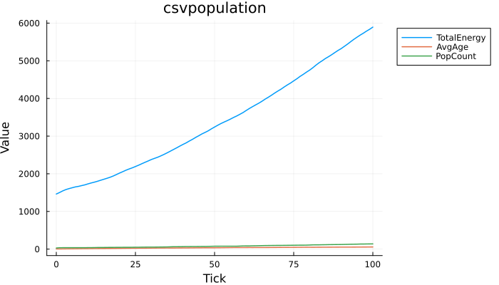
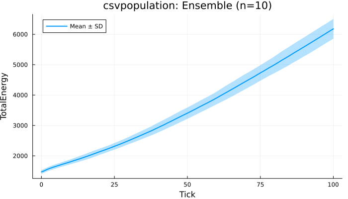
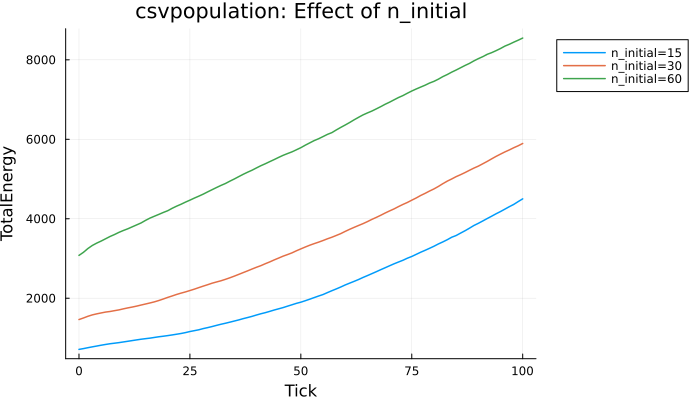

## Overview

This vignette demonstrates the **CSV Population** model implemented in [ArkModelZoo.jl](https://github.com/sdwfrost/ArkModelZoo.jl) using the Ark.jl ECS framework.

## Parameters

| Parameter | Type | Default | Description |
|-----------|------|---------|-------------|
| `n_initial` | `Int` | `30` | n initial |
| `grid_xmin` | `Int` | `-10` | grid xmin |
| `grid_xmax` | `Int` | `10` | grid xmax |
| `grid_ymin` | `Int` | `-10` | grid ymin |
| `grid_ymax` | `Int` | `10` | grid ymax |
| `max_ticks` | `Int` | `100` | max ticks |

## Source Code

The Julia code to run this model:

```julia
using ArkModelZoo
_, trajectory = run_csvpopulation()
```

## Time Series

{width=100%}

## Ensemble Runs

Ten replicates with different random seeds, showing mean ± standard deviation.

{width=100%}

## Parameter Sensitivity

Varying `n_initial`.

{width=100%}


## Appendix: Source Code

This model is implemented in the [Ark.jl](https://github.com/sdwfrost/Ark.jl) Entity-Component-System (ECS) framework. The code is split into five files, each with a distinct role:

- **Parameters**: a mutable struct holding all configurable values.
- **Components**: lightweight data types attached to individual entities (agents).
- **Resources**: world-level shared state accessible to all systems.
- **Systems**: functions that operate on entities each tick, defining model behavior.
- **Model**: wiring that assembles the world, registers resources and systems, and provides the run entry point.

### Parameters (`parameters.jl`)

The parameter struct uses `@kwdef` so that every field has a default value and can be overridden by keyword. These defaults match the original NetLogo model's slider settings.

```julia
Base.@kwdef mutable struct CsvPopParams
    n_initial::Int = 30
    grid_xmin::Int = -10
    grid_xmax::Int = 10
    grid_ymin::Int = -10
    grid_ymax::Int = 10
    max_ticks::Int = 100
    seed::Int = 42
end
```

### Components (`components.jl`)

Components are lightweight data types attached to individual entities (agents). Mutable structs hold per-entity state, while empty tag structs act as markers for the ECS query system to efficiently filter entities.

```julia
struct CsvPopDummy end
```

### Resources (`resources.jl`)

Resources are world-level singletons shared across all systems, used for global state and aggregate statistics.

```julia
mutable struct CsvPopGrid
    width::Int
    height::Int
    food::Matrix{Float64}
end

function CsvPopGrid(w::Int, h::Int)
    CsvPopGrid(w, h, zeros(Float64, w, h))
end

mutable struct CsvPopAgent
    energy::Float64
    age::Int
    speed::Int
    x::Float64
    y::Float64
    heading::Float64
    alive::Bool
end

mutable struct CsvPopState
    agents::Vector{CsvPopAgent}
end
CsvPopState() = CsvPopState(CsvPopAgent[])

mutable struct CsvPopStats
    total_energy::Float64
    avg_age::Float64
    pop_count::Int
end
CsvPopStats() = CsvPopStats(0.0, 0.0, 0)
```

### Systems (`systems.jl`)

Systems contain the model logic and execute in a defined order each tick. Each system struct implements either `initialize!` (run once at setup) or `update!` (run every tick).

```julia
# CSV Population — agent-based population model with foraging/energy/reproduction

struct InitCsvPopSystem <: System end

function _csvpop_wrap(v::Float64, lo::Float64, hi::Float64)
    span = hi - lo
    while v < lo; v += span; end
    while v > hi; v -= span; end
    return v
end

function _csvpop_grid_xy(x::Float64, y::Float64, w::Int, h::Int, xmin::Int, ymin::Int)
    gx = clamp(round(Int, x - xmin) + 1, 1, w)
    gy = clamp(round(Int, y - ymin) + 1, 1, h)
    return gx, gy
end

function initialize!(::InitCsvPopSystem, world::World)
    params = get_resource(world, CsvPopParams)
    rng    = get_resource(world, RNGResource).rng
    grid   = get_resource(world, CsvPopGrid)
    state  = get_resource(world, CsvPopState)
    stats  = get_resource(world, CsvPopStats)
    w, h = grid.width, grid.height

    # Initialize patch food: 2 + random(3) → 2..4
    for x in 1:w, y in 1:h
        grid.food[x, y] = Float64(2 + rand(rng, 0:2))
    end

    # Generate initial population (matching NetLogo CSV round-trip)
    for _ in 1:params.n_initial
        en = Float64(30 + rand(rng, 0:39))
        ag = rand(rng, 0:9)
        sp = 1 + rand(rng, 0:3)
        px = Float64(params.grid_xmin) + rand(rng) * Float64(params.grid_xmax - params.grid_xmin)
        py = Float64(params.grid_ymin) + rand(rng) * Float64(params.grid_ymax - params.grid_ymin)
        heading = rand(rng) * 360.0
        push!(state.agents, CsvPopAgent(en, ag, sp, px, py, heading, true))
    end

    _csvpop_update_stats!(state, stats)
    return nothing
end

function _csvpop_update_stats!(state::CsvPopState, stats::CsvPopStats)
    alive = filter(a -> a.alive, state.agents)
    stats.pop_count = length(alive)
    if stats.pop_count > 0
        stats.total_energy = sum(a.energy for a in alive)
        stats.avg_age = sum(a.age for a in alive) / stats.pop_count
    else
        stats.total_energy = 0.0
        stats.avg_age = 0.0
    end
end

struct CsvPopGoSystem <: System end

function update!(::CsvPopGoSystem, world::World)
    params = get_resource(world, CsvPopParams)
    rng    = get_resource(world, RNGResource).rng
    grid   = get_resource(world, CsvPopGrid)
    state  = get_resource(world, CsvPopState)
    stats  = get_resource(world, CsvPopStats)
    w, h = grid.width, grid.height
    xmin = Float64(params.grid_xmin)
    xmax = Float64(params.grid_xmax)
    ymin = Float64(params.grid_ymin)
    ymax = Float64(params.grid_ymax)

    # Patch food regrowth
    for x in 1:w, y in 1:h
        if grid.food[x, y] < 5.0
            grid.food[x, y] += 0.2
        end
    end

    # Agent movement, foraging, metabolism — shuffle for NetLogo ask
    alive_indices = findall(a -> a.alive, state.agents)
    shuffle!(rng, alive_indices)
    for idx in alive_indices
        a = state.agents[idx]
        # Random turn and move
        a.heading = rand(rng) * 360.0
        dx = sin(deg2rad(a.heading)) * a.speed / 5.0
        dy = cos(deg2rad(a.heading)) * a.speed / 5.0
        a.x = _csvpop_wrap(a.x + dx, xmin, xmax)
        a.y = _csvpop_wrap(a.y + dy, ymin, ymax)

        # Eat food
        gx, gy = _csvpop_grid_xy(a.x, a.y, w, h, params.grid_xmin, params.grid_ymin)
        meal = min(grid.food[gx, gy], 1.5)
        grid.food[gx, gy] -= meal
        a.energy += meal
        a.age += 1
        a.energy -= 0.2

        if a.energy <= 0.0 || a.age > 120
            a.alive = false
        end
    end

    # Reproduction — shuffle high-energy agents
    reproduce_indices = findall(a -> a.alive && a.energy > 60.0, state.agents)
    shuffle!(rng, reproduce_indices)
    for idx in reproduce_indices
        a = state.agents[idx]
        !a.alive && continue
        # Hatch offspring
        child_energy = a.energy / 2.0
        a.energy = child_energy
        child_heading = rand(rng) * 360.0
        cx = a.x + sin(deg2rad(child_heading)) * 1.0
        cy = a.y + cos(deg2rad(child_heading)) * 1.0
        cx = _csvpop_wrap(cx, xmin, xmax)
        cy = _csvpop_wrap(cy, ymin, ymax)
        push!(state.agents, CsvPopAgent(child_energy, 0, a.speed, cx, cy, child_heading, true))
    end

    _csvpop_update_stats!(state, stats)
    return nothing
end

struct CsvPopTerminationSystem <: System end

function update!(::CsvPopTerminationSystem, world::World)
    params = get_resource(world, CsvPopParams)
    tick   = get_resource(world, Tick)
    if tick.tick + 1 >= params.max_ticks
        get_resource(world, Terminate).stop = true
    end
    return nothing
end
```

### Model (`model.jl`)

The model file assembles all pieces: it creates the ECS `World` with the required component types, registers resources, builds the `Scheduler` with systems in execution order, and exposes the public `run` entry point. The observer pattern records the trajectory each tick.

```julia
function csvpopulation_world(; initial_capacity::Int = 128)
    return World(CsvPopDummy; initial_capacity = initial_capacity, allow_mutable = true)
end

function csvpopulation_systems()
    return (InitCsvPopSystem(), CsvPopGoSystem(), CsvPopTerminationSystem())
end

function csvpopulation_model(params::CsvPopParams = CsvPopParams())
    w = params.grid_xmax - params.grid_xmin + 1
    h = params.grid_ymax - params.grid_ymin + 1
    world = csvpopulation_world()
    _add_standard_resources!(world, params)
    add_resource!(world, CsvPopGrid(w, h))
    add_resource!(world, CsvPopState())
    add_resource!(world, CsvPopStats())
    scheduler = Scheduler(world, csvpopulation_systems())
    initialize!(scheduler)
    return scheduler
end

struct CsvPopObserver end

function csvpopulation_headers(::CsvPopObserver)
    return ["TotalEnergy", "AvgAge", "PopCount"]
end

function csvpopulation_values(::CsvPopObserver, world::World)
    stats = get_resource(world, CsvPopStats)
    return Float64[stats.total_energy, stats.avg_age, Float64(stats.pop_count)]
end

function run_csvpopulation(; params::CsvPopParams = CsvPopParams(), observe::Bool = true)
    return _run_model(csvpopulation_model, CsvPopObserver(), csvpopulation_values; params, observe)
end
```
