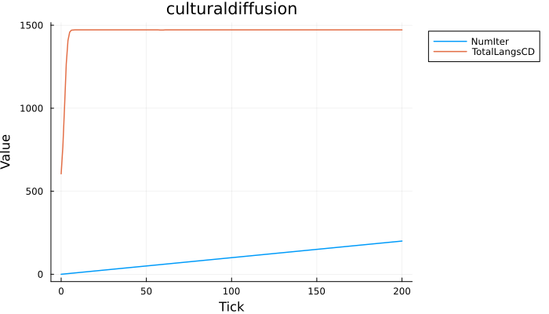
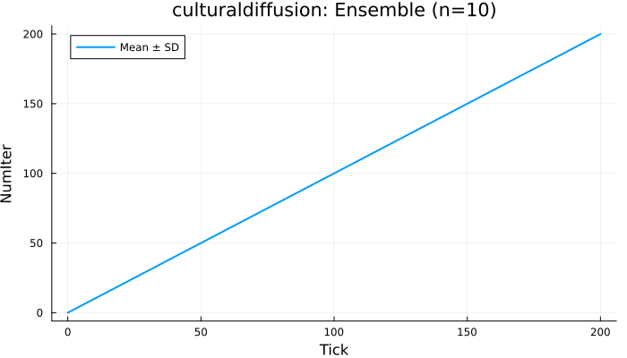
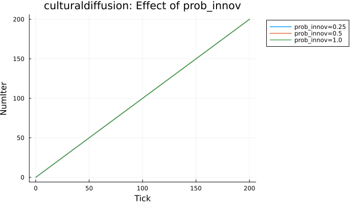

## Overview

This vignette demonstrates the **Cultural Diffusion** model implemented in [ArkModelZoo.jl](https://github.com/sdwfrost/ArkModelZoo.jl) using the Ark.jl ECS framework.

## Parameters

| Parameter | Type | Default | Description |
|-----------|------|---------|-------------|
| `prob_innov` | `Float64` | `0.5` | prob innov |
| `prob_adoption` | `Float64` | `0.9` | prob adoption |
| `prob_forget` | `Float64` | `0.0002` | prob forget |
| `max_lang` | `Int` | `120` | max lang |
| `max_capacity` | `Int` | `3` | max capacity |
| `grid_width` | `Int` | `17` | -8..8 → 17 patches |
| `grid_height` | `Int` | `17` | grid height |
| `max_ticks` | `Int` | `200` | max ticks |

## Source Code

The Julia code to run this model:

```julia
using ArkModelZoo
_, trajectory = run_culturaldiffusion()
```

## Time Series

{width=100%}

## Ensemble Runs

Ten replicates with different random seeds, showing mean ± standard deviation.

{width=100%}

## Parameter Sensitivity

Varying `prob_innov`.

{width=100%}


## Appendix: Source Code

This model is implemented in the [Ark.jl](https://github.com/sdwfrost/Ark.jl) Entity-Component-System (ECS) framework. The code is split into five files, each with a distinct role:

- **Parameters**: a mutable struct holding all configurable values.
- **Components**: lightweight data types attached to individual entities (agents).
- **Resources**: world-level shared state accessible to all systems.
- **Systems**: functions that operate on entities each tick, defining model behavior.
- **Model**: wiring that assembles the world, registers resources and systems, and provides the run entry point.

### Parameters (`parameters.jl`)

The parameter struct uses `@kwdef` so that every field has a default value and can be overridden by keyword. These defaults match the original NetLogo model's slider settings.

```julia
Base.@kwdef mutable struct CulturalDiffusionParams
    prob_innov::Float64 = 0.5
    prob_adoption::Float64 = 0.9
    prob_forget::Float64 = 0.0002
    max_lang::Int = 120
    max_capacity::Int = 3
    grid_width::Int = 17    # -8..8 → 17 patches
    grid_height::Int = 17
    max_ticks::Int = 200
    seed::Int = 42
end
```

### Components (`components.jl`)

Components are lightweight data types attached to individual entities (agents). Mutable structs hold per-entity state, while empty tag structs act as markers for the ECS query system to efficiently filter entities.

```julia
struct CDDummy end
```

### Resources (`resources.jl`)

Resources are world-level singletons shared across all systems, used for global state and aggregate statistics.

```julia
mutable struct CDState
    w::Int
    h::Int
    langj::Vector{Vector{Int}}    # langj[patch_idx] = list of language ids
    census::Vector{Int}           # census[lang_id] = global count
end

function CDState()
    CDState(0, 0, Vector{Int}[], Int[])
end

mutable struct CDStats
    num_iter::Int
    total_langs::Int
end
CDStats() = CDStats(0, 0)
```

### Systems (`systems.jl`)

Systems contain the model logic and execute in a defined order each tick. Each system struct implements either `initialize!` (run once at setup) or `update!` (run every tick).

```julia
# Cultural Diffusion of Programming Languages
# Patches innovate, adopt from neighbors, or forget languages

struct InitCDSystem <: System end

function initialize!(::InitCDSystem, world::World)
    params = get_resource(world, CulturalDiffusionParams)
    st = get_resource(world, CDState)
    stats = get_resource(world, CDStats)

    w = params.grid_width
    h = params.grid_height
    st.w = w
    st.h = h
    n_patches = w * h
    st.langj = [Int[] for _ in 1:n_patches]
    # Census: index 1..MaxLang+1 (language ids 0..MaxLang mapped to 1..MaxLang+1)
    # NetLogo: array:from-list n-values (1 + MaxLang) [5]
    st.census = fill(5, params.max_lang + 1)

    stats.num_iter = 0
    stats.total_langs = sum(st.census)
    return nothing
end

# Helpers for 2D grid indexing (1-based)
_cd_idx(x::Int, y::Int, w::Int) = (y - 1) * w + x

function _cd_weighted_rand_index(rng, probs::Vector{Float64})
    nc = length(probs)
    nc == 0 && return -1
    while true
        i = rand(rng, 1:nc)
        p = probs[i]
        if rand(rng) < p || p >= 0.9999999999
            return i
        end
    end
end

struct CDGoSystem <: System end

function update!(::CDGoSystem, world::World)
    params = get_resource(world, CulturalDiffusionParams)
    rng = get_resource(world, RNGResource).rng
    st = get_resource(world, CDState)
    stats = get_resource(world, CDStats)

    w = st.w
    h = st.h
    n_patches = w * h

    # NetLogo: ask patches [adoption] — shuffled order
    order = collect(1:n_patches)
    Random.shuffle!(rng, order)

    for pidx in order
        py = div(pidx - 1, w) + 1
        px = mod(pidx - 1, w) + 1
        langj = st.langj[pidx]
        check = true

        # Innovation
        if rand(rng) < params.prob_innov
            if length(langj) < params.max_capacity
                l = rand(rng, 1:params.max_lang)
                if !(l in langj)
                    push!(langj, l)
                    st.census[l + 1] += 1  # +1 for 1-based census
                end
            end
            check = false
        end

        # Adoption
        if rand(rng) < params.prob_adoption && check
            nbrs = moore_neighbors_wrap(px, py, w, h)
            # one-of neighbors
            nx, ny = nbrs[rand(rng, 1:length(nbrs))]
            nidx = _cd_idx(nx, ny, w)
            langv = st.langj[nidx]
            if !isempty(langv)
                c_total = sum(st.census)
                # most-frequent-known: weighted by frequency
                if c_total > 0 && length(langv) > 0
                    probs = Float64[st.census[lv + 1] / max(c_total, 1) for lv in langv]
                    sel_idx = length(langv) == 1 ? 1 : _cd_weighted_rand_index(rng, probs)
                    if sel_idx >= 1
                        lv = langv[sel_idx]
                        if !(lv in langj)
                            lenj = length(langj)
                            if lenj >= params.max_capacity
                                # Remove random language
                                ri = rand(rng, 1:lenj)
                                f = langj[ri]
                                deleteat!(langj, ri)
                                st.census[f + 1] -= 1
                            end
                            push!(langj, lv)
                            st.census[lv + 1] += 1
                        end
                    end
                end
            end
            check = false
        end

        # Forget
        if rand(rng) < params.prob_forget && check
            if length(langj) > 1
                c_total = sum(st.census)
                if c_total > 0
                    # least-frequent-known: weighted by 1 - freq
                    probs = Float64[1.0 - st.census[lv + 1] / max(c_total, 1) for lv in langj]
                    sel_idx = length(langj) == 1 ? 1 : _cd_weighted_rand_index(rng, probs)
                    if sel_idx >= 1
                        f = langj[sel_idx]
                        st.census[f + 1] -= 1
                        deleteat!(langj, sel_idx)
                    end
                end
            end
        end
    end

    stats.num_iter += 1
    stats.total_langs = sum(st.census)
    return nothing
end

struct CDTerminationSystem <: System end

function update!(::CDTerminationSystem, world::World)
    params = get_resource(world, CulturalDiffusionParams)
    tick = get_resource(world, Tick)
    if tick.tick + 1 >= params.max_ticks
        get_resource(world, Terminate).stop = true
    end
    return nothing
end
```

### Model (`model.jl`)

The model file assembles all pieces: it creates the ECS `World` with the required component types, registers resources, builds the `Scheduler` with systems in execution order, and exposes the public `run` entry point. The observer pattern records the trajectory each tick.

```julia
function culturaldiffusion_world(; initial_capacity::Int = 64)
    return World(CDDummy; initial_capacity = initial_capacity, allow_mutable = true)
end

function culturaldiffusion_systems()
    return (InitCDSystem(), CDGoSystem(), CDTerminationSystem())
end

function culturaldiffusion_model(params::CulturalDiffusionParams = CulturalDiffusionParams())
    world = culturaldiffusion_world()
    _add_standard_resources!(world, params)
    add_resource!(world, CDState())
    add_resource!(world, CDStats())
    scheduler = Scheduler(world, culturaldiffusion_systems())
    initialize!(scheduler)
    return scheduler
end

struct CDObserver end

function culturaldiffusion_headers(::CDObserver)
    return ["NumIter", "TotalLangsCD"]
end

function culturaldiffusion_values(::CDObserver, world::World)
    stats = get_resource(world, CDStats)
    return Float64[stats.num_iter, stats.total_langs]
end

function run_culturaldiffusion(; params::CulturalDiffusionParams = CulturalDiffusionParams(), observe::Bool = true)
    return _run_model(culturaldiffusion_model, CDObserver(), culturaldiffusion_values; params, observe)
end
```
