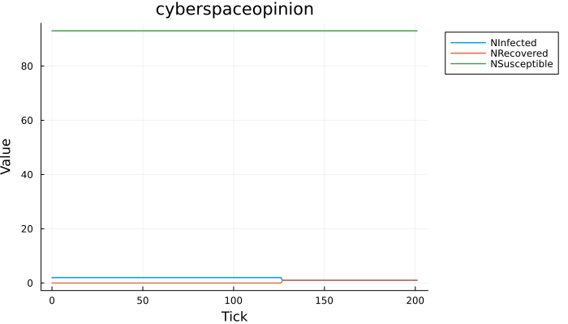
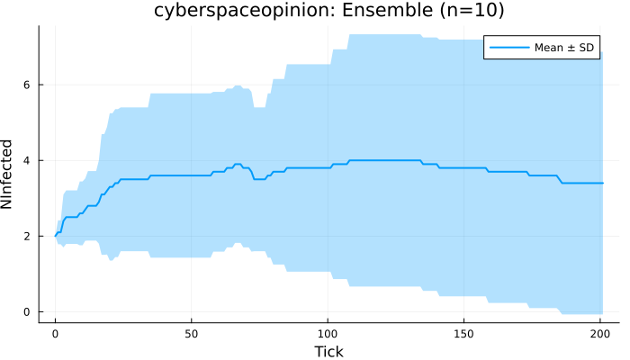
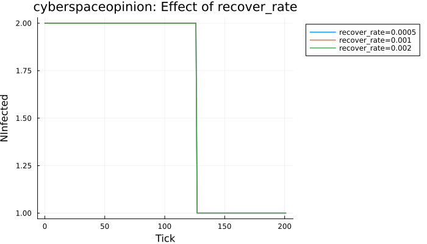

# Cyberspace Opinion


- [Overview](#overview)
- [Parameters](#parameters)
- [Source Code](#source-code)
- [Time Series](#time-series)
- [Ensemble Runs](#ensemble-runs)
- [Parameter Sensitivity](#parameter-sensitivity)
- [Appendix: Source Code](#appendix-source-code)
  - [Parameters (`parameters.jl`)](#parameters-parametersjl)
  - [Components (`components.jl`)](#components-componentsjl)
  - [Resources (`resources.jl`)](#resources-resourcesjl)
  - [Systems (`systems.jl`)](#systems-systemsjl)
  - [Model (`model.jl`)](#model-modeljl)

## Overview

This vignette demonstrates the **Cyberspace Opinion** model implemented
in [ArkModelZoo.jl](https://github.com/sdwfrost/ArkModelZoo.jl) using
the Ark.jl ECS framework.

## Parameters

| Parameter             | Type      | Default | Description         |
|-----------------------|-----------|---------|---------------------|
| `grid_size`           | `Int`     | `51`    | grid size           |
| `recover_rate`        | `Float64` | `0.001` | recover rate        |
| `infection_rate`      | `Float64` | `0.05`  | infection rate      |
| `n_extremist_leaders` | `Int`     | `5`     | n extremist leaders |
| `threshold_sentiment` | `Float64` | `0.5`   | threshold sentiment |
| `n_initial_infected`  | `Int`     | `2`     | n initial infected  |
| `num_ticks`           | `Int`     | `200`   | num ticks           |

## Source Code

The Julia code to run this model:

``` julia
using ArkModelZoo
_, trajectory = run_cyber()
```

## Time Series



## Ensemble Runs

Ten replicates with different random seeds, showing mean ± standard
deviation.



## Parameter Sensitivity

Varying `recover_rate`.



## Appendix: Source Code

This model is implemented in the
[Ark.jl](https://github.com/sdwfrost/Ark.jl) Entity-Component-System
(ECS) framework. The code is split into five files, each with a distinct
role:

- **Parameters**: a mutable struct holding all configurable values.
- **Components**: lightweight data types attached to individual entities
  (agents).
- **Resources**: world-level shared state accessible to all systems.
- **Systems**: functions that operate on entities each tick, defining
  model behavior.
- **Model**: wiring that assembles the world, registers resources and
  systems, and provides the run entry point.

### Parameters (`parameters.jl`)

The parameter struct uses `@kwdef` so that every field has a default
value and can be overridden by keyword. These defaults match the
original NetLogo model’s slider settings.

``` julia
Base.@kwdef mutable struct CyberParams
    seed::Int = 42
    grid_size::Int = 51
    recover_rate::Float64 = 0.001
    infection_rate::Float64 = 0.05
    n_extremist_leaders::Int = 5
    threshold_sentiment::Float64 = 0.5
    n_initial_infected::Int = 2
    num_ticks::Int = 200
end
```

### Components (`components.jl`)

Components are lightweight data types attached to individual entities
(agents). Mutable structs hold per-entity state, while empty tag structs
act as markers for the ECS query system to efficiently filter entities.

``` julia
struct CyberDummy end
```

### Resources (`resources.jl`)

Resources are world-level singletons shared across all systems, used for
global state and aggregate statistics.

``` julia
mutable struct CyberGrid
    width::Int
    height::Int
    sentiment::Matrix{Float64}
    extremist::Matrix{Bool}
    vaccinated::Matrix{Bool}
    susceptible::Matrix{Bool}
    infected::Matrix{Bool}
    recovered::Matrix{Bool}
end

function CyberGrid(w::Int, h::Int)
    return CyberGrid(
        w, h,
        zeros(Float64, w, h),
        falses(w, h),
        falses(w, h),
        falses(w, h),
        falses(w, h),
        falses(w, h),
    )
end

mutable struct CyberNetwork
    adj::Vector{Set{Int}}
end

CyberNetwork(n::Int) = CyberNetwork([Set{Int}() for _ in 1:n])

mutable struct CyberStats
    n_infected::Int
    n_recovered::Int
    n_susceptible::Int
end

CyberStats() = CyberStats(0, 0, 0)
```

### Systems (`systems.jl`)

Systems contain the model logic and execute in a defined order each
tick. Each system struct implements either `initialize!` (run once at
setup) or `update!` (run every tick).

``` julia
# --- Helper: linear index <-> (x,y) ---
@inline function _cyber_idx(x::Int, y::Int, w::Int)
    return (y - 1) * w + x
end

@inline function _cyber_xy(idx::Int, w::Int)
    y = div(idx - 1, w) + 1
    x = mod(idx - 1, w) + 1
    return (x, y)
end

# --- Scale-free network via Barabási-Albert preferential attachment ---
function _cyber_build_scale_free!(net::CyberNetwork, n::Int, rng)
    # Start with 2 connected nodes
    push!(net.adj[1], 2)
    push!(net.adj[2], 1)
    degree = zeros(Int, n)
    degree[1] = 1
    degree[2] = 1
    total_degree = 2

    for i in 3:n
        # Connect to one existing node with probability proportional to degree
        r = rand(rng) * total_degree
        cumsum = 0.0
        target = 1
        for j in 1:(i-1)
            cumsum += degree[j]
            if cumsum >= r
                target = j
                break
            end
        end
        push!(net.adj[i], target)
        push!(net.adj[target], i)
        degree[i] += 1
        degree[target] += 1
        total_degree += 2
    end
    return degree
end

# --- Systems ---

struct InitCyberSystem <: System end

function initialize!(::InitCyberSystem, world::World)
    params = get_resource(world, CyberParams)
    rng = get_resource(world, RNGResource).rng
    grid = get_resource(world, CyberGrid)
    net = get_resource(world, CyberNetwork)
    w = grid.width
    h = grid.height
    n = w * h

    # 1. Set sentiment = clamp(randn(), -1, 1)
    for i in 1:w, j in 1:h
        grid.sentiment[i, j] = clamp(randn(rng), -1.0, 1.0)
    end

    # 2. Build scale-free network
    degree = _cyber_build_scale_free!(net, n, rng)

    # 3. Top n_extremist_leaders by degree become extremist leaders
    sorted_indices = sortperm(degree; rev=true)
    leaders = sorted_indices[1:min(params.n_extremist_leaders, n)]
    for idx in leaders
        x, y = _cyber_xy(idx, w)
        grid.extremist[x, y] = true
        grid.sentiment[x, y] = 1.0
    end

    # 4. Spread extremism: neighbors (network + spatial) of leaders with sentiment >= threshold
    for idx in leaders
        lx, ly = _cyber_xy(idx, w)
        # Network neighbors
        for nidx in net.adj[idx]
            nx, ny = _cyber_xy(nidx, w)
            if grid.sentiment[nx, ny] >= params.threshold_sentiment
                grid.extremist[nx, ny] = true
                grid.sentiment[nx, ny] = 1.0
            end
        end
        # Spatial (Moore) neighbors
        for (nx, ny) in moore_neighbors_bounded(lx, ly, w, h)
            if grid.sentiment[nx, ny] >= params.threshold_sentiment
                grid.extremist[nx, ny] = true
                grid.sentiment[nx, ny] = 1.0
            end
        end
    end

    # 5. Non-extremists get vaccinated
    for i in 1:w, j in 1:h
        if !grid.extremist[i, j]
            grid.vaccinated[i, j] = true
        end
    end

    # 6. Susceptible = not vaccinated
    for i in 1:w, j in 1:h
        grid.susceptible[i, j] = !grid.vaccinated[i, j]
    end

    # 7. Infect n_initial_infected random susceptible agents
    susceptible_cells = Tuple{Int,Int}[]
    for i in 1:w, j in 1:h
        if grid.susceptible[i, j]
            push!(susceptible_cells, (i, j))
        end
    end
    n_to_infect = min(params.n_initial_infected, length(susceptible_cells))
    if n_to_infect > 0
        shuffle!(rng, susceptible_cells)
        for k in 1:n_to_infect
            x, y = susceptible_cells[k]
            grid.infected[x, y] = true
        end
    end

    # Update stats
    _cyber_update_stats!(world)
end

function _cyber_update_stats!(world::World)
    grid = get_resource(world, CyberGrid)
    stats = get_resource(world, CyberStats)
    stats.n_infected = count(grid.infected)
    stats.n_recovered = count(grid.recovered)
    stats.n_susceptible = count(grid.susceptible .& .!grid.infected .& .!grid.recovered)
end

struct CyberSpreadSystem <: System end

function update!(::CyberSpreadSystem, world::World)
    params = get_resource(world, CyberParams)
    rng = get_resource(world, RNGResource).rng
    grid = get_resource(world, CyberGrid)
    w = grid.width
    h = grid.height

    # Spread disease: susceptible (not recovered) can get infected from Moore neighbors
    new_infected = falses(w, h)
    for x in 1:w, y in 1:h
        if grid.susceptible[x, y] && !grid.recovered[x, y] && !grid.infected[x, y]
            n_infected_neighbors = 0
            for (nx, ny) in moore_neighbors_bounded(x, y, w, h)
                if grid.infected[nx, ny]
                    n_infected_neighbors += 1
                end
            end
            if n_infected_neighbors > 0
                prob = 1.0 - exp(-params.infection_rate * n_infected_neighbors)
                if rand(rng) <= prob
                    new_infected[x, y] = true
                end
            end
        end
    end
    # Apply new infections
    for x in 1:w, y in 1:h
        if new_infected[x, y]
            grid.infected[x, y] = true
        end
    end
end

struct CyberRecoverSystem <: System end

function update!(::CyberRecoverSystem, world::World)
    params = get_resource(world, CyberParams)
    rng = get_resource(world, RNGResource).rng
    grid = get_resource(world, CyberGrid)
    w = grid.width
    h = grid.height

    for x in 1:w, y in 1:h
        if grid.infected[x, y]
            if rand(rng) <= params.recover_rate
                grid.recovered[x, y] = true
                grid.infected[x, y] = false
                grid.susceptible[x, y] = false
            end
        end
    end
end

struct CyberStatsSystem <: System end

function update!(::CyberStatsSystem, world::World)
    _cyber_update_stats!(world)
end

struct CyberTerminationSystem <: System end

function update!(::CyberTerminationSystem, world::World)
    params = get_resource(world, CyberParams)
    tick = get_resource(world, Tick).tick
    if tick >= params.num_ticks
        get_resource(world, Terminate).stop = true
    end
end
```

### Model (`model.jl`)

The model file assembles all pieces: it creates the ECS `World` with the
required component types, registers resources, builds the `Scheduler`
with systems in execution order, and exposes the public `run` entry
point. The observer pattern records the trajectory each tick.

``` julia
function cyber_world(; initial_capacity::Int = 128)
    return World(CyberDummy; initial_capacity=initial_capacity, allow_mutable=true)
end

function cyber_systems()
    return (
        InitCyberSystem(),
        CyberSpreadSystem(),
        CyberRecoverSystem(),
        CyberStatsSystem(),
        CyberTerminationSystem(),
    )
end

function cyber_model(params::CyberParams = CyberParams())
    world = cyber_world()
    _add_standard_resources!(world, params)
    add_resource!(world, CyberGrid(params.grid_size, params.grid_size))
    add_resource!(world, CyberNetwork(params.grid_size * params.grid_size))
    add_resource!(world, CyberStats())
    scheduler = Scheduler(world, cyber_systems())
    initialize!(scheduler)
    return scheduler
end

struct CyberObserver end

function cyber_headers(::CyberObserver)
    return ["NInfected", "NRecovered", "NSusceptible"]
end

function cyber_values(::CyberObserver, world::World)
    stats = get_resource(world, CyberStats)
    return Float64[stats.n_infected, stats.n_recovered, stats.n_susceptible]
end

function run_cyber(; params::CyberParams = CyberParams(), observe::Bool = true)
    return _run_model(cyber_model, CyberObserver(), cyber_values; params, observe)
end
```
