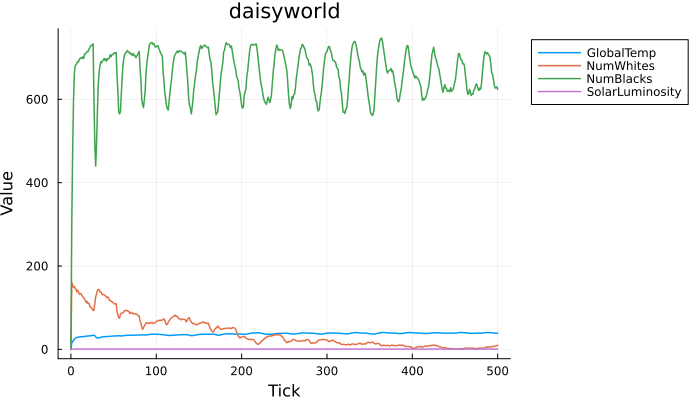
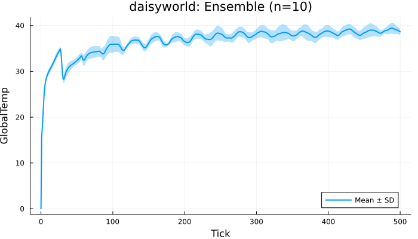
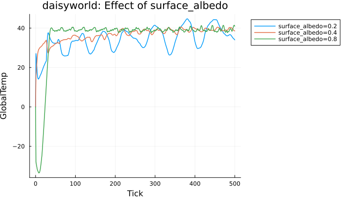

## Overview

### WHAT IS IT?

This model explores the "Gaia hypothesis", which considers the Earth as a single, self-regulating system including both living and non-living parts. In particular, this model explores how living organisms both alter and are altered by climate, which is non-living. The example organisms are daisies and the climatic factor considered is temperature.

Daisyworld is a world filled with two different types of daisies: black daisies and white daisies.  They differ in albedo, which is how much energy they absorb as heat from sunlight.  White daisies have a high surface albedo and thus reflect light and heat, thus cooling the area around them.  Black daisies have a low surface albedo and thus absorb light and heat, thus heating the area around them.  However, there is only a certain temperature range in which daisies can reproduce; if the temperature around a daisy is outside of this range, the daisy will produce no offspring and eventually die of old age.

When the climate is too cold it is necessary for the black daisies to propagate in order to raise the temperature, and vice versa -- when the climate is too warm, it is necessary for more white daisies to be produced in order to cool the temperature.  For a wide range of parameter settings, the temperature and the population of daisies will eventually stabilize.  However, it is possible for Daisyworld to get either too hot or too cold, in which case the daisies are not able to bring the temperature back under control and all of the daisies will eventually die.

### HOW IT WORKS

White daisies, black daisies, and open ground (empty patches) each have an albedo or percentage of energy they absorb as heat from sunlight. Sunlight energy can be changed with the SOLAR-LUMINOSITY slider (a value of 1.0 simulates the average solar luminosity of our sun).

Each time step, every patch will calculate the temperature at that spot based on (1) the energy absorbed by the daisy at that patch and (2) the diffusion of 50% of the temperature value at that patch between its neighbors.  Open ground patches that are adjacent to a daisy have a probability of sprouting a daisy that is the same color as the neighboring daisy, based on a parabolic probability function that depends on the local temperature (where an optimum temperature of 22.5 yields a maximum probability of 100% of sprouting a new daisy). Daisies age each step of the simulation until they reach a maximum age, at which point they die and the patch they were in becomes open.

### THINGS TO NOTICE

Run the simulation. What happens to the daisies?  Do the populations ever remain stable? Are there ever population booms and busts?  If so, what causes them? (Hint: how do the daisies affects the climate? How does the climate then affect the daisies?)

What happens if boom and bust cycles just keep getting bigger and bigger? The swings can't keep getting bigger forever.

Does the planet ever become completely filled with life, or completely devoid of life?

Try running the simulation without the daisies. What happens to the planet's temperature? How is it different from what happens with the daisies?

Can the Daisyworld system be said to exhibit "hysteresis"?  Hysteresis is a property of systems that do not instantly follow the forces applied to them, but react slowly, or do not return completely to their original state.  The state of such systems depend on their immediate history.

### THINGS TO TRY

Try running the model with SHOW-DAISIES? off and SHOW-TEMP-MAP? on. You might be able to see interesting spatial patterns that emerge in temperature concentrations and periodic redistricting of temperature regions more easily in this mode.

Try adjusting the fixed temperature diffusion setting in the procedures (change it from 0.5). What happens to the behavior of Daisyworld if temperature is never diffused (set to 0.0)?

### EXTENDING THE MODEL

Black and white daisies represent two extreme types of daisies that could exist in this world.  Implement a third species of daisy.  You will need to choose what your daisy does and how it is different from black and white daisies.  How does your new daisy affect the results of this model?

Sunlight is only one aspect that controls the growth of daisies and other forms of life. Change the model so different parts of the world have different levels of soil quality.  How will this affect the outcome?

Many people feel that the Gaia hypothesis can be disturbed by human causes.  Implement pollution in the model.  Does this cause the daisies to die off quicker or more often?

Can you think of any other ways in which living organisms both alter and are altered by their environment?

### NETLOGO FEATURES

Uses the `diffuse` primitive to distribute heat between patches.

### RELATED MODELS

An alternate Daisyworld model is listed on the [User Community Models](http://ccl.northwestern.edu/netlogo/models/community/) page. It uses patches only, no turtles.

### CREDITS AND REFERENCES

The Daisyworld model was first proposed and implemented by Lovelock and Andrew Watson. The original Gaia hypothesis is due to Lovelock.

Watson, A.J., and J.E. Lovelock, 1983, "Biological homeostasis of the global environment: the parable of Daisyworld", Tellus 35B, 286-289. (The original paper by Watson and Lovelock introducing the Daisyworld model.)

Wikipedia also has a high-level description of the Daisyworld model: https://en.wikipedia.org/wiki/Daisyworld.

### HOW TO CITE

If you mention this model or the NetLogo software in a publication, we ask that you include the citations below.

For the model itself:

* Novak, M. and Wilensky, U. (2006).  NetLogo Daisyworld model.  http://ccl.northwestern.edu/netlogo/models/Daisyworld.  Center for Connected Learning and Computer-Based Modeling, Northwestern University, Evanston, IL.

Please cite the NetLogo software as:

* Wilensky, U. (1999). NetLogo. http://ccl.northwestern.edu/netlogo/. Center for Connected Learning and Computer-Based Modeling, Northwestern University, Evanston, IL.

### COPYRIGHT AND LICENSE

Copyright 2006 Uri Wilensky.


This model is licensed under the Creative Commons Attribution-NonCommercial-ShareAlike 3.0 License.  To view a copy of this license, visit https://creativecommons.org/licenses/by-nc-sa/3.0/ or send a letter to Creative Commons, 559 Nathan Abbott Way, Stanford, California 94305, USA.

NetLogo itself is free software for non-commercial use under the terms of the GNU General Public License ([see full license information here](https://ccl.northwestern.edu/netlogo/docs/copyright.html)).

To inquire about commercial licenses for either NetLogo or specific models from the models library, please contact netlogo-commercial-admin@ccl.northwestern.edu.

<!-- 2006 Cite: Novak, M. -->

## Parameters

| Parameter | Type | Default | Description |
|-----------|------|---------|-------------|
| `surface_albedo` | `Float64` | `0.4` | surface albedo |
| `white_albedo` | `Float64` | `0.75` | white albedo |
| `black_albedo` | `Float64` | `0.25` | black albedo |
| `solar_luminosity` | `Float64` | `0.8` | solar luminosity |
| `start_pct_whites` | `Float64` | `20.0` | start pct whites |
| `start_pct_blacks` | `Float64` | `20.0` | start pct blacks |
| `max_age` | `Int` | `25` | max age |
| `grid_size` | `Int` | `29` | grid size |
| `max_ticks` | `Int` | `500` | max ticks |
| `ramp_scenario` | `Bool` | `false` | ramp scenario |

## Source Code

The Julia code to run this model:

```julia
using ArkModelZoo
_, trajectory = run_daisyworld()
```

## Time Series

{width=100%}

## Ensemble Runs

Ten replicates with different random seeds, showing mean ± standard deviation.

{width=100%}

## Parameter Sensitivity

Varying `surface_albedo`.

{width=100%}


## Appendix: Source Code

This model is implemented in the [Ark.jl](https://github.com/sdwfrost/Ark.jl) Entity-Component-System (ECS) framework. The code is split into five files, each with a distinct role:

- **Parameters**: a mutable struct holding all configurable values.
- **Components**: lightweight data types attached to individual entities (agents).
- **Resources**: world-level shared state accessible to all systems.
- **Systems**: functions that operate on entities each tick, defining model behavior.
- **Model**: wiring that assembles the world, registers resources and systems, and provides the run entry point.

### Parameters (`parameters.jl`)

The parameter struct uses `@kwdef` so that every field has a default value and can be overridden by keyword. These defaults match the original NetLogo model's slider settings.

```julia
Base.@kwdef mutable struct DaisyworldParams
    surface_albedo::Float64 = 0.4
    white_albedo::Float64 = 0.75
    black_albedo::Float64 = 0.25
    solar_luminosity::Float64 = 0.8
    start_pct_whites::Float64 = 20.0
    start_pct_blacks::Float64 = 20.0
    max_age::Int = 25
    grid_size::Int = 29
    max_ticks::Int = 500
    seed::Int = 42
    # Ramp scenario: if true, luminosity ramps from 0.2 to 3.0 over max_ticks
    ramp_scenario::Bool = false
end
```

### Components (`components.jl`)

Components are lightweight data types attached to individual entities (agents). Mutable structs hold per-entity state, while empty tag structs act as markers for the ECS query system to efficiently filter entities.

```julia
# Position on the grid
mutable struct DaisyPosition
    x::Int
    y::Int
end
DaisyPosition() = DaisyPosition(0, 0)

# Age counter
mutable struct DaisyAge
    age::Int
end
DaisyAge() = DaisyAge(0)

# Albedo (reflectivity): white ~0.75, black ~0.25
mutable struct Albedo
    value::Float64
end
Albedo() = Albedo(0.5)

# Tag components for daisy types
struct WhiteDaisy end
struct BlackDaisy end
```

### Resources (`resources.jl`)

Resources are world-level singletons shared across all systems, used for global state and aggregate statistics.

```julia
mutable struct TemperatureGrid
    width::Int
    height::Int
    temperature::Matrix{Float64}
    occupant::Matrix{Entity}
end

function TemperatureGrid(width::Int, height::Int)
    TemperatureGrid(width, height, zeros(Float64, width, height), fill(zero_entity, width, height))
end

mutable struct DaisyStats
    global_temperature::Float64
    num_whites::Int
    num_blacks::Int
    solar_luminosity::Float64
end
DaisyStats() = DaisyStats(0.0, 0, 0, 0.8)
```

### Systems (`systems.jl`)

Systems contain the model logic and execute in a defined order each tick. Each system struct implements either `initialize!` (run once at setup) or `update!` (run every tick).

```julia
# --- Initialization ---

struct InitDaisyworldSystem <: System end

function initialize!(::InitDaisyworldSystem, world::World)
    params = get_resource(world, DaisyworldParams)
    rng = get_resource(world, RNGResource).rng
    grid = get_resource(world, TemperatureGrid)
    stats = get_resource(world, DaisyStats)
    stats.solar_luminosity = params.solar_luminosity
    w = grid.width

    total = w * w
    num_whites = round(Int, total * params.start_pct_whites / 100.0)
    num_blacks = round(Int, total * params.start_pct_blacks / 100.0)

    positions = [(x, y) for x in 1:w for y in 1:w]
    shuffle!(rng, positions)

    idx = 1
    for _ in 1:num_whites
        x, y = positions[idx]; idx += 1
        eid = new_entity!(world, (DaisyPosition(x, y), DaisyAge(rand(rng, 0:params.max_age)),
                                  Albedo(params.white_albedo), WhiteDaisy()))
        grid.occupant[x, y] = eid
    end
    for _ in 1:num_blacks
        x, y = positions[idx]; idx += 1
        eid = new_entity!(world, (DaisyPosition(x, y), DaisyAge(rand(rng, 0:params.max_age)),
                                  Albedo(params.black_albedo), BlackDaisy()))
        grid.occupant[x, y] = eid
    end

    # Initialize temperatures
    _calc_all_temps!(grid, stats, params)
    return nothing
end

# --- Temperature Calculation ---

struct CalcTemperatureSystem <: System end

function _local_heating(albedo::Float64, luminosity::Float64)
    absorbed = luminosity * (1.0 - albedo)
    absorbed <= 0.0 && return 80.0
    return 72.0 * log(absorbed) + 80.0
end

function _calc_all_temps!(grid::TemperatureGrid, stats::DaisyStats, params::DaisyworldParams)
    w = grid.width
    lum = stats.solar_luminosity

    for x in 1:w, y in 1:w
        eid = grid.occupant[x, y]
        if is_zero(eid)
            local_albedo = params.surface_albedo
        else
            # Get albedo from the entity - we store it in the grid temperature calc
            # For simplicity, we compute via the occupant tag
            local_albedo = params.surface_albedo  # will be overridden below
        end
        heating = _local_heating(local_albedo, lum)
        grid.temperature[x, y] = (grid.temperature[x, y] + heating) / 2.0
    end
end

function update!(::CalcTemperatureSystem, world::World)
    params = get_resource(world, DaisyworldParams)
    grid = get_resource(world, TemperatureGrid)
    stats = get_resource(world, DaisyStats)
    lum = stats.solar_luminosity
    w = grid.width

    # Calculate local temperatures with actual albedos
    for (_, positions, albedos) in Query(world, (DaisyPosition, Albedo))
        @inbounds for i in eachindex(positions)
            x, y = positions[i].x, positions[i].y
            heating = _local_heating(albedos[i].value, lum)
            grid.temperature[x, y] = (grid.temperature[x, y] + heating) / 2.0
        end
    end

    # Bare soil patches
    for x in 1:w, y in 1:w
        if is_zero(grid.occupant[x, y])
            heating = _local_heating(params.surface_albedo, lum)
            grid.temperature[x, y] = (grid.temperature[x, y] + heating) / 2.0
        end
    end
    return nothing
end

# --- Temperature Diffusion ---

struct DiffuseTemperatureSystem <: System end

function update!(::DiffuseTemperatureSystem, world::World)
    grid = get_resource(world, TemperatureGrid)
    w = grid.width
    diffuse!(grid.temperature, 0.5, w, w)
    return nothing
end

# --- Survivability (Aging + Reproduction) ---

struct SurvivabilitySystem <: System
    to_remove::Vector{Entity}
    to_spawn::Vector{Tuple{Int, Int, Bool}}  # (x, y, is_white)
end
SurvivabilitySystem() = SurvivabilitySystem(Entity[], Tuple{Int,Int,Bool}[])

function update!(system::SurvivabilitySystem, world::World)
    params = get_resource(world, DaisyworldParams)
    rng = get_resource(world, RNGResource).rng
    grid = get_resource(world, TemperatureGrid)
    w = grid.width

    empty!(system.to_remove)
    empty!(system.to_spawn)

    for (eids, positions, ages, albedos) in Query(world, (DaisyPosition, DaisyAge, Albedo))
        @inbounds for i in eachindex(positions)
            ages[i].age += 1
            if ages[i].age > params.max_age
                push!(system.to_remove, eids[i])
                continue
            end

            # Reproduction: fitness based on local temperature
            x, y = positions[i].x, positions[i].y
            temp = grid.temperature[x, y]
            # Parabolic fitness: seed_threshold = 0.1457 * T - 0.0032 * T^2 - 0.6443
            seed_threshold = 0.1457 * temp - 0.0032 * temp^2 - 0.6443
            if seed_threshold > 0.0 && rand(rng) < seed_threshold
                # Find empty neighbor
                neighbors = Tuple{Int,Int}[]
                for dx in -1:1, dy in -1:1
                    (dx == 0 && dy == 0) && continue
                    nx = mod1(x + dx, w)
                    ny = mod1(y + dy, w)
                    is_zero(grid.occupant[nx, ny]) && push!(neighbors, (nx, ny))
                end
                if !isempty(neighbors)
                    nx, ny = neighbors[rand(rng, 1:length(neighbors))]
                    is_white = albedos[i].value > 0.5
                    push!(system.to_spawn, (nx, ny, is_white))
                end
            end
        end
    end

    # Remove dead daisies
    for e in system.to_remove
        if is_alive(world, e)
            pos = get_components(world, e, (DaisyPosition,))[1]
            grid.occupant[pos.x, pos.y] = zero_entity
            remove_entity!(world, e)
        end
    end

    # Spawn new daisies
    for (x, y, is_white) in system.to_spawn
        !is_zero(grid.occupant[x, y]) && continue  # cell taken by another spawn
        if is_white
            eid = new_entity!(world, (DaisyPosition(x, y), DaisyAge(0),
                                      Albedo(params.white_albedo), WhiteDaisy()))
        else
            eid = new_entity!(world, (DaisyPosition(x, y), DaisyAge(0),
                                      Albedo(params.black_albedo), BlackDaisy()))
        end
        grid.occupant[x, y] = eid
    end
    return nothing
end

# --- Statistics ---

struct DaisyStatsSystem <: System end

function update!(::DaisyStatsSystem, world::World)
    grid = get_resource(world, TemperatureGrid)
    stats = get_resource(world, DaisyStats)
    params = get_resource(world, DaisyworldParams)

    stats.global_temperature = mean(grid.temperature)

    whites = 0
    blacks = 0
    for (eids, _) in Query(world, (DaisyPosition,); with=(WhiteDaisy,))
        whites += length(eids)
    end
    for (eids, _) in Query(world, (DaisyPosition,); with=(BlackDaisy,))
        blacks += length(eids)
    end
    stats.num_whites = whites
    stats.num_blacks = blacks

    # Ramp scenario
    if params.ramp_scenario
        tick = get_resource(world, Tick).tick
        stats.solar_luminosity = 0.2 + (3.0 - 0.2) * tick / params.max_ticks
    end
    return nothing
end

# --- Termination ---

struct DaisyworldTerminationSystem <: System end

function update!(::DaisyworldTerminationSystem, world::World)
    params = get_resource(world, DaisyworldParams)
    tick = get_resource(world, Tick)
    if tick.tick + 1 >= params.max_ticks
        get_resource(world, Terminate).stop = true
    end
    return nothing
end
```

### Model (`model.jl`)

The model file assembles all pieces: it creates the ECS `World` with the required component types, registers resources, builds the `Scheduler` with systems in execution order, and exposes the public `run` entry point. The observer pattern records the trajectory each tick.

```julia
function daisyworld_world(; initial_capacity::Int = 2048)
    return World(
        DaisyPosition,
        DaisyAge,
        Albedo,
        WhiteDaisy,
        BlackDaisy;
        initial_capacity = initial_capacity,
        allow_mutable = true,
    )
end

function daisyworld_systems()
    return (
        InitDaisyworldSystem(),
        CalcTemperatureSystem(),
        DiffuseTemperatureSystem(),
        SurvivabilitySystem(),
        DaisyStatsSystem(),
        DaisyworldTerminationSystem(),
    )
end

function daisyworld_model(params::DaisyworldParams = DaisyworldParams())
    world = daisyworld_world()
    _add_standard_resources!(world, params)
    add_resource!(world, TemperatureGrid(params.grid_size, params.grid_size))
    add_resource!(world, DaisyStats())
    scheduler = Scheduler(world, daisyworld_systems())
    initialize!(scheduler)
    return scheduler
end

struct DaisyworldObserver end

function daisyworld_headers(::DaisyworldObserver)
    return ["GlobalTemp", "NumWhites", "NumBlacks", "SolarLuminosity"]
end

function daisyworld_values(::DaisyworldObserver, world::World)
    stats = get_resource(world, DaisyStats)
    return Float64[stats.global_temperature, stats.num_whites,
                    stats.num_blacks, stats.solar_luminosity]
end

function run_daisyworld(; params::DaisyworldParams = DaisyworldParams(), observe::Bool = true)
    return _run_model(daisyworld_model, DaisyworldObserver(), daisyworld_values; params, observe)
end
```
