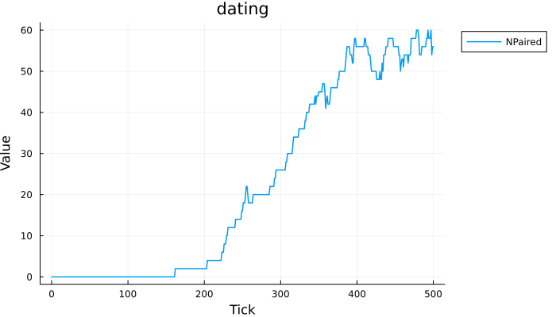
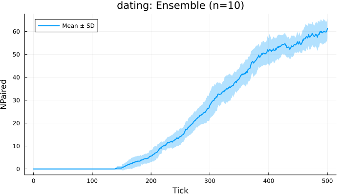
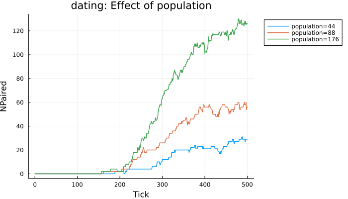

# Dating


- [Overview](#overview)
- [Parameters](#parameters)
- [Source Code](#source-code)
- [Time Series](#time-series)
- [Ensemble Runs](#ensemble-runs)
- [Parameter Sensitivity](#parameter-sensitivity)
- [Appendix: Source Code](#appendix-source-code)
  - [Parameters (`parameters.jl`)](#parameters-parametersjl)
  - [Components (`components.jl`)](#components-componentsjl)
  - [Resources (`resources.jl`)](#resources-resourcesjl)
  - [Systems (`systems.jl`)](#systems-systemsjl)
  - [Model (`model.jl`)](#model-modeljl)

## Overview

This vignette demonstrates the **Dating** model implemented in
[ArkModelZoo.jl](https://github.com/sdwfrost/ArkModelZoo.jl) using the
Ark.jl ECS framework.

## Parameters

| Parameter        | Type      | Default  | Description        |
|------------------|-----------|----------|--------------------|
| `population`     | `Int`     | `88`     | 44 blue + 44 green |
| `grid_size`      | `Int`     | `33`     | 33x33 toroidal     |
| `avg_pickiness`  | `Float64` | `0.0`    | avg pickiness      |
| `avg_timeline`   | `Float64` | `268.0`  | avg timeline       |
| `avg_commitment` | `Float64` | `1000.0` | avg commitment     |
| `max_ticks`      | `Int`     | `500`    | max ticks          |

## Source Code

The Julia code to run this model:

``` julia
using ArkModelZoo
_, trajectory = run_dating()
```

## Time Series



## Ensemble Runs

Ten replicates with different random seeds, showing mean ± standard
deviation.



## Parameter Sensitivity

Varying `population`.



## Appendix: Source Code

This model is implemented in the
[Ark.jl](https://github.com/sdwfrost/Ark.jl) Entity-Component-System
(ECS) framework. The code is split into five files, each with a distinct
role:

- **Parameters**: a mutable struct holding all configurable values.
- **Components**: lightweight data types attached to individual entities
  (agents).
- **Resources**: world-level shared state accessible to all systems.
- **Systems**: functions that operate on entities each tick, defining
  model behavior.
- **Model**: wiring that assembles the world, registers resources and
  systems, and provides the run entry point.

### Parameters (`parameters.jl`)

The parameter struct uses `@kwdef` so that every field has a default
value and can be overridden by keyword. These defaults match the
original NetLogo model’s slider settings.

``` julia
Base.@kwdef mutable struct DatingParams
    population::Int = 88          # 44 blue + 44 green
    grid_size::Int = 33           # 33x33 toroidal
    avg_pickiness::Float64 = 0.0
    avg_timeline::Float64 = 268.0
    avg_commitment::Float64 = 1000.0
    max_ticks::Int = 500
    seed::Int = 42
end
```

### Components (`components.jl`)

Components are lightweight data types attached to individual entities
(agents). Mutable structs hold per-entity state, while empty tag structs
act as markers for the ECS query system to efficiently filter entities.

``` julia
struct DatingDummy end
```

### Resources (`resources.jl`)

Resources are world-level singletons shared across all systems, used for
global state and aggregate statistics.

``` julia
mutable struct DatingState
    n_agents::Int
    x::Vector{Int}
    y::Vector{Int}
    is_blue::Vector{Bool}       # true=blue, false=green
    quality::Vector{Float64}
    pickiness::Vector{Float64}
    timeline::Vector{Int}        # can be negative (NetLogo: round random-normal)
    timeline_count::Vector{Int}
    looking::Vector{Bool}
    partner::Vector{Int}         # 0 = no partner (NetLogo default value)
    has_memory::Vector{Bool}
    consider_single::Vector{Bool}
    relationship_duration::Vector{Int}
    number_partners_ever::Vector{Int}
    # Phase-based fields matching NetLogo's separate ask-turtles blocks
    this_turn_candidate::Vector{Int}          # 0 = "none"
    this_turn_candidate_score::Vector{Float64}
    this_turn_market_assessment::Vector{Float64}
    all_turns_market_assessment::Vector{Float64}
    market_assessment_list::Vector{Vector{Float64}}  # running list for memory agents
end

function DatingState()
    DatingState(0, Int[], Int[], Bool[], Float64[], Float64[], Int[], Int[],
                Bool[], Int[], Bool[], Bool[], Int[], Int[],
                Int[], Float64[], Float64[], Float64[], Vector{Float64}[])
end

function _dating_add_agent!(state::DatingState, x::Int, y::Int, is_blue::Bool,
                            quality::Float64, pickiness::Float64, timeline::Int,
                            has_memory::Bool, consider_single::Bool)
    state.n_agents += 1
    push!(state.x, x)
    push!(state.y, y)
    push!(state.is_blue, is_blue)
    push!(state.quality, quality)
    push!(state.pickiness, pickiness)
    push!(state.timeline, timeline)
    push!(state.timeline_count, 0)
    push!(state.looking, true)
    push!(state.partner, 0)
    push!(state.has_memory, has_memory)
    push!(state.consider_single, consider_single)
    push!(state.relationship_duration, 0)
    push!(state.number_partners_ever, 0)
    push!(state.this_turn_candidate, 0)
    push!(state.this_turn_candidate_score, -100.0)
    push!(state.this_turn_market_assessment, 0.0)
    push!(state.all_turns_market_assessment, 0.0)
    push!(state.market_assessment_list, Float64[0.0, 0.0])  # NetLogo: list 0 0
    return state.n_agents
end

mutable struct DatingGrid
    width::Int
    height::Int
    occupants::Matrix{Vector{Int}}
end

function DatingGrid(w::Int, h::Int)
    occ = Matrix{Vector{Int}}(undef, w, h)
    for i in 1:w, j in 1:h
        occ[i, j] = Int[]
    end
    DatingGrid(w, h, occ)
end

mutable struct DatingStats
    n_paired::Int
end
DatingStats() = DatingStats(0)
```

### Systems (`systems.jl`)

Systems contain the model logic and execute in a defined order each
tick. Each system struct implements either `initialize!` (run once at
setup) or `update!` (run every tick).

``` julia
struct InitDatingSystem <: System end

function initialize!(::InitDatingSystem, world::World)
    params = get_resource(world, DatingParams)
    rng = get_resource(world, RNGResource).rng
    state = get_resource(world, DatingState)
    grid = get_resource(world, DatingGrid)
    stats = get_resource(world, DatingStats)
    w = params.grid_size
    half = params.population ÷ 2

    for i in 1:params.population
        is_blue = i <= half
        x = rand(rng, 1:w)
        y = rand(rng, 1:w)
        quality = Float64(round(Int, randn(rng) * 2.5 + 5.0))
        pickiness = Float64(round(Int, randn(rng) * 1.5 + params.avg_pickiness))
        # NetLogo: round random-normal avg (avg/3) — can be negative, no clamp
        timeline = round(Int, randn(rng) * (params.avg_timeline / 3.0) + params.avg_timeline)
        # Correlated draw: same random-float 1 determines both traits
        draw = rand(rng)
        consider_single = draw < 0.5
        has_memory = draw < 0.5
        idx = _dating_add_agent!(state, x, y, is_blue, quality, pickiness,
                                  timeline, has_memory, consider_single)
        push!(grid.occupants[x, y], idx)
    end

    stats.n_paired = 0
    return nothing
end

# --- Movement System ---

struct DatingMoveSystem <: System end

function update!(::DatingMoveSystem, world::World)
    params = get_resource(world, DatingParams)
    rng = get_resource(world, RNGResource).rng
    state = get_resource(world, DatingState)
    grid = get_resource(world, DatingGrid)
    w = params.grid_size

    # NetLogo: ask turtles [if looking? = "yes" [right random 360 forward 1]]
    perm = randperm(rng, state.n_agents)
    for i in perm
        state.looking[i] || continue

        ox, oy = state.x[i], state.y[i]
        filter!(j -> j != i, grid.occupants[ox, oy])

        # NetLogo: right random 360; forward 1
        # random 360 returns int 0-359, forward 1 moves 1 unit in heading direction
        heading_deg = rand(rng, 0:359)
        heading_rad = heading_deg * π / 180.0
        fx = ox + sin(heading_rad)
        fy = oy + cos(heading_rad)
        nx = mod1(round(Int, fx), w)
        ny = mod1(round(Int, fy), w)

        state.x[i] = nx
        state.y[i] = ny
        push!(grid.occupants[nx, ny], i)
    end
    return nothing
end

# --- Phase-based Interaction System ---

struct DatingInteractSystem <: System end

function update!(::DatingInteractSystem, world::World)
    params = get_resource(world, DatingParams)
    rng = get_resource(world, RNGResource).rng
    state = get_resource(world, DatingState)
    grid = get_resource(world, DatingGrid)
    stats = get_resource(world, DatingStats)
    w = params.grid_size
    n = state.n_agents

    # Each phase is a separate "ask turtles" block with independent shuffle

    # Phase 1: update-timeline-count — ALL turtles increment
    perm = randperm(rng, n)
    for i in perm
        state.timeline_count[i] += 1
    end

    # Phase 2: pick-candidate (neighbors8)
    perm = randperm(rng, n)
    for i in perm
        _dating_pick_candidate_phase!(rng, state, grid, i, w)
    end

    # Phase 3: assess-market (neighbors8)
    perm = randperm(rng, n)
    for i in perm
        _dating_assess_market_phase!(state, grid, i, w)
    end

    # Phase 4: score-candidate
    perm = randperm(rng, n)
    for i in perm
        _dating_score_candidate_phase!(state, i)
    end

    # Phase 5: consider-match (order matters — mutual selection)
    perm = randperm(rng, n)
    for i in perm
        _dating_consider_match_phase!(state, i)
    end

    # Phase 6: calculate-duration
    perm = randperm(rng, n)
    for i in perm
        if !state.looking[i]
            state.relationship_duration[i] += 1
        end
    end

    # Phase 7: consider-unmatch
    perm = randperm(rng, n)
    for i in perm
        _dating_consider_unmatch_phase!(rng, state, params, i)
    end

    # Update n-paired
    n_paired = 0
    for i in 1:n
        if !state.looking[i]
            n_paired += 1
        end
    end
    stats.n_paired = n_paired

    return nothing
end

# Get all agents on the 8 neighboring patches (toroidal)
function _dating_neighbors8(grid::DatingGrid, ax::Int, ay::Int, w::Int)
    result = Int[]
    for dx in -1:1, dy in -1:1
        (dx == 0 && dy == 0) && continue
        nx = mod1(ax + dx, w)
        ny = mod1(ay + dy, w)
        append!(result, grid.occupants[nx, ny])
    end
    return result
end

function _dating_pick_candidate_phase!(rng, state::DatingState, grid::DatingGrid, i::Int, w::Int)
    ax, ay = state.x[i], state.y[i]
    neighbors = _dating_neighbors8(grid, ax, ay, w)
    my_blue = state.is_blue[i]

    # Count opposite-color LOOKING neighbors (determines if we pick)
    n_eligible = 0
    for j in neighbors
        if state.is_blue[j] != my_blue && state.looking[j]
            n_eligible += 1
        end
    end

    if n_eligible == 0
        state.this_turn_candidate[i] = 0
    else
        # Pick from ALL turtles on neighbors (unfiltered!)
        if isempty(neighbors)
            state.this_turn_candidate[i] = 0
        else
            state.this_turn_candidate[i] = neighbors[rand(rng, 1:length(neighbors))]
        end
    end
    return nothing
end

function _dating_assess_market_phase!(state::DatingState, grid::DatingGrid, i::Int, w::Int)
    ax, ay = state.x[i], state.y[i]
    neighbors = _dating_neighbors8(grid, ax, ay, w)
    my_blue = state.is_blue[i]
    candidate = state.this_turn_candidate[i]  # 0 if "none"

    total_q = 0.0
    count = 0

    if state.consider_single[i]
        # "single" mode: opposite-color, looking, excluding candidate
        for j in neighbors
            if state.is_blue[j] != my_blue && state.looking[j] && j != candidate
                total_q += state.quality[j]
                count += 1
            end
        end
    else
        # "all" mode: opposite-color (any looking status), excluding candidate
        for j in neighbors
            if state.is_blue[j] != my_blue && j != candidate
                total_q += state.quality[j]
                count += 1
            end
        end
    end

    this_assessment = count > 0 ? total_q / count : 0.0
    state.this_turn_market_assessment[i] = this_assessment

    if state.has_memory[i]
        push!(state.market_assessment_list[i], this_assessment)
        state.all_turns_market_assessment[i] = Float64(round(Int,
            sum(state.market_assessment_list[i]) / length(state.market_assessment_list[i])))
    end
    return nothing
end

function _dating_score_candidate_phase!(state::DatingState, i::Int)
    candidate = state.this_turn_candidate[i]
    if candidate == 0
        state.this_turn_candidate_score[i] = -100.0
    else
        cq = state.quality[candidate]
        sq = state.quality[i]
        # Score = (candidate_quality - (my_quality - candidate_quality)) - market_assessment
        # Memory agents use all-turns average; non-memory use this-turn
        if state.has_memory[i]
            market = state.all_turns_market_assessment[i]
        else
            market = state.this_turn_market_assessment[i]
        end
        state.this_turn_candidate_score[i] = (cq - (sq - cq)) - market
    end
    return nothing
end

function _dating_consider_match_phase!(state::DatingState, i::Int)
    state.this_turn_candidate_score[i] > state.pickiness[i] || return
    state.timeline_count[i] > state.timeline[i] || return

    candidate = state.this_turn_candidate[i]
    candidate > 0 || return

    # Mutual selection: candidate must be looking, have picked me, score > pickiness, past timeline
    state.looking[candidate] || return
    state.this_turn_candidate[candidate] == i || return
    state.this_turn_candidate_score[candidate] > state.pickiness[candidate] || return
    state.timeline_count[candidate] > state.timeline[candidate] || return

    # Match!
    state.looking[i] = false
    state.partner[i] = candidate
    state.number_partners_ever[i] += 1

    state.looking[candidate] = false
    # NetLogo: ask turtle candidate [set partner ([who] of turtle this-turn-candidate)]
    # Inside ask of candidate, this-turn-candidate = candidate's own candidate = i
    state.partner[candidate] = i
    state.number_partners_ever[candidate] += 1
    return nothing
end

function _dating_consider_unmatch_phase!(rng, state::DatingState, params::DatingParams, i::Int)
    # NetLogo: every turtle draws a breakup threshold each tick (even unpaired)
    # round random-normal average-commitment-length (average-commitment-length / 3)
    breakup_draw = round(Int, randn(rng) * (params.avg_commitment / 3.0) + params.avg_commitment)

    if state.relationship_duration[i] > breakup_draw
        j = state.partner[i]  # save partner before reset

        # Break up self
        state.relationship_duration[i] = 0
        state.looking[i] = true

        # Break up partner (using saved j, before own partner is cleared)
        if j > 0 && j <= state.n_agents
            state.relationship_duration[j] = 0
            state.looking[j] = true
        end

        # NetLogo bug: "set partner 0" then "ask turtle partner [set partner 0]"
        # After setting own partner to 0, "turtle partner" = turtle 0 = agent 1
        state.partner[i] = 0
        state.partner[1] = 0  # corrupts agent 1 (turtle 0 in NetLogo)
    end
    return nothing
end

# --- Termination ---

struct DatingTerminationSystem <: System end

function update!(::DatingTerminationSystem, world::World)
    params = get_resource(world, DatingParams)
    tick = get_resource(world, Tick)
    if tick.tick + 1 >= params.max_ticks
        get_resource(world, Terminate).stop = true
    end
    return nothing
end
```

### Model (`model.jl`)

The model file assembles all pieces: it creates the ECS `World` with the
required component types, registers resources, builds the `Scheduler`
with systems in execution order, and exposes the public `run` entry
point. The observer pattern records the trajectory each tick.

``` julia
function dating_world(; initial_capacity::Int = 128)
    return World(DatingDummy; initial_capacity=initial_capacity, allow_mutable=true)
end

function dating_systems()
    return (
        InitDatingSystem(),
        DatingMoveSystem(),
        DatingInteractSystem(),
        DatingTerminationSystem(),
    )
end

function dating_model(params::DatingParams = DatingParams())
    world = dating_world()
    _add_standard_resources!(world, params)
    add_resource!(world, DatingState())
    add_resource!(world, DatingGrid(params.grid_size, params.grid_size))
    add_resource!(world, DatingStats())
    scheduler = Scheduler(world, dating_systems())
    initialize!(scheduler)
    return scheduler
end

struct DatingObserver end

function dating_headers(::DatingObserver)
    return ["NPaired"]
end

function dating_values(::DatingObserver, world::World)
    stats = get_resource(world, DatingStats)
    return Float64[stats.n_paired]
end

function run_dating(; params::DatingParams = DatingParams(), observe::Bool = true)
    return _run_model(dating_model, DatingObserver(), dating_values; params, observe)
end
```
