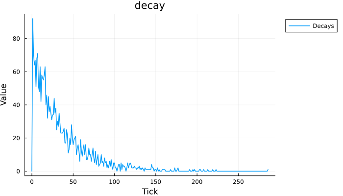
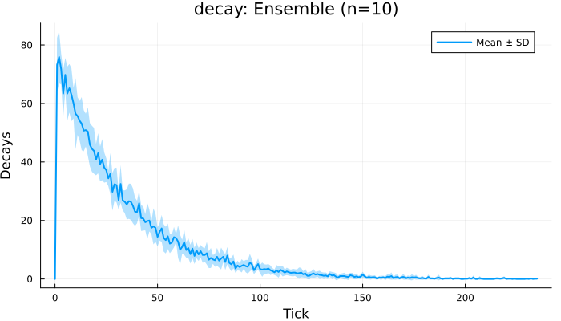
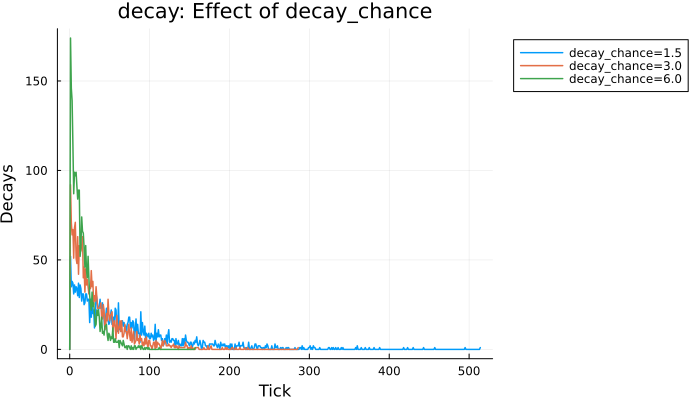

# Radioactive Decay


- [Overview](#overview)
  - [WHAT IS IT?](#what-is-it)
  - [HOW IT WORKS](#how-it-works)
  - [THINGS TO NOTICE](#things-to-notice)
  - [THINGS TO TRY](#things-to-try)
  - [EXTENDING THE MODEL](#extending-the-model)
  - [RELATED MODELS](#related-models)
  - [HOW TO CITE](#how-to-cite)
  - [COPYRIGHT AND LICENSE](#copyright-and-license)
- [Parameters](#parameters)
- [Source Code](#source-code)
- [Time Series](#time-series)
- [Ensemble Runs](#ensemble-runs)
- [Parameter Sensitivity](#parameter-sensitivity)
- [Appendix: Source Code](#appendix-source-code)
  - [Parameters (`parameters.jl`)](#parameters-parametersjl)
  - [Components (`components.jl`)](#components-componentsjl)
  - [Resources (`resources.jl`)](#resources-resourcesjl)
  - [Systems (`systems.jl`)](#systems-systemsjl)
  - [Model (`model.jl`)](#model-modeljl)

## Overview

### WHAT IS IT?

This model simulates the spontaneous decay of a collection of
radioactive nuclei. As they decay and become stable, the plot of the
number that are still radioactive demonstrates the notion of
“half-life”.

### HOW IT WORKS

At each time tick, each undecayed (light blue) nucleus has a certain
chance of decaying. When a nucleus decays, it briefly flashes bright
yellow (as if giving off radiation), then turns dark blue. Eventually,
if you wait long enough, all of the nuclei will have decayed and the
model will stop.

### THINGS TO NOTICE

What is the shape of the decay curve (Radioactive Nuclei)? How is this
affected by the initial conditions?

Why is the decay curve this shape? Is it the same as the decay curve
shown in books?

The time between red lines is called the half-life. What is its physical
meaning? Is it constant as the number of nuclei decreases? Is it
affected by the initial number of nuclei or the decay-chance? Do you
think it’s a useful way to characterize a radioactive material?

How long does it take for all the nuclei to decay?

Watch one nucleus carefully. When will it decay?

Radioactivity depends on the number of decays per unit time (Decay
Rate), because each decay event gives off radiation. What happens to the
radioactivity of this sample over time? What is the shape of the decay
rate curve? How is it related to the shape of the decay curve?

Examine the standard equation for nuclear decay:

> N = No (e exp -(T/tau))

No is the initial number of nuclei, N is the number at a later time T,
and tau is the “mean lifetime”. Compare its behavior to what you see in
this model. The corresponding equation for radiation is:

> R = Ro (e exp -(T/tau))

Why are these two equations so similar?

### THINGS TO TRY

Try the extremes of the initial conditions: many or few nuclei, high or
low decay-chance. How does this affect the “jaggedness” of the decay
rate plot?

What does the plot do when very few nuclei are left?

What instructions would you give each turtle be to make it behave like
an unstable nucleus? Check the code in the Code tab and see if it’s what
you thought it should be.

Carbon-14 dating involves comparing the ratio of a stable (C-12) to an
unstable (C-14) nucleus. Explain that method in terms of this model.

### EXTENDING THE MODEL

It is often the case in nature that two nuclei with different decay
rates are present in the same sample. Modify this model to have two or
more types of nuclei. What happens to the radiation curve?

In this model, the nuclei don’t affect their neighbors when they decay —
they just disappear. Get them to emit particles that in turn cause
reactions in other nuclei. See if you can model a chain reaction. (See
the Reactor Top Down and Reactor X-Section models.)

### RELATED MODELS

- Reactor Top-Down
- Reactor X-Section

### HOW TO CITE

If you mention this model or the NetLogo software in a publication, we
ask that you include the citations below.

For the model itself:

- Wilensky, U. (1997). NetLogo Decay model.
  http://ccl.northwestern.edu/netlogo/models/Decay. Center for Connected
  Learning and Computer-Based Modeling, Northwestern University,
  Evanston, IL.

Please cite the NetLogo software as:

- Wilensky, U. (1999). NetLogo. http://ccl.northwestern.edu/netlogo/.
  Center for Connected Learning and Computer-Based Modeling,
  Northwestern University, Evanston, IL.

### COPYRIGHT AND LICENSE

Copyright 1997 Uri Wilensky.


This model is licensed under the Creative Commons
Attribution-NonCommercial-ShareAlike 3.0 License. To view a copy of this
license, visit https://creativecommons.org/licenses/by-nc-sa/3.0/ or
send a letter to Creative Commons, 559 Nathan Abbott Way, Stanford,
California 94305, USA.

NetLogo itself is free software for non-commercial use under the terms
of the GNU General Public License ([see full license information
here](https://ccl.northwestern.edu/netlogo/docs/copyright.html)).

To inquire about commercial licenses for either NetLogo or specific
models from the models library, please contact
netlogo-commercial-admin@ccl.northwestern.edu.

This model was created as part of the project: CONNECTED MATHEMATICS:
MAKING SENSE OF COMPLEX PHENOMENA THROUGH BUILDING OBJECT-BASED PARALLEL
MODELS (OBPML). The project gratefully acknowledges the support of the
National Science Foundation (Applications of Advanced Technologies
Program) – grant numbers RED \#9552950 and REC \#9632612.

This model was converted to NetLogo as part of the projects:
PARTICIPATORY SIMULATIONS: NETWORK-BASED DESIGN FOR SYSTEMS LEARNING IN
CLASSROOMS and/or INTEGRATED SIMULATION AND MODELING ENVIRONMENT. The
project gratefully acknowledges the support of the National Science
Foundation (REPP & ROLE programs) – grant numbers REC \#9814682 and
REC-0126227. Converted from StarLogoT to NetLogo, 2001.

<!-- 1997 2001 -->

## Parameters

| Parameter       | Type      | Default | Description   |
|-----------------|-----------|---------|---------------|
| `decay_chance`  | `Float64` | `3.0`   | decay chance  |
| `number_nuclei` | `Int`     | `2500`  | number nuclei |
| `grid_width`    | `Int`     | `91`    | grid width    |
| `grid_height`   | `Int`     | `91`    | grid height   |
| `max_ticks`     | `Int`     | `1000`  | max ticks     |

## Source Code

The Julia code to run this model:

``` julia
using ArkModelZoo
_, trajectory = run_decay()
```

## Time Series



## Ensemble Runs

Ten replicates with different random seeds, showing mean ± standard
deviation.



## Parameter Sensitivity

Varying `decay_chance`.



## Appendix: Source Code

This model is implemented in the
[Ark.jl](https://github.com/sdwfrost/Ark.jl) Entity-Component-System
(ECS) framework. The code is split into five files, each with a distinct
role:

- **Parameters**: a mutable struct holding all configurable values.
- **Components**: lightweight data types attached to individual entities
  (agents).
- **Resources**: world-level shared state accessible to all systems.
- **Systems**: functions that operate on entities each tick, defining
  model behavior.
- **Model**: wiring that assembles the world, registers resources and
  systems, and provides the run entry point.

### Parameters (`parameters.jl`)

The parameter struct uses `@kwdef` so that every field has a default
value and can be overridden by keyword. These defaults match the
original NetLogo model’s slider settings.

``` julia
Base.@kwdef mutable struct DecayParams
    decay_chance::Float64 = 3.0
    number_nuclei::Int = 2500
    grid_width::Int = 91
    grid_height::Int = 91
    max_ticks::Int = 1000
    seed::Int = 42
end
```

### Components (`components.jl`)

Components are lightweight data types attached to individual entities
(agents). Mutable structs hold per-entity state, while empty tag structs
act as markers for the ECS query system to efficiently filter entities.

``` julia
mutable struct NucleusPosition
    x::Int
    y::Int
end

struct ActiveNucleus end      # cyan — can decay
struct JustDecayed end        # yellow — will become fully decayed next tick
struct DecayedNucleus end     # blue-3 — final state
```

### Resources (`resources.jl`)

Resources are world-level singletons shared across all systems, used for
global state and aggregate statistics.

``` julia
mutable struct DecayStats
    decays::Int              # decays this tick
    total_active::Int        # count of active nuclei
end
DecayStats() = DecayStats(0, 0)
```

### Systems (`systems.jl`)

Systems contain the model logic and execute in a defined order each
tick. Each system struct implements either `initialize!` (run once at
setup) or `update!` (run every tick).

``` julia
# --- Initialization ---

struct InitDecaySystem <: System end

function initialize!(::InitDecaySystem, world::World)
    params = get_resource(world, DecayParams)
    rng = get_resource(world, RNGResource).rng
    stats = get_resource(world, DecayStats)

    w = params.grid_width
    h = params.grid_height
    total_patches = w * h

    # NetLogo: ask n-of number-nuclei patches — picks unique patches
    indices = randperm(rng, total_patches)[1:params.number_nuclei]
    for idx in indices
        x = mod1(idx, w)
        y = div(idx - 1, w) + 1
        new_entity!(world, (NucleusPosition(x, y), ActiveNucleus()))
    end

    stats.total_active = params.number_nuclei
    stats.decays = 0
    return nothing
end

# --- Decay ---

struct DecaySystem <: System
    to_decay::Vector{Entity}
    to_finalize::Vector{Entity}
end
DecaySystem() = DecaySystem(Entity[], Entity[])

function update!(system::DecaySystem, world::World)
    params = get_resource(world, DecayParams)
    rng = get_resource(world, RNGResource).rng
    stats = get_resource(world, DecayStats)

    # Reset decays count for this tick
    stats.decays = 0
    empty!(system.to_decay)
    empty!(system.to_finalize)

    # Phase 1: ask turtles with [color = cyan] — check for decay
    for (eids, _) in Query(world, (NucleusPosition,); with=(ActiveNucleus,))
        @inbounds for i in eachindex(eids)
            if rand(rng) * 100.0 < params.decay_chance
                push!(system.to_decay, eids[i])
            end
        end
    end

    # Apply transitions: ActiveNucleus → JustDecayed
    for e in system.to_decay
        exchange_components!(world, e; add=(JustDecayed(),), remove=(ActiveNucleus,))
        stats.decays += 1
    end

    # Phase 2: ask turtles with [color = yellow] → blue-3
    # Convert all JustDecayed to DecayedNucleus
    for (eids,) in Query(world, (); with=(JustDecayed,))
        @inbounds for i in eachindex(eids)
            push!(system.to_finalize, eids[i])
        end
    end

    for e in system.to_finalize
        exchange_components!(world, e; add=(DecayedNucleus(),), remove=(JustDecayed,))
    end

    return nothing
end

# --- Stats ---

struct DecayStatsSystem <: System end

function update!(::DecayStatsSystem, world::World)
    stats = get_resource(world, DecayStats)

    active_count = 0
    for (eids, _) in Query(world, (NucleusPosition,); with=(ActiveNucleus,))
        active_count += length(eids)
    end
    stats.total_active = active_count

    return nothing
end

# --- Termination ---

struct DecayTerminationSystem <: System end

function update!(::DecayTerminationSystem, world::World)
    params = get_resource(world, DecayParams)
    tick = get_resource(world, Tick)
    stats = get_resource(world, DecayStats)

    if stats.total_active == 0 || tick.tick + 1 >= params.max_ticks
        get_resource(world, Terminate).stop = true
    end
    return nothing
end
```

### Model (`model.jl`)

The model file assembles all pieces: it creates the ECS `World` with the
required component types, registers resources, builds the `Scheduler`
with systems in execution order, and exposes the public `run` entry
point. The observer pattern records the trajectory each tick.

``` julia
function decay_world(; initial_capacity::Int = 4096)
    return World(
        NucleusPosition,
        ActiveNucleus,
        JustDecayed,
        DecayedNucleus;
        initial_capacity = initial_capacity,
        allow_mutable = true,
    )
end

function decay_systems()
    return (
        InitDecaySystem(),
        DecaySystem(),
        DecayStatsSystem(),
        DecayTerminationSystem(),
    )
end

function decay_model(params::DecayParams = DecayParams())
    world = decay_world()
    _add_standard_resources!(world, params)
    add_resource!(world, DecayStats())
    scheduler = Scheduler(world, decay_systems())
    initialize!(scheduler)
    return scheduler
end

struct DecayObserver end

function decay_headers(::DecayObserver)
    return ["Decays"]
end

function decay_values(::DecayObserver, world::World)
    stats = get_resource(world, DecayStats)
    return Float64[stats.decays]
end

function run_decay(; params::DecayParams = DecayParams(), observe::Bool = true)
    return _run_model(decay_model, DecayObserver(), decay_values; params, observe)
end
```
