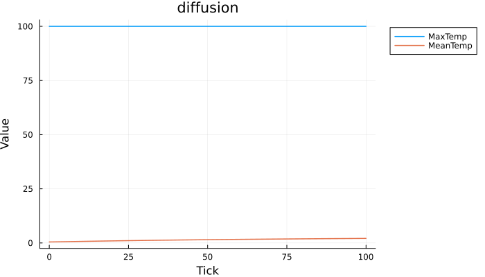
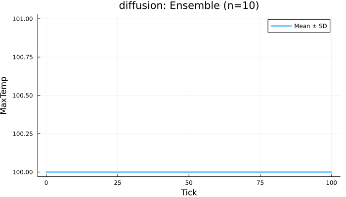

# Heat Diffusion


- [Overview](#overview)
  - [WHAT IS IT?](#what-is-it)
  - [HOW IT WORKS](#how-it-works)
  - [THINGS TO NOTICE](#things-to-notice)
  - [THINGS TO TRY](#things-to-try)
  - [EXTENDING THE MODEL](#extending-the-model)
  - [RELATED MODELS](#related-models)
  - [HOW TO CITE](#how-to-cite)
  - [COPYRIGHT AND LICENSE](#copyright-and-license)
- [Parameters](#parameters)
- [Source Code](#source-code)
- [Time Series](#time-series)
- [Ensemble Runs](#ensemble-runs)
- [Appendix: Source Code](#appendix-source-code)
  - [Parameters (`parameters.jl`)](#parameters-parametersjl)
  - [Components (`components.jl`)](#components-componentsjl)
  - [Resources (`resources.jl`)](#resources-resourcesjl)
  - [Systems (`systems.jl`)](#systems-systemsjl)
  - [Model (`model.jl`)](#model-modeljl)

## Overview

### WHAT IS IT?

This model simulates transient and steady-state temperature distribution
of a thin plate. The View shows a square thin plate as viewed from
above. The plate is thermally isolated on the two faces parallel to the
view such that heat can flow only in and out from the perimeter of the
plate and not into or out of the world. Heat is kept constant at the
edges.

As the simulation runs, heat is transmitted from warmer parts of the
plate to cooler parts of the plate as shown by the varying color of the
plate. Therefore, the temperature of the plate begins to change
immediately and possibly differently at different locations, gradually
converging to a stable state. Overall, the temperature distribution over
the plate is a function of time and location. In addition to this simple
use of the model, you are encouraged to control various paramaters, such
as the temperature of each edge edge of the plate and of the center of
the plate before–and even while–the model is running.

### HOW IT WORKS

Heat diffuses (“spreads”) at different rates through different media.
These rates can be determined and are called the [Thermal
Diffusivity](https://en.wikipedia.org/wiki/Thermal_diffusivity) of the
material. The Greek letter alpha is often associated with this value.
The diffusivity of a material does not change based on how much of the
material there is; it is always the same.

Below is a table containing several different materials with different
diffusivity rates. See that wood (bottom row) has a lower heat
diffusivity than, say, iron. This means that it takes a longer for heat
to spread through a wooden object than an iron one. That is one reason
why the handles of iron saucepans are often wooden and not the other way
round.

Think of a marble table with iron legs that has just been put out in the
sun in a street-side cafe. Which material part of the table do you
expect will warm up faster? The model allows you to change thermal
diffusivity of the plate in two ways. You can directly change the value
of ALPHA to any value you like, or you can indirectly change ALPHA by
selecting a material.

### THINGS TO NOTICE

How does the equilibrium temperature distribution vary for different
edge temperature settings?

Notice how an equilibrium (the steady-state condition) is reached.

Keep track of the units:

<table border>

<tr>

<th>

Variables
<th>

Units
<tr>

<td>

time
<td>

0.1 second
<tr>

<td>

temperature
<td>

degrees Celsius
<tr>

<td>

length
<td>

centimeters
<tr>

<td>

diffusivity
<td>

square centimeters per second
</table>

### THINGS TO TRY

Set the parameters on the temperature sliders. Pick a value for ALPHA
(or pick MATERIAL-TYPE and press UPDATE ALPHA). After you have changed
all the sliders to values you like, press Setup followed by GO or GO
ONCE.

Try different materials to observe the heat transfer speed. How does
this compare to physical experiments?

Try the following sample settings:

- Top:100, Bottom:0, Left:0, Right:0
- Top:0, Bottom:100, Left:100, Right:100
- Top:0, Bottom:66, Left:99, Right:33
- Top:25, Bottom:25, Left:100, Right:0

### EXTENDING THE MODEL

This model simulates a classic partial differential equation problem
(that of heat diffusion). The thin square plate is a typical example,
and the simplest model of the behavior. Try changing the shape or
thickness of the plate (e.g. a circular or elliptical plate), or adding
a hole in the center (the plate would then be a slice of a torus, a
doughnut-shaped geometric object).

Add a slider to alter this thickness.

Try modeling derivative or combined boundary conditions.

### RELATED MODELS

Checkout the other Materials Science models in the library

### HOW TO CITE

If you mention this model or the NetLogo software in a publication, we
ask that you include the citations below.

For the model itself:

- Wilensky, U. (1998). NetLogo Heat Diffusion model.
  http://ccl.northwestern.edu/netlogo/models/HeatDiffusion. Center for
  Connected Learning and Computer-Based Modeling, Northwestern
  University, Evanston, IL.

Please cite the NetLogo software as:

- Wilensky, U. (1999). NetLogo. http://ccl.northwestern.edu/netlogo/.
  Center for Connected Learning and Computer-Based Modeling,
  Northwestern University, Evanston, IL.

### COPYRIGHT AND LICENSE

Copyright 1998 Uri Wilensky.


This model is licensed under the Creative Commons
Attribution-NonCommercial-ShareAlike 3.0 License. To view a copy of this
license, visit https://creativecommons.org/licenses/by-nc-sa/3.0/ or
send a letter to Creative Commons, 559 Nathan Abbott Way, Stanford,
California 94305, USA.

NetLogo itself is free software for non-commercial use under the terms
of the GNU General Public License ([see full license information
here](https://ccl.northwestern.edu/netlogo/docs/copyright.html)).

To inquire about commercial licenses for either NetLogo or specific
models from the models library, please contact
netlogo-commercial-admin@ccl.northwestern.edu.

This model was created as part of the project: CONNECTED MATHEMATICS:
MAKING SENSE OF COMPLEX PHENOMENA THROUGH BUILDING OBJECT-BASED PARALLEL
MODELS (OBPML). The project gratefully acknowledges the support of the
National Science Foundation (Applications of Advanced Technologies
Program) – grant numbers RED \#9552950 and REC \#9632612.

This model was converted to NetLogo as part of the projects:
PARTICIPATORY SIMULATIONS: NETWORK-BASED DESIGN FOR SYSTEMS LEARNING IN
CLASSROOMS and/or INTEGRATED SIMULATION AND MODELING ENVIRONMENT. The
project gratefully acknowledges the support of the National Science
Foundation (REPP & ROLE programs) – grant numbers REC \#9814682 and
REC-0126227. Converted from StarLogoT to NetLogo, 2001.

<!-- 1998 2001 -->

## Parameters

| Parameter     | Type  | Default | Description |
|---------------|-------|---------|-------------|
| `grid_width`  | `Int` | `33`    | grid width  |
| `grid_height` | `Int` | `33`    | grid height |
| `max_ticks`   | `Int` | `100`   | max ticks   |

## Source Code

The Julia code to run this model:

``` julia
using ArkModelZoo
_, trajectory = run_diffusion()
```

## Time Series



## Ensemble Runs

Ten replicates with different random seeds, showing mean ± standard
deviation.



## Appendix: Source Code

This model is implemented in the
[Ark.jl](https://github.com/sdwfrost/Ark.jl) Entity-Component-System
(ECS) framework. The code is split into five files, each with a distinct
role:

- **Parameters**: a mutable struct holding all configurable values.
- **Components**: lightweight data types attached to individual entities
  (agents).
- **Resources**: world-level shared state accessible to all systems.
- **Systems**: functions that operate on entities each tick, defining
  model behavior.
- **Model**: wiring that assembles the world, registers resources and
  systems, and provides the run entry point.

### Parameters (`parameters.jl`)

The parameter struct uses `@kwdef` so that every field has a default
value and can be overridden by keyword. These defaults match the
original NetLogo model’s slider settings.

``` julia
Base.@kwdef mutable struct DiffusionParams
    grid_width::Int = 33
    grid_height::Int = 33
    max_ticks::Int = 100
    seed::Int = 42
end
```

### Components (`components.jl`)

Components are lightweight data types attached to individual entities
(agents). Mutable structs hold per-entity state, while empty tag structs
act as markers for the ECS query system to efficiently filter entities.

``` julia
# Diffusion model has no entity components — purely patch-based
struct DiffusionDummy end
```

### Resources (`resources.jl`)

Resources are world-level singletons shared across all systems, used for
global state and aggregate statistics.

``` julia
mutable struct DiffusionGrid
    width::Int
    height::Int
    temp::Matrix{Float64}
end
DiffusionGrid(w, h) = DiffusionGrid(w, h, zeros(Float64, w, h))

mutable struct DiffusionStats
    max_temp::Float64
    mean_temp::Float64
end
DiffusionStats() = DiffusionStats(0.0, 0.0)
```

### Systems (`systems.jl`)

Systems contain the model logic and execute in a defined order each
tick. Each system struct implements either `initialize!` (run once at
setup) or `update!` (run every tick).

``` julia
# --- Initialization ---

struct InitDiffusionSystem <: System end

function initialize!(::InitDiffusionSystem, world::World)
    grid = get_resource(world, DiffusionGrid)
    stats = get_resource(world, DiffusionStats)

    # Center patch (0,0) in NetLogo maps to (cx, cy) in a 33×33 grid
    cx = (grid.width ÷ 2) + 1
    cy = (grid.height ÷ 2) + 1

    # NetLogo: ask patch 0 0 [ set temp 100 ]
    grid.temp[cx, cy] = 100.0

    # NetLogo: ask neighbors [ set temp 50 ] — 8 Moore neighbors (toroidal)
    for (dx, dy) in ((-1,-1), (-1,0), (-1,1), (0,-1), (0,1), (1,-1), (1,0), (1,1))
        nx = mod1(cx + dx, grid.width)
        ny = mod1(cy + dy, grid.height)
        grid.temp[nx, ny] = 50.0
    end

    stats.max_temp = maximum(grid.temp)
    stats.mean_temp = Statistics.mean(grid.temp)
    return nothing
end

# --- Diffuse + Decay + Re-heat center ---
# NetLogo: diffuse temp 0.5
#   new[p] = old[p] * (1 - 0.5) + (0.5 / 8) * sum_of_8_neighbors(old)
#          = 0.5 * old[p] + 0.0625 * sum_neighbors(old)
# Then: set temp temp * 0.99  (decay)
# Then: ask patch 0 0 [ set temp 100 ]

struct DiffusionUpdateSystem <: System end

function update!(::DiffusionUpdateSystem, world::World)
    grid = get_resource(world, DiffusionGrid)
    w, h = grid.width, grid.height

    # Diffuse temp 0.5
    diffuse!(grid.temp, 0.5, w, h)

    # Decay: temp * 0.99
    for x in 1:w, y in 1:h
        grid.temp[x, y] *= 0.99
    end

    # Re-heat center
    cx = (w ÷ 2) + 1
    cy = (h ÷ 2) + 1
    grid.temp[cx, cy] = 100.0

    return nothing
end

# --- Stats ---

struct DiffusionStatsSystem <: System end

function update!(::DiffusionStatsSystem, world::World)
    grid = get_resource(world, DiffusionGrid)
    stats = get_resource(world, DiffusionStats)
    stats.max_temp = maximum(grid.temp)
    stats.mean_temp = Statistics.mean(grid.temp)
    return nothing
end

# --- Termination ---

struct DiffusionTerminationSystem <: System end

function update!(::DiffusionTerminationSystem, world::World)
    params = get_resource(world, DiffusionParams)
    tick = get_resource(world, Tick)

    # tick.tick is the count before this step's increment; after the step
    # it becomes tick.tick + 1.  Stop so that exactly max_ticks updates run.
    if tick.tick + 1 >= params.max_ticks
        get_resource(world, Terminate).stop = true
    end
    return nothing
end
```

### Model (`model.jl`)

The model file assembles all pieces: it creates the ECS `World` with the
required component types, registers resources, builds the `Scheduler`
with systems in execution order, and exposes the public `run` entry
point. The observer pattern records the trajectory each tick.

``` julia
function diffusion_world(; initial_capacity::Int = 128)
    return World(
        DiffusionDummy;
        initial_capacity = initial_capacity,
        allow_mutable = true,
    )
end

function diffusion_systems()
    return (
        InitDiffusionSystem(),
        DiffusionUpdateSystem(),
        DiffusionStatsSystem(),
        DiffusionTerminationSystem(),
    )
end

function diffusion_model(params::DiffusionParams = DiffusionParams())
    world = diffusion_world()
    _add_standard_resources!(world, params)
    add_resource!(world, DiffusionGrid(params.grid_width, params.grid_height))
    add_resource!(world, DiffusionStats())
    scheduler = Scheduler(world, diffusion_systems())
    initialize!(scheduler)
    return scheduler
end

struct DiffusionObserver end

function diffusion_headers(::DiffusionObserver)
    return ["MaxTemp", "MeanTemp"]
end

function diffusion_values(::DiffusionObserver, world::World)
    stats = get_resource(world, DiffusionStats)
    return Float64[stats.max_temp, stats.mean_temp]
end

function run_diffusion(; params::DiffusionParams = DiffusionParams(), observe::Bool = true)
    return _run_model(diffusion_model, DiffusionObserver(), diffusion_values; params, observe)
end
```
