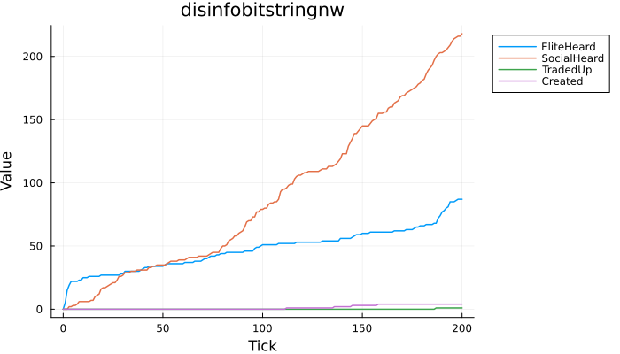
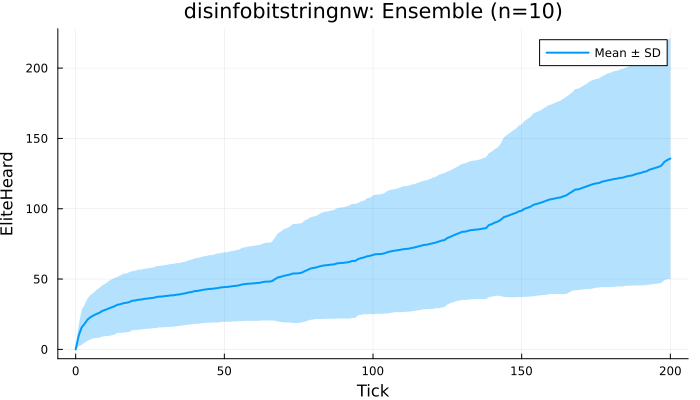
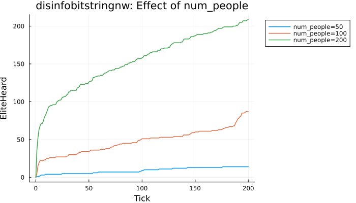

# Disinfobitstringnw


- [Overview](#overview)
- [Parameters](#parameters)
- [Source Code](#source-code)
- [Time Series](#time-series)
- [Ensemble Runs](#ensemble-runs)
- [Parameter Sensitivity](#parameter-sensitivity)
- [Appendix: Source Code](#appendix-source-code)
  - [Parameters (`parameters.jl`)](#parameters-parametersjl)
  - [Components (`components.jl`)](#components-componentsjl)
  - [Resources (`resources.jl`)](#resources-resourcesjl)
  - [Systems (`systems.jl`)](#systems-systemsjl)
  - [Model (`model.jl`)](#model-modeljl)

## Overview

This vignette demonstrates the **Disinfobitstringnw** model implemented
in [ArkModelZoo.jl](https://github.com/sdwfrost/ArkModelZoo.jl) using
the Ark.jl ECS framework.

## Parameters

| Parameter            | Type      | Default          | Description        |
|----------------------|-----------|------------------|--------------------|
| `num_people`         | `Int`     | `100`            | num people         |
| `frac_influencers`   | `Float64` | `0.1`            | frac influencers   |
| `network_type`       | `String`  | `"preferential"` | network type       |
| `network_density`    | `Float64` | `0.1`            | network density    |
| `min_size`           | `Int`     | `1`              | min size           |
| `neighborhood_size`  | `Int`     | `4`              | neighborhood size  |
| `max_rumors`         | `Int`     | `10`             | max rumors         |
| `elite_influence`    | `Float64` | `0.6`            | elite influence    |
| `social_influence`   | `Float64` | `0.1`            | social influence   |
| `trade_up_influence` | `Float64` | `0.1`            | trade up influence |
| `rumor_generation`   | `Float64` | `0.05`           | rumor generation   |
| `initial_green_pct`  | `Int`     | `50`             | initial green pct  |
| `variant`            | `String`  | `"irregular"`    | variant            |

## Source Code

The Julia code to run this model:

``` julia
using ArkModelZoo
_, trajectory = run_disinfobitstringnw()
```

## Time Series



## Ensemble Runs

Ten replicates with different random seeds, showing mean ± standard
deviation.



## Parameter Sensitivity

Varying `num_people`.



## Appendix: Source Code

This model is implemented in the
[Ark.jl](https://github.com/sdwfrost/Ark.jl) Entity-Component-System
(ECS) framework. The code is split into five files, each with a distinct
role:

- **Parameters**: a mutable struct holding all configurable values.
- **Components**: lightweight data types attached to individual entities
  (agents).
- **Resources**: world-level shared state accessible to all systems.
- **Systems**: functions that operate on entities each tick, defining
  model behavior.
- **Model**: wiring that assembles the world, registers resources and
  systems, and provides the run entry point.

### Parameters (`parameters.jl`)

The parameter struct uses `@kwdef` so that every field has a default
value and can be overridden by keyword. These defaults match the
original NetLogo model’s slider settings.

``` julia
Base.@kwdef mutable struct DisBitParams
    num_people::Int = 100
    frac_influencers::Float64 = 0.1
    network_type::String = "preferential"
    network_density::Float64 = 0.1
    min_size::Int = 1
    neighborhood_size::Int = 4
    max_rumors::Int = 10
    elite_influence::Float64 = 0.6
    social_influence::Float64 = 0.1
    trade_up_influence::Float64 = 0.1
    rumor_generation::Float64 = 0.05
    initial_green_pct::Int = 50
    variant::String = "irregular"
    ticks_to_end::Int = 3000
    model_rate_1_nth::Int = 1
    heard_rumors_to_generate::Bool = true
    influencers_generate_rumors::Bool = false
    only_one_generates::Bool = true
    only_one_forgets::Bool = false
    dissipation_rate::Float64 = 0.1
    max_ticks::Int = 200
    seed::Int = 42
end
```

### Components (`components.jl`)

Components are lightweight data types attached to individual entities
(agents). Mutable structs hold per-entity state, while empty tag structs
act as markers for the ECS query system to efficiently filter entities.

``` julia
struct DisBitDummy end
```

### Resources (`resources.jl`)

Resources are world-level singletons shared across all systems, used for
global state and aggregate statistics.

``` julia
mutable struct DisBitNetwork
    n_total::Int                    # num_people + 1 (elite)
    adj::Vector{Set{Int}}
    agent_type::Vector{Int}         # 0=regular, 1=influencer, 2=elite
    rumors::Vector{BitVector}       # BitVector of length max_rumors per agent
    patch_vote::Matrix{Int}         # patch voting grid for irregular/block variant
end

function DisBitNetwork()
    DisBitNetwork(0, Set{Int}[], Int[], BitVector[], zeros(Int, 0, 0))
end

function _disbit_add_agent!(net::DisBitNetwork, max_rumors::Int)
    push!(net.adj, Set{Int}())
    push!(net.agent_type, 0)
    push!(net.rumors, falses(max_rumors))
    net.n_total += 1
    return net.n_total
end

function _disbit_add_edge!(net::DisBitNetwork, i::Int, j::Int)
    if j ∉ net.adj[i]
        push!(net.adj[i], j)
        push!(net.adj[j], i)
    end
end

mutable struct DisBitStats
    times_heard_from_elites::Int
    times_heard_from_social::Int
    times_traded_up::Int
    times_created_rumor::Int
end
DisBitStats() = DisBitStats(0, 0, 0, 0)
```

### Systems (`systems.jl`)

Systems contain the model logic and execute in a defined order each
tick. Each system struct implements either `initialize!` (run once at
setup) or `update!` (run every tick).

``` julia
# Participatory Disinformation NW+Bitstring — full variant with 3 network types and 3 elite variants

struct InitDisBitSystem <: System end

function _disbit_setup_irregular!(patch_vote::Matrix{Int}, rng, initial_green_pct::Int)
    w, h = size(patch_vote)
    for x in 1:w, y in 1:h
        patch_vote[x, y] = rand(rng, 0:99) < initial_green_pct ? 0 : 1
    end
    # Cellular automaton smoothing
    stop_count = 100
    for iter in 1:stop_count
        totals = zeros(Int, w, h)
        for x in 1:w, y in 1:h
            s = 0
            for dx in -1:1, dy in -1:1
                (dx == 0 && dy == 0) && continue
                nx, ny = x + dx, y + dy
                if 1 <= nx <= w && 1 <= ny <= h
                    s += patch_vote[nx, ny]
                end
            end
            totals[x, y] = s
        end
        any_changed = false
        for x in 1:w, y in 1:h
            prev = patch_vote[x, y]
            t = totals[x, y]
            if t < 3
                patch_vote[x, y] = 0
            elseif t == 3
                patch_vote[x, y] = 0
            elseif t == 4
                patch_vote[x, y] = 1 - patch_vote[x, y]
            elseif t == 5
                patch_vote[x, y] = 1
            else
                patch_vote[x, y] = 1
            end
            if patch_vote[x, y] != prev
                any_changed = true
            end
        end
        !any_changed && break
    end
end

function initialize!(::InitDisBitSystem, world::World)
    params = get_resource(world, DisBitParams)
    rng    = get_resource(world, RNGResource).rng
    net    = get_resource(world, DisBitNetwork)
    stats  = get_resource(world, DisBitStats)

    # Build network
    if params.network_type == "preferential"
        g = nw_generate_preferential_attachment(rng, params.num_people, params.min_size)
        for i in 1:g.n; _disbit_add_agent!(net, params.max_rumors); end
        net.adj[1:g.n] = g.adj
    elseif params.network_type == "random"
        g = nw_generate_random(rng, params.num_people, params.network_density)
        for i in 1:g.n; _disbit_add_agent!(net, params.max_rumors); end
        net.adj[1:g.n] = g.adj
    elseif params.network_type == "small-world"
        g = nw_generate_watts_strogatz(rng, params.num_people, params.neighborhood_size, 0.1)
        for i in 1:g.n; _disbit_add_agent!(net, params.max_rumors); end
        net.adj[1:g.n] = g.adj
    end

    # Assign influencers
    n_inf = max(1, round(Int, params.frac_influencers * params.num_people))
    indices = shuffle!(rng, collect(1:params.num_people))
    for k in 1:n_inf
        net.agent_type[indices[k]] = 1
    end

    # Create elite (last agent)
    elite_id = _disbit_add_agent!(net, params.max_rumors)
    net.agent_type[elite_id] = 2
    rumor_idx = rand(rng, 1:params.max_rumors)
    net.rumors[elite_id][rumor_idx] = true

    # Setup patch votes for variant
    pw = 33  # default NetLogo world width
    net.patch_vote = ones(Int, pw, pw)
    if params.variant == "uniform"
        # All vote=1 (all green/adopt)
    elseif params.variant == "block"
        green_y_pct = params.initial_green_pct
        cutoff = round(Int, pw * green_y_pct / 100)
        for x in 1:pw, y in 1:pw
            net.patch_vote[x, y] = y > cutoff ? 0 : 1
        end
    elseif params.variant == "irregular"
        _disbit_setup_irregular!(net.patch_vote, rng, params.initial_green_pct)
    end

    stats.times_heard_from_elites = 0
    stats.times_heard_from_social = 0
    stats.times_traded_up = 0
    stats.times_created_rumor = 0
    return nothing
end

# Bitstring helpers
function _disbit_adopt_rumor(my_rumors::BitVector, other_rumors::BitVector, rng)
    novel = other_rumors .& .!my_rumors
    if any(novel)
        novel_idx = findall(novel)
        chosen = novel_idx[rand(rng, 1:length(novel_idx))]
        result = copy(my_rumors)
        result[chosen] = true
        return result
    end
    return my_rumors
end

struct DisBitGoSystem <: System end

function update!(::DisBitGoSystem, world::World)
    params   = get_resource(world, DisBitParams)
    rng      = get_resource(world, RNGResource).rng
    net      = get_resource(world, DisBitNetwork)
    stats    = get_resource(world, DisBitStats)
    tick     = get_resource(world, Tick)
    elite_id = net.n_total  # last agent is elite

    # Check early termination: all heard all rumors
    all_heard = true
    for i in 1:params.num_people
        if !all(net.rumors[i])
            all_heard = false
            break
        end
    end
    if all_heard
        get_resource(world, Terminate).stop = true
        return nothing
    end

    # Only act on model-rate ticks
    if tick.tick % params.model_rate_1_nth != 0
        return nothing
    end

    # Process non-elite agents in random order
    order = shuffle!(rng, collect(1:params.num_people))
    for i in order
        net.agent_type[i] == 2 && continue  # skip elite

        # 1. Adopt from elite
        elite_adoption = params.elite_influence
        if params.variant == "irregular" || params.variant == "block"
            pw = size(net.patch_vote, 1)
            # Map agent to patch position (simple deterministic mapping)
            px = mod1(i, pw)
            py = mod1(div(i - 1, pw) + 1, pw)
            near_adopt = 0
            cnt = 0
            for dx in -1:1, dy in -1:1
                (dx == 0 && dy == 0) && continue
                nx, ny = px + dx, py + dy
                if 1 <= nx <= pw && 1 <= ny <= pw
                    cnt += 1
                    if net.patch_vote[nx, ny] == 1
                        near_adopt += 1
                    end
                end
            end
            near_pct = cnt > 0 ? near_adopt / 8.0 : 0.0
            own_adopt = net.patch_vote[px, py] == 1 ? 1.0 : 0.0
            elite_adoption = params.elite_influence * 0.5 * (near_pct + own_adopt)
        end

        if rand(rng) < elite_adoption
            new_rumors = _disbit_adopt_rumor(net.rumors[i], net.rumors[elite_id], rng)
            if new_rumors != net.rumors[i]
                net.rumors[i] = new_rumors
                stats.times_heard_from_elites += 1
            end
        end

        # 2. Adopt from network
        neighbors = net.adj[i]
        total_nbrs = length(neighbors)
        if total_nbrs > 0
            adopted_nbrs = [j for j in neighbors if any(net.rumors[j])]
            frac = length(adopted_nbrs) / total_nbrs
            if frac > 0.0 && rand(rng) < params.social_influence * frac
                source = adopted_nbrs[rand(rng, 1:length(adopted_nbrs))]
                new_rumors = _disbit_adopt_rumor(net.rumors[i], net.rumors[source], rng)
                if new_rumors != net.rumors[i]
                    net.rumors[i] = new_rumors
                    stats.times_heard_from_social += 1
                end
            end
        end

        # 3. Generate rumor
        if !params.only_one_generates || rand(rng, 0:(params.num_people-1)) == i - 1
            if net.agent_type[i] != 1 || params.influencers_generate_rumors
                if !params.heard_rumors_to_generate || any(net.rumors[i])
                    if rand(rng) < params.rumor_generation
                        pos = rand(rng, 1:params.max_rumors)
                        if !net.rumors[i][pos]
                            net.rumors[i][pos] = true
                            stats.times_created_rumor += 1
                        end
                    end
                end
            end
        end

        # 4. Forget rumor
        if !params.only_one_forgets || rand(rng, 0:(params.num_people-1)) == i - 1
            if rand(rng) < params.dissipation_rate
                pos = rand(rng, 1:params.max_rumors)
                net.rumors[i][pos] = false
            end
        end
    end

    # 5. Trade-up: influencer → elite
    influencer_ids = findall(==(1), net.agent_type)
    if !isempty(influencer_ids) && rand(rng) < params.trade_up_influence
        source = influencer_ids[rand(rng, 1:length(influencer_ids))]
        new_rumors = _disbit_adopt_rumor(net.rumors[elite_id], net.rumors[source], rng)
        if new_rumors != net.rumors[elite_id]
            net.rumors[elite_id] = new_rumors
            stats.times_traded_up += 1
        end
    end

    return nothing
end

struct DisBitTerminationSystem <: System end

function update!(::DisBitTerminationSystem, world::World)
    params = get_resource(world, DisBitParams)
    tick   = get_resource(world, Tick)
    if tick.tick + 1 >= params.max_ticks
        get_resource(world, Terminate).stop = true
    end
    return nothing
end
```

### Model (`model.jl`)

The model file assembles all pieces: it creates the ECS `World` with the
required component types, registers resources, builds the `Scheduler`
with systems in execution order, and exposes the public `run` entry
point. The observer pattern records the trajectory each tick.

``` julia
function disinfobitstringnw_world(; initial_capacity::Int = 128)
    return World(DisBitDummy; initial_capacity = initial_capacity, allow_mutable = true)
end

function disinfobitstringnw_systems()
    return (InitDisBitSystem(), DisBitGoSystem(), DisBitTerminationSystem())
end

function disinfobitstringnw_model(params::DisBitParams = DisBitParams())
    world = disinfobitstringnw_world()
    _add_standard_resources!(world, params)
    add_resource!(world, DisBitNetwork())
    add_resource!(world, DisBitStats())
    scheduler = Scheduler(world, disinfobitstringnw_systems())
    initialize!(scheduler)
    return scheduler
end

struct DisBitObserver end

function disinfobitstringnw_headers(::DisBitObserver)
    return ["EliteHeard", "SocialHeard", "TradedUp", "Created"]
end

function disinfobitstringnw_values(::DisBitObserver, world::World)
    stats = get_resource(world, DisBitStats)
    return Float64[stats.times_heard_from_elites, stats.times_heard_from_social,
                    stats.times_traded_up, stats.times_created_rumor]
end

function run_disinfobitstringnw(; params::DisBitParams = DisBitParams(), observe::Bool = true)
    return _run_model(disinfobitstringnw_model, DisBitObserver(), disinfobitstringnw_values; params, observe)
end
```
