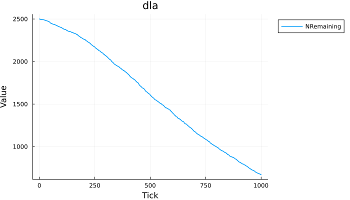
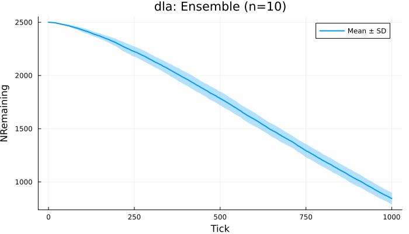
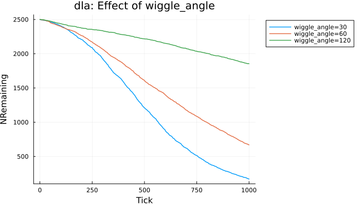

## Overview

### WHAT IS IT?

This model demonstrates diffusion-limited aggregation, in which randomly moving (diffusing) particles stick together (aggregate) to form beautiful treelike branching fractal structures.  There are many patterns found in nature that resemble the patterns produced by this model: crystals, coral, fungi, lightning, and so on.

### HOW IT WORKS

The model begins with an initial green "seed" in the center of the world.  Red particles move around the world randomly.  When a red particle hits a green square, it "sticks" and turns green (and a new red particle is created to keep the process going).

### THINGS TO NOTICE

Note that the resulting structure has a branching structure, like a tree.  Why does this happen?

What other phenomena in the world do the shapes remind you of?  Is this aggregation process a plausible model of how those phenomena occur?

When the enclosing circle gets too near to the edge of the world, the model stops, since allowing the particles to wrap around the edges of the world would distort the shape of the aggregate.

New red particles are created not at the edge of the world, but at the edge of a circle enclosing the current size of the green aggregate, instead of traveling from the edge of the world.  Also, if a red particle wanders too far outside the circle, it disappears and a new one is created.  Neither of these behaviors is essential to the model -- it is done this way just to the model runs fast.

### THINGS TO TRY

Try different settings for WIGGLE-ANGLE.  What is the effect on the appearance of the resulting aggregate?  Why?

Does the MAX-PARTICLES slider make any difference?  Why or why not?

Do you think the USE-WHOLE-WORLD? setting has an effect on the appearance of the resulting aggregate?  Why or why not?  Experiment and find out.  If you initially thought differently from what you found, why do you think you thought otherwise?  Can you explain why it does happen the way you found?

### EXTENDING THE MODEL

What happens if you start with more than one "seed" patch?  What happens if the seed is a line instead of a point?

Can you find a way to modify the code so the resulting pattern spirals out instead of radiating straight out?

The rule used in this model is that a particle "sticks" if any of the eight patches surrounding it are green.  What do the resulting structures look like if you use a different rule (for example, only testing the single patch ahead, or using `neighbors4` instead of `neighbors`)?

Can you compute the fractal dimension of the aggregate?

If instead of using green, you gradually vary the color of deposited particles over time, you can see more vividly the accretion of "layers" over time.  (The effect is also visually pleasing.)

The model will run faster if the turtles are invisible, so you may want to add a switch that hides them (using the `hide-turtle` command).

Let's use the term "envelope" to describe the large "circle" created by all the green particles, with the green particle that is farthest from the center defining the radius of this envelope.  Within this envelope, what is the ratio between patches with green particles and patches that have no particles?  Or, what is the ratio between particles and patches?  Create a graph to track this ratio.  Create a histogram that accumulates the end value of this process over multiple runs.

How circular is the envelope at the end of a simulation? Is it "smooth" or "bumpy"? How would you define the goodness of this circle?

Let's use the term "end particles" to describe the green particles at the end of an outward reaching branch (so they are connected only to one other particle).  Create a procedure to calculate and report the average number of nodes along all the possible paths from the center to the end particles).  You can also create a histogram of these values.

How many "end particles" are there over time?  It seem likely that this number should grow, but how would you expect this number to grow?  Create a graph to track the growth in the number of these "end particles."

What is the ratio between "end particles" and nodes?  Does this ratio change over time?  Create a graph to track this ratio as the simulation runs.

Create a procedure that allows you to click on any two green particles and have another moving particle sprout at the first green particle you clicked and then track and color the path between these two green particles. What is the longest path between any two green particles?  Is this number bound above?

### NETLOGO FEATURES

Note the use of the `neighbors` and `distancexy` primitives.

### RELATED MODELS

In this model, the green squares are on a grid.  For a different implementation of the same idea that does not involve a grid, see DLA Alternate.  It uses circular particles that stick to each other.

DLA Alternate Linear has particles that fall straight down from the top of the world, instead of falling towards a central point.

DLA Simple is a simplified (but less computationally efficient) version of this model.

The various models in the "Fractals" subsection of the "Mathematics" section of the Models Library demonstrate some other ways of "growing" fractal structures.

The "Percolation" model in the "Earth Science" section produces patterns resembling the patterns in this model.

The "Hex Cell Aggregation" model in the "Computer Science" section uses a grid of hexagons, rather than squares, and uses a cellular automaton with a growth rule instead of moving particles.

### CREDITS AND REFERENCES

The concept of diffusion limited aggregation was invented by T.A. Witten and L.M. Sander in 1981.  Tamas Viczek's book "Fractal Growth Phenomena" contains a discussion, as do many other books about fractals.

### HOW TO CITE

If you mention this model or the NetLogo software in a publication, we ask that you include the citations below.

For the model itself:

* Wilensky, U. (1997).  NetLogo DLA model.  http://ccl.northwestern.edu/netlogo/models/DLA.  Center for Connected Learning and Computer-Based Modeling, Northwestern University, Evanston, IL.

Please cite the NetLogo software as:

* Wilensky, U. (1999). NetLogo. http://ccl.northwestern.edu/netlogo/. Center for Connected Learning and Computer-Based Modeling, Northwestern University, Evanston, IL.

### COPYRIGHT AND LICENSE

Copyright 1997 Uri Wilensky.


This model is licensed under the Creative Commons Attribution-NonCommercial-ShareAlike 3.0 License.  To view a copy of this license, visit https://creativecommons.org/licenses/by-nc-sa/3.0/ or send a letter to Creative Commons, 559 Nathan Abbott Way, Stanford, California 94305, USA.

NetLogo itself is free software for non-commercial use under the terms of the GNU General Public License ([see full license information here](https://ccl.northwestern.edu/netlogo/docs/copyright.html)).

To inquire about commercial licenses for either NetLogo or specific models from the models library, please contact netlogo-commercial-admin@ccl.northwestern.edu.

This model was created as part of the project: CONNECTED MATHEMATICS: MAKING SENSE OF COMPLEX PHENOMENA THROUGH BUILDING OBJECT-BASED PARALLEL MODELS (OBPML).  The project gratefully acknowledges the support of the National Science Foundation (Applications of Advanced Technologies Program) -- grant numbers RED #9552950 and REC #9632612.

This model was developed at the MIT Media Lab using CM StarLogo.  See Wilensky, U. (1993). Thesis - Connected Mathematics: Building Concrete Relationships with Mathematical Knowledge. Adapted to StarLogoT, 1997, as part of the Connected Mathematics Project.  Adapted to NetLogo, 2002, as part of the Participatory Simulations Project.

This model was converted to NetLogo as part of the projects: PARTICIPATORY SIMULATIONS: NETWORK-BASED DESIGN FOR SYSTEMS LEARNING IN CLASSROOMS and/or INTEGRATED SIMULATION AND MODELING ENVIRONMENT. The project gratefully acknowledges the support of the National Science Foundation (REPP & ROLE programs) -- grant numbers REC #9814682 and REC-0126227. Converted from StarLogoT to NetLogo, 2002.

<!-- 1997 2002 Wilensky -->

## Parameters

| Parameter | Type | Default | Description |
|-----------|------|---------|-------------|
| `wiggle_angle` | `Int` | `60` | wiggle angle |
| `num_particles` | `Int` | `2500` | num particles |
| `grid_width` | `Int` | `201` | grid width |
| `grid_height` | `Int` | `201` | grid height |
| `max_ticks` | `Int` | `1000` | max ticks |

## Source Code

The Julia code to run this model:

```julia
using ArkModelZoo
_, trajectory = run_dla()
```

## Time Series

{width=100%}

## Ensemble Runs

Ten replicates with different random seeds, showing mean ± standard deviation.

{width=100%}

## Parameter Sensitivity

Varying `wiggle_angle`.

{width=100%}


## Appendix: Source Code

This model is implemented in the [Ark.jl](https://github.com/sdwfrost/Ark.jl) Entity-Component-System (ECS) framework. The code is split into five files, each with a distinct role:

- **Parameters**: a mutable struct holding all configurable values.
- **Components**: lightweight data types attached to individual entities (agents).
- **Resources**: world-level shared state accessible to all systems.
- **Systems**: functions that operate on entities each tick, defining model behavior.
- **Model**: wiring that assembles the world, registers resources and systems, and provides the run entry point.

### Parameters (`parameters.jl`)

The parameter struct uses `@kwdef` so that every field has a default value and can be overridden by keyword. These defaults match the original NetLogo model's slider settings.

```julia
Base.@kwdef mutable struct DLAParams
    wiggle_angle::Int = 60
    num_particles::Int = 2500
    grid_width::Int = 201
    grid_height::Int = 201
    max_ticks::Int = 1000
    seed::Int = 42
end
```

### Components (`components.jl`)

Components are lightweight data types attached to individual entities (agents). Mutable structs hold per-entity state, while empty tag structs act as markers for the ECS query system to efficiently filter entities.

```julia
# Continuous position on the grid
mutable struct DLAPosition
    x::Float64
    y::Float64
end
DLAPosition() = DLAPosition(0.0, 0.0)

# Heading in degrees (0 = north, 90 = east, NetLogo convention)
mutable struct DLAHeading
    angle::Float64
end
DLAHeading() = DLAHeading(0.0)
```

### Resources (`resources.jl`)

Resources are world-level singletons shared across all systems, used for global state and aggregate statistics.

```julia
# Grid tracking which patches are part of the cluster (green in NetLogo)
mutable struct DLAGrid
    width::Int
    height::Int
    cluster::Matrix{Bool}
end
DLAGrid(w::Int, h::Int) = DLAGrid(w, h, falses(w, h))

# Tracked globals matching NetLogo
mutable struct DLAStats
    n_remaining::Int
end
DLAStats() = DLAStats(0)
```

### Systems (`systems.jl`)

Systems contain the model logic and execute in a defined order each tick. Each system struct implements either `initialize!` (run once at setup) or `update!` (run every tick).

```julia
# DLA model systems matching NetLogo Diffusion-Limited Aggregation
# Execution order: init → update (wiggle + attach) → stats → terminate

# --- Initialization ---
# NetLogo: ask patch 0 0 [ set pcolor green ]
#          create-turtles num-particles [ set color red; set size 1.5; setxy random-xcor random-ycor ]

struct InitDLASystem <: System end

function initialize!(::InitDLASystem, world::World)
    params = get_resource(world, DLAParams)
    rng = get_resource(world, RNGResource).rng
    grid = get_resource(world, DLAGrid)
    stats = get_resource(world, DLAStats)

    # Seed cluster at center patch: NetLogo patch (0,0) → grid cell (101, 101)
    cx = (params.grid_width + 1) ÷ 2
    cy = (params.grid_height + 1) ÷ 2
    grid.cluster[cx, cy] = true

    # Create particles with random positions and integer headings
    w = Float64(params.grid_width)
    h = Float64(params.grid_height)
    for _ in 1:params.num_particles
        x = rand(rng) * w
        y = rand(rng) * h
        heading = Float64(rand(rng, 0:359))
        new_entity!(world, (DLAPosition(x, y), DLAHeading(heading)))
    end

    stats.n_remaining = params.num_particles
    return nothing
end

# --- DLA Update ---
# NetLogo: ask turtles [ right random wiggle-angle; left random wiggle-angle; fd 1;
#                         if any? neighbors with [pcolor = green] [ set pcolor green; die ] ]
# Turtles processed in shuffled order with immediate grid updates.

struct DLAUpdateSystem <: System
    entity_buf::Vector{Entity}
    to_remove::Vector{Entity}
end
DLAUpdateSystem() = DLAUpdateSystem(Entity[], Entity[])

function update!(system::DLAUpdateSystem, world::World)
    rng = get_resource(world, RNGResource).rng
    params = get_resource(world, DLAParams)
    grid = get_resource(world, DLAGrid)
    gw = params.grid_width
    gh = params.grid_height
    w = Float64(gw)
    h = Float64(gh)
    wa = params.wiggle_angle

    empty!(system.entity_buf)
    empty!(system.to_remove)

    # Collect all particle entities
    for (eids,) in Query(world, (DLAPosition,))
        for i in eachindex(eids)
            push!(system.entity_buf, eids[i])
        end
    end

    # Shuffle for NetLogo-style sequential ask
    shuffle!(rng, system.entity_buf)

    # Process each turtle in shuffled order
    for eid in system.entity_buf
        pos, heading = get_components(world, eid, (DLAPosition, DLAHeading))

        # right random wiggle-angle  (NetLogo random N → integer [0, N-1])
        heading.angle += Float64(rand(rng, 0:(wa - 1)))
        # left random wiggle-angle
        heading.angle -= Float64(rand(rng, 0:(wa - 1)))

        # fd 1 with toroidal wrapping
        θ = deg2rad(heading.angle)
        pos.x = mod(pos.x + sin(θ), w)
        pos.y = mod(pos.y + cos(θ), h)

        # Determine current patch
        gx = clamp(floor(Int, pos.x) + 1, 1, gw)
        gy = clamp(floor(Int, pos.y) + 1, 1, gh)

        # Check 8 Moore neighbors for cluster membership (toroidal)
        attached = false
        for dx in -1:1, dy in -1:1
            (dx == 0 && dy == 0) && continue
            nx = mod1(gx + dx, gw)
            ny = mod1(gy + dy, gh)
            if grid.cluster[nx, ny]
                attached = true
                break
            end
        end

        if attached
            grid.cluster[gx, gy] = true
            push!(system.to_remove, eid)
        end
    end

    # Remove attached particles
    for eid in system.to_remove
        is_alive(world, eid) && remove_entity!(world, eid)
    end

    return nothing
end

# --- Statistics ---
# NetLogo: set n-remaining count turtles

struct DLAStatsSystem <: System end

function update!(::DLAStatsSystem, world::World)
    stats = get_resource(world, DLAStats)
    total = 0
    for (eids,) in Query(world, (DLAPosition,))
        total += length(eids)
    end
    stats.n_remaining = total
    return nothing
end

# --- Termination ---

struct DLATerminationSystem <: System end

function update!(::DLATerminationSystem, world::World)
    params = get_resource(world, DLAParams)
    tick = get_resource(world, Tick)
    stats = get_resource(world, DLAStats)
    if stats.n_remaining == 0 || tick.tick + 1 >= params.max_ticks
        get_resource(world, Terminate).stop = true
    end
    return nothing
end
```

### Model (`model.jl`)

The model file assembles all pieces: it creates the ECS `World` with the required component types, registers resources, builds the `Scheduler` with systems in execution order, and exposes the public `run` entry point. The observer pattern records the trajectory each tick.

```julia
function dla_world(; initial_capacity::Int = 4096)
    return World(
        DLAPosition,
        DLAHeading;
        initial_capacity = initial_capacity,
        allow_mutable = true,
    )
end

function dla_systems()
    return (
        InitDLASystem(),
        DLAUpdateSystem(),
        DLAStatsSystem(),
        DLATerminationSystem(),
    )
end

function dla_model(params::DLAParams = DLAParams())
    world = dla_world()
    _add_standard_resources!(world, params)
    add_resource!(world, DLAGrid(params.grid_width, params.grid_height))
    add_resource!(world, DLAStats())
    scheduler = Scheduler(world, dla_systems())
    initialize!(scheduler)
    return scheduler
end

struct DLAObserver end

function dla_headers(::DLAObserver)
    return ["NRemaining"]
end

function dla_values(::DLAObserver, world::World)
    stats = get_resource(world, DLAStats)
    return Float64[stats.n_remaining]
end

function run_dla(; params::DLAParams = DLAParams(), observe::Bool = true)
    return _run_model(dla_model, DLAObserver(), dla_values; params, observe)
end
```
