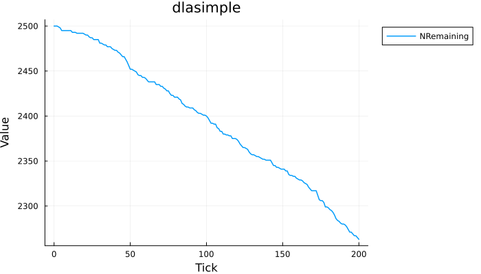
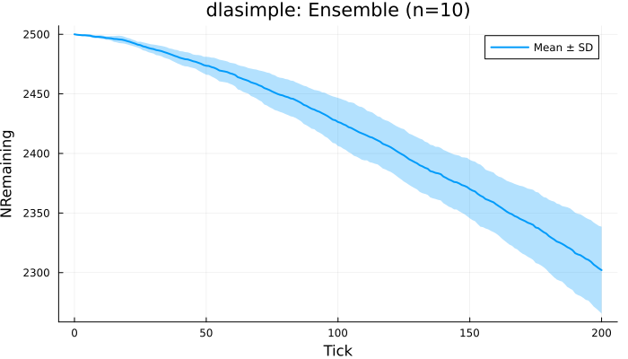
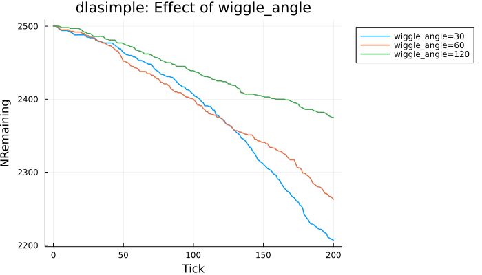

## Overview

### WHAT IS IT?

Like the main DLA model, this model demonstrates diffusion-limited aggregation, in which particles moving (diffusing) in random trajectories stick together (aggregate) to form beautiful treelike branching fractal structures. There are many patterns found in nature that resemble the patterns produced by this model: crystals, coral, fungi, lightning, and so on.

This model is called DLA Simple because it is it is a simplified version of the main DLA model from the NetLogo models library. In the main model, new particles are created as existing particles aggregate. In this model, particles are only created at the beginning. The main model is more computationally efficient, but the rules that drive the phenomenon are more digestible in this model.

### THINGS TO NOTICE

Note that the resulting structure has a branching structure, like a tree.  Why does this happen?

What other phenomena in the world do the shapes remind you of?  Is this aggregation process a plausible model of how those phenomena occur?

### THINGS TO TRY

Try different settings for how much the turtles turn as they do their random walk (the WIGGLE-ANGLE slider).  What is the effect on the appearance of the resulting aggregate?  Why?

Does it make any difference whether there are more or fewer particles?  Why or why not?

### EXTENDING THE MODEL

What happens if you start with more than one "seed" patch?  What happens if the seed is a line instead of a point?

Can you find a way to modify the code so the resulting pattern spirals out instead of radiating straight out?

The rule used in this model is that a particle "sticks" if any of the eight patches surrounding it are green.  What do the resulting structures look like if you use a different rule (for example, only testing the single patch ahead, or using `neighbors4` instead of `neighbors`)?

Can you compute the fractal dimension of the aggregate?

If instead of using green, you gradually vary the color of deposited particles over time, you can see more vividly the accretion of "layers" over time.  (The effect is also visually pleasing.)

The model will run faster if the turtles are invisible, so you may want to add a switch that hides them (using the HT command).

### NETLOGO FEATURES

Note the use of the `neighbors` primitive.

### RELATED MODELS

The various models in the "Fractals" subsection of the "Mathematics" section of the Models Library demonstrate some other ways of "growing" fractal structures.

The "Percolation" model in the "Earth Science" section produces patterns resembling the patterns in this model.

### CREDITS AND REFERENCES

This model is a simplified version of:

* Wilensky, U. (1997).  NetLogo DLA model.  http://ccl.northwestern.edu/netlogo/models/DLA.  Center for Connected Learning and Computer-Based Modeling, Northwestern University, Evanston, IL.

The concept of diffusion limited aggregation was invented by T.A. Witten and L.M. Sander in 1981.  Witten, T. & Sanders, L. (1981).  Diffusion-limited aggregation, a kinetic critical phenomena. Phys. Rev. Lett. 47(19), 1400–1403 (1981).

Tamas Viczek's book "Fractal Growth Phenomena" contains a discussion, as do many other books about fractals.

### HOW TO CITE

This model is part of the textbook, “Introduction to Agent-Based Modeling: Modeling Natural, Social and Engineered Complex Systems with NetLogo.”

If you mention this model or the NetLogo software in a publication, we ask that you include the citations below.

For the model itself:

* Wilensky, U., Rand, W. (2006).  NetLogo DLA Simple model.  http://ccl.northwestern.edu/netlogo/models/DLASimple.  Center for Connected Learning and Computer-Based Modeling, Northwestern Institute on Complex Systems, Northwestern University, Evanston, IL.

Please cite the NetLogo software as:

* Wilensky, U. (1999). NetLogo. http://ccl.northwestern.edu/netlogo/. Center for Connected Learning and Computer-Based Modeling, Northwestern University, Evanston, IL.

Please cite the textbook as:

* Wilensky, U. & Rand, W. (2015). Introduction to Agent-Based Modeling: Modeling Natural, Social and Engineered Complex Systems with NetLogo. Cambridge, MA. MIT Press.

### COPYRIGHT AND LICENSE

Copyright 2006 Uri Wilensky.


This model is licensed under the Creative Commons Attribution-NonCommercial-ShareAlike 3.0 License.  To view a copy of this license, visit https://creativecommons.org/licenses/by-nc-sa/3.0/ or send a letter to Creative Commons, 559 Nathan Abbott Way, Stanford, California 94305, USA.

NetLogo itself is free software for non-commercial use under the terms of the GNU General Public License ([see full license information here](https://ccl.northwestern.edu/netlogo/docs/copyright.html)).

To inquire about commercial licenses for either NetLogo or specific models from the models library, please contact netlogo-commercial-admin@ccl.northwestern.edu.

<!-- 2006 Cite: Wilensky, U., Rand, W. -->

## Parameters

| Parameter | Type | Default | Description |
|-----------|------|---------|-------------|
| `wiggle_angle` | `Int` | `60` | wiggle angle |
| `num_particles` | `Int` | `2500` | num particles |
| `grid_width` | `Int` | `201` | grid width |
| `grid_height` | `Int` | `201` | grid height |
| `max_ticks` | `Int` | `200` | max ticks |

## Source Code

The Julia code to run this model:

```julia
using ArkModelZoo
_, trajectory = run_dlasimple()
```

## Time Series

{width=100%}

## Ensemble Runs

Ten replicates with different random seeds, showing mean ± standard deviation.

{width=100%}

## Parameter Sensitivity

Varying `wiggle_angle`.

{width=100%}


## Appendix: Source Code

This model is implemented in the [Ark.jl](https://github.com/sdwfrost/Ark.jl) Entity-Component-System (ECS) framework. The code is split into five files, each with a distinct role:

- **Parameters**: a mutable struct holding all configurable values.
- **Components**: lightweight data types attached to individual entities (agents).
- **Resources**: world-level shared state accessible to all systems.
- **Systems**: functions that operate on entities each tick, defining model behavior.
- **Model**: wiring that assembles the world, registers resources and systems, and provides the run entry point.

### Parameters (`parameters.jl`)

The parameter struct uses `@kwdef` so that every field has a default value and can be overridden by keyword. These defaults match the original NetLogo model's slider settings.

```julia
Base.@kwdef mutable struct DLAsParams
    wiggle_angle::Int = 60
    num_particles::Int = 2500
    grid_width::Int = 201
    grid_height::Int = 201
    max_ticks::Int = 200
    seed::Int = 42
end
```

### Components (`components.jl`)

Components are lightweight data types attached to individual entities (agents). Mutable structs hold per-entity state, while empty tag structs act as markers for the ECS query system to efficiently filter entities.

```julia
mutable struct DLAsPosition
    x::Float64
    y::Float64
end
DLAsPosition() = DLAsPosition(0.0, 0.0)

mutable struct DLAsHeading
    angle::Float64
end
DLAsHeading() = DLAsHeading(0.0)
```

### Resources (`resources.jl`)

Resources are world-level singletons shared across all systems, used for global state and aggregate statistics.

```julia
mutable struct DLAsGrid
    width::Int
    height::Int
    cluster::Matrix{Bool}
end
DLAsGrid(w::Int, h::Int) = DLAsGrid(w, h, falses(w, h))

mutable struct DLAsStats
    n_remaining::Int
end
DLAsStats() = DLAsStats(0)
```

### Systems (`systems.jl`)

Systems contain the model logic and execute in a defined order each tick. Each system struct implements either `initialize!` (run once at setup) or `update!` (run every tick).

```julia
# DLA Simple — diffusion-limited aggregation with death
# 201×201 wrapping grid, center seed, 2500 red turtles wiggle+attach+die

struct InitDLAsSystem <: System end

function initialize!(::InitDLAsSystem, world::World)
    params = get_resource(world, DLAsParams)
    rng    = get_resource(world, RNGResource).rng
    grid   = get_resource(world, DLAsGrid)
    stats  = get_resource(world, DLAsStats)

    # Seed cluster at center
    cx = (params.grid_width + 1) ÷ 2
    cy = (params.grid_height + 1) ÷ 2
    grid.cluster[cx, cy] = true

    w = Float64(params.grid_width)
    h = Float64(params.grid_height)
    for _ in 1:params.num_particles
        x = rand(rng) * w
        y = rand(rng) * h
        heading = Float64(rand(rng, 0:359))
        new_entity!(world, (DLAsPosition(x, y), DLAsHeading(heading)))
    end
    stats.n_remaining = params.num_particles
    return nothing
end

# --- Update: wiggle, move, attach ---
struct DLAsUpdateSystem <: System
    entity_buf::Vector{Entity}
    to_remove::Vector{Entity}
end
DLAsUpdateSystem() = DLAsUpdateSystem(Entity[], Entity[])

function update!(sys::DLAsUpdateSystem, world::World)
    rng    = get_resource(world, RNGResource).rng
    params = get_resource(world, DLAsParams)
    grid   = get_resource(world, DLAsGrid)
    gw = params.grid_width
    gh = params.grid_height
    w  = Float64(gw)
    h  = Float64(gh)
    wa = params.wiggle_angle

    empty!(sys.entity_buf)
    empty!(sys.to_remove)

    for (eids,) in Query(world, (DLAsPosition,))
        for i in eachindex(eids)
            push!(sys.entity_buf, eids[i])
        end
    end
    shuffle!(rng, sys.entity_buf)

    for eid in sys.entity_buf
        is_alive(world, eid) || continue
        pos, heading = get_components(world, eid, (DLAsPosition, DLAsHeading))

        # Wiggle: right random wiggle-angle, left random wiggle-angle
        heading.angle += Float64(rand(rng, 0:(wa - 1)))
        heading.angle -= Float64(rand(rng, 0:(wa - 1)))

        # Forward 1 (NetLogo heading: 0=north, clockwise)
        θ = deg2rad(heading.angle)
        pos.x = mod(pos.x + sin(θ), w)
        pos.y = mod(pos.y + cos(θ), h)

        # Current patch
        gx = clamp(floor(Int, pos.x) + 1, 1, gw)
        gy = clamp(floor(Int, pos.y) + 1, 1, gh)

        # Check 8 Moore neighbors for green (cluster)
        attached = false
        for dx in -1:1, dy in -1:1
            (dx == 0 && dy == 0) && continue
            nx = mod1(gx + dx, gw)
            ny = mod1(gy + dy, gh)
            if grid.cluster[nx, ny]
                attached = true
                break
            end
        end

        if attached
            grid.cluster[gx, gy] = true
            push!(sys.to_remove, eid)
        end
    end

    for eid in sys.to_remove
        is_alive(world, eid) && remove_entity!(world, eid)
    end
    return nothing
end

# --- Stats ---
struct DLAsStatsSystem <: System end

function update!(::DLAsStatsSystem, world::World)
    stats = get_resource(world, DLAsStats)
    total = 0
    for (eids,) in Query(world, (DLAsPosition,))
        total += length(eids)
    end
    stats.n_remaining = total
    return nothing
end

# --- Termination ---
struct DLAsTerminationSystem <: System end

function update!(::DLAsTerminationSystem, world::World)
    params = get_resource(world, DLAsParams)
    tick   = get_resource(world, Tick)
    stats  = get_resource(world, DLAsStats)
    if stats.n_remaining == 0 || tick.tick + 1 >= params.max_ticks
        get_resource(world, Terminate).stop = true
    end
    return nothing
end
```

### Model (`model.jl`)

The model file assembles all pieces: it creates the ECS `World` with the required component types, registers resources, builds the `Scheduler` with systems in execution order, and exposes the public `run` entry point. The observer pattern records the trajectory each tick.

```julia
function dlasimple_world(; initial_capacity::Int = 4096)
    return World(DLAsPosition, DLAsHeading; initial_capacity = initial_capacity, allow_mutable = true)
end

function dlasimple_systems()
    return (InitDLAsSystem(), DLAsUpdateSystem(), DLAsStatsSystem(), DLAsTerminationSystem())
end

function dlasimple_model(params::DLAsParams = DLAsParams())
    world = dlasimple_world()
    _add_standard_resources!(world, params)
    add_resource!(world, DLAsGrid(params.grid_width, params.grid_height))
    add_resource!(world, DLAsStats())
    scheduler = Scheduler(world, dlasimple_systems())
    initialize!(scheduler)
    return scheduler
end

struct DLAsObserver end

function dlasimple_headers(::DLAsObserver)
    return ["NRemaining"]
end

function dlasimple_values(::DLAsObserver, world::World)
    stats = get_resource(world, DLAsStats)
    return Float64[stats.n_remaining]
end

function run_dlasimple(; params::DLAsParams = DLAsParams(), observe::Bool = true)
    return _run_model(dlasimple_model, DLAsObserver(), dlasimple_values; params, observe)
end
```
