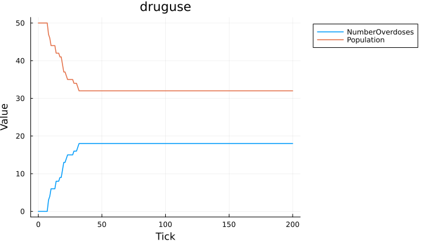
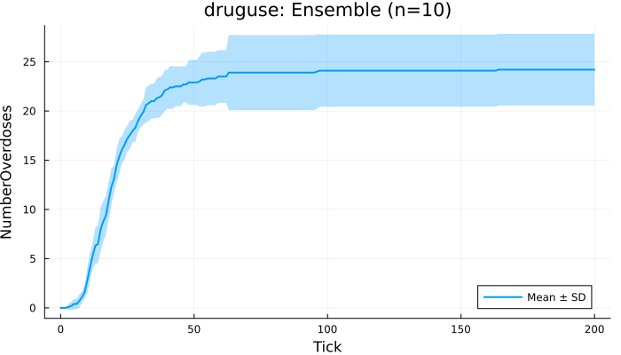
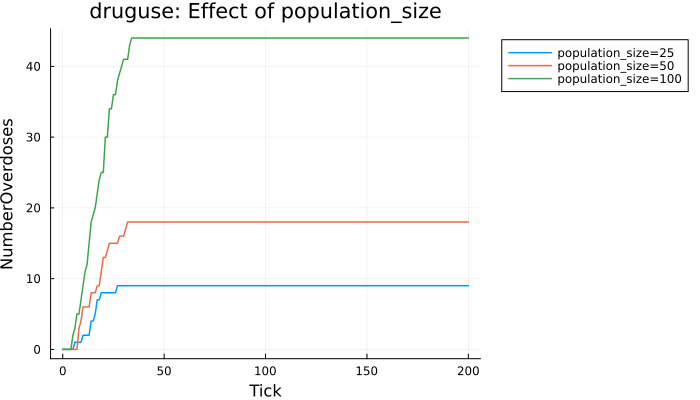

## Overview

### WHAT IS IT?

This model is trying to look at how drug use may spread through a network, as existing drug users reinforce their habits and those of others, and new drugs users are recruited by existing drug users as they are visited more than once. Thus, turtles represent people in this model.

This model also aims to look at how overdose may occur as a function of increasing drug use.

### HOW IT WORKS

People start out as either drug users or not, and wander randomly around the world. 
Drug users also have a range of severity of their drug use, with 0 = little/none. 

People may start using drugs if they run into drugs in the world, represented by red patches. 

Drug users ask one of their connections to increase drug use level by a small amount at times. This could represent trying drugs, not necessarily becoming a drug user.

If drug users 1) have too high of drug use, or 2) have moderately high drug use and are also socially isolated, they overdose.

### THINGS TO NOTICE

How many overdoses are there at any point? Does this increase with the overall number of drug users? Do overdoses increase with the number of drug users initially?

### THINGS TO TRY

Play with the number on the sliders.

### EXTENDING THE MODEL

(suggested things to add or change in the Code tab to make the model more complicated, detailed, accurate, etc.)

### NETLOGO FEATURES

(interesting or unusual features of NetLogo that the model uses, particularly in the Code tab; or where workarounds were needed for missing features)

### RELATED MODELS

(models in the NetLogo Models Library and elsewhere which are of related interest)

### CREDITS AND REFERENCES

(a reference to the model's URL on the web if it has one, as well as any other necessary credits, citations, and links)

## Parameters

| Parameter | Type | Default | Description |
|-----------|------|---------|-------------|
| `population_size` | `Int` | `50` | population size |
| `percent_drug_user` | `Float64` | `20.0` | percent drug user |
| `drug_availability` | `Int` | `5` | drug availability |
| `grid_size` | `Int` | `33` | 33×33 grid (-16..16) |
| `max_ticks` | `Int` | `200` | max ticks |

## Source Code

The Julia code to run this model:

```julia
using ArkModelZoo
_, trajectory = run_druguse()
```

## Time Series

{width=100%}

## Ensemble Runs

Ten replicates with different random seeds, showing mean ± standard deviation.

{width=100%}

## Parameter Sensitivity

Varying `population_size`.

{width=100%}


## Appendix: Source Code

This model is implemented in the [Ark.jl](https://github.com/sdwfrost/Ark.jl) Entity-Component-System (ECS) framework. The code is split into five files, each with a distinct role:

- **Parameters**: a mutable struct holding all configurable values.
- **Components**: lightweight data types attached to individual entities (agents).
- **Resources**: world-level shared state accessible to all systems.
- **Systems**: functions that operate on entities each tick, defining model behavior.
- **Model**: wiring that assembles the world, registers resources and systems, and provides the run entry point.

### Parameters (`parameters.jl`)

The parameter struct uses `@kwdef` so that every field has a default value and can be overridden by keyword. These defaults match the original NetLogo model's slider settings.

```julia
Base.@kwdef mutable struct DrugUseParams
    population_size::Int = 50
    percent_drug_user::Float64 = 20.0
    drug_availability::Int = 5
    grid_size::Int = 33       # 33×33 grid (-16..16)
    max_ticks::Int = 200
    seed::Int = 42
end
```

### Components (`components.jl`)

Components are lightweight data types attached to individual entities (agents). Mutable structs hold per-entity state, while empty tag structs act as markers for the ECS query system to efficiently filter entities.

```julia
mutable struct DrugPosition
    x::Float64
    y::Float64
end
DrugPosition() = DrugPosition(0.0, 0.0)

mutable struct DrugHeading
    angle::Float64
end
DrugHeading() = DrugHeading(0.0)

mutable struct DrugState
    drug_user::Bool
    drug_level::Float64
    unemployed::Bool
end
DrugState() = DrugState(false, 0.0, false)
```

### Resources (`resources.jl`)

Resources are world-level singletons shared across all systems, used for global state and aggregate statistics.

```julia
mutable struct DrugGrid
    width::Int
    height::Int
    drug_sites::Matrix{Bool}  # true = red patch (drug site)
end
function DrugGrid(w::Int, h::Int)
    DrugGrid(w, h, falses(w, h))
end

mutable struct DrugNetwork
    neighbors::Dict{Entity, Vector{Entity}}
end
DrugNetwork() = DrugNetwork(Dict{Entity, Vector{Entity}}())

mutable struct DrugStats
    number_overdoses::Int
    population::Int
end
DrugStats() = DrugStats(0, 0)
```

### Systems (`systems.jl`)

Systems contain the model logic and execute in a defined order each tick. Each system struct implements either `initialize!` (run once at setup) or `update!` (run every tick).

```julia
# --- Initialization ---

struct InitDrugUseSystem <: System end

function initialize!(::InitDrugUseSystem, world::World)
    params = get_resource(world, DrugUseParams)
    rng = get_resource(world, RNGResource).rng
    grid = get_resource(world, DrugGrid)
    network = get_resource(world, DrugNetwork)
    stats = get_resource(world, DrugStats)
    w, h = grid.width, grid.height

    # Create turtles
    entities = Entity[]
    for _ in 1:params.population_size
        x = rand(rng) * w
        y = rand(rng) * h
        e = new_entity!(world, (DrugPosition(x, y), DrugHeading(Float64(rand(rng, 0:359))), DrugState()))
        push!(entities, e)
        network.neighbors[e] = Entity[]
    end

    # Set initial drug users
    n_drug_users = round(Int, (params.percent_drug_user / 100.0) * params.population_size)
    drug_user_indices = randperm(rng, params.population_size)[1:n_drug_users]
    for idx in drug_user_indices
        e = entities[idx]
        ds = get_components(world, e, (DrugState,))[1]
        ds.drug_user = true
        ds.drug_level = rand(rng) * 0.5
        if ds.unemployed
            ds.drug_level += 0.2
        end
    end

    # Setup network: each turtle creates links with up to random(4) others within radius 10
    for i in 1:params.population_size
        e = entities[i]
        pos_i = get_components(world, e, (DrugPosition,))[1]
        # Find others within radius 10
        nearby = Entity[]
        for j in 1:params.population_size
            i == j && continue
            other = entities[j]
            pos_j = get_components(world, other, (DrugPosition,))[1]
            dx = abs(pos_i.x - pos_j.x)
            dy = abs(pos_i.y - pos_j.y)
            dx = min(dx, w - dx)
            dy = min(dy, h - dy)
            dist = sqrt(dx^2 + dy^2)
            if dist <= 10.0
                push!(nearby, other)
            end
        end
        # Link with n-of (random 4) nearby
        n_links = rand(rng, 0:3)
        if !isempty(nearby)
            n_links = min(n_links, length(nearby))
            chosen = randperm(rng, length(nearby))[1:n_links]
            for c in chosen
                other = nearby[c]
                # Undirected: add both directions
                if !(other in network.neighbors[e])
                    push!(network.neighbors[e], other)
                end
                if !(e in network.neighbors[other])
                    push!(network.neighbors[other], e)
                end
            end
        end
    end

    # Setup drug sites
    total_patches = w * h
    site_indices = randperm(rng, total_patches)[1:min(params.drug_availability, total_patches)]
    for idx in site_indices
        x = mod1(idx, w)
        y = div(idx - 1, w) + 1
        grid.drug_sites[x, y] = true
    end

    stats.population = params.population_size
    stats.number_overdoses = 0
    return nothing
end

# --- Movement and Drug Dynamics ---

struct DrugGoSystem <: System end

function update!(::DrugGoSystem, world::World)
    params = get_resource(world, DrugUseParams)
    rng = get_resource(world, RNGResource).rng
    grid = get_resource(world, DrugGrid)
    network = get_resource(world, DrugNetwork)
    stats = get_resource(world, DrugStats)
    w, h = grid.width, grid.height

    to_remove = Entity[]

    # Collect all entities to shuffle
    all_entities = Entity[]
    for (eids, _positions) in Query(world, (DrugPosition,))
        append!(all_entities, eids)
    end
    Random.shuffle!(rng, all_entities)

    for eid in all_entities
        !is_alive(world, eid) && continue

        pos, heading, ds = get_components(world, eid, (DrugPosition, DrugHeading, DrugState))

        # Movement: rt 40, lt 10 → net +30 degrees, fd 2
        heading.angle += 30.0
        θ = deg2rad(heading.angle)
        pos.x = mod(pos.x + 2.0 * sin(θ), Float64(w))
        pos.y = mod(pos.y + 2.0 * cos(θ), Float64(h))

        # start-drugs: if random 100 < drug-level and on drug site
        gx = clamp(floor(Int, pos.x) + 1, 1, w)
        gy = clamp(floor(Int, pos.y) + 1, 1, h)
        if rand(rng, 0:99) < round(Int, ds.drug_level * 100) && grid.drug_sites[gx, gy]
            ds.drug_level += 0.1
            ds.drug_user = true
        end

        # Check threshold
        if ds.drug_level > 0.5
            ds.drug_user = true
        end

        if ds.drug_user
            # increase-drug-network
            nbrs = get(network.neighbors, eid, Entity[])
            alive_nbrs = filter(n -> is_alive(world, n), nbrs)
            if !isempty(alive_nbrs)
                chosen = alive_nbrs[rand(rng, 1:length(alive_nbrs))]
                if is_alive(world, chosen)
                    ds_chosen = get_components(world, chosen, (DrugState,))[1]
                    ds_chosen.drug_level += 0.1
                end
            end

            # overdose
            overdosed = false
            if ds.drug_level > 0.6
                # sum drug_level of link-neighbors > 1.2
                nbr_sum = 0.0
                for n in alive_nbrs
                    if is_alive(world, n)
                        ds_n = get_components(world, n, (DrugState,))[1]
                        nbr_sum += ds_n.drug_level
                    end
                end
                if nbr_sum > 1.2
                    stats.number_overdoses += 1
                    overdosed = true
                end
            end
            if !overdosed && ds.drug_level > 2.0
                stats.number_overdoses += 1
                overdosed = true
            end
            if overdosed
                push!(to_remove, eid)
            end
        end
    end

    # Remove dead agents and clean up network
    for e in to_remove
        if is_alive(world, e)
            # Remove from neighbors' lists
            nbrs = get(network.neighbors, e, Entity[])
            for n in nbrs
                if haskey(network.neighbors, n)
                    filter!(x -> x != e, network.neighbors[n])
                end
            end
            delete!(network.neighbors, e)
            remove_entity!(world, e)
        end
    end

    # Update population count
    pop = 0
    for (eids, _) in Query(world, (DrugPosition,))
        pop += length(eids)
    end
    stats.population = pop

    return nothing
end

# --- Termination ---

struct DrugTerminationSystem <: System end

function update!(::DrugTerminationSystem, world::World)
    params = get_resource(world, DrugUseParams)
    tick = get_resource(world, Tick)
    stats = get_resource(world, DrugStats)
    if tick.tick + 1 >= params.max_ticks || stats.population == 0
        get_resource(world, Terminate).stop = true
    end
    return nothing
end
```

### Model (`model.jl`)

The model file assembles all pieces: it creates the ECS `World` with the required component types, registers resources, builds the `Scheduler` with systems in execution order, and exposes the public `run` entry point. The observer pattern records the trajectory each tick.

```julia
function druguse_world(; initial_capacity::Int = 256)
    return World(
        DrugPosition,
        DrugHeading,
        DrugState;
        initial_capacity = initial_capacity,
        allow_mutable = true,
    )
end

function druguse_systems()
    return (
        InitDrugUseSystem(),
        DrugGoSystem(),
        DrugTerminationSystem(),
    )
end

function druguse_model(params::DrugUseParams = DrugUseParams())
    world = druguse_world()
    _add_standard_resources!(world, params)
    add_resource!(world, DrugGrid(params.grid_size, params.grid_size))
    add_resource!(world, DrugNetwork())
    add_resource!(world, DrugStats())
    scheduler = Scheduler(world, druguse_systems())
    initialize!(scheduler)
    return scheduler
end

struct DrugUseObserver end

function druguse_headers(::DrugUseObserver)
    return ["NumberOverdoses", "Population"]
end

function druguse_values(::DrugUseObserver, world::World)
    stats = get_resource(world, DrugStats)
    return Float64[stats.number_overdoses, stats.population]
end

function run_druguse(; params::DrugUseParams = DrugUseParams(), observe::Bool = true)
    return _run_model(druguse_model, DrugUseObserver(), druguse_values; params, observe)
end
```
