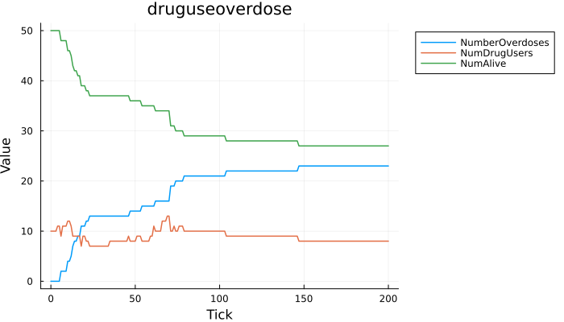
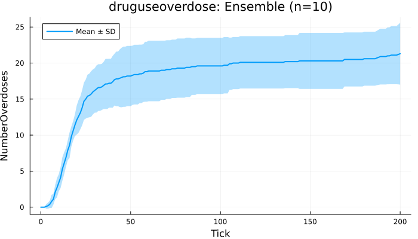
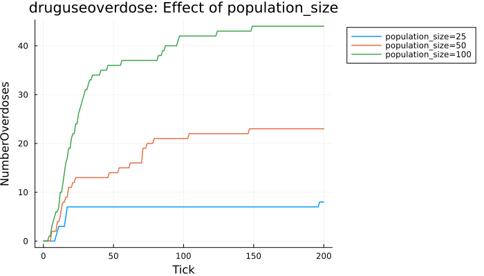

## Overview

This vignette demonstrates the **Drug Use Overdose** model implemented in [ArkModelZoo.jl](https://github.com/sdwfrost/ArkModelZoo.jl) using the Ark.jl ECS framework.

## Parameters

| Parameter | Type | Default | Description |
|-----------|------|---------|-------------|
| `population_size` | `Int` | `50` | population size |
| `percent_drug_user` | `Int` | `20` | percent drug user |
| `drug_availability` | `Int` | `15` | drug availability |
| `grid_width` | `Int` | `33` | -16..16 → 33 patches |
| `grid_height` | `Int` | `33` | grid height |
| `max_ticks` | `Int` | `200` | max ticks |

## Source Code

The Julia code to run this model:

```julia
using ArkModelZoo
_, trajectory = run_druguseoverdose()
```

## Time Series

{width=100%}

## Ensemble Runs

Ten replicates with different random seeds, showing mean ± standard deviation.

{width=100%}

## Parameter Sensitivity

Varying `population_size`.

{width=100%}


## Appendix: Source Code

This model is implemented in the [Ark.jl](https://github.com/sdwfrost/Ark.jl) Entity-Component-System (ECS) framework. The code is split into five files, each with a distinct role:

- **Parameters**: a mutable struct holding all configurable values.
- **Components**: lightweight data types attached to individual entities (agents).
- **Resources**: world-level shared state accessible to all systems.
- **Systems**: functions that operate on entities each tick, defining model behavior.
- **Model**: wiring that assembles the world, registers resources and systems, and provides the run entry point.

### Parameters (`parameters.jl`)

The parameter struct uses `@kwdef` so that every field has a default value and can be overridden by keyword. These defaults match the original NetLogo model's slider settings.

```julia
Base.@kwdef mutable struct DrugUseOverdoseParams
    population_size::Int = 50
    percent_drug_user::Int = 20
    drug_availability::Int = 15
    grid_width::Int = 33    # -16..16 → 33 patches
    grid_height::Int = 33
    max_ticks::Int = 200
    seed::Int = 42
end
```

### Components (`components.jl`)

Components are lightweight data types attached to individual entities (agents). Mutable structs hold per-entity state, while empty tag structs act as markers for the ECS query system to efficiently filter entities.

```julia
mutable struct DUOPosition
    x::Float64
    y::Float64
end

mutable struct DUOHeading
    angle::Float64
end

mutable struct DUOAgentState
    drug_user::Bool
    drug_level::Float64
    unemployed::Bool
    alive::Bool
    slot::Int       # index into network adjacency
end

struct DUOTag end
```

### Resources (`resources.jl`)

Resources are world-level singletons shared across all systems, used for global state and aggregate statistics.

```julia
mutable struct DUOGrid
    w::Int
    h::Int
    drug_patch::Vector{Bool}   # red patches = drug availability zones
end
DUOGrid() = DUOGrid(0, 0, Bool[])

mutable struct DUONetwork
    adj::Vector{Set{Int}}  # adjacency for agent social network (by slot index)
end
DUONetwork() = DUONetwork(Set{Int}[])

mutable struct DUOStats
    number_overdoses::Int
    num_drug_users::Int
    num_alive::Int
end
DUOStats() = DUOStats(0, 0, 0)
```

### Systems (`systems.jl`)

Systems contain the model logic and execute in a defined order each tick. Each system struct implements either `initialize!` (run once at setup) or `update!` (run every tick).

```julia
# Drug Use and Overdose Model
# Agents move, start using drugs near availability patches,
# spread drug use through social network, and can overdose

struct InitDUOSystem <: System end

function initialize!(::InitDUOSystem, world::World)
    params = get_resource(world, DrugUseOverdoseParams)
    rng = get_resource(world, RNGResource).rng
    grid = get_resource(world, DUOGrid)
    net = get_resource(world, DUONetwork)
    stats = get_resource(world, DUOStats)

    w = params.grid_width
    h = params.grid_height
    wf = Float64(w)
    hf = Float64(h)
    grid.w = w
    grid.h = h
    grid.drug_patch = falses(w * h)

    # Drug availability patches
    n_patches = w * h
    avail_indices = Random.shuffle!(rng, collect(1:n_patches))
    for i in 1:min(params.drug_availability, n_patches)
        grid.drug_patch[avail_indices[i]] = true
    end

    # Create agents
    n = params.population_size
    net.adj = [Set{Int}() for _ in 1:n]
    entities = Entity[]
    positions_vec = Tuple{Float64,Float64}[]

    for slot in 1:n
        x = rand(rng) * wf
        y = rand(rng) * hf
        heading = Float64(rand(rng, 0:359))
        st = DUOAgentState(false, 0.0, false, true, slot)
        eid = new_entity!(world, (DUOPosition(x, y), DUOHeading(heading), st, DUOTag()))
        push!(entities, eid)
        push!(positions_vec, (x, y))
    end

    # Seed initial drug users
    n_drug = div(params.percent_drug_user * n, 100)
    drug_indices = Random.shuffle!(rng, collect(1:n))
    for i in 1:min(n_drug, n)
        slot = drug_indices[i]
        # Find entity with this slot and update
        for (eids, agent_states) in Query(world, (DUOAgentState,); with=(DUOTag,))
            @inbounds for j in eachindex(agent_states)
                if agent_states[j].slot == slot
                    agent_states[j].drug_user = true
                    agent_states[j].drug_level = rand(rng) * 0.5
                    if agent_states[j].unemployed
                        agent_states[j].drug_level += 0.2
                    end
                end
            end
        end
    end

    # Create social network: each turtle links with up to random(4) others in-radius 10
    for i in 1:n
        xi, yi = positions_vec[i]
        in_radius = Int[]
        for j in 1:n
            j == i && continue
            xj, yj = positions_vec[j]
            ddx = abs(xi - xj)
            ddx = min(ddx, wf - ddx)
            ddy = abs(yi - yj)
            ddy = min(ddy, hf - ddy)
            dist = sqrt(ddx * ddx + ddy * ddy)
            if dist <= 10.0
                push!(in_radius, j)
            end
        end
        if !isempty(in_radius)
            n_links = min(rand(rng, 0:3), length(in_radius))
            Random.shuffle!(rng, in_radius)
            for k in 1:n_links
                j = in_radius[k]
                push!(net.adj[i], j)
                push!(net.adj[j], i)
            end
        end
    end

    _duo_update_stats!(world, stats)
    return nothing
end

function _duo_update_stats!(world::World, stats::DUOStats)
    n_users = 0
    n_alive = 0
    for (_, agent_states) in Query(world, (DUOAgentState,); with=(DUOTag,))
        @inbounds for i in eachindex(agent_states)
            if agent_states[i].alive
                n_alive += 1
                if agent_states[i].drug_user
                    n_users += 1
                end
            end
        end
    end
    stats.num_drug_users = n_users
    stats.num_alive = n_alive
end

struct DUOGoSystem <: System
    to_kill::Vector{Entity}
end
DUOGoSystem() = DUOGoSystem(Entity[])

function update!(sys::DUOGoSystem, world::World)
    params = get_resource(world, DrugUseOverdoseParams)
    rng = get_resource(world, RNGResource).rng
    grid = get_resource(world, DUOGrid)
    net = get_resource(world, DUONetwork)
    stats = get_resource(world, DUOStats)
    w = grid.w
    h = grid.h
    wf = Float64(w)
    hf = Float64(h)

    empty!(sys.to_kill)

    # Collect all alive entities and build slot maps
    all_entities = Entity[]
    slot_to_eid = Dict{Int,Entity}()
    for (eids, states) in Query(world, (DUOAgentState,); with=(DUOTag,))
        @inbounds for i in eachindex(eids)
            if states[i].alive
                push!(all_entities, eids[i])
                slot_to_eid[states[i].slot] = eids[i]
            end
        end
    end
    Random.shuffle!(rng, all_entities)

    for eid in all_entities
        !is_alive(world, eid) && continue

        pos, heading, state = get_components(world, eid, (DUOPosition, DUOHeading, DUOAgentState))
        !state.alive && continue
        slot = state.slot

        # Movement: rt 40, lt 10, fd 2
        heading.angle += 40.0
        heading.angle -= 10.0
        θ = deg2rad(heading.angle)
        pos.x = mod(pos.x + sin(θ) * 2.0, wf)
        pos.y = mod(pos.y + cos(θ) * 2.0, hf)

        # start-drugs
        px = mod(floor(Int, pos.x), w) + 1
        py = mod(floor(Int, pos.y), h) + 1
        pidx = (py - 1) * w + px
        if rand(rng, 0:99) < floor(Int, state.drug_level * 100) && grid.drug_patch[pidx]
            state.drug_level += 0.1
            state.drug_user = true
        end

        if state.drug_level > 0.5
            state.drug_user = true
        end

        if state.drug_user
            # increase-drug-network
            neighbors = collect(net.adj[slot])
            alive_nbrs = Int[]
            for n in neighbors
                haskey(slot_to_eid, n) || continue
                is_alive(world, slot_to_eid[n]) || continue
                push!(alive_nbrs, n)
            end

            if !isempty(alive_nbrs)
                chosen = alive_nbrs[rand(rng, 1:length(alive_nbrs))]
                chosen_eid = slot_to_eid[chosen]
                if is_alive(world, chosen_eid)
                    chosen_state = get_components(world, chosen_eid, (DUOAgentState,))[1]
                    chosen_state.drug_level += 0.1
                end
            end

            # overdose checks
            overdosed = false
            if state.drug_level > 0.6 && !isempty(alive_nbrs)
                nbr_drug_sum = 0.0
                for nbr_slot in alive_nbrs
                    nbr_eid = slot_to_eid[nbr_slot]
                    if is_alive(world, nbr_eid)
                        nbr_state = get_components(world, nbr_eid, (DUOAgentState,))[1]
                        nbr_drug_sum += nbr_state.drug_level
                    end
                end
                if nbr_drug_sum > 1.2
                    stats.number_overdoses += 1
                    overdosed = true
                end
            end
            if !overdosed && state.drug_level > 2.0
                stats.number_overdoses += 1
                overdosed = true
            end
            if overdosed
                state.alive = false
                push!(sys.to_kill, eid)
                delete!(slot_to_eid, slot)
            end
        end
    end

    # Remove dead agents outside query
    for eid in sys.to_kill
        is_alive(world, eid) && remove_entity!(world, eid)
    end

    _duo_update_stats!(world, stats)
    return nothing
end

struct DUOTerminationSystem <: System end

function update!(::DUOTerminationSystem, world::World)
    params = get_resource(world, DrugUseOverdoseParams)
    tick = get_resource(world, Tick)
    stats = get_resource(world, DUOStats)
    if tick.tick + 1 >= params.max_ticks || stats.num_alive == 0
        get_resource(world, Terminate).stop = true
    end
    return nothing
end
```

### Model (`model.jl`)

The model file assembles all pieces: it creates the ECS `World` with the required component types, registers resources, builds the `Scheduler` with systems in execution order, and exposes the public `run` entry point. The observer pattern records the trajectory each tick.

```julia
function druguseoverdose_world(; initial_capacity::Int = 128)
    return World(
        DUOPosition, DUOHeading, DUOAgentState, DUOTag;
        initial_capacity = initial_capacity, allow_mutable = true,
    )
end

function druguseoverdose_systems()
    return (InitDUOSystem(), DUOGoSystem(), DUOTerminationSystem())
end

function druguseoverdose_model(params::DrugUseOverdoseParams = DrugUseOverdoseParams())
    world = druguseoverdose_world()
    _add_standard_resources!(world, params)
    add_resource!(world, DUOGrid())
    add_resource!(world, DUONetwork())
    add_resource!(world, DUOStats())
    scheduler = Scheduler(world, druguseoverdose_systems())
    initialize!(scheduler)
    return scheduler
end

struct DUOObserver end

function druguseoverdose_headers(::DUOObserver)
    return ["NumberOverdoses", "NumDrugUsers", "NumAlive"]
end

function druguseoverdose_values(::DUOObserver, world::World)
    stats = get_resource(world, DUOStats)
    return Float64[stats.number_overdoses, stats.num_drug_users, stats.num_alive]
end

function run_druguseoverdose(; params::DrugUseOverdoseParams = DrugUseOverdoseParams(), observe::Bool = true)
    return _run_model(druguseoverdose_model, DUOObserver(), druguseoverdose_values; params, observe)
end
```
