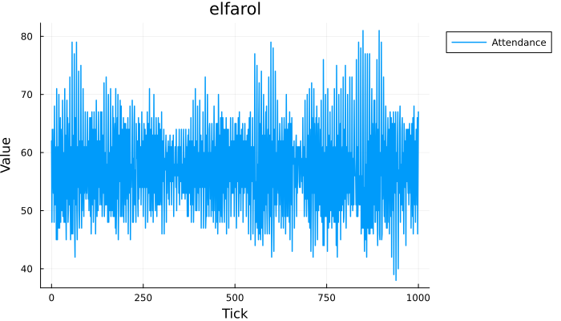
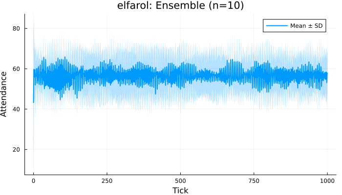
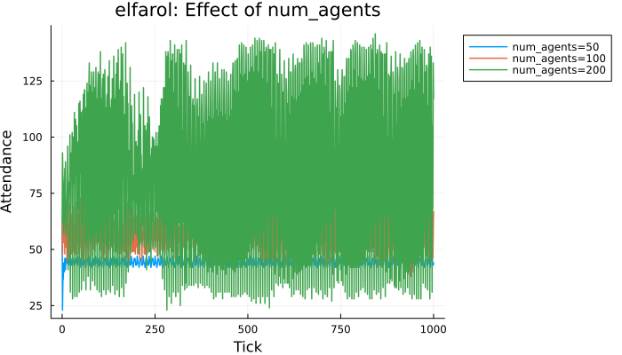

# El Farol


- [Overview](#overview)
  - [WHAT IS IT?](#what-is-it)
  - [HOW IT WORKS](#how-it-works)
  - [THINGS TO NOTICE](#things-to-notice)
  - [THINGS TO TRY](#things-to-try)
  - [EXTENDING THE MODEL](#extending-the-model)
  - [NETLOGO FEATURES](#netlogo-features)
  - [RELATED MODELS](#related-models)
  - [CREDITS AND REFERENCES](#credits-and-references)
  - [HOW TO CITE](#how-to-cite)
  - [COPYRIGHT AND LICENSE](#copyright-and-license)
- [Parameters](#parameters)
- [Source Code](#source-code)
- [Time Series](#time-series)
- [Ensemble Runs](#ensemble-runs)
- [Parameter Sensitivity](#parameter-sensitivity)
- [Appendix: Source Code](#appendix-source-code)
  - [Parameters (`parameters.jl`)](#parameters-parametersjl)
  - [Components (`components.jl`)](#components-componentsjl)
  - [Resources (`resources.jl`)](#resources-resourcesjl)
  - [Systems (`systems.jl`)](#systems-systemsjl)
  - [Model (`model.jl`)](#model-modeljl)

## Overview

### WHAT IS IT?

El Farol is a bar in Santa Fe, New Mexico. The bar is popular —
especially on Thursday nights when they offer Irish music — but
sometimes becomes overcrowded and unpleasant. In fact, if the patrons of
the bar think it will be overcrowded they stay home; otherwise they go
enjoy themselves at El Farol. This model explores what happens to the
overall attendance at the bar on these popular Thursday evenings, as the
patrons use different strategies for determining how crowded they think
the bar will be.

El Farol was originally put forth by Brian Arthur (1994) as an example
of how one might model economic systems of boundedly rational agents who
use inductive reasoning.

This is a version of the El Farol model in the Social Science Section of
the NetLogo Models Library. This version is intended for use with the
IABM textbook. It is NOT intended for textbook users to understand all
the code in this model as the point in this section of the textbook is
to extend the model by adding new output measures to the model, and not
to alter the fundamental algorithm of the model.

### HOW IT WORKS

An agent will go to the bar on Thursday night if they think that there
will not be more than a certain number of people there — a number given
by the OVERCROWDING-THRESHOLD. To predict the attendance for any given
week, each agent has access to a set of prediction strategies and the
actual attendance figures of the bar from previous Thursdays. A
prediction strategy is represented as a list of weights that determines
how the agent believes that each time period of the historical data
affects the attendance prediction for the current week. One of these
weights (the first one) is a constant term which allows the baseline of
the prediction to be modified. This definition of a strategy is based on
an implementation of Arthur’s model as revised by David Fogel et
al. (1999). The agent decides which one of its strategies to use by
determining which one would have done the best had they used it in the
preceding weeks.

Interestingly, the optimal strategy from a perfectly rational
point-of-view would be to always go to the bar since you are not
punished for going when it is crowded, but in Arthur’s model agents are
not optimizing attending when not crowded, instead they are optimizing
their prediction of the attendance.

The number of potential strategies an agent has is given by
NUMBER-STRATEGIES, and these potential strategies are distributed
randomly to the agents during SETUP. As the model runs, at any one tick
each agent will only utilize one strategy, based on its previous ability
to predict the attendance at the bar. In this version of the El Farol
model, agents are given strategies and do not change them once they have
them, however since they can change their strategies at any time based
on performance, the ecology of strategies being used by the whole
population changes over time. The length of the attendance history the
agents can use for a prediction or evaluation of a strategy is given by
MEMORY-SIZE. This evaluation of performance is carried out in
UPDATE-STRATEGIES, which does not change the strategies, but rather
updates the performance of each strategy by testing it, and then
selecting the strategy that has the best performance given the current
data. In order to test each strategy its performance on MEMORY-SIZE past
days is computed. To make this work, the model actually records twice
the MEMORY-SIZE historical data so that a strategy can be tested
MEMORY-SIZE days into the past still using the full MEMORY-SIZE data to
make its prediction.

### THINGS TO NOTICE

The green part of the world represents the homes of the patrons, while
the blue part of the world represents the El Farol Bar. Over time the
attendance will increase and decrease but its mean value comes close to
the OVERCROWDING-THRESHOLD.

### THINGS TO TRY

Try running the model with different settings for MEMORY-SIZE and
NUMBER-STRATEGIES. What happens to the variability in attendance as you
decrease NUMBER-STRATEGIES? What happens to the variability in the plot
if you decrease MEMORY-SIZE?

### EXTENDING THE MODEL

Currently the weights that determine each strategy are randomly
generated during the model setup. Try altering the weights that are
possible during setup so that they only reflect a mix of the following
agent strategies:

- always predict the same as last week’s attendance
- an average of the last several week’s attendance
- the same as 2 weeks ago

Can you think of other simple rules one might follow?

At the end of Arthur’s original paper, he mentions that though he uses a
simple learning technique (the “bag of strategies” method that we use
here) almost any other kind of machine learning technique would achieve
the same results. This method is particularly limiting in that the
strategies an agent is given during the setup are all the strategies
they have for the entire run of the model. Most other machine learning
methods would enable the agents to change their strategies over time. In
fact Fogel et al. (1999) implemented a genetic algorithm and got
somewhat different results. Try implementing another machine learning
technique and see what the results are.

Can you think of a better way to measure the success of strategies and
calculate the best-strategy?

### NETLOGO FEATURES

Lists are used to represent strategies and attendance histories.

`n-values` is useful for generating random strategies.

### RELATED MODELS

Arthur’s original model has been generalized as the Minority Game and is
included in the Social Sciences section of the NetLogo models library.

Wilensky, U. (2004). NetLogo Minority Game model.
http://ccl.northwestern.edu/netlogo/models/MinorityGame. Center for
Connected Learning and Computer-Based Modeling, Northwestern University,
Evanston, IL.

There is also a participatory simulation version of the Minority Game
model in the models library.

Stouffer, D. & Wilensky, U. (2004). NetLogo Minority Game HubNet model.
http://ccl.northwestern.edu/netlogo/models/MinorityGameHubNet. Center
for Connected Learning and Computer-Based Modeling, Northwestern
University, Evanston, IL.

There is an alternative implementation of this model with more
parameters that is part of the NetLogo User Community Models.

### CREDITS AND REFERENCES

This model is adapted from:

Rand, W. and Wilensky, U. (1997). NetLogo El Farol model.
http://ccl.northwestern.edu/netlogo/models/ElFarol. Center for Connected
Learning and Computer-Based Modeling, Northwestern University, Evanston,
IL.

This model is inspired by a paper by W. Brian Arthur. “Inductive
Reasoning and Bounded Rationality”, W. Brian Arthur, The American
Economic Review, 1994, v84n2, p406-411.

David Fogel et al. also built a version of this model using a genetic
algorithm. “Inductive reasoning and bounded rationality reconsidered”,
Fogel, D.B.; Chellapilla, K.; Angeline, P.J., IEEE Transactions on
Evolutionary Computation, 1999, v3n2, p142-146.

### HOW TO CITE

This model is part of the textbook, “Introduction to Agent-Based
Modeling: Modeling Natural, Social and Engineered Complex Systems with
NetLogo.”

If you mention this model or the NetLogo software in a publication, we
ask that you include the citations below.

For the model itself:

- Rand, W., Wilensky, U. (2007). NetLogo El Farol model.
  http://ccl.northwestern.edu/netlogo/models/ElFarol. Center for
  Connected Learning and Computer-Based Modeling, Northwestern Institute
  on Complex Systems, Northwestern University, Evanston, IL.

Please cite the NetLogo software as:

- Wilensky, U. (1999). NetLogo. http://ccl.northwestern.edu/netlogo/.
  Center for Connected Learning and Computer-Based Modeling,
  Northwestern University, Evanston, IL.

Please cite the textbook as:

- Wilensky, U. & Rand, W. (2015). Introduction to Agent-Based Modeling:
  Modeling Natural, Social and Engineered Complex Systems with NetLogo.
  Cambridge, MA. MIT Press.

### COPYRIGHT AND LICENSE

Copyright 2007 Uri Wilensky.


This model is licensed under the Creative Commons
Attribution-NonCommercial-ShareAlike 3.0 License. To view a copy of this
license, visit https://creativecommons.org/licenses/by-nc-sa/3.0/ or
send a letter to Creative Commons, 559 Nathan Abbott Way, Stanford,
California 94305, USA.

NetLogo itself is free software for non-commercial use under the terms
of the GNU General Public License ([see full license information
here](https://ccl.northwestern.edu/netlogo/docs/copyright.html)).

To inquire about commercial licenses for either NetLogo or specific
models from the models library, please contact
netlogo-commercial-admin@ccl.northwestern.edu.

<!-- 2007 Cite: Rand, W., Wilensky, U. -->

## Parameters

| Parameter                | Type  | Default | Description            |
|--------------------------|-------|---------|------------------------|
| `num_agents`             | `Int` | `100`   | num agents             |
| `memory_size`            | `Int` | `5`     | memory size            |
| `number_strategies`      | `Int` | `10`    | number strategies      |
| `overcrowding_threshold` | `Int` | `60`    | overcrowding threshold |
| `max_ticks`              | `Int` | `1000`  | max ticks              |

## Source Code

The Julia code to run this model:

``` julia
using ArkModelZoo
_, trajectory = run_elfarol()
```

## Time Series



## Ensemble Runs

Ten replicates with different random seeds, showing mean ± standard
deviation.



## Parameter Sensitivity

Varying `num_agents`.



## Appendix: Source Code

This model is implemented in the
[Ark.jl](https://github.com/sdwfrost/Ark.jl) Entity-Component-System
(ECS) framework. The code is split into five files, each with a distinct
role:

- **Parameters**: a mutable struct holding all configurable values.
- **Components**: lightweight data types attached to individual entities
  (agents).
- **Resources**: world-level shared state accessible to all systems.
- **Systems**: functions that operate on entities each tick, defining
  model behavior.
- **Model**: wiring that assembles the world, registers resources and
  systems, and provides the run entry point.

### Parameters (`parameters.jl`)

The parameter struct uses `@kwdef` so that every field has a default
value and can be overridden by keyword. These defaults match the
original NetLogo model’s slider settings.

``` julia
Base.@kwdef mutable struct ElFarolParams
    num_agents::Int = 100
    memory_size::Int = 5
    number_strategies::Int = 10
    overcrowding_threshold::Int = 60
    max_ticks::Int = 1000
    seed::Int = 42
end
```

### Components (`components.jl`)

Components are lightweight data types attached to individual entities
(agents). Mutable structs hold per-entity state, while empty tag structs
act as markers for the ECS query system to efficiently filter entities.

``` julia
# Each agent has a set of strategies and a decision for the current tick
mutable struct ElFarolStrategies
    strategies::Vector{Vector{Float64}}
    best_strategy::Vector{Float64}
end

mutable struct ElFarolDecision
    attend::Bool
    prediction::Float64
end
```

### Resources (`resources.jl`)

Resources are world-level singletons shared across all systems, used for
global state and aggregate statistics.

``` julia
# Global attendance history (most recent first)
mutable struct ElFarolHistory
    history::Vector{Int}
end
ElFarolHistory(n::Int) = ElFarolHistory(zeros(Int, n))

mutable struct ElFarolStats
    attendance::Int
end
ElFarolStats() = ElFarolStats(0)
```

### Systems (`systems.jl`)

Systems contain the model logic and execute in a defined order each
tick. Each system struct implements either `initialize!` (run once at
setup) or `update!` (run every tick).

``` julia
# --- Helpers ---

# NetLogo: 1.0 - random-float 2.0 → values in (-1.0, 1.0]
function _elfarol_random_strategy(rng, memory_size::Int)
    return [1.0 - rand(rng) * 2.0 for _ in 1:(memory_size + 1)]
end

# NetLogo: 100 * first strategy + sum(map ... butfirst strategy subhistory)
function _elfarol_predict(strategy::Vector{Float64}, subhistory::AbstractVector{Int})
    pred = 100.0 * strategy[1]
    for i in eachindex(subhistory)
        pred += strategy[i + 1] * subhistory[i]
    end
    return pred
end

# Evaluate all strategies against history, pick the one with lowest total error.
# NetLogo: if score <= best-score ⇒ ties broken by LAST strategy.
function _elfarol_update_best!(strats::ElFarolStrategies, history::Vector{Int}, memory_size::Int)
    best_score = memory_size * 100.0 + 1.0
    for s in strats.strategies
        score = 0.0
        for week in 1:memory_size
            pred = _elfarol_predict(s, @view history[(week + 1):(week + memory_size)])
            score += abs(history[week] - pred)
        end
        if score <= best_score
            best_score = score
            strats.best_strategy = s
        end
    end
end

# --- Initialization ---

struct InitElFarolSystem <: System end

function initialize!(::InitElFarolSystem, world::World)
    params = get_resource(world, ElFarolParams)
    rng = get_resource(world, RNGResource).rng
    hist = get_resource(world, ElFarolHistory)
    stats = get_resource(world, ElFarolStats)

    # history: n-values (memory-size * 2) [random 100]  (most-recent first)
    hist.history = [rand(rng, 0:99) for _ in 1:(params.memory_size * 2)]
    stats.attendance = first(hist.history)

    for _ in 1:params.num_agents
        strategies = [_elfarol_random_strategy(rng, params.memory_size)
                      for _ in 1:params.number_strategies]
        new_entity!(world, (
            ElFarolStrategies(strategies, strategies[1]),
            ElFarolDecision(false, 0.0),
        ))
    end

    # NetLogo calls update-strategies in create-turtles block
    for (_, sv) in Query(world, (ElFarolStrategies,))
        @inbounds for i in eachindex(sv)
            _elfarol_update_best!(sv[i], hist.history, params.memory_size)
        end
    end
    return nothing
end

# --- Update (go) ---

struct ElFarolUpdateSystem <: System end

function update!(::ElFarolUpdateSystem, world::World)
    params = get_resource(world, ElFarolParams)
    hist = get_resource(world, ElFarolHistory)
    stats = get_resource(world, ElFarolStats)
    ms = params.memory_size

    # 1. Predict & decide (independent — order irrelevant)
    for (_, sv, dv) in Query(world, (ElFarolStrategies, ElFarolDecision))
        @inbounds for i in eachindex(sv)
            pred = _elfarol_predict(sv[i].best_strategy, @view hist.history[1:ms])
            dv[i].prediction = pred
            dv[i].attend = (pred <= params.overcrowding_threshold)
        end
    end

    # 2. Count attendance
    attendance = 0
    for (_, dv) in Query(world, (ElFarolDecision,))
        @inbounds for i in eachindex(dv)
            attendance += dv[i].attend
        end
    end
    stats.attendance = attendance

    # 3. Update history: fput attendance but-last history
    pop!(hist.history)                       # drop oldest (last element)
    pushfirst!(hist.history, attendance)      # prepend newest

    # 4. Update strategies
    for (_, sv) in Query(world, (ElFarolStrategies,))
        @inbounds for i in eachindex(sv)
            _elfarol_update_best!(sv[i], hist.history, ms)
        end
    end
    return nothing
end

# --- Stats (attendance already tracked in update) ---

struct ElFarolStatsSystem <: System end
function update!(::ElFarolStatsSystem, world::World)
    return nothing
end

# --- Termination ---

struct ElFarolTerminationSystem <: System end

function update!(::ElFarolTerminationSystem, world::World)
    params = get_resource(world, ElFarolParams)
    tick = get_resource(world, Tick)
    if tick.tick + 1 >= params.max_ticks
        get_resource(world, Terminate).stop = true
    end
    return nothing
end
```

### Model (`model.jl`)

The model file assembles all pieces: it creates the ECS `World` with the
required component types, registers resources, builds the `Scheduler`
with systems in execution order, and exposes the public `run` entry
point. The observer pattern records the trajectory each tick.

``` julia
function elfarol_world(; initial_capacity::Int = 256)
    return World(
        ElFarolStrategies,
        ElFarolDecision;
        initial_capacity = initial_capacity,
        allow_mutable = true,
    )
end

function elfarol_systems()
    return (
        InitElFarolSystem(),
        ElFarolUpdateSystem(),
        ElFarolStatsSystem(),
        ElFarolTerminationSystem(),
    )
end

function elfarol_model(params::ElFarolParams = ElFarolParams())
    world = elfarol_world()
    _add_standard_resources!(world, params)
    add_resource!(world, ElFarolHistory(params.memory_size * 2))
    add_resource!(world, ElFarolStats())
    scheduler = Scheduler(world, elfarol_systems())
    initialize!(scheduler)
    return scheduler
end

struct ElFarolObserver end

function elfarol_headers(::ElFarolObserver)
    return ["Attendance"]
end

function elfarol_values(::ElFarolObserver, world::World)
    stats = get_resource(world, ElFarolStats)
    return Float64[stats.attendance]
end

function run_elfarol(; params::ElFarolParams = ElFarolParams(), observe::Bool = true)
    return _run_model(elfarol_model, ElFarolObserver(), elfarol_values; params, observe)
end
```
