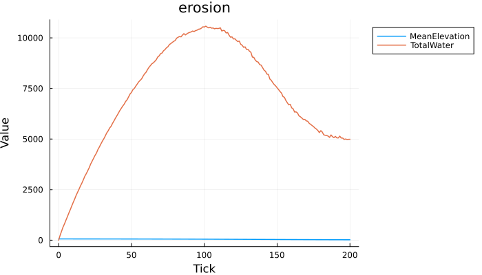
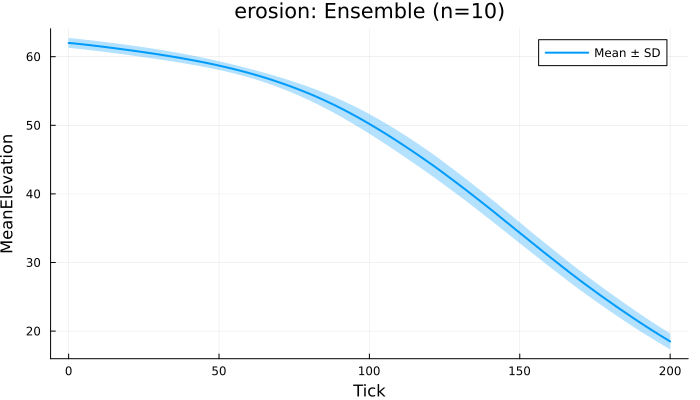
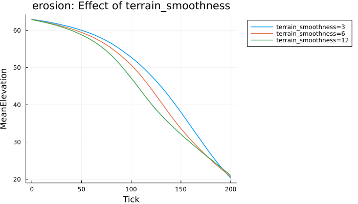

## Overview

### WHAT IS IT?

This model is a simulation of soil erosion by water.  The user is presented with an empty terrain.  Rain falls on the terrain and starts to flow downhill.  As it flows, it erodes the terrain below.  The patterns of water flow change as the terrain is reshaped by erosion.  Eventually, a river system emerges.

### HOW IT WORKS

The soil is represented by gray patches.  The lighter the patch, the higher the elevation. Water is represented by blue patches.  Deeper water is represented by a darker blue.  Around the edge of the world is a "drain" into which water and sediment disappear.

Each patch has a certain chance per time step of receiving rain.  If it does receive rain, its water depth increases by one.

The model uses the following naive model of flowing water.  Water flows to the adjacent patch where the water level is lowest, as long as that patch is lower than the source.  The amount of flow is proportional to the difference in level, so that the water level on the two patches is (if possible) equalized.

Erosion is represented by decreasing the elevation of the source patch a bit when flow occurs.  The amount of erosion is proportional to the amount of flow.

### THINGS TO NOTICE

Initially, the world is covered by lakes.  Then rivers start to form at the edge of the world.  Gradually, these rivers grow until they have drained all the lakes.

### THINGS TO TRY

Use the HIDE-WATER button to make the water invisible, and observe the terrain.

Experiment with the effect of the different sliders on the appearance of the resulting rivers.

See what happens when you start with a perfectly flat terrain.  (Is what happens realistic, or does it reveal limitations of the model?)

See what happens when you start with a hill.

### EXTENDING THE MODEL

Add evaporation.  Does this alter the behavior of the system in interesting ways?

Add "springs" -- point sources from which new water flows.

Add indicator turtles to show the direction and magnitude of flow on each patch.

Experiment with the rules for water flow.  Currently, all of the water simply flows to the lowest neighbor.  Would a more elaborate rule produce different results?

Add multiple soil types to the terrain, so that the land is of varying hardness, that is, varying speed of erosion.

What would it take to get river deltas to form?  You'd need to model sediment being carried by water and then deposited.

### NETLOGO FEATURES

Only patches are used, no turtles.

The code depends on agentsets always being randomly ordered.

### CREDITS AND REFERENCES

Here is an eroded volcano in Kamchatka with a strong resemblance to this model:
https://www.google.com/maps/@52.544312,157.338467,7882m/data=!3m1!1e3?dg=dbrw&newdg=1

Thanks to Greg Dunham and Seth Tisue for their work on this model.

### HOW TO CITE

If you mention this model or the NetLogo software in a publication, we ask that you include the citations below.

For the model itself:

* Dunham, G., Tisue, S. and Wilensky, U. (2004).  NetLogo Erosion model.  http://ccl.northwestern.edu/netlogo/models/Erosion.  Center for Connected Learning and Computer-Based Modeling, Northwestern University, Evanston, IL.

Please cite the NetLogo software as:

* Wilensky, U. (1999). NetLogo. http://ccl.northwestern.edu/netlogo/. Center for Connected Learning and Computer-Based Modeling, Northwestern University, Evanston, IL.

### COPYRIGHT AND LICENSE

Copyright 2004 Uri Wilensky.


This model is licensed under the Creative Commons Attribution-NonCommercial-ShareAlike 3.0 License.  To view a copy of this license, visit https://creativecommons.org/licenses/by-nc-sa/3.0/ or send a letter to Creative Commons, 559 Nathan Abbott Way, Stanford, California 94305, USA.

NetLogo itself is free software for non-commercial use under the terms of the GNU General Public License ([see full license information here](https://ccl.northwestern.edu/netlogo/docs/copyright.html)).

To inquire about commercial licenses for either NetLogo or specific models from the models library, please contact netlogo-commercial-admin@ccl.northwestern.edu.

This model was created as part of the projects: PARTICIPATORY SIMULATIONS: NETWORK-BASED DESIGN FOR SYSTEMS LEARNING IN CLASSROOMS and/or INTEGRATED SIMULATION AND MODELING ENVIRONMENT. The project gratefully acknowledges the support of the National Science Foundation (REPP & ROLE programs) -- grant numbers REC #9814682 and REC-0126227.

<!-- 2004 Cite: Dunham, G., Tisue, S. -->

## Parameters

| Parameter | Type | Default | Description |
|-----------|------|---------|-------------|
| `grid_width` | `Int` | `51` | -25..25 => 51 patches (NetLogo -50..50 = 101, reduced for speed) |
| `grid_height` | `Int` | `51` | grid height |
| `bumpy` | `Bool` | `true` | bumpy |
| `hill` | `Bool` | `false` | hill |
| `terrain_smoothness` | `Int` | `6` | terrain smoothness |
| `rainfall` | `Float64` | `0.1` | rainfall |
| `soil_hardness` | `Float64` | `0.8` | soil hardness |
| `max_ticks` | `Int` | `200` | max ticks |

## Source Code

The Julia code to run this model:

```julia
using ArkModelZoo
_, trajectory = run_erosion()
```

## Time Series

{width=100%}

## Ensemble Runs

Ten replicates with different random seeds, showing mean ± standard deviation.

{width=100%}

## Parameter Sensitivity

Varying `terrain_smoothness`.

{width=100%}


## Appendix: Source Code

This model is implemented in the [Ark.jl](https://github.com/sdwfrost/Ark.jl) Entity-Component-System (ECS) framework. The code is split into five files, each with a distinct role:

- **Parameters**: a mutable struct holding all configurable values.
- **Components**: lightweight data types attached to individual entities (agents).
- **Resources**: world-level shared state accessible to all systems.
- **Systems**: functions that operate on entities each tick, defining model behavior.
- **Model**: wiring that assembles the world, registers resources and systems, and provides the run entry point.

### Parameters (`parameters.jl`)

The parameter struct uses `@kwdef` so that every field has a default value and can be overridden by keyword. These defaults match the original NetLogo model's slider settings.

```julia
Base.@kwdef mutable struct ERParams
    grid_width::Int = 51       # -25..25 => 51 patches (NetLogo -50..50 = 101, reduced for speed)
    grid_height::Int = 51
    bumpy::Bool = true
    hill::Bool = false
    terrain_smoothness::Int = 6
    rainfall::Float64 = 0.1
    soil_hardness::Float64 = 0.8
    max_ticks::Int = 200
    seed::Int = 42
end
```

### Components (`components.jl`)

Components are lightweight data types attached to individual entities (agents). Mutable structs hold per-entity state, while empty tag structs act as markers for the ECS query system to efficiently filter entities.

```julia
# Erosion is a patch-only model — no turtle components needed.
# We use a dummy component so the World has at least one component type.
mutable struct ERDummy
    val::Int
end
ERDummy() = ERDummy(0)
```

### Resources (`resources.jl`)

Resources are world-level singletons shared across all systems, used for global state and aggregate statistics.

```julia
mutable struct ERGrid
    width::Int
    height::Int
    elevation::Matrix{Float64}
    water::Matrix{Float64}
    drain::Matrix{Bool}
end

function ERGrid(w::Int, h::Int)
    ERGrid(w, h, zeros(w, h), zeros(w, h), falses(w, h))
end

mutable struct ERStats
    mean_elevation::Float64
    total_water::Float64
end
ERStats() = ERStats(0.0, 0.0)
```

### Systems (`systems.jl`)

Systems contain the model logic and execute in a defined order each tick. Each system struct implements either `initialize!` (run once at setup) or `update!` (run every tick).

```julia
struct InitErosionSystem <: System end

function initialize!(::InitErosionSystem, world::World)
    params = get_resource(world, ERParams)
    rng = get_resource(world, RNGResource).rng
    g = get_resource(world, ERGrid)
    w, h = g.width, g.height
    cx, cy = (w + 1) / 2.0, (h + 1) / 2.0
    max_dist = max(cx - 1, cy - 1)

    for x in 1:w, y in 1:h
        if params.bumpy
            dist = sqrt((x - cx)^2 + (y - cy)^2)
            if params.hill
                g.elevation[x, y] = -100.0 * (dist / max_dist) + 100.0 + Float64(rand(rng, 0:99))
            else
                g.elevation[x, y] = Float64(rand(rng, 0:124))
            end
        else
            g.elevation[x, y] = 100.0
        end
        g.water[x, y] = 0.0
        g.drain[x, y] = false
    end

    # Smooth terrain via diffusion (NetLogo: diffuse elevation 0.5)
    # NetLogo diffuse: each patch shares rate/8 of its value with each of its
    # existing neighbors; shares to non-existent neighbors are kept by the patch.
    if params.bumpy
        old = similar(g.elevation)
        rate8 = 0.5 / 8.0
        for _ in 1:params.terrain_smoothness
            copyto!(old, g.elevation)
            for x in 1:w, y in 1:h
                s = 0.0; n_nbrs = 0
                for dx in -1:1, dy in -1:1
                    (dx == 0 && dy == 0) && continue
                    nx, ny = x + dx, y + dy
                    if 1 <= nx <= w && 1 <= ny <= h
                        s += old[nx, ny]; n_nbrs += 1
                    end
                end
                g.elevation[x, y] = old[x, y] * (1.0 - n_nbrs * rate8) + s * rate8
            end
        end
    end

    # Mark edge patches as drains
    for x in 1:w, y in 1:h
        is_edge = (x == 1 || x == w || y == 1 || y == h)
        if is_edge
            g.drain[x, y] = true
            g.elevation[x, y] = -1e7
        end
    end

    _er_update_stats!(world)
    return nothing
end

struct ErosionGoSystem <: System end

function update!(::ErosionGoSystem, world::World)
    params = get_resource(world, ERParams)
    rng = get_resource(world, RNGResource).rng
    g = get_resource(world, ERGrid)
    w, h = g.width, g.height

    # Rainfall on land patches
    for x in 1:w, y in 1:h
        g.drain[x, y] && continue
        if rand(rng) < params.rainfall
            g.water[x, y] += 1.0
        end
    end

    # Flow — shuffle land patch order (NetLogo ask agentset is random order)
    land_patches = [(x, y) for x in 1:w for y in 1:h if !g.drain[x, y]]
    Random.shuffle!(rng, land_patches)

    for (x, y) in land_patches
        g.water[x, y] <= 0.0 && continue
        # Find neighbor with lowest (elevation + water)
        best_x, best_y = x, y
        best_level = g.elevation[x, y] + g.water[x, y]
        for dx in -1:1, dy in -1:1
            (dx == 0 && dy == 0) && continue
            nx, ny = x + dx, y + dy
            (nx < 1 || nx > w || ny < 1 || ny > h) && continue
            level = g.elevation[nx, ny] + g.water[nx, ny]
            if level < best_level
                best_level = level
                best_x = nx
                best_y = ny
            end
        end
        (best_x == x && best_y == y) && continue

        my_level = g.elevation[x, y] + g.water[x, y]
        target_level = g.elevation[best_x, best_y] + g.water[best_x, best_y]
        amount = min(g.water[x, y], 0.5 * (my_level - target_level))
        amount <= 0.0 && continue

        # Erosion
        erosion = amount * (1.0 - params.soil_hardness)
        g.elevation[x, y] -= erosion

        # Recalculate amount after erosion changed elevation
        my_level = g.elevation[x, y] + g.water[x, y]
        target_level = g.elevation[best_x, best_y] + g.water[best_x, best_y]
        amount = min(g.water[x, y], 0.5 * (my_level - target_level))
        if amount > 0.0
            g.water[x, y] -= amount
            g.water[best_x, best_y] += amount
        end
    end

    # Reset drains
    for x in 1:w, y in 1:h
        if g.drain[x, y]
            g.water[x, y] = 0.0
            g.elevation[x, y] = -1e7
        end
    end

    _er_update_stats!(world)
    return nothing
end

function _er_update_stats!(world::World)
    g = get_resource(world, ERGrid)
    stats = get_resource(world, ERStats)
    w, h = g.width, g.height
    sum_elev = 0.0; sum_water = 0.0; n_land = 0
    for x in 1:w, y in 1:h
        g.drain[x, y] && continue
        sum_elev += g.elevation[x, y]
        sum_water += g.water[x, y]
        n_land += 1
    end
    stats.mean_elevation = n_land > 0 ? sum_elev / n_land : 0.0
    stats.total_water = sum_water
end

struct ErosionTerminationSystem <: System end

function update!(::ErosionTerminationSystem, world::World)
    params = get_resource(world, ERParams)
    tick = get_resource(world, Tick)
    if tick.tick + 1 >= params.max_ticks
        get_resource(world, Terminate).stop = true
    end
    return nothing
end
```

### Model (`model.jl`)

The model file assembles all pieces: it creates the ECS `World` with the required component types, registers resources, builds the `Scheduler` with systems in execution order, and exposes the public `run` entry point. The observer pattern records the trajectory each tick.

```julia
function erosion_world(; initial_capacity::Int = 64)
    return World(ERDummy; initial_capacity = initial_capacity, allow_mutable = true)
end

function erosion_systems()
    return (InitErosionSystem(), ErosionGoSystem(), ErosionTerminationSystem())
end

function erosion_model(params::ERParams = ERParams())
    world = erosion_world()
    _add_standard_resources!(world, params)
    add_resource!(world, ERGrid(params.grid_width, params.grid_height))
    add_resource!(world, ERStats())
    scheduler = Scheduler(world, erosion_systems())
    initialize!(scheduler)
    return scheduler
end

struct ErosionObserver end

function erosion_headers(::ErosionObserver)
    return ["MeanElevation", "TotalWater"]
end

function erosion_values(::ErosionObserver, world::World)
    stats = get_resource(world, ERStats)
    return Float64[stats.mean_elevation, stats.total_water]
end

function run_erosion(; params::ERParams = ERParams(), observe::Bool = true)
    return _run_model(erosion_model, ErosionObserver(), erosion_values; params, observe)
end
```
