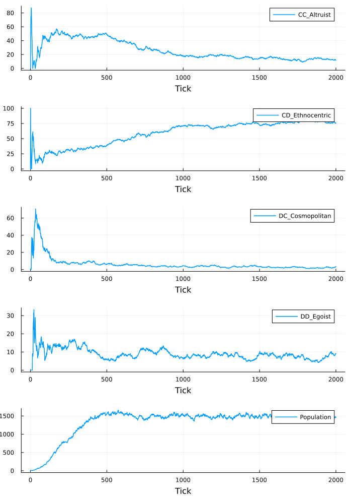
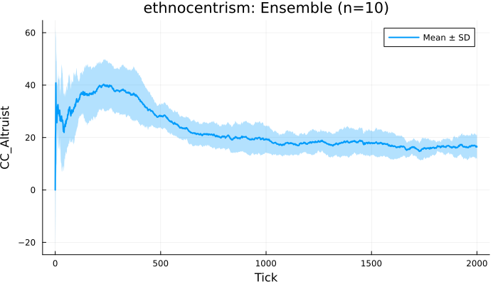
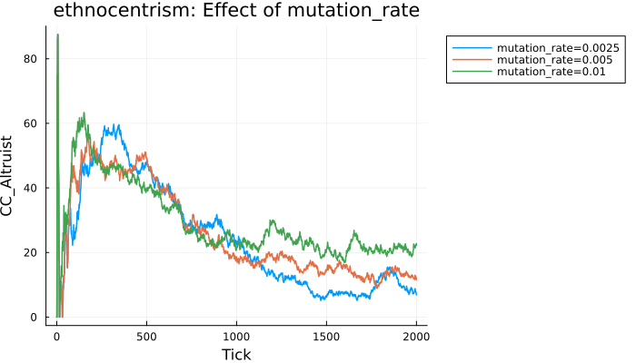

## Overview

### WHAT IS IT?

This model, due to Robert Axelrod and Ross A. Hammond, suggests that "ethnocentric" behavior can evolve under a wide variety of conditions, even when there are no native "ethnocentrics" and no way to differentiate between agent types.  Agents compete for limited space via Prisoner Dilemma's type interactions. "Ethnocentric" agents treat agents within their group more beneficially than those outside their group.  The model includes a mechanism for inheritance (genetic or cultural) of strategies.

### HOW IT WORKS

Each agent has three traits: a) color, b) whether they cooperate with same colored agents, and c) whether they cooperate with different colored agents.  An "ethnocentric" agent is one which cooperates with same colored agents, but does not cooperate with different colored agents. An "altruist" cooperates with all agents, while an "egoist" cooperates with no one.  A "cosmopolitan" cooperates with agents of a different color but not of their own color.

At each time step, the following events occur:

1. Up to IMMIGRANTS-PER-DAY, new agents appear in random locations with random traits.

2. Agents start with an INITIAL-PTR (Potential-To-Reproduce) chance of reproducing.  Each pair of adjacent agents interact in a one-move Prisoner's Dilemma in which each chooses whether or not to help the other.  They either gain, or lose some of their potential to reproduce.

3. In random order, each agent is given a chance to reproduce.  Offspring have the same traits as their parents, with a MUTATION-RATE chance of each trait mutating.  Agents are only allowed to reproduce if there is an empty space next to them.  Each agent's birth-rate is reset to the INITIAL-PTR.

4. The agent has a DEATH-RATE chance of dying, making room for future offspring and immigrants.

### THINGS TO NOTICE

Agents appear as circles if they cooperate with the same color.  They are filled in if they also cooperate with a different color (altruists) or empty if they do not (ethnocentrics).  Agents are squares if they do not cooperate with the same color.  The agents are filled in if they cooperate with a different color (cosmopolitans) or empty if they do not (egoists).

Observe the interaction along the edge of a group of ethnocentric agents, and non-ethnocentric agents.  What behaviors do you see?  Is one more stable?  Does one expand into the other group?

Observer the STRATEGY COUNTS plot.  Does one strategy occur more than others?  What happens when we change the model?

### THINGS TO TRY

Set the IMMIGRANT-CHANCE-COOPERATE sliders both to 1.0.  This means there are only altruists created.  Do ethnocentrics and other strategies ever evolve?  Do they ever out compete the altruists?

Change the values of COST-OF-GIVING and GAIN-OF-RECEIVING and observe the effects on the model and the level of ethnocentricity.

This model comes with a group of BehaviorSpace experiments defined.  You can access them by choosing BehaviorSpace on the Tools menu.  These are the original experiments that Axelrod and Hammond ran to test the robustness of this model. These experiments vary lots of parameters like the size of the world, IMMIGRANTS-PER-DAY and COST-OF-GIVING.  These experiments are detailed at   http://www-personal.umich.edu/~axe/Shared_Files/Axelrod.Hammond/index.htm

### EXTENDING THE MODEL

Add more colors to the model.  Does the behavior change?

Make some patches richer than others, so that agents on them have a higher chance of reproducing.  Distribute this advantage across the world in different ways such as randomly, in blobs, or in quarters.

Tag patches with a color.  distribute the colors across the world in different ways: blobs, randomly, in discrete quarters.  Agents use the patch color under other agents to determine whether to cooperate with them or not.

### NETLOGO FEATURES

To ensure fairness, the agents should run in random order.  Agentsets in NetLogo are always in random order, so no extra code is needed to achieve this.

### RELATED MODELS

* Segregation
 * PD Basic
 * Ethnocentrism - Alternative Visualization

### CREDITS AND REFERENCES

This model is a NetLogo version of the ethnocentrism model presented by Robert Axelrod at Northwestern University at the NICO (Northwestern Institute on Complex Systems) conference on October 25th, 2003.

See also Ross A. Hammond and Robert Axelrod, The Evolution of Ethnocentrism, http://www-personal.umich.edu/~axe/research/AxHamm_Ethno.pdf

### HOW TO CITE

If you mention this model or the NetLogo software in a publication, we ask that you include the citations below.

For the model itself:

* Wilensky, U. (2003).  NetLogo Ethnocentrism model.  http://ccl.northwestern.edu/netlogo/models/Ethnocentrism.  Center for Connected Learning and Computer-Based Modeling, Northwestern University, Evanston, IL.

Please cite the NetLogo software as:

* Wilensky, U. (1999). NetLogo. http://ccl.northwestern.edu/netlogo/. Center for Connected Learning and Computer-Based Modeling, Northwestern University, Evanston, IL.

### COPYRIGHT AND LICENSE

Copyright 2003 Uri Wilensky.


This model is licensed under the Creative Commons Attribution-NonCommercial-ShareAlike 3.0 License.  To view a copy of this license, visit https://creativecommons.org/licenses/by-nc-sa/3.0/ or send a letter to Creative Commons, 559 Nathan Abbott Way, Stanford, California 94305, USA.

NetLogo itself is free software for non-commercial use under the terms of the GNU General Public License ([see full license information here](https://ccl.northwestern.edu/netlogo/docs/copyright.html)).

To inquire about commercial licenses for either NetLogo or specific models from the models library, please contact netlogo-commercial-admin@ccl.northwestern.edu.

This model was created as part of the projects: PARTICIPATORY SIMULATIONS: NETWORK-BASED DESIGN FOR SYSTEMS LEARNING IN CLASSROOMS and/or INTEGRATED SIMULATION AND MODELING ENVIRONMENT. The project gratefully acknowledges the support of the National Science Foundation (REPP & ROLE programs) -- grant numbers REC #9814682 and REC-0126227.

<!-- 2003 -->

## Parameters

| Parameter | Type | Default | Description |
|-----------|------|---------|-------------|
| `mutation_rate` | `Float64` | `0.005` | mutation rate |
| `death_rate` | `Float64` | `0.10` | death rate |
| `immigrants_per_day` | `Int` | `1` | immigrants per day |
| `initial_ptr` | `Float64` | `0.12` | initial ptr |
| `cost_of_giving` | `Float64` | `0.01` | cost of giving |
| `gain_of_receiving` | `Float64` | `0.03` | gain of receiving |
| `immigrant_chance_cooperate_same` | `Float64` | `0.5` | immigrant chance cooperate same |
| `immigrant_chance_cooperate_different` | `Float64` | `0.5` | immigrant chance cooperate different |
| `grid_size` | `Int` | `50` | grid size |
| `max_ticks` | `Int` | `2000` | max ticks |
| `start_full` | `Bool` | `false` | if true, fill entire grid at start |

## Source Code

The Julia code to run this model:

```julia
using ArkModelZoo
_, trajectory = run_ethnocentrism()
```

## Time Series

{width=100%}

## Ensemble Runs

Ten replicates with different random seeds, showing mean ± standard deviation.

{width=100%}

## Parameter Sensitivity

Varying `mutation_rate`.

{width=100%}


## Appendix: Source Code

This model is implemented in the [Ark.jl](https://github.com/sdwfrost/Ark.jl) Entity-Component-System (ECS) framework. The code is split into five files, each with a distinct role:

- **Parameters**: a mutable struct holding all configurable values.
- **Components**: lightweight data types attached to individual entities (agents).
- **Resources**: world-level shared state accessible to all systems.
- **Systems**: functions that operate on entities each tick, defining model behavior.
- **Model**: wiring that assembles the world, registers resources and systems, and provides the run entry point.

### Parameters (`parameters.jl`)

The parameter struct uses `@kwdef` so that every field has a default value and can be overridden by keyword. These defaults match the original NetLogo model's slider settings.

```julia
Base.@kwdef mutable struct EthnocentrismParams
    mutation_rate::Float64 = 0.005
    death_rate::Float64 = 0.10
    immigrants_per_day::Int = 1
    initial_ptr::Float64 = 0.12
    cost_of_giving::Float64 = 0.01
    gain_of_receiving::Float64 = 0.03
    immigrant_chance_cooperate_same::Float64 = 0.5
    immigrant_chance_cooperate_different::Float64 = 0.5
    grid_size::Int = 50
    max_ticks::Int = 2000
    seed::Int = 42
    start_full::Bool = false  # if true, fill entire grid at start
end
```

### Components (`components.jl`)

Components are lightweight data types attached to individual entities (agents). Mutable structs hold per-entity state, while empty tag structs act as markers for the ECS query system to efficiently filter entities.

```julia
# Grid position (integer, Von Neumann neighborhood)
mutable struct EthnoPosition
    x::Int
    y::Int
end
EthnoPosition() = EthnoPosition(0, 0)

# Strategy: cooperate-with-same?, cooperate-with-different?
mutable struct Strategy
    cooperate_with_same::Bool
    cooperate_with_different::Bool
end
Strategy() = Strategy(false, false)

# Agent color (1-4)
mutable struct EthnoColor
    color::Int
end
EthnoColor() = EthnoColor(1)

# Potential to reproduce (accumulated through interactions)
mutable struct PTR
    value::Float64
end
PTR() = PTR(0.0)
```

### Resources (`resources.jl`)

Resources are world-level singletons shared across all systems, used for global state and aggregate statistics.

```julia
# Grid occupancy
mutable struct EthnoGrid
    width::Int
    height::Int
    cells::Matrix{Entity}
end

function EthnoGrid(w::Int, h::Int)
    EthnoGrid(w, h, fill(zero_entity, w, h))
end

# Running statistics
mutable struct EthnoStats
    # Per-tick counts
    meet::Int
    meetown::Int
    meetother::Int
    coopown::Int
    coopother::Int
    defother::Int
    # Strategy percentages (rolling 100-tick window)
    cc_history::Vector{Float64}  # altruist
    cd_history::Vector{Float64}  # ethnocentric
    dc_history::Vector{Float64}  # cosmopolitan
    dd_history::Vector{Float64}  # egoist
    total_population::Int
end

function EthnoStats()
    EthnoStats(0, 0, 0, 0, 0, 0,
               Float64[], Float64[], Float64[], Float64[], 0)
end

function clear_tick_stats!(stats::EthnoStats)
    stats.meet = 0
    stats.meetown = 0
    stats.meetother = 0
    stats.coopown = 0
    stats.coopother = 0
    stats.defother = 0
end
```

### Systems (`systems.jl`)

Systems contain the model logic and execute in a defined order each tick. Each system struct implements either `initialize!` (run once at setup) or `update!` (run every tick).

```julia
# --- Initialization ---

struct InitEthnoSystem <: System end

function _random_ethno_agent!(world::World, rng, params::EthnocentrismParams,
                               grid::EthnoGrid, x::Int, y::Int)
    color = rand(rng, 1:4)
    coop_same = rand(rng) < params.immigrant_chance_cooperate_same
    coop_diff = rand(rng) < params.immigrant_chance_cooperate_different
    eid = new_entity!(world, (
        EthnoPosition(x, y),
        Strategy(coop_same, coop_diff),
        EthnoColor(color),
        PTR(0.0),
    ))
    grid.cells[x, y] = eid
    return eid
end

function initialize!(::InitEthnoSystem, world::World)
    params = get_resource(world, EthnocentrismParams)
    rng = get_resource(world, RNGResource).rng
    grid = get_resource(world, EthnoGrid)

    if params.start_full
        for x in 1:grid.width, y in 1:grid.height
            _random_ethno_agent!(world, rng, params, grid, x, y)
        end
    end
    return nothing
end

# --- Immigration ---

struct ImmigrationSystem <: System end

function update!(::ImmigrationSystem, world::World)
    params = get_resource(world, EthnocentrismParams)
    rng = get_resource(world, RNGResource).rng
    grid = get_resource(world, EthnoGrid)

    # Collect empty cells
    empties = Tuple{Int,Int}[]
    for x in 1:grid.width, y in 1:grid.height
        is_zero(grid.cells[x, y]) && push!(empties, (x, y))
    end

    isempty(empties) && return nothing

    for _ in 1:params.immigrants_per_day
        isempty(empties) && break
        idx = rand(rng, 1:length(empties))
        x, y = empties[idx]
        _random_ethno_agent!(world, rng, params, grid, x, y)
        deleteat!(empties, idx)
    end
    return nothing
end

# --- Interaction ---

struct InteractionSystem <: System end

function update!(::InteractionSystem, world::World)
    params = get_resource(world, EthnocentrismParams)
    grid = get_resource(world, EthnoGrid)
    stats = get_resource(world, EthnoStats)
    clear_tick_stats!(stats)
    w, h = grid.width, grid.height

    # Set PTR to initial value for all agents
    for (_, _, ptrs) in Query(world, (EthnoPosition, PTR))
        @inbounds for i in eachindex(ptrs)
            ptrs[i].value = params.initial_ptr
        end
    end

    # Von Neumann neighbors (N, S, E, W)
    offsets = [(0, 1), (0, -1), (1, 0), (-1, 0)]

    for (eids, positions, strategies, colors, ptrs) in Query(world, (EthnoPosition, Strategy, EthnoColor, PTR))
        @inbounds for i in eachindex(positions)
            pos = positions[i]
            my_color = colors[i].color
            my_strategy = strategies[i]

            for (dx, dy) in offsets
                nx = pos.x + dx
                ny = pos.y + dy
                # Wrap toroidal
                nx = mod1(nx, w)
                ny = mod1(ny, h)

                neighbor_eid = grid.cells[nx, ny]
                is_zero(neighbor_eid) && continue

                stats.meet += 1
                neighbor_color = get_components(world, neighbor_eid, (EthnoColor,))[1]
                neighbor_ptr = get_components(world, neighbor_eid, (PTR,))[1]
                same_group = my_color == neighbor_color.color

                if same_group
                    stats.meetown += 1
                    if my_strategy.cooperate_with_same
                        ptrs[i].value -= params.cost_of_giving
                        neighbor_ptr.value += params.gain_of_receiving
                        stats.coopown += 1
                    end
                else
                    stats.meetother += 1
                    if my_strategy.cooperate_with_different
                        ptrs[i].value -= params.cost_of_giving
                        neighbor_ptr.value += params.gain_of_receiving
                        stats.coopother += 1
                    else
                        stats.defother += 1
                    end
                end
            end
        end
    end
    return nothing
end

# --- Reproduction ---

mutable struct EthnoReproductionSystem <: System
    to_spawn::Vector{Tuple{Int, Int, Int, Bool, Bool}}  # (x, y, color, coop_same, coop_diff)
end
EthnoReproductionSystem() = EthnoReproductionSystem(Tuple{Int,Int,Int,Bool,Bool}[])

function update!(system::EthnoReproductionSystem, world::World)
    params = get_resource(world, EthnocentrismParams)
    rng = get_resource(world, RNGResource).rng
    grid = get_resource(world, EthnoGrid)
    w, h = grid.width, grid.height
    offsets = [(0, 1), (0, -1), (1, 0), (-1, 0)]

    empty!(system.to_spawn)

    for (_, positions, strategies, colors, ptrs) in Query(world, (EthnoPosition, Strategy, EthnoColor, PTR))
        @inbounds for i in eachindex(positions)
            ptrs[i].value <= 0.0 && continue
            rand(rng) >= ptrs[i].value && continue

            # Find empty neighbor
            pos = positions[i]
            neighbors = Tuple{Int,Int}[]
            for (dx, dy) in offsets
                nx = mod1(pos.x + dx, w)
                ny = mod1(pos.y + dy, h)
                is_zero(grid.cells[nx, ny]) && push!(neighbors, (nx, ny))
            end
            isempty(neighbors) && continue

            nx, ny = neighbors[rand(rng, 1:length(neighbors))]

            # Offspring inherits parent traits with mutation
            child_color = colors[i].color
            child_coop_same = strategies[i].cooperate_with_same
            child_coop_diff = strategies[i].cooperate_with_different

            if rand(rng) < params.mutation_rate
                child_color = rand(rng, 1:4)
            end
            if rand(rng) < params.mutation_rate
                child_coop_same = !child_coop_same
            end
            if rand(rng) < params.mutation_rate
                child_coop_diff = !child_coop_diff
            end

            push!(system.to_spawn, (nx, ny, child_color, child_coop_same, child_coop_diff))
        end
    end

    for (x, y, color, cs, cd) in system.to_spawn
        !is_zero(grid.cells[x, y]) && continue
        eid = new_entity!(world, (
            EthnoPosition(x, y),
            Strategy(cs, cd),
            EthnoColor(color),
            PTR(0.0),
        ))
        grid.cells[x, y] = eid
    end
    return nothing
end

# --- Death ---

struct EthnoDeathSystem <: System
    to_remove::Vector{Entity}
end
EthnoDeathSystem() = EthnoDeathSystem(Entity[])

function update!(system::EthnoDeathSystem, world::World)
    params = get_resource(world, EthnocentrismParams)
    rng = get_resource(world, RNGResource).rng
    grid = get_resource(world, EthnoGrid)
    empty!(system.to_remove)

    for (eids, positions) in Query(world, (EthnoPosition,))
        @inbounds for i in eachindex(positions)
            if rand(rng) < params.death_rate
                push!(system.to_remove, eids[i])
            end
        end
    end

    for e in system.to_remove
        if is_alive(world, e)
            pos = get_components(world, e, (EthnoPosition,))[1]
            grid.cells[pos.x, pos.y] = zero_entity
            remove_entity!(world, e)
        end
    end
    return nothing
end

# --- Statistics ---

struct EthnoStatsSystem <: System end

function update!(::EthnoStatsSystem, world::World)
    stats = get_resource(world, EthnoStats)
    cc = 0; cd = 0; dc = 0; dd = 0; total = 0

    for (_, _, strategies) in Query(world, (EthnoPosition, Strategy))
        @inbounds for i in eachindex(strategies)
            total += 1
            s = strategies[i]
            if s.cooperate_with_same && s.cooperate_with_different
                cc += 1  # altruist
            elseif s.cooperate_with_same && !s.cooperate_with_different
                cd += 1  # ethnocentric
            elseif !s.cooperate_with_same && s.cooperate_with_different
                dc += 1  # cosmopolitan
            else
                dd += 1  # egoist
            end
        end
    end

    stats.total_population = total
    if total > 0
        push!(stats.cc_history, cc / total * 100.0)
        push!(stats.cd_history, cd / total * 100.0)
        push!(stats.dc_history, dc / total * 100.0)
        push!(stats.dd_history, dd / total * 100.0)
        # Keep rolling window of 100
        if length(stats.cc_history) > 100
            popfirst!(stats.cc_history)
            popfirst!(stats.cd_history)
            popfirst!(stats.dc_history)
            popfirst!(stats.dd_history)
        end
    end
    return nothing
end

# --- Termination ---

struct EthnoTerminationSystem <: System end

function update!(::EthnoTerminationSystem, world::World)
    params = get_resource(world, EthnocentrismParams)
    tick = get_resource(world, Tick)
    if tick.tick + 1 >= params.max_ticks
        get_resource(world, Terminate).stop = true
    end
    return nothing
end
```

### Model (`model.jl`)

The model file assembles all pieces: it creates the ECS `World` with the required component types, registers resources, builds the `Scheduler` with systems in execution order, and exposes the public `run` entry point. The observer pattern records the trajectory each tick.

```julia
function ethnocentrism_world(; initial_capacity::Int = 4096)
    return World(
        EthnoPosition,
        Strategy,
        EthnoColor,
        PTR;
        initial_capacity = initial_capacity,
        allow_mutable = true,
    )
end

function ethnocentrism_systems()
    return (
        InitEthnoSystem(),
        ImmigrationSystem(),
        InteractionSystem(),
        EthnoReproductionSystem(),
        EthnoDeathSystem(),
        EthnoStatsSystem(),
        EthnoTerminationSystem(),
    )
end

function ethnocentrism_model(params::EthnocentrismParams = EthnocentrismParams())
    world = ethnocentrism_world()
    _add_standard_resources!(world, params)
    add_resource!(world, EthnoGrid(params.grid_size, params.grid_size))
    add_resource!(world, EthnoStats())
    scheduler = Scheduler(world, ethnocentrism_systems())
    initialize!(scheduler)
    return scheduler
end

struct EthnocentrismObserver end

function ethnocentrism_headers(::EthnocentrismObserver)
    return ["CC_Altruist", "CD_Ethnocentric", "DC_Cosmopolitan", "DD_Egoist", "Population"]
end

function ethnocentrism_values(::EthnocentrismObserver, world::World)
    stats = get_resource(world, EthnoStats)
    cc = isempty(stats.cc_history) ? 0.0 : last(stats.cc_history)
    cd = isempty(stats.cd_history) ? 0.0 : last(stats.cd_history)
    dc = isempty(stats.dc_history) ? 0.0 : last(stats.dc_history)
    dd = isempty(stats.dd_history) ? 0.0 : last(stats.dd_history)
    return Float64[cc, cd, dc, dd, stats.total_population]
end

function run_ethnocentrism(; params::EthnocentrismParams = EthnocentrismParams(), observe::Bool = true)
    return _run_model(ethnocentrism_model, EthnocentrismObserver(), ethnocentrism_values; params, observe)
end
```
