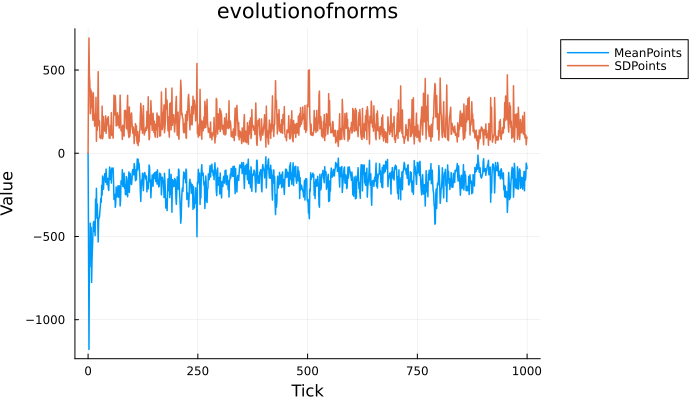
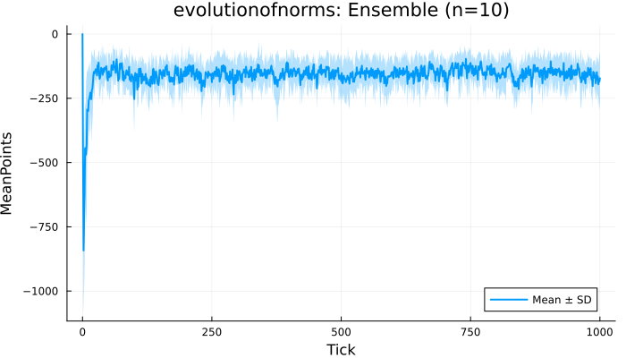
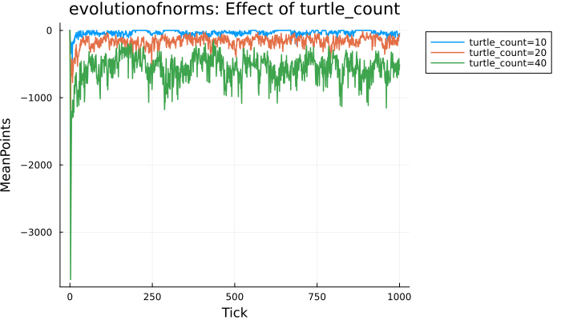

## Overview

### WHAT IS IT?

Model constructed based on Axelrod (1986) An Evolutionary Approach to Norms. Axelrod's proposed norms game provides a game-theoretic/evolutionary simulation of how norms might evolve in a community based on negative feedback through punishment.

### HOW IT WORKS

20 agents are created with random boldness and vengefulness of 0-7. With each run, an agent has four opportunities to "defect" (ie. carry out a negative behaviour) based on their boldness and a random likeliness of being caught. a defection carries a positive score of 3 and a loss of 1 to all other agents.

If other agents observe the defection they choose to punish it with a likelihood based on their vengefulness level. Punishment is -9 to the defecting agent, with a -2 cost to the punishing agent.

In the "metanorms" condition, agents are also punished if they chose not to punish an observed defector.

After each round, the agents with the best scores reproduce the most (i.e. carry their boldness and vengefulness levels through to the next run). There is also a 1% likelihood of mutation.

### THINGS TO NOTICE

According to Axelrod, the model will either converge on zero boldness and some vengefulness (due to the cost of being punished), or a full norm violation condition where all agents defect and boldness becomes maximised (and no one is being punished as they are all at it!). In my test, the latter condition only arises rarely.

In the metanorms condition, convergence on a stable state of high vengefulness is more rapid and predictable - as enacting a punishment is reinforced.

### THINGS TO TRY

Try repeating the 100 runs and note how sometimes a mutation seems to lead to 100% defections by the end, though usually it converges on low boldness and mid vengefulness.

### CREDITS AND REFERENCES

v1.0 Paul Matthews, 2015. University of the West of England. paul2.matthews@uwe.ac.uk

AXELROD, R., 1986. An Evolutionary Approach to Norms. The American Political Science Review, 80(4), pp. 1095-1111

## Parameters

| Parameter | Type | Default | Description |
|-----------|------|---------|-------------|
| `turtle_count` | `Int` | `20` | turtle count |
| `metanorm` | `Bool` | `true` | metanorm |
| `max_ticks` | `Int` | `1000` | max ticks |

## Source Code

The Julia code to run this model:

```julia
using ArkModelZoo
_, trajectory = run_evolutionofnorms()
```

## Time Series

{width=100%}

## Ensemble Runs

Ten replicates with different random seeds, showing mean ± standard deviation.

{width=100%}

## Parameter Sensitivity

Varying `turtle_count`.

{width=100%}


## Appendix: Source Code

This model is implemented in the [Ark.jl](https://github.com/sdwfrost/Ark.jl) Entity-Component-System (ECS) framework. The code is split into five files, each with a distinct role:

- **Parameters**: a mutable struct holding all configurable values.
- **Components**: lightweight data types attached to individual entities (agents).
- **Resources**: world-level shared state accessible to all systems.
- **Systems**: functions that operate on entities each tick, defining model behavior.
- **Model**: wiring that assembles the world, registers resources and systems, and provides the run entry point.

### Parameters (`parameters.jl`)

The parameter struct uses `@kwdef` so that every field has a default value and can be overridden by keyword. These defaults match the original NetLogo model's slider settings.

```julia
Base.@kwdef mutable struct NormParams
    turtle_count::Int = 20
    metanorm::Bool = true
    max_ticks::Int = 1000
    seed::Int = 42
end
```

### Components (`components.jl`)

Components are lightweight data types attached to individual entities (agents). Mutable structs hold per-entity state, while empty tag structs act as markers for the ECS query system to efficiently filter entities.

```julia
# Agent traits: boldness (0-7), vengefulness (0-7), accumulated points, seen value
mutable struct NormAgent
    boldness::Int
    vengefulness::Int
    points::Float64
    seen::Float64
end
NormAgent() = NormAgent(0, 0, 0.0, 0.0)
```

### Resources (`resources.jl`)

Resources are world-level singletons shared across all systems, used for global state and aggregate statistics.

```julia
mutable struct NormStats
    mean_points::Float64
    sd_points::Float64
    defections::Int
end
NormStats() = NormStats(0.0, 0.0, 0)
```

### Systems (`systems.jl`)

Systems contain the model logic and execute in a defined order each tick. Each system struct implements either `initialize!` (run once at setup) or `update!` (run every tick).

```julia
# --- Initialization ---

struct InitNormSystem <: System end

function initialize!(::InitNormSystem, world::World)
    params = get_resource(world, NormParams)
    rng = get_resource(world, RNGResource).rng

    for _ in 1:params.turtle_count
        new_entity!(world, (NormAgent(rand(rng, 0:7), rand(rng, 0:7), 0.0, 0.0),))
    end
    return nothing
end

# --- Interaction ---
# Each turtle repeats 4 rounds. May defect, others may punish/meta-punish.
# Points are modified in real-time. seen? is a turtle-own used as observation probability.

mutable struct NormInteractionSystem <: System
    entities::Vector{Tuple{Entity, Int}}  # (eid, index into agents array)
    agents::Vector{NormAgent}             # cached references
    agent_eids::Vector{Entity}            # all entity IDs
end
NormInteractionSystem() = NormInteractionSystem(
    Tuple{Entity, Int}[], NormAgent[], Entity[],
)

function update!(system::NormInteractionSystem, world::World)
    params = get_resource(world, NormParams)
    rng = get_resource(world, RNGResource).rng
    stats = get_resource(world, NormStats)
    stats.defections = 0

    # Collect all agents into a flat array for O(1) random access
    empty!(system.agents)
    empty!(system.agent_eids)
    for (eids, agents) in Query(world, (NormAgent,))
        @inbounds for i in eachindex(agents)
            push!(system.agents, agents[i])
            push!(system.agent_eids, eids[i])
        end
    end

    n = length(system.agents)
    n == 0 && return nothing

    # Random order for outer ask
    order = randperm(rng, n)

    for idx in order
        agent = system.agents[idx]

        for _ in 1:4
            punishcount = 0
            metapunishcount = 0
            agent.seen = rand(rng)

            if agent.seen < agent.boldness / 7.0
                # Defect: gain 3 points
                agent.points += 3.0
                stats.defections += 1

                # ask other turtles (random order)
                other_order = randperm(rng, n)
                for oidx in other_order
                    oidx == idx && continue  # skip self

                    other = system.agents[oidx]
                    other.points -= 1.0  # all others lose 1

                    # Observation: uses OTHER turtle's seen value
                    if rand(rng) < other.seen
                        punish_roll = rand(rng)
                        if other.vengefulness / 7.0 > punish_roll
                            # Punish
                            punishcount += 1
                            other.points -= 2.0
                        else
                            # Non-punisher may get meta-punished
                            if params.metanorm
                                metapunishcount = 0
                                # ask other turtles of the non-punisher
                                meta_order = randperm(rng, n)
                                for midx in meta_order
                                    midx == oidx && continue  # skip non-punisher
                                    meta_agent = system.agents[midx]
                                    if rand(rng) < meta_agent.seen
                                        metapunishcount += 1
                                        meta_agent.points -= 2.0
                                    end
                                end
                                other.points -= 9.0 * metapunishcount
                            end
                        end
                    end
                end
                agent.points -= 9.0 * punishcount
            end
        end
    end
    return nothing
end

# --- Reproduction ---
# All turtles die. High fitness → hatch 2, medium → 1, low → 0.
# Population adjusted to turtle_count. Then 1% mutation.

mutable struct NormReproductionSystem <: System
    offspring::Vector{Tuple{Int, Int, Float64}}  # (boldness, vengefulness, seen)
end
NormReproductionSystem() = NormReproductionSystem(Tuple{Int, Int, Float64}[])

function update!(system::NormReproductionSystem, world::World)
    params = get_resource(world, NormParams)
    rng = get_resource(world, RNGResource).rng
    stats = get_resource(world, NormStats)

    # Collect agents and compute stats
    agents = NormAgent[]
    eids = Entity[]
    for (es, avs) in Query(world, (NormAgent,))
        @inbounds for i in eachindex(avs)
            push!(agents, avs[i])
            push!(eids, es[i])
        end
    end

    n = length(agents)
    n == 0 && return nothing

    points = [a.points for a in agents]
    mn = sum(points) / n
    sd = n > 1 ? sqrt(sum((p - mn)^2 for p in points) / (n - 1)) : 0.0

    # NetLogo uses population std dev (not sample), but let's check:
    # standard-deviation in NetLogo uses N-1 denominator (sample std dev)
    # Actually, NetLogo standard-deviation uses N-1. So the above is correct.
    stats.mean_points = mn
    stats.sd_points = sd

    empty!(system.offspring)

    # Process in random order (ask turtles)
    order = randperm(rng, n)
    for idx in order
        a = agents[idx]
        if a.points >= mn + sd
            push!(system.offspring, (a.boldness, a.vengefulness, a.seen))
            push!(system.offspring, (a.boldness, a.vengefulness, a.seen))
        elseif a.points >= mn - sd
            push!(system.offspring, (a.boldness, a.vengefulness, a.seen))
        end
        # All turtles die (handled below)
    end

    # Remove all current turtles
    for e in eids
        is_alive(world, e) && remove_entity!(world, e)
    end

    # Spawn offspring (inherit seen from parent, as NetLogo hatch inherits turtle-owns)
    for (b, v, s) in system.offspring
        new_entity!(world, (NormAgent(b, v, 0.0, s),))
    end

    # Adjust population to turtle_count
    current_count = length(system.offspring)
    diff = params.turtle_count - current_count

    if diff < 0
        # Too many: kill newest (highest who → last spawned)
        new_eids = Entity[]
        for (es, _) in Query(world, (NormAgent,))
            @inbounds for i in eachindex(es)
                push!(new_eids, es[i])
            end
        end
        # Remove from end (newest entities)
        for _ in 1:(-diff)
            isempty(new_eids) && break
            e = pop!(new_eids)
            is_alive(world, e) && remove_entity!(world, e)
        end
    elseif diff > 0
        # Too few: add random agents
        for _ in 1:diff
            new_entity!(world, (NormAgent(rand(rng, 0:7), rand(rng, 0:7), 0.0, 0.0),))
        end
    end

    # 1% mutation on boldness and vengefulness
    for (_, avs) in Query(world, (NormAgent,))
        @inbounds for i in eachindex(avs)
            if rand(rng) <= 0.01
                avs[i].boldness = rand(rng, 0:7)
            end
            if rand(rng) <= 0.01
                avs[i].vengefulness = rand(rng, 0:7)
            end
        end
    end
    return nothing
end

# --- Stats (computed in reproduction) ---

struct NormStatsSystem <: System end
function update!(::NormStatsSystem, world::World)
    return nothing
end

# --- Termination ---

struct NormTerminationSystem <: System end

function update!(::NormTerminationSystem, world::World)
    params = get_resource(world, NormParams)
    tick = get_resource(world, Tick)
    if tick.tick + 1 >= params.max_ticks
        get_resource(world, Terminate).stop = true
    end
    return nothing
end
```

### Model (`model.jl`)

The model file assembles all pieces: it creates the ECS `World` with the required component types, registers resources, builds the `Scheduler` with systems in execution order, and exposes the public `run` entry point. The observer pattern records the trajectory each tick.

```julia
function evolutionofnorms_world(; initial_capacity::Int = 256)
    return World(
        NormAgent;
        initial_capacity = initial_capacity,
        allow_mutable = true,
    )
end

function evolutionofnorms_systems()
    return (
        InitNormSystem(),
        NormInteractionSystem(),
        NormReproductionSystem(),
        NormStatsSystem(),
        NormTerminationSystem(),
    )
end

function evolutionofnorms_model(params::NormParams = NormParams())
    world = evolutionofnorms_world()
    _add_standard_resources!(world, params)
    add_resource!(world, NormStats())
    scheduler = Scheduler(world, evolutionofnorms_systems())
    initialize!(scheduler)
    return scheduler
end

struct NormObserver end

function norm_headers(::NormObserver)
    return ["MeanPoints", "SDPoints"]
end

function norm_values(::NormObserver, world::World)
    stats = get_resource(world, NormStats)
    return Float64[stats.mean_points, stats.sd_points]
end

function run_evolutionofnorms(; params::NormParams = NormParams(), observe::Bool = true)
    return _run_model(evolutionofnorms_model, NormObserver(), norm_values; params, observe)
end
```
