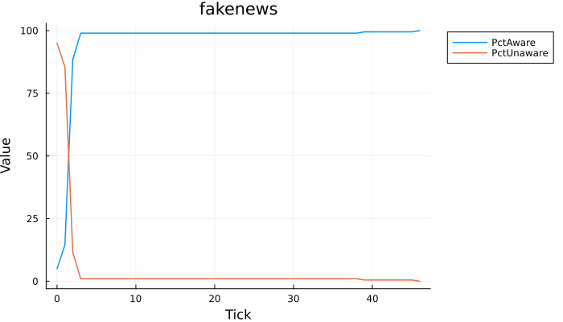
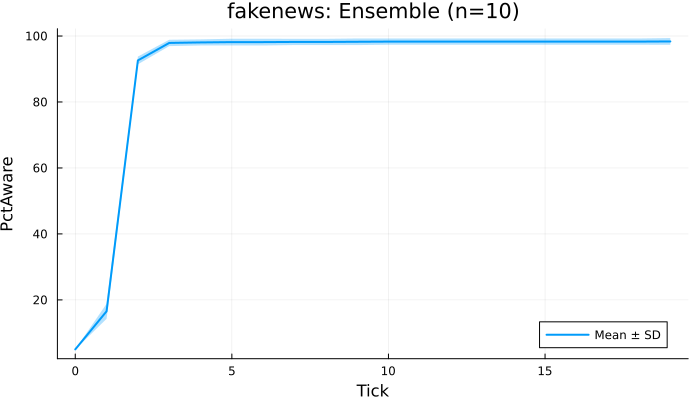
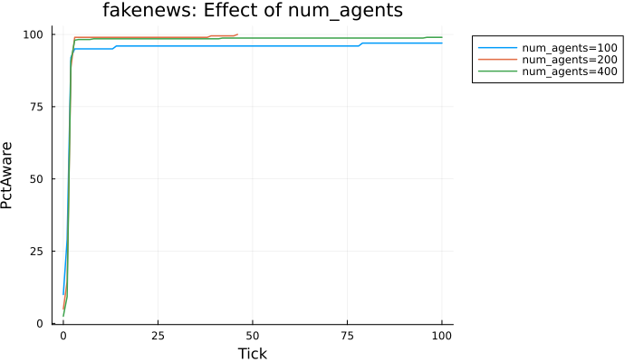

# Spread of Fake News


- [Overview](#overview)
- [Parameters](#parameters)
- [Source Code](#source-code)
- [Time Series](#time-series)
- [Ensemble Runs](#ensemble-runs)
- [Parameter Sensitivity](#parameter-sensitivity)
- [Appendix: Source Code](#appendix-source-code)
  - [Parameters (`parameters.jl`)](#parameters-parametersjl)
  - [Components (`components.jl`)](#components-componentsjl)
  - [Resources (`resources.jl`)](#resources-resourcesjl)
  - [Systems (`systems.jl`)](#systems-systemsjl)
  - [Model (`model.jl`)](#model-modeljl)

## Overview

This vignette demonstrates the **Spread of Fake News** model implemented
in [ArkModelZoo.jl](https://github.com/sdwfrost/ArkModelZoo.jl) using
the Ark.jl ECS framework.

## Parameters

| Parameter             | Type      | Default | Description         |
|-----------------------|-----------|---------|---------------------|
| `num_agents`          | `Int`     | `200`   | num agents          |
| `mean_degree`         | `Int`     | `4`     | mean degree         |
| `num_seed_informers`  | `Int`     | `10`    | num seed informers  |
| `broadcast_influence` | `Float64` | `0.01`  | broadcast influence |
| `influence_rate`      | `Float64` | `0.3`   | influence rate      |
| `max_ticks`           | `Int`     | `100`   | max ticks           |

## Source Code

The Julia code to run this model:

``` julia
using ArkModelZoo
_, trajectory = run_fakenews()
```

## Time Series



## Ensemble Runs

Ten replicates with different random seeds, showing mean ± standard
deviation.



## Parameter Sensitivity

Varying `num_agents`.



## Appendix: Source Code

This model is implemented in the
[Ark.jl](https://github.com/sdwfrost/Ark.jl) Entity-Component-System
(ECS) framework. The code is split into five files, each with a distinct
role:

- **Parameters**: a mutable struct holding all configurable values.
- **Components**: lightweight data types attached to individual entities
  (agents).
- **Resources**: world-level shared state accessible to all systems.
- **Systems**: functions that operate on entities each tick, defining
  model behavior.
- **Model**: wiring that assembles the world, registers resources and
  systems, and provides the run entry point.

### Parameters (`parameters.jl`)

The parameter struct uses `@kwdef` so that every field has a default
value and can be overridden by keyword. These defaults match the
original NetLogo model’s slider settings.

``` julia
Base.@kwdef mutable struct FNewsParams
    num_agents::Int = 200
    mean_degree::Int = 4
    num_seed_informers::Int = 10
    broadcast_influence::Float64 = 0.01
    influence_rate::Float64 = 0.3
    max_ticks::Int = 100
    seed::Int = 42
end
```

### Components (`components.jl`)

Components are lightweight data types attached to individual entities
(agents). Mutable structs hold per-entity state, while empty tag structs
act as markers for the ECS query system to efficiently filter entities.

``` julia
struct FNewsDummy end
```

### Resources (`resources.jl`)

Resources are world-level singletons shared across all systems, used for
global state and aggregate statistics.

``` julia
mutable struct FNewsNetwork
    n_agents::Int
    aware::Vector{Bool}
    seed_agent::Vector{Bool}
    tick_become_aware::Vector{Int}
    adj::Vector{Set{Int}}
end

function FNewsNetwork()
    FNewsNetwork(0, Bool[], Bool[], Int[], Set{Int}[])
end

function _fnews_add_agent!(net::FNewsNetwork)
    push!(net.aware, false)
    push!(net.seed_agent, false)
    push!(net.tick_become_aware, 0)
    push!(net.adj, Set{Int}())
    net.n_agents += 1
    return net.n_agents
end

function _fnews_add_edge!(net::FNewsNetwork, i::Int, j::Int)
    if j ∉ net.adj[i]
        push!(net.adj[i], j)
        push!(net.adj[j], i)
    end
end

mutable struct FNewsStats
    pct_aware::Float64
    pct_unaware::Float64
end
FNewsStats() = FNewsStats(0.0, 0.0)
```

### Systems (`systems.jl`)

Systems contain the model logic and execute in a defined order each
tick. Each system struct implements either `initialize!` (run once at
setup) or `update!` (run every tick).

``` julia
# Fake News — cascade/Bass info diffusion on Erdős-Rényi network

struct InitFNewsSystem <: System end

function _fnews_build_er!(net::FNewsNetwork, rng, n::Int, p::Float64)
    for _ in 1:n
        _fnews_add_agent!(net)
    end
    for i in 1:n, j in (i+1):n
        if rand(rng) < p
            _fnews_add_edge!(net, i, j)
        end
    end
end

function initialize!(::InitFNewsSystem, world::World)
    params = get_resource(world, FNewsParams)
    rng    = get_resource(world, RNGResource).rng
    net    = get_resource(world, FNewsNetwork)
    stats  = get_resource(world, FNewsStats)

    # Erdős-Rényi graph
    edge_prob = (2.0 * params.mean_degree) / (params.num_agents - 1)
    _fnews_build_er!(net, rng, params.num_agents, edge_prob)

    # Select seed informers
    indices = shuffle!(rng, collect(1:net.n_agents))
    for k in 1:min(params.num_seed_informers, net.n_agents)
        i = indices[k]
        net.aware[i] = true
        net.seed_agent[i] = true
        net.tick_become_aware[i] = -1
    end

    _fnews_update_stats!(net, stats)
    return nothing
end

function _fnews_update_stats!(net::FNewsNetwork, stats::FNewsStats)
    n_aware = count(net.aware)
    n = net.n_agents
    stats.pct_aware   = n > 0 ? n_aware / n * 100.0 : 0.0
    stats.pct_unaware = n > 0 ? (n - n_aware) / n * 100.0 : 0.0
end

# --- Cascade spread + broadcast ---
struct FNewsGoSystem <: System end

function update!(::FNewsGoSystem, world::World)
    params = get_resource(world, FNewsParams)
    rng    = get_resource(world, RNGResource).rng
    net    = get_resource(world, FNewsNetwork)
    stats  = get_resource(world, FNewsStats)
    tick   = get_resource(world, Tick)

    # Cascade: ask turtles with [tick-become-aware = (ticks - 1)] [pass-adopt]
    # NetLogo: build filtered agentset FIRST, then shuffle ONLY matching agents
    cascade_agents = [i for i in 1:net.n_agents if net.tick_become_aware[i] == tick.tick - 1]
    shuffle!(rng, cascade_agents)
    for i in cascade_agents
        # pass-adopt: ask link-neighbors with [not aware?] — shuffled
        unadopted = Int[]
        for j in net.adj[i]
            !net.aware[j] && push!(unadopted, j)
        end
        shuffle!(rng, unadopted)
        for j in unadopted
            if rand(rng) < params.influence_rate
                net.aware[j] = true
                net.tick_become_aware[j] = tick.tick
            end
        end
    end

    # Broadcast: ask turtles with [not aware?] [adopt] — shuffled
    unaware_agents = [i for i in 1:net.n_agents if !net.aware[i]]
    shuffle!(rng, unaware_agents)
    for i in unaware_agents
        if rand(rng) < params.broadcast_influence
            net.aware[i] = true
            net.tick_become_aware[i] = tick.tick
        end
    end

    _fnews_update_stats!(net, stats)
    return nothing
end

# --- Termination ---
struct FNewsTerminationSystem <: System end

function update!(::FNewsTerminationSystem, world::World)
    params = get_resource(world, FNewsParams)
    tick   = get_resource(world, Tick)
    net    = get_resource(world, FNewsNetwork)

    all_aware = all(net.aware)
    if all_aware || tick.tick + 1 >= params.max_ticks
        get_resource(world, Terminate).stop = true
    end
    return nothing
end
```

### Model (`model.jl`)

The model file assembles all pieces: it creates the ECS `World` with the
required component types, registers resources, builds the `Scheduler`
with systems in execution order, and exposes the public `run` entry
point. The observer pattern records the trajectory each tick.

``` julia
function fakenews_world(; initial_capacity::Int = 128)
    return World(FNewsDummy; initial_capacity = initial_capacity, allow_mutable = true)
end

function fakenews_systems()
    return (InitFNewsSystem(), FNewsGoSystem(), FNewsTerminationSystem())
end

function fakenews_model(params::FNewsParams = FNewsParams())
    world = fakenews_world()
    _add_standard_resources!(world, params)
    add_resource!(world, FNewsNetwork())
    add_resource!(world, FNewsStats())
    scheduler = Scheduler(world, fakenews_systems())
    initialize!(scheduler)
    return scheduler
end

struct FNewsObserver end

function fakenews_headers(::FNewsObserver)
    return ["PctAware", "PctUnaware"]
end

function fakenews_values(::FNewsObserver, world::World)
    stats = get_resource(world, FNewsStats)
    return Float64[stats.pct_aware, stats.pct_unaware]
end

function run_fakenews(; params::FNewsParams = FNewsParams(), observe::Bool = true)
    return _run_model(fakenews_model, FNewsObserver(), fakenews_values; params, observe)
end
```
