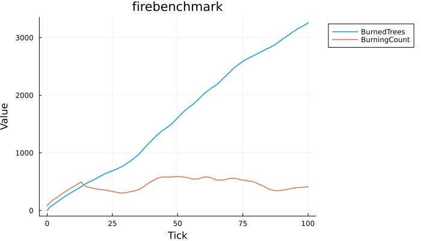
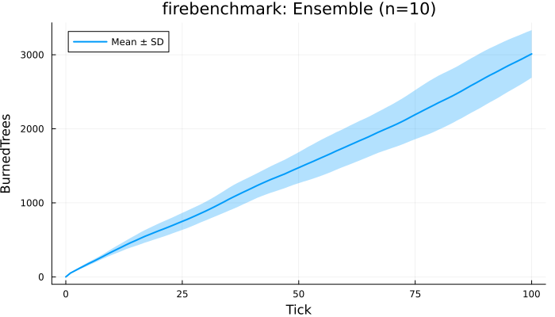
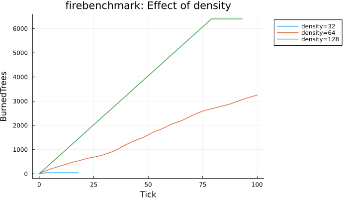

# FireBenchmark


- [Overview](#overview)
  - [WHAT IS IT?](#what-is-it)
  - [HOW IT WORKS](#how-it-works)
  - [THINGS TO NOTICE](#things-to-notice)
  - [THINGS TO TRY](#things-to-try)
  - [EXTENDING THE MODEL](#extending-the-model)
  - [NETLOGO FEATURES](#netlogo-features)
  - [RELATED MODELS](#related-models)
  - [CREDITS AND REFERENCES](#credits-and-references)
  - [HOW TO CITE](#how-to-cite)
  - [COPYRIGHT AND LICENSE](#copyright-and-license)
- [Parameters](#parameters)
- [Source Code](#source-code)
- [Time Series](#time-series)
- [Ensemble Runs](#ensemble-runs)
- [Parameter Sensitivity](#parameter-sensitivity)
- [Appendix: Source Code](#appendix-source-code)
  - [Parameters (`parameters.jl`)](#parameters-parametersjl)
  - [Components (`components.jl`)](#components-componentsjl)
  - [Resources (`resources.jl`)](#resources-resourcesjl)
  - [Systems (`systems.jl`)](#systems-systemsjl)
  - [Model (`model.jl`)](#model-modeljl)

## Overview

### WHAT IS IT?

This project simulates the spread of a fire through a forest. It shows
that the fire’s chance of reaching the right edge of the forest depends
critically on the density of trees. This is an example of a common
feature of complex systems, the presence of a non-linear threshold or
critical parameter.

### HOW IT WORKS

The fire starts on the left edge of the forest, and spreads to
neighboring trees. The fire spreads in four directions: north, east,
south, and west.

The model assumes there is no wind. So, the fire must have trees along
its path in order to advance. That is, the fire cannot skip over an
unwooded area (patch), so such a patch blocks the fire’s motion in that
direction.

### THINGS TO NOTICE

When you run the model, how much of the forest burns. If you run it
again with the same settings, do the same trees burn? How similar is the
burn from run to run?

Each turtle that represents a piece of the fire is born and then dies
without ever moving. If the fire is made of turtles but no turtles are
moving, what does it mean to say that the fire moves? This is an example
of different levels in a system: at the level of the individual turtles,
there is no motion, but at the level of the turtles collectively over
time, the fire moves.

### THINGS TO TRY

Set the density of trees to 55%. At this setting, there is virtually no
chance that the fire will reach the right edge of the forest. Set the
density of trees to 70%. At this setting, it is almost certain that the
fire will reach the right edge. There is a sharp transition around 59%
density. At 59% density, the fire has a 50/50 chance of reaching the
right edge.

Try setting up and running a BehaviorSpace experiment (see Tools menu)
to analyze the percent burned at different tree density levels. Plot the
burn-percentage against the density. What kind of curve do you get?

Try changing the size of the lattice (`max-pxcor` and `max-pycor` in the
Model Settings). Does it change the burn behavior of the fire?

### EXTENDING THE MODEL

What if the fire could spread in eight directions (including diagonals)?
To do that, use `neighbors` instead of `neighbors4`. How would that
change the fire’s chances of reaching the right edge? In this model,
what “critical density” of trees is needed for the fire to propagate?

Add wind to the model so that the fire can “jump” greater distances in
certain directions.

Add the ability to plant trees where you want them. What configurations
of trees allow the fire to cross the forest? Which don’t? Why is over
59% density likely to result in a tree configuration that works? Why
does the likelihood of such a configuration increase so rapidly at the
59% density?

The physicist Per Bak asked why we frequently see systems undergoing
critical changes. He answers this by proposing the concept of
\[self-organzing criticality\]
(https://en.wikipedia.org/wiki/Self-organized_criticality) (SOC). Can
you create a version of the fire model that exhibits SOC?

### NETLOGO FEATURES

Unburned trees are represented by green patches; burning trees are
represented by turtles. Two breeds of turtles are used, “fires” and
“embers”. When a tree catches fire, a new fire turtle is created; a fire
turns into an ember on the next turn. Notice how the program gradually
darkens the color of embers to achieve the visual effect of burning out.

The `neighbors4` primitive is used to spread the fire.

You could also write the model without turtles by just having the
patches spread the fire, and doing it that way makes the code a little
simpler. Written that way, the model would run much slower, since all of
the patches would always be active. By using turtles, it’s much easier
to restrict the model’s activity to just the area around the leading
edge of the fire.

See the “CA 1D Rule 30” and “CA 1D Rule 30 Turtle” for an example of a
model written both with and without turtles.

### RELATED MODELS

- Percolation
- Rumor Mill

### CREDITS AND REFERENCES

https://en.wikipedia.org/wiki/Forest-fire_model

### HOW TO CITE

If you mention this model or the NetLogo software in a publication, we
ask that you include the citations below.

For the model itself:

- Wilensky, U. (1997). NetLogo Fire model.
  http://ccl.northwestern.edu/netlogo/models/Fire. Center for Connected
  Learning and Computer-Based Modeling, Northwestern University,
  Evanston, IL.

Please cite the NetLogo software as:

- Wilensky, U. (1999). NetLogo. http://ccl.northwestern.edu/netlogo/.
  Center for Connected Learning and Computer-Based Modeling,
  Northwestern University, Evanston, IL.

### COPYRIGHT AND LICENSE

Copyright 1997 Uri Wilensky.


This model is licensed under the Creative Commons
Attribution-NonCommercial-ShareAlike 3.0 License. To view a copy of this
license, visit https://creativecommons.org/licenses/by-nc-sa/3.0/ or
send a letter to Creative Commons, 559 Nathan Abbott Way, Stanford,
California 94305, USA.

NetLogo itself is free software for non-commercial use under the terms
of the GNU General Public License ([see full license information
here](https://ccl.northwestern.edu/netlogo/docs/copyright.html)).

To inquire about commercial licenses for either NetLogo or specific
models from the models library, please contact
netlogo-commercial-admin@ccl.northwestern.edu.

This model was created as part of the project: CONNECTED MATHEMATICS:
MAKING SENSE OF COMPLEX PHENOMENA THROUGH BUILDING OBJECT-BASED PARALLEL
MODELS (OBPML). The project gratefully acknowledges the support of the
National Science Foundation (Applications of Advanced Technologies
Program) – grant numbers RED \#9552950 and REC \#9632612.

This model was developed at the MIT Media Lab using CM StarLogo. See
Resnick, M. (1994) “Turtles, Termites and Traffic Jams: Explorations in
Massively Parallel Microworlds.” Cambridge, MA: MIT Press. Adapted to
StarLogoT, 1997, as part of the Connected Mathematics Project.

This model was converted to NetLogo as part of the projects:
PARTICIPATORY SIMULATIONS: NETWORK-BASED DESIGN FOR SYSTEMS LEARNING IN
CLASSROOMS and/or INTEGRATED SIMULATION AND MODELING ENVIRONMENT. The
project gratefully acknowledges the support of the National Science
Foundation (REPP & ROLE programs) – grant numbers REC \#9814682 and
REC-0126227. Converted from StarLogoT to NetLogo, 2001.

<!-- 1997 2001 MIT -->

## Parameters

| Parameter     | Type  | Default | Description |
|---------------|-------|---------|-------------|
| `density`     | `Int` | `64`    | density     |
| `grid_width`  | `Int` | `81`    | grid width  |
| `grid_height` | `Int` | `81`    | grid height |
| `max_ticks`   | `Int` | `100`   | max ticks   |

## Source Code

The Julia code to run this model:

``` julia
using ArkModelZoo
_, trajectory = run_firebenchmark()
```

## Time Series



## Ensemble Runs

Ten replicates with different random seeds, showing mean ± standard
deviation.



## Parameter Sensitivity

Varying `density`.



## Appendix: Source Code

This model is implemented in the
[Ark.jl](https://github.com/sdwfrost/Ark.jl) Entity-Component-System
(ECS) framework. The code is split into five files, each with a distinct
role:

- **Parameters**: a mutable struct holding all configurable values.
- **Components**: lightweight data types attached to individual entities
  (agents).
- **Resources**: world-level shared state accessible to all systems.
- **Systems**: functions that operate on entities each tick, defining
  model behavior.
- **Model**: wiring that assembles the world, registers resources and
  systems, and provides the run entry point.

### Parameters (`parameters.jl`)

The parameter struct uses `@kwdef` so that every field has a default
value and can be overridden by keyword. These defaults match the
original NetLogo model’s slider settings.

``` julia
Base.@kwdef mutable struct FBParams
    density::Int = 64
    grid_width::Int = 81
    grid_height::Int = 81
    max_ticks::Int = 100
    seed::Int = 42
end
```

### Components (`components.jl`)

Components are lightweight data types attached to individual entities
(agents). Mutable structs hold per-entity state, while empty tag structs
act as markers for the ECS query system to efficiently filter entities.

``` julia
struct FBDummy end
```

### Resources (`resources.jl`)

Resources are world-level singletons shared across all systems, used for
global state and aggregate statistics.

``` julia
mutable struct FBGrid
    width::Int
    height::Int
    tree::Matrix{Bool}
    heat::Matrix{Int}
    next_fire::Matrix{Bool}
    fire_front::Matrix{Bool}   # only the newest burning front spreads fire
end

function FBGrid(w::Int, h::Int)
    FBGrid(w, h, falses(w, h), zeros(Int, w, h), falses(w, h), falses(w, h))
end

mutable struct FBStats
    initial_trees::Int
    burned_trees::Int
    burning_count::Int
end
FBStats() = FBStats(0, 0, 0)
```

### Systems (`systems.jl`)

Systems contain the model logic and execute in a defined order each
tick. Each system struct implements either `initialize!` (run once at
setup) or `update!` (run every tick).

``` julia
struct InitFBSystem <: System end

function initialize!(::InitFBSystem, world::World)
    params = get_resource(world, FBParams)
    rng = get_resource(world, RNGResource).rng
    grid = get_resource(world, FBGrid)
    stats = get_resource(world, FBStats)

    # Plant trees: columns 3+ (pxcor > 1 + min-pxcor, i.e. pxcor > -39, grid col > 2)
    for x in 3:grid.width, y in 1:grid.height
        if rand(rng, 0:99) < params.density
            grid.tree[x, y] = true
        end
    end

    # Column 2 (pxcor = 1 + min-pxcor = -39): start fire wall
    for y in 1:grid.height
        grid.heat[2, y] = 14
        grid.fire_front[2, y] = true
    end

    stats.initial_trees = count(grid.tree)
    stats.burned_trees = 0

    # Count initial burning
    stats.burning_count = 0
    for x in 1:grid.width, y in 1:grid.height
        if grid.heat[x, y] > 0
            stats.burning_count += 1
        end
    end
    return nothing
end

struct FBStepSystem <: System end

function update!(::FBStepSystem, world::World)
    grid = get_resource(world, FBGrid)
    stats = get_resource(world, FBStats)

    # Only fire-front patches spread to tree neighbors4
    # (NetLogo: ask fire-front [...]; fire-front = most recently ignited patches)
    # Use torus wrapping (NetLogo default topology)
    fill!(grid.next_fire, false)
    for x in 1:grid.width, y in 1:grid.height
        grid.fire_front[x, y] || continue
        for (dx, dy) in ((0, 1), (0, -1), (1, 0), (-1, 0))
            nx = mod1(x + dx, grid.width)
            ny = mod1(y + dy, grid.height)
            if grid.tree[nx, ny]
                grid.next_fire[nx, ny] = true
            end
        end
    end

    # New fire front: set heat=14, tree=false
    new_fire_count = 0
    for x in 1:grid.width, y in 1:grid.height
        if grid.next_fire[x, y]
            grid.tree[x, y] = false
            grid.heat[x, y] = 14
            new_fire_count += 1
        end
    end

    # Burning front loses heat (all patches with heat > 0, EXCLUDING new fire front)
    for x in 1:grid.width, y in 1:grid.height
        if grid.heat[x, y] > 0 && !grid.next_fire[x, y]
            grid.heat[x, y] -= 1
        end
    end

    stats.burned_trees += new_fire_count

    # Update fire front: only newly ignited patches spread next tick
    fill!(grid.fire_front, false)
    for x in 1:grid.width, y in 1:grid.height
        if grid.next_fire[x, y]
            grid.fire_front[x, y] = true
        end
    end

    # Count total burning (burning_front = new fire + still-burning old patches)
    stats.burning_count = 0
    for x in 1:grid.width, y in 1:grid.height
        if grid.heat[x, y] > 0
            stats.burning_count += 1
        end
    end
    return nothing
end

struct FBTerminationSystem <: System end

function update!(::FBTerminationSystem, world::World)
    stats = get_resource(world, FBStats)
    params = get_resource(world, FBParams)
    tick = get_resource(world, Tick)

    if stats.burning_count == 0 || tick.tick + 1 >= params.max_ticks
        get_resource(world, Terminate).stop = true
    end
    return nothing
end
```

### Model (`model.jl`)

The model file assembles all pieces: it creates the ECS `World` with the
required component types, registers resources, builds the `Scheduler`
with systems in execution order, and exposes the public `run` entry
point. The observer pattern records the trajectory each tick.

``` julia
function firebenchmark_world(; initial_capacity::Int = 128)
    return World(FBDummy; initial_capacity = initial_capacity, allow_mutable = true)
end

function firebenchmark_systems()
    return (InitFBSystem(), FBStepSystem(), FBTerminationSystem())
end

function firebenchmark_model(params::FBParams = FBParams())
    world = firebenchmark_world()
    _add_standard_resources!(world, params)
    add_resource!(world, FBGrid(params.grid_width, params.grid_height))
    add_resource!(world, FBStats())
    scheduler = Scheduler(world, firebenchmark_systems())
    initialize!(scheduler)
    return scheduler
end

struct FBObserver end

function firebenchmark_headers(::FBObserver)
    return ["BurnedTrees", "BurningCount"]
end

function firebenchmark_values(::FBObserver, world::World)
    stats = get_resource(world, FBStats)
    return Float64[stats.burned_trees, stats.burning_count]
end

function run_firebenchmark(; params::FBParams = FBParams(), observe::Bool = true)
    return _run_model(firebenchmark_model, FBObserver(), firebenchmark_values; params, observe)
end
```
