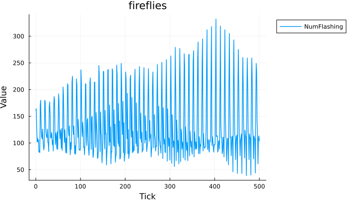
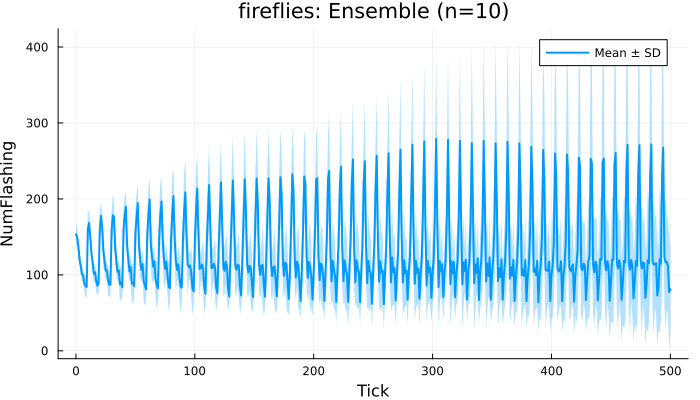
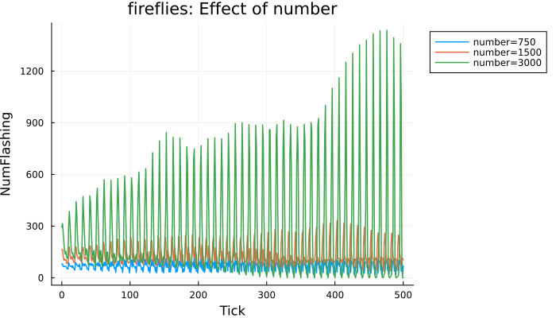

# Fireflies


- [Overview](#overview)
  - [WHAT IS IT?](#what-is-it)
  - [HOW IT WORKS](#how-it-works)
  - [THINGS TO NOTICE](#things-to-notice)
  - [THINGS TO TRY](#things-to-try)
  - [EXTENDING THE MODEL](#extending-the-model)
  - [NETLOGO FEATURES](#netlogo-features)
  - [CREDITS AND REFERENCES](#credits-and-references)
  - [HOW TO CITE](#how-to-cite)
  - [COPYRIGHT AND LICENSE](#copyright-and-license)
- [Parameters](#parameters)
- [Source Code](#source-code)
- [Time Series](#time-series)
- [Ensemble Runs](#ensemble-runs)
- [Parameter Sensitivity](#parameter-sensitivity)
- [Appendix: Source Code](#appendix-source-code)
  - [Parameters (`parameters.jl`)](#parameters-parametersjl)
  - [Components (`components.jl`)](#components-componentsjl)
  - [Resources (`resources.jl`)](#resources-resourcesjl)
  - [Systems (`systems.jl`)](#systems-systemsjl)
  - [Model (`model.jl`)](#model-modeljl)

## Overview

### WHAT IS IT?

This model demonstrates a population of fireflies which synchronize
their flashing using only the interactions between the individual
fireflies. It is a good example of how a distributed system (i.e. a
system with many interacting elements, but no ‘leader’) can coordinate
itself without any central coordinator.

Though most species of firefly are not generally known to synchronize in
groups, there are some (for example, Pteroptyx cribellata, Luciola
pupilla,and Pteroptyx malaccae) that have been observed to do so in
certain settings. This model generalizes two main strategies used by
such insects to synchronize with each other (phase delay and phase
advance synchronization, as described below), retaining the essentials
of the strategies while downplaying biological detail.

### HOW IT WORKS

Each firefly constantly cycles through its own clock, flashing at the
beginning of each cycle and then resetting the clock to zero once it has
reached the maximum. At the start of each simulation all fireflies begin
at a random point in their cycles (though they all have the same cycle
lengths) and so flashing will occur erratically through the population.
As fireflies perceive other flashes around them they are able to use
this information to reset their own clocks to try and synchronize with
the other fireflies in their vicinity. Each firefly uses the same set of
rules to govern its own clock, and depending on the parameters of the
simulation, the population may synchronize more or less effectively.

### THINGS TO NOTICE

Using the default settings (number: 1500, cycle-length: 10,
flash-length: 1, number-flashes: 1, flashes-to-reset: 1, strategy:
“delay”), notice how local clusters of synchronization begin to form.
See if you can figure out where each cluster is represented on the plot.
As the simulation proceeds, try to determine which local cluster will
eventually “take over” the population. Did this cluster originally have
the highest spike on the plot?

In phase advance simulations, why do the plots generally top off before
the peaks reach the entire population?

In this model fireflies cannot reset their cycle when they are in the
middle of a flash. Why was this restriction imposed?

### THINGS TO TRY

Run the model with the “delay” strategy in the default settings. Change
FLASHES-TO-RESET to 2, and run the model with the “advance” strategy
(while keeping the other settings steady). Which strategy seems more
effective? Why?

Try adjusting FLASHES-TO-RESET between 0, 1 and 2 using both phase delay
and phase advance settings. Notice that each setting will give a
characteristically different plot, and some of them do not allow for
synchronization at all (for example, with the delay strategy, contrast
FLASHES-TO-RESET set to 1 as opposed to 2). Why does this control make
such a difference in the outcome of the simulation?

Changing the number of fireflies in a simulation affects the density of
the population (as does adjusting the size of the world). What effect
does this have on a simulation?

### EXTENDING THE MODEL

This model explores only two general strategies for attaining synchrony
in such cycle-governed fireflies. Can you find any others? Can you
improve the existing strategies (i.e., by speeding them up)?

There are many other possible situations in which distributed agents
must synchronize their behavior through the use of simple rules. What
if, instead of perceiving only other discrete flashes, an insect could
sense where another insect was in its cycle (perhaps by hearing an
increasingly loud hum)? What kinds of strategies for synchronization
might be useful in such a situation?

If all fireflies had adjustable cycle-lengths (initially set to random
intervals) would it then be possible to coordinate both their
cycle-lengths and their flashing?

Introduce some blind fireflies. How do the strategies fare with this
addition?

### NETLOGO FEATURES

Note the use of agentsets to count the number of nearby fireflies that
are flashing:

    count turtles in-radius 1 with [color = yellow]

### CREDITS AND REFERENCES

Buck, John. (1988). Synchronous Rhythmic Flashing of Fireflies. The
Quarterly Review of Biology, September 1988, 265 - 286.

Carlson, A.D. & Copeland, J. (1985). Flash Communication in Fireflies.
The Quarterly Review of Biology, December 1985, 415 - 433.

### HOW TO CITE

If you mention this model or the NetLogo software in a publication, we
ask that you include the citations below.

For the model itself:

- Wilensky, U. (1997). NetLogo Fireflies model.
  http://ccl.northwestern.edu/netlogo/models/Fireflies. Center for
  Connected Learning and Computer-Based Modeling, Northwestern
  University, Evanston, IL.

Please cite the NetLogo software as:

- Wilensky, U. (1999). NetLogo. http://ccl.northwestern.edu/netlogo/.
  Center for Connected Learning and Computer-Based Modeling,
  Northwestern University, Evanston, IL.

### COPYRIGHT AND LICENSE

Copyright 1997 Uri Wilensky.


This model is licensed under the Creative Commons
Attribution-NonCommercial-ShareAlike 3.0 License. To view a copy of this
license, visit https://creativecommons.org/licenses/by-nc-sa/3.0/ or
send a letter to Creative Commons, 559 Nathan Abbott Way, Stanford,
California 94305, USA.

NetLogo itself is free software for non-commercial use under the terms
of the GNU General Public License ([see full license information
here](https://ccl.northwestern.edu/netlogo/docs/copyright.html)).

To inquire about commercial licenses for either NetLogo or specific
models from the models library, please contact
netlogo-commercial-admin@ccl.northwestern.edu.

This model was created as part of the project: CONNECTED MATHEMATICS:
MAKING SENSE OF COMPLEX PHENOMENA THROUGH BUILDING OBJECT-BASED PARALLEL
MODELS (OBPML). The project gratefully acknowledges the support of the
National Science Foundation (Applications of Advanced Technologies
Program) – grant numbers RED \#9552950 and REC \#9632612.

This model was converted to NetLogo as part of the projects:
PARTICIPATORY SIMULATIONS: NETWORK-BASED DESIGN FOR SYSTEMS LEARNING IN
CLASSROOMS and/or INTEGRATED SIMULATION AND MODELING ENVIRONMENT. The
project gratefully acknowledges the support of the National Science
Foundation (REPP & ROLE programs) – grant numbers REC \#9814682 and
REC-0126227. Converted from StarLogoT to NetLogo, 2001.

<!-- 1997 2001 -->

## Parameters

| Parameter          | Type     | Default  | Description        |
|--------------------|----------|----------|--------------------|
| `number`           | `Int`    | `1500`   | number             |
| `cycle_length`     | `Int`    | `10`     | cycle length       |
| `flash_length`     | `Int`    | `1`      | flash length       |
| `flashes_to_reset` | `Int`    | `1`      | flashes to reset   |
| `strategy`         | `Symbol` | `:delay` | :delay or :advance |
| `grid_width`       | `Int`    | `71`     | -35..35            |
| `grid_height`      | `Int`    | `71`     | grid height        |
| `max_ticks`        | `Int`    | `500`    | max ticks          |

## Source Code

The Julia code to run this model:

``` julia
using ArkModelZoo
_, trajectory = run_fireflies()
```

## Time Series



## Ensemble Runs

Ten replicates with different random seeds, showing mean ± standard
deviation.



## Parameter Sensitivity

Varying `number`.



## Appendix: Source Code

This model is implemented in the
[Ark.jl](https://github.com/sdwfrost/Ark.jl) Entity-Component-System
(ECS) framework. The code is split into five files, each with a distinct
role:

- **Parameters**: a mutable struct holding all configurable values.
- **Components**: lightweight data types attached to individual entities
  (agents).
- **Resources**: world-level shared state accessible to all systems.
- **Systems**: functions that operate on entities each tick, defining
  model behavior.
- **Model**: wiring that assembles the world, registers resources and
  systems, and provides the run entry point.

### Parameters (`parameters.jl`)

The parameter struct uses `@kwdef` so that every field has a default
value and can be overridden by keyword. These defaults match the
original NetLogo model’s slider settings.

``` julia
Base.@kwdef mutable struct FFParams
    number::Int = 1500
    cycle_length::Int = 10
    flash_length::Int = 1
    flashes_to_reset::Int = 1
    strategy::Symbol = :delay    # :delay or :advance
    grid_width::Int = 71         # -35..35
    grid_height::Int = 71
    max_ticks::Int = 500
    seed::Int = 42
end
```

### Components (`components.jl`)

Components are lightweight data types attached to individual entities
(agents). Mutable structs hold per-entity state, while empty tag structs
act as markers for the ECS query system to efficiently filter entities.

``` julia
mutable struct FFFirefly
    x::Float64
    y::Float64
    clock::Int
    threshold::Int
    reset_level::Int
    window::Int
    flashing::Bool
end
FFFirefly() = FFFirefly(0.0, 0.0, 0, 1, 0, -1, false)
```

### Resources (`resources.jl`)

Resources are world-level singletons shared across all systems, used for
global state and aggregate statistics.

``` julia
mutable struct FFStats
    num_flashing::Int
end
FFStats() = FFStats(0)
```

### Systems (`systems.jl`)

Systems contain the model logic and execute in a defined order each
tick. Each system struct implements either `initialize!` (run once at
setup) or `update!` (run every tick).

``` julia
struct InitFFSystem <: System end

function initialize!(::InitFFSystem, world::World)
    params = get_resource(world, FFParams)
    rng = get_resource(world, RNGResource).rng

    for _ in 1:params.number
        x = rand(rng) * params.grid_width
        y = rand(rng) * params.grid_height
        clock = rand(rng, 0:params.cycle_length - 1)
        threshold = params.flash_length
        if params.strategy == :delay
            reset_level = threshold
            window = -1
        else  # :advance
            reset_level = 0
            window = threshold + 1
        end
        flashing = clock < threshold
        new_entity!(world, (FFFirefly(x, y, clock, threshold, reset_level, window, flashing),))
    end

    _ff_update_stats!(world)
    return nothing
end

struct FFGoSystem <: System end

function update!(::FFGoSystem, world::World)
    params = get_resource(world, FFParams)
    rng = get_resource(world, RNGResource).rng

    # First pass: move, increment clock, look (in shuffled order)
    fireflies = Tuple{Entity, FFFirefly}[]
    for (eids, ffs) in Query(world, (FFFirefly,))
        @inbounds for i in eachindex(ffs)
            push!(fireflies, (eids[i], ffs[i]))
        end
    end
    Random.shuffle!(rng, fireflies)

    w = Float64(params.grid_width)
    h = Float64(params.grid_height)

    for (_, ff) in fireflies
        # Move: rt random 90 - random 90; fd 1
        heading = (rand(rng) * 90.0 - rand(rng) * 90.0) * π / 180.0
        ff.x = mod(ff.x + sin(heading), w)
        ff.y = mod(ff.y + cos(heading), h)

        # Increment clock
        ff.clock += 1
        if ff.clock >= params.cycle_length
            ff.clock = 0
        end

        # Look: if clock > window and clock >= threshold, check neighbors
        if ff.clock > ff.window && ff.clock >= ff.threshold
            # Count flashing neighbors within radius 1
            n_flashing = 0
            for (_, ff2) in fireflies
                ff2 === ff && continue
                dx = abs(ff.x - ff2.x)
                dx = min(dx, w - dx)
                dy = abs(ff.y - ff2.y)
                dy = min(dy, h - dy)
                if dx^2 + dy^2 <= 1.0
                    if ff2.flashing
                        n_flashing += 1
                    end
                end
            end
            if n_flashing >= params.flashes_to_reset
                ff.clock = ff.reset_level
            end
        end
    end

    # Second pass: recolor (update flashing state)
    for (_, ff) in fireflies
        ff.flashing = ff.clock < ff.threshold
    end

    _ff_update_stats!(world)
    return nothing
end

function _ff_update_stats!(world::World)
    stats = get_resource(world, FFStats)
    n = 0
    for (_, ffs) in Query(world, (FFFirefly,))
        @inbounds for i in eachindex(ffs)
            if ffs[i].flashing
                n += 1
            end
        end
    end
    stats.num_flashing = n
end

struct FFTerminationSystem <: System end

function update!(::FFTerminationSystem, world::World)
    params = get_resource(world, FFParams)
    tick = get_resource(world, Tick)
    if tick.tick + 1 >= params.max_ticks
        get_resource(world, Terminate).stop = true
    end
    return nothing
end
```

### Model (`model.jl`)

The model file assembles all pieces: it creates the ECS `World` with the
required component types, registers resources, builds the `Scheduler`
with systems in execution order, and exposes the public `run` entry
point. The observer pattern records the trajectory each tick.

``` julia
function ff_world(; initial_capacity::Int = 4096)
    return World(FFFirefly; initial_capacity = initial_capacity, allow_mutable = true)
end

function ff_systems()
    return (InitFFSystem(), FFGoSystem(), FFTerminationSystem())
end

function ff_model(params::FFParams = FFParams())
    world = ff_world()
    _add_standard_resources!(world, params)
    add_resource!(world, FFStats())
    scheduler = Scheduler(world, ff_systems())
    initialize!(scheduler)
    return scheduler
end

struct FFObserver end

function ff_headers(::FFObserver)
    return ["NumFlashing"]
end

function ff_values(::FFObserver, world::World)
    stats = get_resource(world, FFStats)
    return Float64[Float64(stats.num_flashing)]
end

function run_fireflies(; params::FFParams = FFParams(), observe::Bool = true)
    return _run_model(ff_model, FFObserver(), ff_values; params, observe)
end
```
